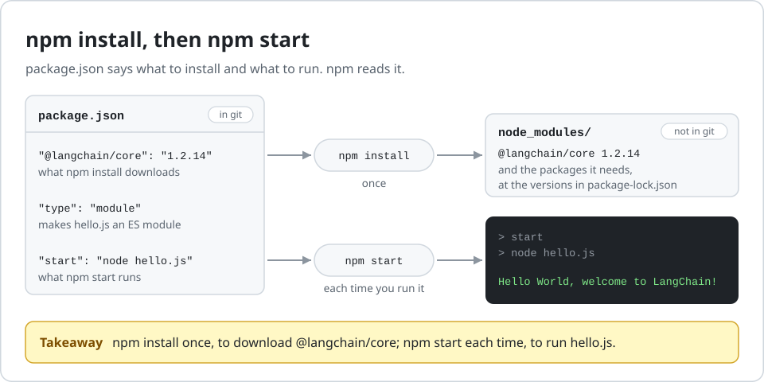
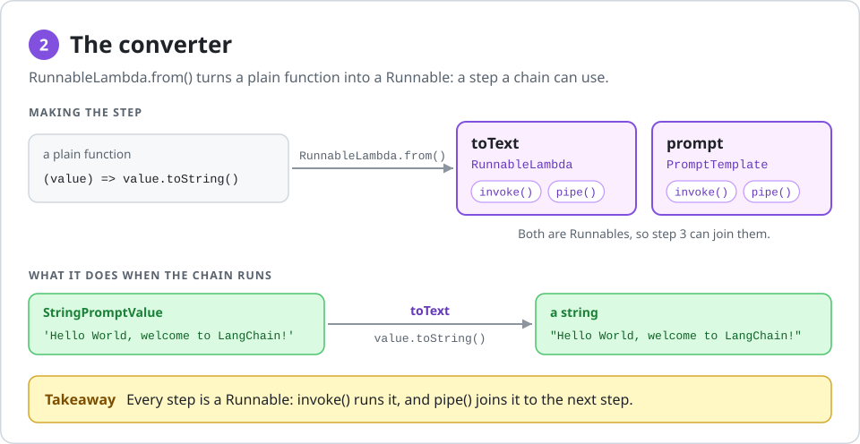
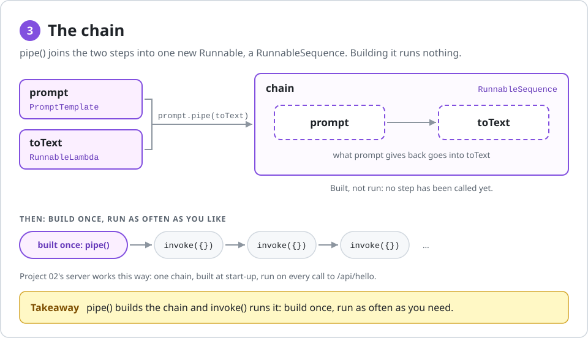
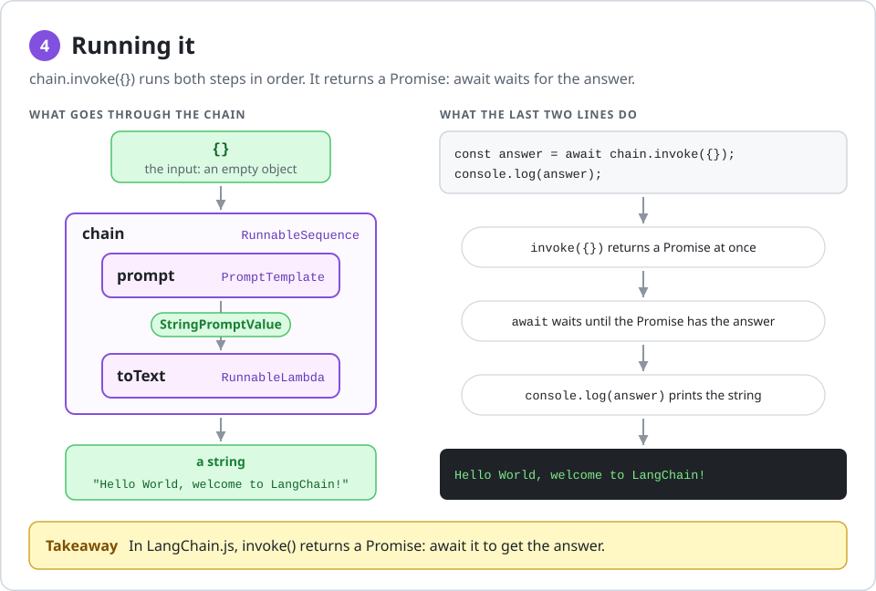

# 01 · LangChain basic

LangChain is a library for building apps around language models: you join small steps (a prompt, a model, a
converter) into a chain, and each step's output goes into the next. This project builds a two-step chain in
JavaScript, with no model yet, so you can see how steps are joined and run before a real model (Google's Gemini)
arrives in project 10.

```text
{}  ->  prompt  ->  a StringPromptValue  ->  toText  ->  "Hello World, welcome to LangChain!"
```

## What you'll build

- `hello.js`: a chain of two steps, a `PromptTemplate` piped into a `RunnableLambda`, run once.
- `package.json`: the one package the project needs, `@langchain/core` 1.2.14, and the `start` script that runs
  `hello.js`.
- What you see: `npm start` prints `Hello World, welcome to LangChain!` in your terminal. No server, no page, no
  model, no API key.

## What you'll learn

- **`PromptTemplate.fromTemplate()`**: holds the text; its `invoke()` gives back a `StringPromptValue`, not a string
- **Template variables**: a word in curly braces, like `{name}`, is filled in by `invoke()`; this text has none
- **`RunnableLambda.from()`**: wraps a plain function as a Runnable, with `invoke()` and `pipe()` like the prompt
- **Runnables and `.pipe()`**: `a.pipe(b)` joins two Runnables into a `RunnableSequence`; building it runs nothing
- **`await chain.invoke({})`**: runs the chain; in LangChain.js `invoke()` returns a Promise, so you `await` it
- **npm basics**: `package.json`, `package-lock.json`, `npm install`, `npm start` and `"type": "module"`

## Before you start

- **Node.js 20 or newer** (22 is used here). Check with `node --version`; if that fails, install Node from
  nodejs.org, which includes npm (`npm --version`). `@langchain/core` 1.2.14 asks for Node 20 or newer.
- Nothing else: no Python yet (it starts in project 02) and no API key (you make one in
  [project 9](../09-gemini-key/README.md)).

## Files

| File | What it is |
|---|---|
| `hello.js` | The chain: `prompt.pipe(toText)`, run once with `invoke({})`, and the answer printed |
| `package.json` | The project's settings for npm: one package, `@langchain/core` pinned at 1.2.14; the `start` script (`node hello.js`); `"type": "module"` |
| `package-lock.json` | The exact version of every package `npm install` puts in `node_modules/` (`@langchain/core` and the packages it needs). Written by npm: don't edit it by hand |
| `images/` | The five diagrams on this page, one per idea. They're SVG files: pictures written as text, which GitHub shows as images |
| `README.md` | This page |

## How it works

### `npm install`, then `npm start`

All of the project's setup is in `package.json`:

```json
{
  "name": "01-langchain-basic",
  "private": true,
  "type": "module",
  "description": "Project 1: the smallest LangChain chain, a PromptTemplate piped into a RunnableLambda, invoked once.",
  "scripts": {
    "start": "node hello.js"
  },
  "dependencies": {
    "@langchain/core": "1.2.14"
  }
}
```



- **`"dependencies"`**: the one package this project uses, pinned to an exact version. `npm install` downloads it,
  and the packages it needs in turn, into a `node_modules/` folder, at the versions listed in `package-lock.json`.
  Both files are in git, so everyone gets the same versions; `node_modules/` is not (the repo's `.gitignore` skips
  it).
- **`"scripts"`**: `npm start` runs the `start` script, `node hello.js`. npm prints the script (`> node hello.js`)
  before running it.
- **`"type": "module"`**: tells Node that the `.js` files here are ES modules, the modern JavaScript module format.
  `hello.js` needs that for its `import` lines and for the `await` outside any function in ④.

### The imports

```js
import { PromptTemplate } from "@langchain/core/prompts";
import { RunnableLambda } from "@langchain/core/runnables";
```

Each line takes one name from a part of the `@langchain/core` package, like Python's
`from langchain_core.prompts import PromptTemplate` in project 02. `@langchain/core` is LangChain's base package: the
building blocks, such as prompts and Runnables, and no connection to any model.

### ① The template

```js
const prompt = PromptTemplate.fromTemplate("Hello World, welcome to LangChain!");
```


`fromTemplate()` turns a text into a prompt template. A word in curly braces, like `{name}`, would be a variable for
`invoke()` to fill in; this text has none, so `prompt.inputVariables` is `[]`. Curly braces are special in the text
for that reason: see [When things go wrong](#when-things-go-wrong).

### ② The converter

```js
const toText = RunnableLambda.from((value) => value.toString());
```



The prompt doesn't give back a string: `prompt.invoke({})` gives back a `StringPromptValue`, a LangChain object with
the text inside ([Things to try](#things-to-try) prints one). `toText` turns it into text:

- `(value) => value.toString()` is a small function (an arrow function, like Python's
  `lambda value: value.to_string()`): it takes the `StringPromptValue` and returns the text inside it.
- `RunnableLambda.from()` wraps that function as a **Runnable**, LangChain's word for a step: something with
  `invoke()` to run it and `pipe()` to join it to the next step. The prompt is a Runnable too.

### ③ The chain

```js
const chain = prompt.pipe(toText);
```



`pipe()` joins the two steps into a new Runnable, a `RunnableSequence`: what `prompt` gives back goes into `toText`.
Building it runs nothing. No step is called until `invoke()`, and you can call `invoke()` as many times as you like.
Project 02's server does exactly that: it builds the chain once, when it starts, and runs it on every call to
`/api/hello`.

### ④ Running it

```js
const answer = await chain.invoke({});

console.log(answer);
```



| Step | Gets | Gives back |
|---|---|---|
| `prompt` | `{}` | a `StringPromptValue` |
| `toText` | that `StringPromptValue` | the string `Hello World, welcome to LangChain!` |
| `chain` (both steps, in order) | `{}` | the same string |

- `{}` is the input: an empty object, since the template has no variables to fill in.
- In LangChain.js, `invoke()` returns a Promise (an answer that arrives later), so `await` waits for it and gives
  back the string. In Python, from project 02 on, `invoke()` returns the answer directly and `ainvoke()` is the one
  you `await`.
- An `await` outside any function is allowed because this file is an ES module (`"type": "module"`).
- `console.log(answer)` prints the string.

## Run it

```bash
cd projects/01-langchain-basic   # from the repo root
npm install                      # once: downloads @langchain/core into node_modules/
npm start                        # runs node hello.js
```

`npm start` prints:

```text
> start
> node hello.js

Hello World, welcome to LangChain!
```

The two `>` lines are npm showing the script it runs; the last line is `hello.js`'s `console.log`. `node hello.js`
runs the same file and prints only that last line. There's no server, page or port in this project: the line
appears in the same terminal, and the program ends. In Windows PowerShell, if `npm` is refused, see
[When things go wrong](#when-things-go-wrong).

## Test it

No automated tests yet. The whole program is one chain that prints one line, so running it is the test:
`npm start` should print `Hello World, welcome to LangChain!`. Tests start in
[project 02](../02-langchain-python/README.md), in Python with pytest, and every project after it has them; a
JavaScript test tool here would be one you'd use only once.

## When things go wrong

Node prints a lot for each error. The line that starts with `Error` is the one that says what went wrong; the
lines around it mostly point inside Node and `node_modules/`.

| What happens | What you see | What to do |
|---|---|---|
| `npm start` before `npm install` | `Error [ERR_MODULE_NOT_FOUND]: Cannot find package '@langchain/core' imported from ...hello.js` | Run `npm install` in this folder, then `npm start` |
| `npm start` in another folder, such as the repo root | `npm error enoent Could not read package.json: Error: ENOENT: no such file or directory, ...` | `cd projects/01-langchain-basic` first |
| Curly braces in the template's text | `{name}` with `invoke({})`: `Error: (f-string) Missing value for input name` (it names the word in the braces). A lone `{`: `Error: Unclosed '{' in template.` A lone `}`: `Error: Single '}' in template.` | Give each variable a value, as in `invoke({ name: "Ada" })`, or double a brace to print it: `{{World}}` prints `{World}` |
| `npm` in Windows PowerShell | `npm.ps1 cannot be loaded because running scripts is disabled on this system` | Type `npm.cmd` instead of `npm` (`npm.cmd install`, `npm.cmd start`), or use Git Bash or Command Prompt. Or allow scripts for your Windows user once: `Set-ExecutionPolicy -Scope CurrentUser RemoteSigned` |

## Things to try

1. **Change the text.** Replace the words in `fromTemplate("...")`, for example with `"Hi there, LangChain!"`, and
   run `npm start` again: it prints `Hi there, LangChain!`. Leave out `{` and `}` for now; the next item shows what
   they do.
2. **Add a variable.** Change the text to `"Hello {name}, welcome to LangChain!"` and the call in ④ to
   `await chain.invoke({ name: "Ada" })`. It prints `Hello Ada, welcome to LangChain!`. Put back `invoke({})` and it
   stops with `Error: (f-string) Missing value for input name`. Project 04 does the same in Python, with the name
   sent from a web page.
3. **See what the prompt gives back.** Change the line under ③ to `const chain = prompt;`, the prompt alone,
   without `toText`. Instead of the line, it prints the object:

   ```text
   StringPromptValue {
     lc_serializable: true,
     lc_kwargs: { value: 'Hello World, welcome to LangChain!' },
     lc_namespace: [ 'langchain_core', 'prompt_values' ],
     value: 'Hello World, welcome to LangChain!'
   }
   ```

   That object is why `toText` is there.
4. **Forget the `await`.** Change the line under ④ to `const answer = chain.invoke({});`. It prints
   `Promise { <pending> }`:
   `console.log` ran before the chain had finished, so it printed the Promise instead of the answer.

## Next

**[Project 02 · LangChain basic (Python)](../02-langchain-python/README.md)**: the same chain in Python, served by a
FastAPI server to a web page that calls it as soon as it opens, with the first tests.
