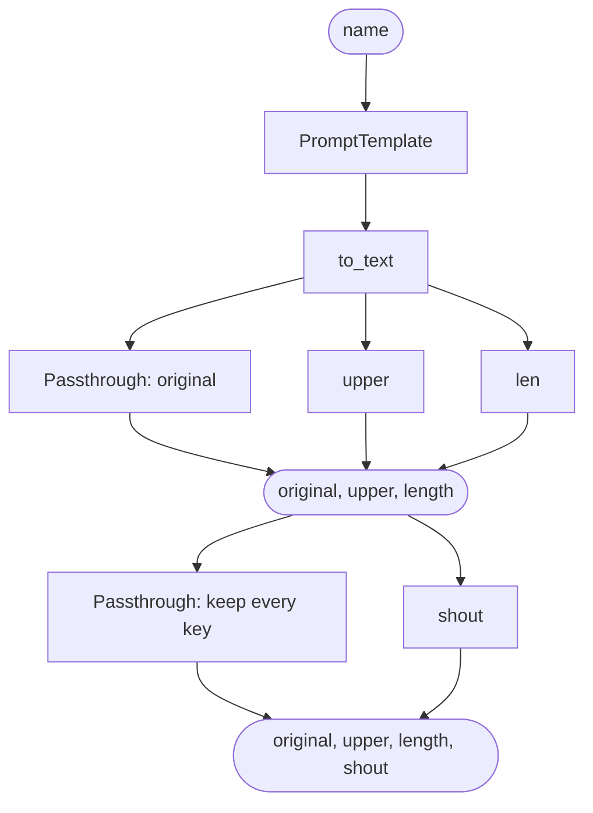

# 06 · Run steps side by side

Until now each chain was a straight line: one step's output went into the next. This project splits the line.
One input (the greeting) goes into `RunnableParallel`, which runs three steps on it side by side and returns
their results as one dict. Then `RunnablePassthrough.assign()` adds a fourth key. No model, no API key.

```json
{
  "original": "Hello Raghu, welcome to LangChain!",
  "upper": "HELLO RAGHU, WELCOME TO LANGCHAIN!",
  "length": 34,
  "shout": "HELLO RAGHU, WELCOME TO LANGCHAIN!!!"
}
```

This is the shape every RAG chain uses later: the question goes one way (to search the documents) and, at the
same time, is passed through unchanged, so the next step gets both:
`{"context": retriever, "question": RunnablePassthrough()}`.

## What you learn

- `RunnableParallel(a=…, b=…)`: gives the same input to every step and returns `{"a": …, "b": …}`
- `RunnablePassthrough()`: passes its input through unchanged, so the original stays in the result
- `RunnablePassthrough.assign(key=…)`: takes a dict, keeps every key, and adds one computed from it
- `chain.get_graph().draw_mermaid()`: LangChain draws the chain's shape for you

## Files

| File | What it is |
|---|---|
| `hello.py` | The chain: `prompt \| to_text \| side_by_side \| add_shout`. `python hello.py Asha` prints the results and the graph |
| `main.py` | FastAPI: `GET /` serves the page, `POST /api/hello` returns the four results, `GET /api/graph` returns the Mermaid text |
| `index.html` | The page: a name box, a table with the four results from one call, and the chain's graph |
| `tests/test_hello.py` | Tests each piece on its own, the whole chain, the graph, the script, both endpoints and the page |
| `requirements.txt` | `fastapi`, `uvicorn`, `langchain-core` |
| `requirements-dev.txt` | Adds `pytest` and `httpx` for the tests |

## The chain, piece by piece

```python
prompt  = PromptTemplate.from_template("Hello {name}, welcome to LangChain!")
to_text = RunnableLambda(lambda value: value.to_string(), name="to_text")

side_by_side = RunnableParallel(
    original=RunnablePassthrough(),       # the input, unchanged
    upper=RunnableLambda(str.upper),      # the input in capitals
    length=RunnableLambda(len),           # how many characters
)
add_shout = RunnablePassthrough.assign(shout=shout)   # shout() reads result["upper"]

chain = prompt | to_text | side_by_side | add_shout
```

| After step | The value is |
|---|---|
| input | `{"name": "Raghu"}` |
| `prompt` | a `StringPromptValue` |
| `to_text` | `"Hello Raghu, welcome to LangChain!"`, one string |
| `side_by_side` | `{"original": "Hello Raghu, …", "upper": "HELLO RAGHU, …", "length": 34}`: three steps, same input |
| `add_shout` | the same dict plus `"shout": "HELLO RAGHU, WELCOME TO LANGCHAIN!!!"` |

**What does `RunnablePassthrough` pass through?** Exactly what it is given, here the greeting string. On its own
it does nothing; inside a `RunnableParallel` it keeps the input next to the new results. `.assign()` is the same
idea for dicts: everything that came in goes out, plus the new key.

**Side by side, really?** With `invoke()` the three steps run on a thread pool; with `ainvoke()` (what the server
uses) they run concurrently. Here they finish in microseconds, so you won't see a difference, but with slow steps
(a model call, a document search) the parallel step takes as long as the slowest one, not the sum of all of them.

A plain dict in a chain means the same thing: `to_text | {"original": RunnablePassthrough(), "upper": ...}` is
turned into a `RunnableParallel` for you. RAG examples often use that shorter form.

## The graph

`python hello.py` and the page print what `chain.get_graph().draw_mermaid()` returns. Simplified, it is:



To see the real one drawn, paste the printed text into https://mermaid.live.

## Run it

```bash
cd projects/06-langchain-parallel
python -m venv .venv
source .venv/bin/activate          # Windows: .venv\Scripts\activate
pip install -r requirements-dev.txt

python hello.py                    # the four results for Raghu, then the graph
python hello.py Asha               # the same for Asha
python -m pytest                   # 18 tests

uvicorn main:app --reload          # the server (Ctrl+C to stop)
```

With the server running, open:

| What | On your laptop | In GitHub Codespaces |
|---|---|---|
| The page | http://127.0.0.1:8000 or `/index.html` | `https://<codespace-name>-8000.app.github.dev` or `/index.html` |
| The graph as JSON | http://127.0.0.1:8000/api/graph | `https://<codespace-name>-8000.app.github.dev/api/graph` |
| Try the API by hand | http://127.0.0.1:8000/docs | `https://<codespace-name>-8000.app.github.dev/docs` |

```bash
curl -X POST http://127.0.0.1:8000/api/hello -H "Content-Type: application/json" -d '{"name": "Raghu"}'
```

Only one server can use port 8000: stop the previous project's server (Ctrl+C) before starting this one.

## Next

Every input takes the same path. The next project branches (different inputs, different paths) and runs a batch
of inputs in one call.
