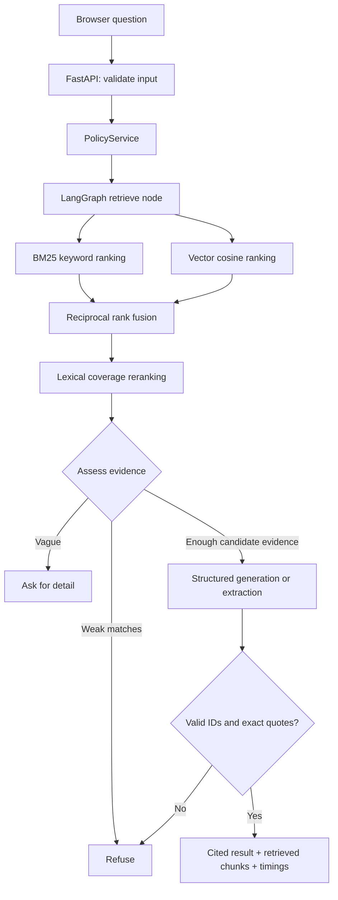

# Architecture and contributor guide

## Read these files in order

1. `config.py`: settings and paths.
2. `models.py`: the data moving between modules.
3. `service.py`: the operations exposed to the UI and command line.
4. `pipeline.py`: the explicit question-answering graph.
5. `retrieval/hybrid.py` and `generation.py`: ranking and grounded output.
6. `evaluation.py`: scoring and report generation.
7. `api.py`: thin HTTP endpoints.

Every module starts with a purpose statement. Comments explain decisions that are easy to miss: incompatible embeddings, transactional updates, ranking scales, quote validation and the limitations of proxy metrics. Function names describe actions, and typed models define boundaries.

## Request flow

## Module ownership

| Concern | Owner | Why separate? |
|---|---|---|
| Settings | `config.py` | One source for models, sizes and filesystem paths |
| HTTP | `api.py` | Parsing and status codes stay out of the RAG logic |
| Application operations | `service.py` | CLI and HTTP share the same behavior |
| Document parsing | `ingestion/loaders.py` | Add another file format without editing retrieval |
| Chunking | `ingestion/chunking.py` | Tune boundaries independently of the store |
| Embeddings | `retrieval/embeddings.py` | Explicit preview vs neural provider adapters |
| Persistence | `retrieval/store.py` | Replace SQLite without changing prompts |
| Ranking | `retrieval/hybrid.py` | BM25, fusion and reranking remain inspectable |
| Orchestration | `pipeline.py` | Routing is visible in an explicit graph |
| Output and grounding | `generation.py` | The same citation contract applies to model adapters |
| Evaluation | `evaluation.py` | Metrics do not influence answers or use test labels in retrieval |
| Browser features | `web/js/*.js` | Each view owns its rendering and interactions |

## Index lifecycle

`sources.json` records public-source provenance. Local uploads get a safe filename and a content-hash suffix. Indexing loads all current documents, creates deterministic chunk IDs, embeds the text, and atomically replaces SQLite rows plus index metadata.

A failed embedding request leaves the previous complete index intact. SQLite reads metadata and chunks in one transaction and closes every connection. Queries pin a read-only index snapshot, then release the state lock before network calls. Evaluations reuse one pinned generation across all questions without blocking status or other requests. Rebuilds capture document bytes before parsing and embedding, serialize separately, verify the live corpus before publishing, and hold the state lock only for short file/commit operations.

An index fingerprint includes embedding identity, chunk settings, captured source metadata and content hashes. Warm requests reuse cached immutable vectors, token/profile data and stat-keyed file hashes, with a 30-second forced byte-verification bound. The stored fingerprint belongs to exactly the bytes parsed and embedded; edits during indexing reject publication. Identical uploads are not rewritten. Changed documents or settings block queries until rebuilt. Freshness is distinct: an unchanged but old snapshot may still be indexed correctly, so the UI shows a separate age notice.

## Retrieval decisions

BM25 is implemented in a short, commented function using positive IDF and conventional k1=1.5/b=0.75 parameters. Cosine similarity is computed from normalized numeric arrays. RRF combines rankings without pretending BM25 and cosine are on the same scale. Lexical coverage adds a lightweight, explainable reranking signal.

The final ranking score is a heuristic, not a probability. A separate weighted evidence check uses stems, corpus rarity and local co-occurrence. Section headings may supply a named subject, but body text must supply evidence and any requested amount/time/contact value. Neural mode lets the model assess uncertain paraphrases. These checks are heuristics, not semantic proof. In extractive mode both channels are lexical; neural semantic recall requires OpenAI mode. A short query may miss synonyms, and top-k may overrepresent one topic in a multi-document question. Inspect the evaluation before tuning.

## Output decisions

OpenAI receives the question and excerpts as one JSON data object, with evidence explicitly marked untrusted in the system instruction and returns typed claims. Model refusals, content filters and length cutoffs produce fixed refusal text. Each claim must name known chunk IDs and quote at least 15 characters present in those chunks after case/whitespace normalization. Any invalid citation rejects the entire draft. Refusal/clarification messages use fixed application text so model messages cannot smuggle unsupported policy assertions.

This contract prevents fabricated source references and quotations. It does not prove that the quotation supports the generated claim; manual faithfulness review remains necessary. The extractive path makes no synthesized policy claims and displays exact source sentences as evidence. Typed answer parts carry explicit citation numbers, so a literal bracket number in a document remains plain text. App graph, model and embedding operations use tracing-disabled contexts regardless of ambient LangSmith settings.

## HTTP routes

| Route | Purpose |
|---|---|
| `GET /api/health` | Liveness |
| `GET /api/status` | Mode, documents, freshness and index configuration |
| `POST /api/index` | Rebuild the current collection |
| `POST /api/ask` | Question plus optional `source_ids` filter |
| `POST /api/documents` | Upload a supported local document |
| `GET /api/documents/{source_id}` | Read document text and provenance |
| `POST /api/evaluations` | Start a background evaluation |
| `GET /api/evaluations/{id}` | Poll progress or retrieve a completed result |
| `GET /api/evaluations/latest` | Most recent persisted report |
| `GET /api/reports/{id}.md` / `.json` | Download an actual report |

The server binds to loopback, validates Host against localhost/127.0.0.1, and bounds actual request bytes before multipart parsing. The frontend escapes all document/model text and accepts only HTTP(S) source links. Report downloads validate IDs, uploaded filenames are sanitized, and mutating browser requests check Origin. There is no enterprise authentication or tenant isolation.

## Sensible next extensions

Add a parser in `loaders.py` for another format; replace the embedding adapter for another provider; replace the SQLite adapter for a larger corpus; add a neural reranker to `hybrid.py` once an evaluation shows the latency/quality tradeoff. Add any new evaluation questions to a separate held-out file before using them to claim generalization.

## Review follow-up

See `REVIEW_FIXES.md` for the complete review disposition and regression coverage. The evaluation now keeps the 15 assignment questions plus 6 regression questions, and separates routing from complete reference checks and displayed evidence recall.

## Round-two changes

`text.py` uses Unicode words, CJK bigrams, contraction expansion and a thread-local Snowball stemmer. `chunking.py` slices original source spans and drops heading-only fragments. `grounding.py` owns shared topic features and weighted/local evidence checks; explicit query value types need matching body values. `generation.py` validates quote integrity and clear polarity reversals, then requests a separate structured semantic support/completeness review. This adds a model call and is still not a human faithfulness measurement.

`uploads.py` owns stable filename-plus-extension identities, revision history and reversible removal/restoration. `SafeErrorsMiddleware` handles unexpected exceptions before they can be re-raised to uvicorn; frame headers also apply. The fetcher validates HTTPS/host/port before each redirect hop.

Evaluation v3 reports assignment/review/challenge suites separately. Its timing is pinned-pipeline timing, with session setup and wall time recorded separately. See `REVIEW2_FIXES.md` for tests, development results and remaining limitations.
