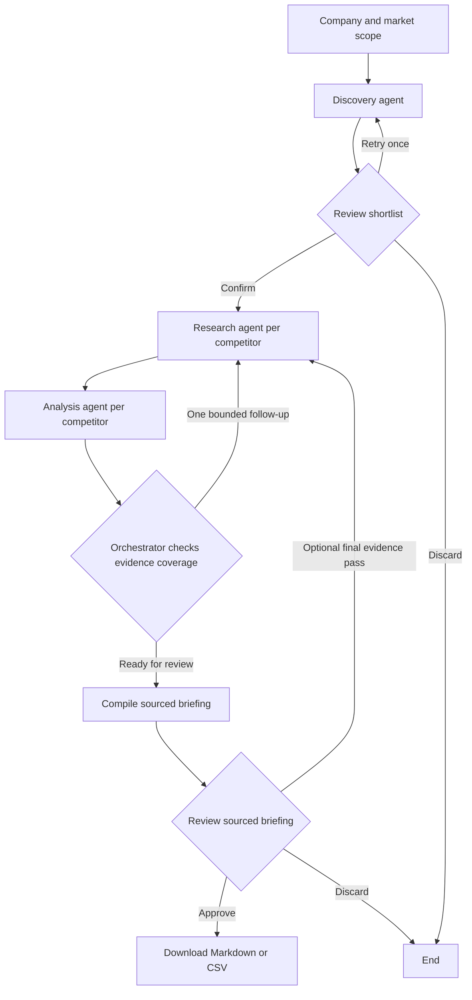

# RivalScope | Week 3 Project 3A

**Project overview**

RivalScope helps product managers compare three competitors in a local Streamlit workspace, replacing manual searches and spreadsheet assembly. It searches public sources, pulls pricing, core features, positioning and news into a single briefing, and pauses for the researcher to confirm the shortlist and approve the briefing before export.

**Success target.** On ten representative live research tasks, a reviewer should be able to finish an approved, usable briefing in under five minutes at least eight times. For a pass, the shortlist must fit the chosen market, each displayed finding must have a traceable source, and missing information must be clearly marked. This is an evaluation target. The checks included in the repository cover workflow behavior and do not measure live research quality.

## Architecture

| Design question | Decision |
| --- | --- |
| Goal and interface | Produce a sourced briefing for one company in a local Streamlit web app. |
| Steps and tools | Use Tavily Search for public web and news evidence, Nebius for candidate selection and extraction, and LangGraph for orchestration. |
| State | Store shortlist, evidence, accepted findings, follow-up plan and approvals in a local SQLite database. The run ID ties the browser URL to its checkpoint. |
| Human decisions | A reviewer may edit the three competitors. A second review controls whether the final report is available for download. |
| Action boundary | Search and inference run autonomously within the workflow. Reports are downloaded by the user. |
| Error recovery | Retry transient HTTP failures once. Incomplete discovery can be retried or completed by the reviewer. A limited gap search preserves supported earlier findings. |
| Evaluation | Test approval, persistence and recovery automatically. Use the rubric above to score ten live tasks for quality and completion time. |

The orchestrator uses explicit conditional routing so the next action and retry budget are easy to inspect. The model handles interpretation of evidence. The application checks that each accepted finding refers to an available excerpt and that any price numbers in the finding appear in its supporting quote. Those checks still leave the reviewer responsible for whether a quote fully supports a paraphrase.

## Data and sample output

Live runs use current public search results from Tavily, including company websites, product documentation, pricing pages, and dated news. Tavily is the primary retrieval source. Relevant excerpts are supplied to Nebius as untrusted data for structured extraction.

The included Trello example covers Asana, ClickUp, and monday.com. Its fixed snapshot is dated November 10, 2026 and uses public pricing, product, and announcement pages. The evidence summaries were curated from those pages for offline use. The graph exports the sample through the same review gates as a live run. The demo simulates a missing initial ClickUp pricing result so the targeted follow-up can be demonstrated without relying on network behavior. [Markdown sample](../examples/trello-briefing.md) · [CSV sample](../examples/trello-briefing.csv)

## AI coding prompts and iterations

The main project prompt asked Codex to build an original, modular RivalScope implementation from the Week 3 handout, using the public GitHub project only as a reference. It also requested clear comments, local API key instructions, a sample report, a project write-up, a demo script, and an in-app documentation page.

| Iteration | What changed and what it showed |
| --- | --- |
| Establish the review workflow | Split competitor approval from briefing approval and persisted each step in SQLite. This made browser refresh and restart recoverable. |
| Connect findings to evidence | Required a source ID and an excerpt that appears in the returned evidence. Added numeric and date checks for pricing and news. |
| Handle incomplete research | Added one automatic follow-up for missing evidence and a final pass the reviewer can request. Earlier supported fields survive follow-ups. |
| Make the walkthrough repeatable | Added a frozen Trello snapshot that uses the same graph and exporters as Live mode. Kept provider failures and sample behavior testable without credentials. |

The production prompts live in `rivalscope/prompts.py`. The GitHub reference was used to compare the assignment scope. RivalScope was implemented independently. [Week 3 handout](https://docs.google.com/document/d/1ixizY2Bd-FUkT6nhYPNRVbtP-LFGqUWHP9tB9HgcH6Q/edit) · [Reference repository](https://github.com/Gaurav-Chavan/GenAI_Learnings/tree/main/Maven-MasteringAgenticAI/Week3_Project)

## Observations

- The market focus changes what counts as a competitor. An explicit shortlist review makes that decision visible before tool calls are spent on the wrong companies.
- A missing price is a useful result when it is clearly labeled. Provider errors and absent evidence are shown with the competitor so reviewers can decide whether to retry.
- A fixed snapshot makes demo behavior reproducible, while live mode is needed to measure latency, freshness, and real research quality across markets.
