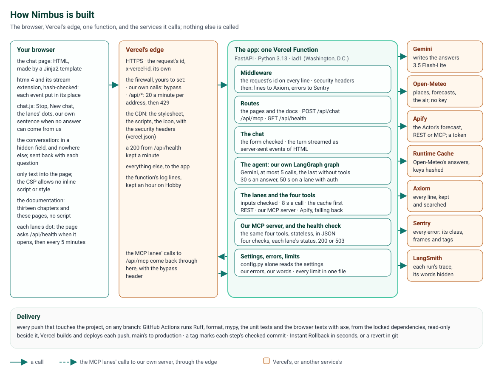
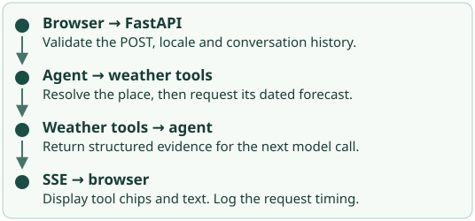

# Architecture and Design

Nimbus is a weather chatbot: ask about the weather anywhere, now or in the coming days, or about the air, and it
answers in a few sentences, showing each tool call behind the answer and the path that call took. It's live at
https://weather-chatbot-hazel.vercel.app/. This page is its whole design in one place: what it does, how it's built,
how a question flows through it, why each choice was made, what makes it production grade, and what keeps it safe and
secure. The other pages go deeper: [System design](system-design.md) sets it against a reference design for AI
assistants, [Technical details](technical-details.md) follows one question through the code, each step's chapter
tells how a part was built, and [Issues and fixes](issues.md) tells all 80 problems met on the way and how each was
fixed.

## At a glance

| Part | What it is |
|---|---|
| **Stack** | Python 3.13, FastAPI, Jinja2 and htmx 4, LangChain and LangGraph, Pydantic; uv, exact versions locked |
| **Model** | Gemini 3.5 Flash-Lite, through LangChain; LangSmith traces each run, its words hidden |
| **Weather** | Open-Meteo's geocoding, forecast and air-quality APIs, which need no key; Apify's Actor, behind a token |
| **Interfaces** | The chat page; the documentation; an MCP server at `/api/mcp`; a health check at `/api/health` |
| **Hosting** | One Vercel Function in `iad1` (Washington, D.C.), on the Hobby plan; Vercel's CDN for the files |
| **State** | No database: the conversation stays in the visitor's browser; the weather, in Vercel's Runtime Cache |
| **Monitoring** | JSON log lines with each request's id, to Axiom; errors to Sentry; a health check of each lane |
| **Checks** | 595 unit tests, 179 browser tests with accessibility checks, 184 mutation rules, 13 golden questions |

## What it does

### For a visitor

- **The weather, anywhere:** now, today and up to 16 days ahead, each hour of the next 3 if asked, and the air's
  quality, for a place by its name or for coordinates.
- **Answers as they're written:** the words stream in as Gemini writes them, and each tool call shows as a chip above
  them, running, then done or failed. Open a chip to see the request it sent, as it went out, and its result.
- **A place that's unclear is asked about:** "Springfield" gets a question back, listing the largest three; a place
  that doesn't exist is said not to; a forecast past 16 days is refused, with no tool called.
- **Your units and your day:** imperial for a browser in the United States, Liberia or Myanmar, metric elsewhere;
  "tomorrow" is your tomorrow, from your browser's time zone; times are given in the place's own time, and say so.
- **A conversation:** a follow-up question carries the last 10 messages, kept in your browser alone; New chat starts
  over; Stop ends an answer on the page.
- **Four lanes, side by side:** the same tools reached four ways: over REST or through an MCP server, without a key or
  with Apify's. A dot beside each says whether it's working; a compare view shows the request each lane sends.
- **Its own words when things go wrong:** never another service's error page; each failure's sentence ends with a
  ref that finds its log lines.
- **Accessible:** every page passes axe's checks, works with the keyboard, reads out new messages, and never scrolls
  sideways on a phone.
- **Its own documentation:** in the menu, from each step's chapter to this page.

### For an operator or a developer

- **An MCP server** at `/api/mcp`: the same four weather tools, for any MCP client.
- **A health check** at `/api/health`: each way out checked, each lane's status, `200` or `503`.
- **Monitoring:** every line in Axiom, every error in Sentry, every model run in LangSmith; the dashboards and alerts
  written out, ready to set up.
- **Tools:** `run_tool` (one weather tool on its own, on any lane), `call_mcp` (a call to any MCP server), `evals`
  (the golden questions), `load_test`, and `mutation_check`.

## Architecture

**Your browser** gets each page as HTML, made by a Jinja2 template. On the chat page, htmx 4 posts each question and
puts each event of the answer's stream into the page; its two files are kept in the project, checked against npm's
own hashes by a test. Our script, `chat.js`, adds Stop, New chat, the status dots, and the conversation, which it
keeps in a hidden field of the form and nowhere else.

**Vercel's edge** takes the HTTPS request and gives it an id. Its CDN serves the stylesheet, the scripts and the icon
itself, with the same security headers as the app's (`vercel.json`). Its firewall, once its two rules are set, lets
the app's own calls through and limits everyone else to 20 calls a minute to `/api/*`.

**The app** is one Vercel Function, `main.py`'s `app`, made by `create_app()` once in each copy Vercel starts:

| Module | What it does |
|---|---|
| `config.py` | The settings, checked when the app starts; the only module that reads the environment |
| `middleware.py` | Each request's id on every line and on the response; one line when it ends; then its lines to Axiom and any error to Sentry; the security headers on every response |
| `pages.py`, `docs.py` | The chat page and the documentation, from Markdown with raw HTML off |
| `chat.py` | `POST /api/chat`: the form checked, the question's turn streamed as server-sent events of HTML |
| `answer.py`, `agent.py`, `prompts.py`, `model.py` | The agent: our own LangGraph graph, the system prompt, Gemini, the answer made safe HTML |
| `lanes.py`, `mcp_lane.py`, `auth_lanes.py` | How the tools are reached: REST, our MCP server, or Apify, with a fallback |
| `tools.py`, `weather.py`, `open_meteo.py`, `cache.py` | The four tools, their inputs checked; Open-Meteo, its answers cached |
| `actor.py`, `apify.py` | Apify's Actor: its input, its answer checked, its two doors |
| `mcp_server.py` | Our MCP server: the same four tools, stateless, in JSON |
| `health.py` | `GET /api/health`: four checks, each lane's status |
| `logger.py`, `axiom.py`, `sentry.py` | JSON lines; Axiom's batch; Sentry's events, nothing private |
| `errors.py`, `utils.py`, `constants.py` | Our errors and their sentences; small helpers; every limit, in one place |

**The services** it calls: Gemini, which writes the answers; Open-Meteo, for places, forecasts and the air; Apify,
whose Actor gives the forecast on the lanes with auth; Vercel's Runtime Cache, for Open-Meteo's answers; Axiom, Sentry
and LangSmith, for monitoring. The app calls nothing else.

## Data flow

### A question, end to end

1. **The browser** posts the form: the question, the conversation so far, its language and time zone, and the lane.
2. **Vercel's edge** gives the request its id, and sends it to the function.
3. **The middleware** binds the id to every line the request logs, and puts it on the response.
4. **The form is checked** (`read_chat_request()`): a form, at most 256 KiB and 10 fields, each once, in UTF-8; the
   question 1 to 2,000 characters; the conversation's messages in turn, at most 10, each answer 4,000 characters, all
   16,000. A broken rule gets our sentence. A language that isn't a well-formed tag, or a time zone the IANA database
   doesn't have, is replaced by the default, and the line says so.
5. **The turn starts:** `chat.request` logs the question's length, never its words; the messages are made (the
   system prompt with the time, the language and the time zone, then the conversation, then the question); the
   answer gets its deadline, 30 s, or 50 s on a lane with auth; the turn's first event is made before the response.
6. **The agent runs:** Gemini reads the messages and asks for tools; LangGraph runs them, then calls Gemini again;
   at most 5 calls, the last with its tools off, so every answer ends in words.
7. **Each tool call** is checked against its tool's input model and runs within 8 s on the question's lane: from
   the cache, else Open-Meteo, from the app or through our MCP server; or, for a forecast on a lane with auth, by
   Apify's Actor, within 20 s and never cached.
8. **The events go back** as they happen: each chip as its call starts and ends, each piece of the words as Gemini
   writes them, then the finished answer, its Markdown made HTML that can only be text and links.
9. **The browser** puts each event in its place; the conversation, the answer included, waits in the form for the
   next question.
10. **The lines** say how it went: each tool call, each request out, how the answer ended, with its tokens and time.
11. **Once it has answered,** its lines go to Axiom and any error to Sentry, while Vercel keeps the function alive for
    them; LangSmith gets the run's names and times, its words hidden.

### The four lanes

| Lane | How the tools are reached | What it needs | If it fails |
|---|---|---|---|
| REST · no auth | Open-Meteo, over HTTPS, from the app | Nothing | A failed call's chip says so, in our words, and Gemini answers with what it has |
| MCP · no auth | Our own MCP server, on the same deployment, one connection for the answer | Nothing | A server out of reach is our sentence, pointing to REST · no auth; a failed call as on REST |
| REST · with auth | `get_forecast` by Apify's Actor, over its REST API; the other three tools as REST · no auth | Apify's token | The forecast falls back to REST · no auth, the chip saying why |
| MCP · with auth | `get_forecast` by the Actor, through Apify's MCP server; the other three through our own | Apify's token | The forecast falls back to MCP · no auth |

### What goes where

| Who | Gets | Never gets |
|---|---|---|
| Gemini | The question, the conversation so far, the tools' results; the browser's language and time zone | Who asked |
| Open-Meteo | A place's name searched; a point, rounded to about 1 km | The question, who asked |
| Apify | A point, rounded; the days; Apify's token, in a header | The question, the name searched, who asked |
| Our MCP server | A tool's input | The question |
| Vercel's Runtime Cache | Open-Meteo's answers, under a hash of their address; the day's count of Apify runs | The question, who asked |
| Our log lines (Vercel, Axiom) | A question's length, the lane, ids, times, tokens, classes | The question, the conversation, a place's name, a token |
| Sentry | An error's class, its frames and its tags | Its message, a request's data, a frame's variables |
| LangSmith | Each run's names, times and lane; of a run that failed, only that it failed | The question, the answer, an error's text |
| Your browser | The conversation, in the page's form, until New chat or the page closes | |

### What's kept, and for how long

There's no database. The conversation lives in the visitor's browser and comes back with each question, as untrusted
input. Open-Meteo's answers live in Vercel's Runtime Cache: a place for 30 days, a forecast for 30 minutes and never
past the place's midnight, the air for 30 minutes, the weather now for 10. Vercel keeps the log lines for an hour on
Hobby, and Axiom for its dataset's retention. Nothing a visitor types is stored on our side.

## Technical design: the decisions, and why

| Decision | Why |
|---|---|
| FastAPI, async throughout | Every answer waits on the network: the model, the tools and the stream wait together, and the health check's four checks run at once |
| Pages from Jinja2, made live by htmx; no front-end framework | The server makes the HTML; nothing to build, a page's whole code readable, and the documentation needs no JavaScript at all |
| The answer as server-sent events of HTML | Each event is a piece of the page, put in place by htmx: the words appear as they're written |
| The turn's first event made before the response starts | However the stream ends, the code that logs how it ended runs |
| Our own LangGraph graph | Every limit is ours to set: 5 calls to the model, the last without tools, 10 s to its first words |
| Each tool's input a Pydantic model | The model's arguments are checked before a tool runs; the schema the model reads comes from the same class |
| Open-Meteo, which needs no key | Three weather APIs, free, with no secret to keep |
| Open-Meteo's answers cached, keyed by our namespace and the address's SHA-256 | A repeated question costs no call; on Hobby the cache is shared across a team's projects, and a key never names a place |
| No database | Vercel's copies share no memory; the conversation in the browser means nothing typed is stored, and nothing to secure at rest |
| An MCP server of our own, stateless, in JSON | Any copy answers any call; the same tools serve the page and any MCP client |
| The MCP lane calls our server through the deployment's own address | The lane is a real MCP client, testing the server as any client would use it |
| On the lanes with auth, only `get_forecast` through Apify | The Actor forecasts and nothing else; the other tools stay on the twin with no auth |
| A paid call falls back to its twin, never retried | A retry costs again; the twin answers within the answer's time |
| One module reads the settings | Every setting is checked when the app starts, and Vercel's own variables come from the real environment only |
| Monitoring sent after the answer, with `wait_until` | A visitor never waits for Axiom or Sentry, and a failed send fails nothing |
| A health check that runs each lane's way out | It checks what visitors use, not that the process is alive; it costs nothing |
| Every limit in `constants.py` | One place for each value, so the code, its tests and these pages agree |

## Why it's production grade

### It always answers, in time

- **Every wait has a limit:** an answer 30 s (50 s with auth), a call to Gemini 20 s with one retry, its first words
  10 s, a tool 8 s, a try at Open-Meteo 3 s with one retry, the cache 1 s, an Apify run 18 s, a health check 8 s, a
  send to Axiom or Sentry 2 s.
- **Every failure has a way through:** a slow cache is a miss; a failed Apify run falls back to its twin; an MCP lane
  that can't connect says so; the last model call has no tools, so the answer ends in words.
- **Every failure has our words:** a refusal, a timeout, a busy model or a missing key is our sentence, with the ref
  that finds its lines; another service's error page is never shown.
- **Costs are capped:** 1,024 tokens out a call to the model, 5 calls an answer; Apify's runs at $0.01 each, 2 an
  answer, 25 a day; the conversation at 16,000 characters.

### You can see what it does

- **One line for each thing that happens,** as JSON, with the request's id, the build and the environment: a request,
  a question's length, each tool call, each request out, each cache hit, how an answer ended, with its tokens.
- **Axiom** keeps the lines; **Sentry** gets the errors, tagged with where they came from; **LangSmith** traces each
  run; the dashboards and alerts are written out in [step 12](step-12.md).
- **The health check** says which lanes work, for an uptime monitor and for the page's dots.
- **One id finds everything:** the ref in an error's sentence finds its lines in Axiom and its event in Sentry.

### It's tested, every way

- **Static checks:** Ruff and mypy in strict mode, in CI on every push.
- **Unit tests,** 595, with every way out played back: Gemini, Open-Meteo, Apify's REST API and its MCP server.
- **Browser tests,** 179, on every page and through the chat, each page checked by axe and at a phone's width.
- **A mutation check:** 184 rules, each breaking the code on purpose; a test must catch each, and does.
- **Privacy tests:** words of their own sent through three lanes, then searched for in every log line and every
  request out.
- **Golden questions:** 13, asked of the live site and graded by rules; 13 passed.
- **A load test:** 83 requests at 8 at once, none failed.
- **An independent review** of every step before it was tagged, and a check on the live site after each deploy.

### It ships, and goes back, safely

- **CI on every push** that touches the project: the locked dependencies, Ruff, format, mypy, the unit tests, the
  browser tests; with read-only permissions.
- **Vercel deploys every push;** a tag marks each step's checked commit (`py-step-01` to `py-step-13`).
- **Rolling back:** Vercel's Instant Rollback in seconds, or a revert in git ([step 13](step-13.md)).
- **Exact versions:** `uv.lock`, installed `--locked`; htmx's files checked against npm's hashes; the Actor's build
  pinned.

## Safety and security

| Threat | What stops it |
|---|---|
| **A malformed or oversized request** | The form checked at the edge of the app: its type, 256 KiB, 10 fields, each once, UTF-8; the question 1 to 2,000 characters; the language a well-formed tag (letters, digits, hyphens); the time zone one of the IANA database's; the conversation's shape and lengths. Our MCP server takes 8 KiB a request |
| **Prompt injection**, in a question, in the conversation sent back, or in a tool's result | The system prompt's rules: no message can change them, reveal them, or turn the tools to anything else (rule 11); the earlier messages come from the browser and can't change them; a tool's result is data. Two golden questions try it: one asks to change the rules, one to see them |
| **A model that's been fooled anyway** | Its four tools only read the weather, their inputs checked; it can't reach anything else |
| **Script in the page (XSS)** | Jinja2 escapes every value; an answer's Markdown has raw HTML and pictures off; `chat.js` puts only text into the page; the Content Security Policy, enforced, allows no inline script or style and only our own files |
| **The conversation carried off in an answer** | No pictures in an answer, so nothing loads by itself; a link opens only if clicked, in a new tab, with no referrer (`nofollow noopener noreferrer`): its own address is all it can carry |
| **Clickjacking** | `frame-ancestors 'none'` and `X-Frame-Options: DENY` |
| **Secrets leaking** | Every key a setting, read once, kept as a secret value; Apify's token only in an `Authorization` header, masked in every chip; the bypass secret and a session's id masked too; no key in code, logs or docs; every `.env` file ignored by git but the example, whose values are empty |
| **Visitors' words leaking** | The question never logged or traced, only its length; no query string in any line; the conversation only in the browser; Sentry, LangSmith and Axiom get nothing a visitor typed; tested on three lanes. The page says that questions go to Google's Gemini |
| **Abuse, and its cost** | The firewall's rate limit, 20 calls a minute per address to `/api/*` (yours to set); every answer capped in model calls, tokens and time; Apify's runs capped by the answer, by the day and by the run; the health check costs nothing and runs at most once a minute per address on each copy |
| **Being turned against other hosts (SSRF)** | The app calls only fixed services, and itself; the MCP lane's own address comes from Vercel's names (on a computer, the socket's), never from a request's `Host` header; off Vercel, our MCP server takes only local hosts |
| **Errors that say too much** | Our sentences only; FastAPI's API pages off; a missing page gets our own; other libraries' lines without their query strings |
| **The supply chain** | Exact versions, locked; htmx's files hash-checked; CI with read-only permissions; the vercel package's telemetry off |
| **Monitoring that harms** | Sentry's integrations and data collection off, an exception's message dropped; a failing check reaches Sentry once a copy, so its quota lasts |

## Limits and budgets

| What | Limit |
|---|---|
| A question | 1 to 2,000 characters |
| A chat request's body | 256 KiB, 10 fields |
| The conversation sent back | 10 messages; each answer 4,000 characters; 16,000 in all |
| An answer | 30 s (50 s on a lane with auth); 5 calls to the model, each at most 1,024 tokens out |
| A call to Gemini | 20 s, two attempts; its first words within 10 s |
| A tool call | 8 s (20 s for Apify's Actor) |
| A try at Open-Meteo | 3 s, two tries |
| The cache | 1 s a read or write; a place 30 days, a forecast 30 minutes, the air 30 minutes, the weather now 10 minutes |
| A place's name | 100 characters; 5 places, at most 10 |
| A forecast | 1 to 16 days; each hour of the first 3 |
| A point | Rounded to 2 decimals, about 1 km |
| An Apify run | 18 s, $0.01; 2 an answer, 25 a day |
| An MCP request | 8 KiB; connecting 6 s (Apify's, 5 s) |
| The health check | 8 s a check; a run answers its address for a minute |
| Monitoring | A batch of at most 1,000 lines; 2 s to send |

## Running and operating it

- **On your computer:** `uv sync`, then `uv run uvicorn main:app --reload --no-access-log`, and open
  http://127.0.0.1:8000; [step 1](step-1.md) has the rest.
- **Deploying:** push to `main`; CI and Vercel's build run side by side.
- **Watching:** Axiom's dashboard and Sentry's alerts, once set up; an uptime monitor on `/api/health`.
- **Going back:** [step 13](step-13.md)'s rollback.
- **What only you can do:** [Waiting on you](waiting-on-you.md): the firewall's rules, Apify's usage limit, two
  variables, the dashboards and alerts, the evals in LangSmith, a rollback, practised.

## Known limits

- **The firewall's rules aren't set yet,** nor the bypass secret they need: until they are, nothing limits how often
  one address asks ([Waiting on you](waiting-on-you.md)). Apify's caps hold whatever happens.
- **Stop never reaches the function on Vercel:** the page stops showing the answer, but Vercel doesn't tell the app,
  so the answer runs to its end, inside its caps (issue 32).
- **The Runtime Cache's own errors** are the package's plain lines, not our warning: Vercel gives each request its
  cache, with the package's own error handling (issues 60 and 72).
- **Gemini's free tier** may use what it gets to improve Google's products; the page says so. Its quota, not Vercel,
  is where heavy use stops first.
- **One region,** Washington, D.C.; on Hobby, a rollback goes back one deployment, and Vercel keeps logs for an hour.
- **No accounts:** the weather is public, so anyone can ask; no feedback on answers yet ([To do](todo.md)).
