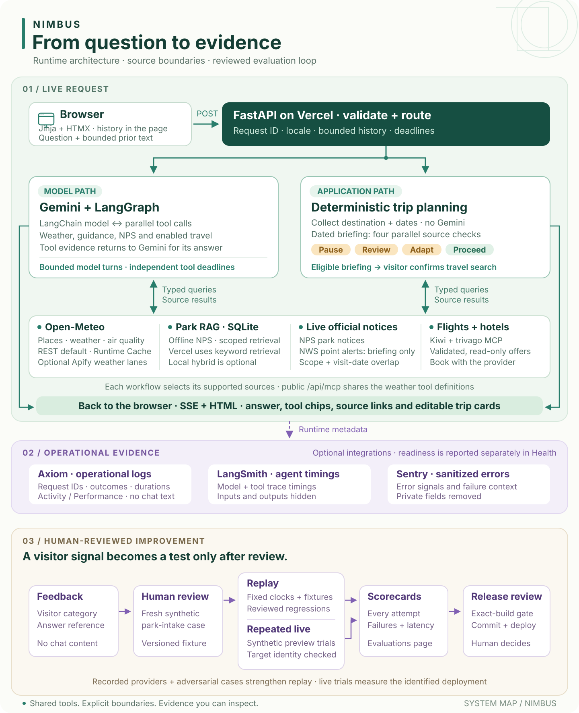

# Architecture and Design

Ask “Will it rain in Paris tomorrow?” and Nimbus can show the place lookup and forecast behind its answer.
Ask “Plan a trip to Dallas” and the first useful answer is a question about dates. Ask for a weekend in Zion
and the first decision is whether conditions affect the visit. One chat supports all three.

[Open the full-size system map](/docs/images/nimbus-system-map.svg).

Follow the request through the upper half of the map, then follow the evaluation loop below. The model can
choose tools for an agent answer; application code can collect trip details and check park conditions directly.
Both paths expose their evidence. The harness checks behavior using repeatable cases and live trials, with
human review between visitor feedback, a new regression case and a release decision.

## How Nimbus chooses a response

| What you ask in chat | What you see | Why it works this way |
| --- | --- | --- |
| “Will it rain in Paris tomorrow?” | The weather agent can look up the place, request a forecast and stream its answer with expandable tool calls. | The forecast needs coordinates and the local date. The tool results give the model evidence for its answer. |
| “Plan a trip to Dallas” | A question about dates. Reply with dates and Nimbus can offer weather and the travel searches enabled here. | The city intake can collect missing details without a speculative forecast or a model call. |
| “Plan a trip to Zion” | An inline trip form with editable dates and travel details. | A park name alone gives no dates against which to check a warning or price a stay. |
| “Plan a trip to Zion this weekend from DFW” | A dated conditions briefing, or a choice if the weekend is ambiguous. | A verified park reference point and visit dates let the app check conditions before offering a travel search. |

Nimbus has curated preparation guidance for Zion, Yosemite and Grand Canyon, including selected trails. City
weather uses a global place lookup. For example, “I'm planning a trip to Dallas, Texas. Will it rain there
tomorrow?” is a weather question even though it mentions a trip. [Try these questions in chat](/).

## What builds an answer

**The browser and FastAPI** share one interface. Jinja renders the pages. HTMX inserts HTML events as a turn
progresses, so you can expand a tool call or stop a streaming reply. The browser sends a bounded conversation
history with a follow-up. Nimbus keeps the chat transcript in the page.

**The weather agent** uses Gemini through LangChain. A LangGraph loop can call several independent tools in
parallel, then give their results to the model. The four weather operations find a place, read current weather,
get a forecast and read air quality. Chat defaults to direct Open-Meteo REST without authentication. The same
weather tool definitions also power the public Nimbus MCP server. Apify-backed lanes are available when
configured. [Weather MCP tools and connection address](/health#mcp-server).

**The park briefing** uses application code to check a forecast, retrieved National Park Service (NPS)
preparation guidance, current NPS notices and active National Weather Service (NWS) alerts. This lets Nimbus
explain which check is incomplete or which warning overlaps a visit before a visitor requests prices. The
separate park trip form runs the searches a visitor confirms. [How a park trip is assembled](system-design.md).

## Where the evidence comes from

- **Weather and air quality** come from weather tools. The place, forecast dates and available hours constrain
  what the answer can say. A current observation and a forecast cover different times.
- **Preparation advice** comes from a versioned SQLite collection built from official NPS pages. Each passage
  retains its source, section and destination. Follow a passage from the original document to its retrieval
  score. [Source documents](/knowledge/sources) · [Chunks and vectors](/knowledge/chunks) ·
  [Retrieval Playground](/knowledge/retrieval).
- **Notices and warnings** come from separate live services. A park-wide NPS closure and an NWS warning for a
  particular point can have different geographic and time boundaries. You can also check current NPS notices
  for a park directly. [Park alerts](/parks/alerts).
- **Travel options** come from Kiwi for flights and trivago for hotels when each integration is enabled. The
  adapters validate dates, prices and provider links before displaying offers. Booking and payment happen with
  the provider. [Flight and hotel search](step-18.md).

## How to check an answer

Start with the tool chips in chat to see what ran. On Vercel, the CDN serves static assets and one Python
function serves FastAPI routes. Request middleware attaches a request ID to structured events. When configured,
Axiom stores those events and a separate read credential lets Activity and Performance display them. Sentry can
receive sanitized errors. LangSmith adds model and tool timings to eligible Activity rows when tracing is enabled.
[Activity](/activity) · [Performance](/performance).

Evaluations shows how the app performed on synthetic questions, including repeated trials and failures.
Health reports dependency readiness separately from answer quality. [Evaluations](/evaluations) · [Health](/health).

The harness keeps offline replay and live attempts separate. Its scorecards preserve failed attempts, and its
release evidence check ties complete, repeated evaluation to the specified commit and preview deployment.
Feedback supplies a category and answer reference; a reviewer writes a synthetic park-intake case before
promoting it into the regression suite. This process adds a test, without training the model or automatically
deploying the app. [Follow the harness loop](step-19.md).

For the functions that choose a route, rank a passage and build an offer card, see
[Technical details](technical-details.md).
