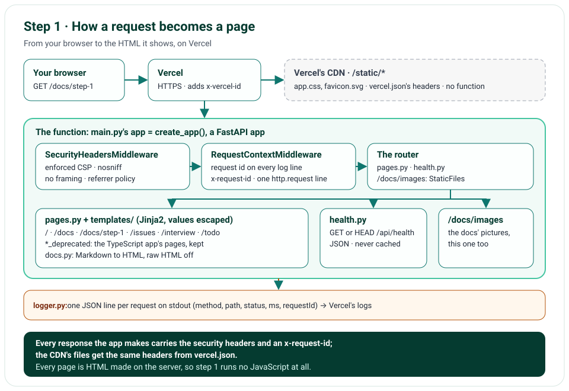

# Step 1 · The Project, Its Pages and Its First Deploy

The first step of Nimbus's rebuild in Python lays the ground every later step stands on: a FastAPI app, managed with
uv, checked by Ruff, mypy and pytest, and deployed to Vercel on every push. It serves the page shell with Nimbus's
look, the documentation (these chapters, and the TypeScript version's pages, kept as *_deprecated), and a health
check. Every request the app answers gets an id and one JSON log line; every response gets the security headers, the
CDN's files included. The chat itself doesn't answer yet: that's step 2.

**In one line:** your browser → Vercel → the FastAPI app: the security headers, then the request's id, then the
router → a page made from a Jinja2 template, or JSON → back to you, with one log line.

## What you'll build

- A FastAPI app, run with uv, deployed to Vercel from a push.
- The page shell, with the TypeScript version's mint and teal look: the menu, the chat card (not answering yet), and
  the documentation, rendered from Markdown.
- The TypeScript version's pages, kept at their old addresses with `_deprecated` added.
- `GET /api/health` (and `HEAD`): up, and which build is answering.
- A request id on every log line and response, and one JSON line per request.
- The security headers, with a Content Security Policy enforced from the start.
- The checks: Ruff, mypy in strict mode, unit tests, browser and accessibility tests, a mutation check; CI on every
  push.

## What you'll learn

- How a production Python web project is laid out with uv: `pyproject.toml`, `uv.lock`, exact versions.
- FastAPI's pieces: an app factory, routers, templates, static files and an error handler.
- How to write ASGI middleware, and why it's better here than Starlette's `BaseHTTPMiddleware`.
- Settings with pydantic-settings, and structured logs with structlog and context variables.
- How to render Markdown so a page can only ever be text and links.
- How Vercel runs a Python app, and what its CDN serves without it.
- How to test it in memory, in a real browser, for accessibility, and with a mutation check.

## Before you start

- **Python 3.13** and **uv** 0.9 or newer (`uv --version`), and Git.
- **For the browser tests:** Edge or Chrome on your computer, or `uv run playwright install chromium`.
- In the project's folder, `uv sync` makes `.venv/` and installs every package at the version `uv.lock` pins.

## The design



| Decision | Why |
|---|---|
| One FastAPI app for the pages and the API | One deploy, one language; FastAPI is ASGI, so step 2 can stream an answer as it's written |
| Pages rendered on the server with Jinja2 | No JavaScript at all in step 1, so the Content Security Policy can forbid inline scripts from the start; step 2 adds HTMX, one script file, for the live parts |
| Plain ASGI middleware | Each message passes through untouched, so a streamed answer (step 2) streams, with its request's log context |
| One module reads the environment | `config.py` checks every value once, at start; a test builds its own settings instead |
| JSON log lines with the request id | One search finds everything about a request; the field names are the TypeScript app's, so its Axiom queries still work |
| The stylesheet in `public/`, for Vercel's CDN | Served without running the function; `vercel.json` gives those files the same security headers |
| The docs are Markdown in the repository | They read the same on GitHub and in the app, which turns `step-2.md` into `/docs/step-2` |
| The old pages at their old addresses, plus `_deprecated` | Each page marks exactly one menu link as current (issue 2) |

## Files

| File | What it does |
|---|---|
| `main.py` | The entry point: a top-level `app`, which Vercel and Uvicorn both look for |
| `nimbus/app.py` | `create_app()`: the settings, logging, routes, files and middleware, put together |
| `nimbus/config.py` | The settings: the only code that reads the environment |
| `nimbus/constants.py` | Fixed values: paths, header names, the security headers |
| `nimbus/logger.py` | structlog, set up: one JSON object per line, with the build's fields |
| `nimbus/middleware.py` | The request's id and log line; the security headers |
| `nimbus/pages.py` | The pages, the menu, and the 404 page |
| `nimbus/docs.py` | The documentation's pages, and Markdown rendered safely |
| `nimbus/health.py` | `GET /api/health` |
| `nimbus/utils.py` | Small shared helpers: request ids and times |
| `templates/*.html` | The shell (`base.html`), the chat, a list of pages, a page, the 404 page |
| `public/static/` | The stylesheet and the icon, which Vercel's CDN serves |
| `docs/` | The chapters, the issues log, the interview guide, the to-do list, the deprecated pages, and their pictures |
| `tests/unit/`, `tests/e2e/` | The tests: in memory, and in a real browser |
| `tools/mutation_check.py` | Breaks each rule on purpose and checks a test fails |
| `pyproject.toml`, `uv.lock`, `.python-version` | The packages, pinned, the tools' settings, and Python 3.13 |
| `vercel.json` | The CDN's files' security headers; the tests and tools left out of the function |
| `.github/workflows/weather-chatbot.yml` | CI, at the repository's root: every check, on every push |

## How it works

Each section is one file; the circled numbers are the ones in its code.

### The settings: `nimbus/config.py`

`Settings` is a pydantic-settings class: each field is an environment variable, checked when the app starts. Vercel
sets its own (①: `VERCEL`, read as `is_vercel`, `VERCEL_ENV`, the commit and the deployment); on a computer,
`.env.local` can set yours (②). An empty value counts as unset, and an unknown one stops the app with a clear error.
Vercel's own come from the real environment only (③): `vercel env pull` copies them into `.env.local`, where they'd
make a computer look like Vercel (issue 18).

```python
class Settings(BaseSettings):
    model_config = SettingsConfigDict(env_file=(".env", ".env.local"), env_ignore_empty=True, extra="ignore")

    is_vercel: bool = Field(default=False, validation_alias=AliasChoices("is_vercel", "VERCEL"))
    vercel_env: Literal["production", "preview", "development"] | None = None
```

### The logs: `nimbus/logger.py`

structlog writes one JSON object per line to stdout, which Vercel's logs keep. Each line gets its level and time, the
build's fields (`env`, `commit`, `deploymentId`), and whatever the request has bound to its context: its id (①); then
it's written as JSON (②). Loggers aren't cached, so a later configuration, a test's, reaches all of them.

### The request's id, and its line: `nimbus/middleware.py`

`RequestContextMiddleware` runs around every request the app answers. It takes Vercel's id for it, `x-vercel-id`, when
it looks like an id, else makes a new one (①); sends it back as `x-request-id` (②); binds it to the request's log
context, so every line carries it (③); and logs one line when the request ends: the method, the path, the status and
the time (④). Never the query string: it can hold what someone typed.

```python
with structlog.contextvars.bound_contextvars(requestId=request_id):
    try:
        await self.app(scope, receive, send_with_id)
    except Exception as error:
        error_class = type(error).__name__
        raise
    finally:
        ...  # one http.request line, at error level if the request failed
```

Both middleware classes are plain ASGI: a callable that gets each request's `scope` and wraps `send`, so it sees the
response's start (to add headers) and lets every other message pass as it is.

### The security headers: `nimbus/constants.py` and `vercel.json`

`SecurityHeadersMiddleware` adds `SECURITY_HEADERS` (`constants.py` ③) to every response the app makes: a Content
Security Policy that allows only our own files and no framing, `nosniff`, a referrer policy, `X-Frame-Options: DENY`,
and a permissions policy. The policy is enforced, not report-only: step 1 has no script at all. The stylesheet and
the icon never reach the app, since Vercel's CDN serves them, so `vercel.json` gives `/static/*` the same headers, and
a unit test keeps the two lists equal.

### The pages: `nimbus/pages.py` and `templates/`

The menu is two lists, the new pages and the deprecated ones (①); each page is a route that renders a Jinja2
template inside `base.html`, the shell with the menu (②, ③, ④). Jinja2 escapes every value it puts into a page,
except the two marked safe (see the pitfalls). The
menu marks the current link with `aria-current`: `"page"` for the page itself, `"true"` for the section it's in
(`to_aria_current()`). A missing page gets our own 404 page, a missing API JSON (⑤).

### The documentation: `nimbus/docs.py`

Each page is a `DocPage` in a registry: its file's name, its address, its label; the new ones (①), and the TypeScript
version's (②). A route finds the page by the request's address, so an address never becomes a file path.
markdown-it-py renders the Markdown with raw HTML off; its render rules turn GitHub-style links
(`step-3_deprecated.md`) and pictures (`images/x.png`) into the app's addresses, and a table column's alignment into a
class, since the policy refuses the inline style markdown-it would write.

```python
markdown = MarkdownIt("commonmark", {"html": False}).enable(["table", "strikethrough"])
markdown.add_render_rule("link_open", _link_open)
markdown.add_render_rule("image", _image)
```

### The health check: `nimbus/health.py`

`GET /api/health` answers `{"status": "ok", ...}` with the time and the build, marked `no-store`; `HEAD`, which uptime
monitors often send, gets the same answer without its body. Step 12 adds a check of each lane's way out.

### Putting it together: `nimbus/app.py` and `main.py`

`create_app()` builds the app in order: the settings and logging (①); FastAPI, with its own API pages off, since
`/docs` is ours (②); the routes (③); the docs' pictures, and, on a computer only, the stylesheet (④); the 404 page
(⑤); and the two middleware classes, the security headers outermost (⑥). `main.py` calls it once:
`app = create_app()`.

### On Vercel

Vercel's FastAPI preset finds `app` at the top level of `main.py`, installs the packages with uv from `pyproject.toml`
and `uv.lock`, takes Python 3.13 from `.python-version`, and serves `public/` from its CDN without running the
function. Vercel's docs say never to mount `public/` with `app.mount()`, so `create_app()` mounts `/static` only off
Vercel (`settings.is_vercel`).

## Run it

```text
$ uv run uvicorn main:app --reload --no-access-log
INFO:     Will watch for changes in these directories: ['C:\\...\\weather-chatbot']
INFO:     Uvicorn running on http://127.0.0.1:8000 (Press CTRL+C to quit)
INFO:     Started reloader process [36760] using StatReload
INFO:     Started server process [3920]
INFO:     Waiting for application startup.
INFO:     Application startup complete.
```

(The folder's path is shortened here.) Open http://127.0.0.1:8000. `--no-access-log` turns off Uvicorn's own line per
request, which would also write the query string; the app writes its own. Asking for `/docs?q=private` wrote this
line, without the query:

```json
{"method": "GET", "path": "/docs", "status": 200, "ms": 13, "event": "http.request", "level": "info",
 "ts": "2026-10-30T23:07:18.495927Z", "env": "local", "commit": null, "deploymentId": null,
 "requestId": "6fcf320b485d4f78"}
```

And the health check, with its headers (the policy's long line wrapped here; in PowerShell, type `curl.exe`):

```text
$ curl -i http://127.0.0.1:8000/api/health
HTTP/1.1 200 OK
date: Fri, 30 Oct 2026 23:07:18 GMT
server: uvicorn
cache-control: no-store
content-length: 90
content-type: application/json
x-request-id: a2b33c6df3194eae
content-security-policy: default-src 'self'; script-src 'self'; style-src 'self'; img-src 'self' data:; font-src
  'self'; connect-src 'self'; frame-ancestors 'none'; base-uri 'self'; form-action 'self'; object-src 'none'
x-content-type-options: nosniff
referrer-policy: strict-origin-when-cross-origin
x-frame-options: DENY
permissions-policy: camera=(), geolocation=(self), microphone=()

{"status":"ok","checkedAt":"2026-10-30T23:07:18.439Z","commit":null,"environment":"local"}
```

## Test it

```text
$ uv run ruff check .
All checks passed!
$ uv run ruff format --check .
48 files already formatted
$ uv run mypy
Success: no issues found in 26 source files
$ uv run pytest
117 passed in 1.00s
$ uv run pytest tests/e2e --browser-channel msedge
89 passed in 52.69s
$ uv run python tools/mutation_check.py
caught: a request id is ASCII
caught: a request id is at most 128 characters
caught: the docs never render raw HTML
caught: a page is found by its own address
caught: a picture's address is the app's
caught: an aligned column has no inline style
caught: Chat isn't a section
caught: a label may break before _deprecated
caught: the query string is never logged
caught: every response has the Content Security Policy
caught: the request id goes back to the browser
caught: an empty setting is unset
caught: Vercel's own settings never come from a .env file
caught: a time is written with Z
caught: on Vercel, public/ is never mounted
caught: the health check answers HEAD
16 of 16 caught
```

The unit tests call the app in memory, through FastAPI's `TestClient`: every page and its menu link, the 404 page, the
headers on every kind of response, a stream passed on message by message, the log line, the settings, and the
Markdown. No setting comes from your shell (an automatic fixture removes them), and any warning fails the test that
caused it. The browser tests serve the real app with Uvicorn and drive it with Playwright, on every one of the 21
pages: no error in the browser's console, axe's accessibility checks, no sideways scrolling at 1,280 and 360 pixels;
and the menu, every menu link inside the menu, and a deprecated page's diagram and links. Leave out
`--browser-channel msedge` to use Playwright's own Chromium.

The mutation check breaks one rule at a time, the way a bug would, and runs the unit tests: each change must fail
one. Issue 4 tells the one that didn't, at first.

## Deploy it

Vercel deploys every push to `main`. Before this step's push, the project's Framework Preset was switched from
Next.js, which Vercel had detected for the TypeScript version, to FastAPI, with no command overrides (Settings, Build
and Deployment). The push then built and went live in 14 seconds. Its build log, without the times:

```text
Running "vercel build"
Vercel CLI 65.4.0
Using Python 3.13 from projects/Agentic/weather-chatbot/.python-version
Using uv 0.13.5 (x86_64-unknown-linux-gnu)
Creating virtual environment at "/vercel/path0/projects/Agentic/weather-chatbot/.vercel/python/.venv"...
Installing required dependencies from uv.lock...
Compiling Python bytecode...
Build Completed in /vercel/output [7s]
Deploying outputs...
Deployment completed
```

The deployment is one function, `/fastapi`: Python 3.13, 8.4 MB, without the dev group (pytest, Playwright, mypy and
Ruff aren't in it), in Washington, D.C. (`iad1`); and the CDN's two files, the stylesheet and the icon. Vercel read the
lock with its own uv, 0.13.5, newer than the 0.9.18 that wrote it and that CI uses.

Checked on the live site, https://weather-chatbot-hazel.vercel.app:

- `/api/health` answered
  `{"status":"ok","checkedAt":"2026-10-30T23:30:45.561Z","commit":"369e149","environment":"production"}`, with
  `cache-control: no-store`, the security headers, and `x-request-id: cle1::nmzgg-1793403045507-1e71e313788a`:
  Vercel's id for the request, as the function got it (the response's `x-vercel-id` adds the function's region:
  `cle1::iad1::nmzgg-...`). `HEAD` answered 200, without a body.
- Sent with its own `x-vercel-id: forged-id-123`, a request still got Vercel's id back: Vercel replaces the header, so
  there the id is always Vercel's, and the app's check of it matters on a computer.
- Each of the 21 pages answered 200, with the security headers and "Build 369e149 · production"; in Edge, at 1,280
  and 360 pixels, none logged an error (so the policy refused nothing) or scrolled sideways.
- `/static/app.css` and `/static/favicon.svg` came from the CDN with the same five headers, from `vercel.json`, and no
  `x-request-id`: the app never saw them. The docs' pictures come from the function, with an id.
- A missing page got the 404 page; a missing API address got `{"detail":"Not Found"}`, as JSON.
- Searched for the request's id, Vercel's logs found its one line:

```json
{"method": "GET", "path": "/api/health", "status": 200, "ms": 1, "event": "http.request", "level": "info",
 "ts": "2026-10-30T23:30:45.562565Z", "env": "production", "commit": "369e149",
 "deploymentId": "dpl_85W8gAmSCsmU34mV5AG4dvfKjoKY", "requestId": "cle1::nmzgg-1793403045507-1e71e313788a"}
```

CI ran every check on the same push, and passed, in about two minutes.

## Things to take care of, and pitfalls

- **FastAPI's own `/docs`.** FastAPI serves its API pages at `/docs` unless told not to; here that address is ours, so
  `docs_url`, `redoc_url` and `openapi_url` are `None`, and the API's shape isn't public either.
- **`BaseHTTPMiddleware` and streams.** Starlette's easy middleware wraps the response in a stream of its own; plain
  ASGI middleware lets a streamed answer through as it is, one message at a time.
- **The CDN's files skip the app.** Middleware never sees `public/`, so its files' headers come from `vercel.json`.
- **Never mount `public/` on Vercel.** Vercel serves it itself, and its docs say not to mount it with `app.mount()`.
- **Python's `\w` takes any Unicode letter.** A pattern that checks a header needs `re.ASCII`.
- **`vercel env pull` copies Vercel's own variables into `.env.local`.** The settings ignore them there, and read
  them only from the real environment.
- **Your shell can change a test's result.** The unit tests remove every variable the settings read, and build
  `Settings(_env_file=None, ...)`, so your `.env.local` stays out too.
- **Paths from the file, not the working directory.** `constants.py` finds the docs and templates from its own place.
- **An address must never become a file path.** Pages are found in a registry, by address.
- **`Markup()` only for HTML you made.** Two values aren't escaped: the Markdown renderer's output, with raw HTML off,
  and a menu label, whose only HTML is the `<wbr>` we put in it, the label itself escaped.
- **An enforced policy refuses inline styles,** markdown-it's table alignment among them: it's a class here.
- **FastAPI routes don't answer `HEAD` by themselves.** The health check lists it, for uptime monitors.
- **Cached loggers ignore a later configuration.** structlog's `cache_logger_on_first_use` is off here.
- **A crash's 500 skips our headers.** Starlette's outermost error handler answers a crash with plain text, outside
  our middleware; the request's line still says 500 and the error's class.
- **`uv add` writes `>=`.** This project pins exact versions; change it to `==`.
- **On Windows, Git Bash rewrites arguments that start with `/`**, and a script run from another folder can't import
  the app (issue 6).
- **On Vercel, a changed variable reaches only the next deployment.** Redeploy after changing one.
- **Vercel keeps the framework it detected when the project was made.** A project that changes framework needs its
  Framework Preset switched by hand, before the push: Vercel builds with the preset in the project's settings, not
  with what the repository now holds.

## Issues we hit

1. Starlette's test client said `httpx` is deprecated: the tests use `httpx2`, and any warning fails a test now.
2. A deprecated page marked two menu links as current: the old pages moved to their old addresses with the suffix.
3. A test's captured log lines had no request id: `capture_logs()` needs the context step given back.
4. A mutation check found an untested rule in the menu: a test for `//docs`.
5. Four deprecated pages scrolled sideways on a phone: long words break now.
6. Two Windows traps: Git Bash's argument rewriting, and Python's import path for a script run from elsewhere.
7. mypy refused a page's values: a `dict` is invariant, a `Mapping` isn't.
8. mypy found two modules named `conftest`: the test folders are packages now.
9. A deprecated menu link ran past the menu's edge: a label may break before "_deprecated".
10. The CDN's files had none of our security headers: `vercel.json` gives them the same ones.
11. The unit tests read the shell's environment: an automatic fixture removes the settings' variables.
12. App code that only tests used: removed, and `VERCEL` now decides whether `/static` is mounted.
13. Outputs that didn't come from the commands shown: captured again, with those commands.
14. Two checks this log claimed didn't exist: warnings fail tests now, and the browser tests cover all 21 pages.
15. An aligned table would have broken the policy: its alignment is a class.
16. `HEAD /api/health` answered 405: the health check answers `HEAD` too.
17. Smaller review findings.
18. A pulled `.env.local` would have made a computer look like Vercel: Vercel's own settings come from the real
    environment only.
19. A build-log line copied wrong: copied again, from the page's own text.

Each is told in full, with how it was found and how it's checked, in [Issues and fixes](issues.md).

## Interview questions

**1. Why FastAPI, and not Flask or Django?**
FastAPI is ASGI, so it can stream an answer while it's written (step 2) and wait on the model and the weather APIs
without blocking; it checks every input with Pydantic and type hints; and Vercel runs it as it is. Flask is WSGI: it
can stream from a generator, but each open stream holds a worker thread, and async is an add-on. Django brings an ORM,
an admin and sessions this app doesn't need.

**2. Why render pages on the server with Jinja2 instead of building a React app?**
The whole app stays in Python, the pages work with no JavaScript, and the Content Security Policy can forbid inline
scripts from day one. Where a page must update live, HTMX (step 2) swaps in HTML the server renders. React pays off for
a far more interactive interface.

**3. What is ASGI middleware, and why not Starlette's `BaseHTTPMiddleware`?**
ASGI middleware is a callable that wraps the app: it gets each request's scope and every message the app sends.
`BaseHTTPMiddleware` is easier to write, but wraps the response in a stream of its own, and has had problems with
streamed bodies and with context variables; plain ASGI passes each message through untouched, which streamed answers
need.

**4. How does a request id travel through the app?**
Vercel gives each request an id, `x-vercel-id`. The middleware takes it if it looks like an id, else makes one; binds
it to structlog's context, so every line the request logs carries it; and sends it back as `x-request-id`. One search
then finds everything about one request; later steps pass it on to our MCP server too.

**5. Why check the `x-vercel-id` header before using it?**
A header can hold anything, and this one goes into every log line and back into a response header. Only ASCII letters,
digits and `_:.-` are allowed, at most 128: without `re.ASCII`, Python's `\w` would take any Unicode letter.

**6. How are settings and secrets handled?**
One module, `config.py`, reads the environment with pydantic-settings and checks each value when the app starts;
nothing else reads `os.environ`. Secrets live in Vercel's Sensitive environment variables, or in `.env.local` on a
computer, which git never sees. Tests build their own settings, and remove the shell's, so nothing leaks in.

**7. What does your Content Security Policy do, and why enforce it from the start?**
It lets a page load scripts, styles, pictures and connections only from our own site, and forbids framing, plugins
and forms that post elsewhere. The first version shipped it report-only and never got to enforcing it; with no inline
script from the start, enforcing it costs nothing.

**8. How do you render Markdown safely?**
markdown-it-py with raw HTML off, so HTML in a page shows as text; its link check refuses `javascript:` addresses; and
Jinja2 escapes every value except two marked safe: the renderer's own output, and a menu label with the one `<wbr>` we
add, the label itself escaped first.

**9. How do you make sure a URL can't read any file it names?**
Every documentation page is in a registry, found by its address; the file's name comes from the registry, never from
the URL, so `/docs/../../etc/passwd` simply isn't a page.

**10. How is a Python app deployed on Vercel?**
Vercel's FastAPI preset finds `app` at the top level of `main.py`, installs the packages with uv from `pyproject.toml`
and `uv.lock`, uses Python 3.13 from `.python-version`, and serves `public/` from its CDN without running the function.
`vercel.json` keeps the tests out of the function's bundle, and gives the CDN's files their headers.

**11. How do you choose and pin dependency versions?**
Exact versions, which uv chooses with `exclude-newer` set two weeks back, so a release has had time to settle before
we use it; `uv.lock` pins everything else, CI installs with `--locked`, which fails if the lock is out of date, and uv
itself is pinned in CI to the version that wrote the lock.

**12. How is the app tested?**
Unit tests call the app in memory with `TestClient`: every page, header, log line and setting. Browser tests serve the
real app with Uvicorn and drive it with Playwright on every page: accessibility with axe, no sideways scrolling on a
phone, no console errors. A mutation check breaks each rule on purpose, to prove a test catches it.

**13. What is a mutation check, and what did it find here?**
It changes the code the way a bug would, one change at a time, and runs the tests; a change no test notices points at
a rule nothing tests. Here, removing the guard that keeps the Chat link from being marked on other pages broke
nothing, since no test used an address starting with `//`; a test now does.

**14. Why log the path but never the query string?**
A query string can hold what a user typed, such as a question, and the logs must never hold that. The path says which
page was asked for, which is all the logs need. Uvicorn's own access line would log it, so it's turned off.

**15. Why JSON log lines?**
Each field can be searched and counted (`status`, `ms`, `requestId`) in Vercel's logs and, from step 12, in Axiom,
without parsing text.

**16. Static files skip your middleware: how do they get security headers?**
On Vercel, the CDN serves `public/` before any function runs, so headers the app adds never reach those files.
`vercel.json` gives `/static/*` the same headers, and a unit test fails if the two lists ever differ.

## Things to try

- **Add a page:** a Markdown file in `docs/`, and its `DocPage` in `nimbus/docs.py`. Forget either, and
  `test_every_page_has_its_file_and_every_file_its_page` fails.
- **Fewer lines:** put `LOG_LEVEL=warning` in `.env.local` and restart; the request lines stop.
- **A forged id:** `curl -i -H "x-vercel-id: not an id" http://127.0.0.1:8000/api/health` gets a new id back.
- **Uvicorn's own line:** leave out `--no-access-log`, and compare its line with the app's: its line keeps the query.
- **A new mutation:** add one to `tools/mutation_check.py`, and see whether a test catches it.

## What's next

Step 2 makes the chat answer: a fixed answer, streamed over server-sent events with HTMX, with a Stop button and our
own error sentences, before any AI is involved. The roadmap for every step is in
[PLAN.md](https://github.com/EasyLearnJava/AgenticProgramming/blob/main/projects/Agentic/weather-chatbot/PLAN.md).
