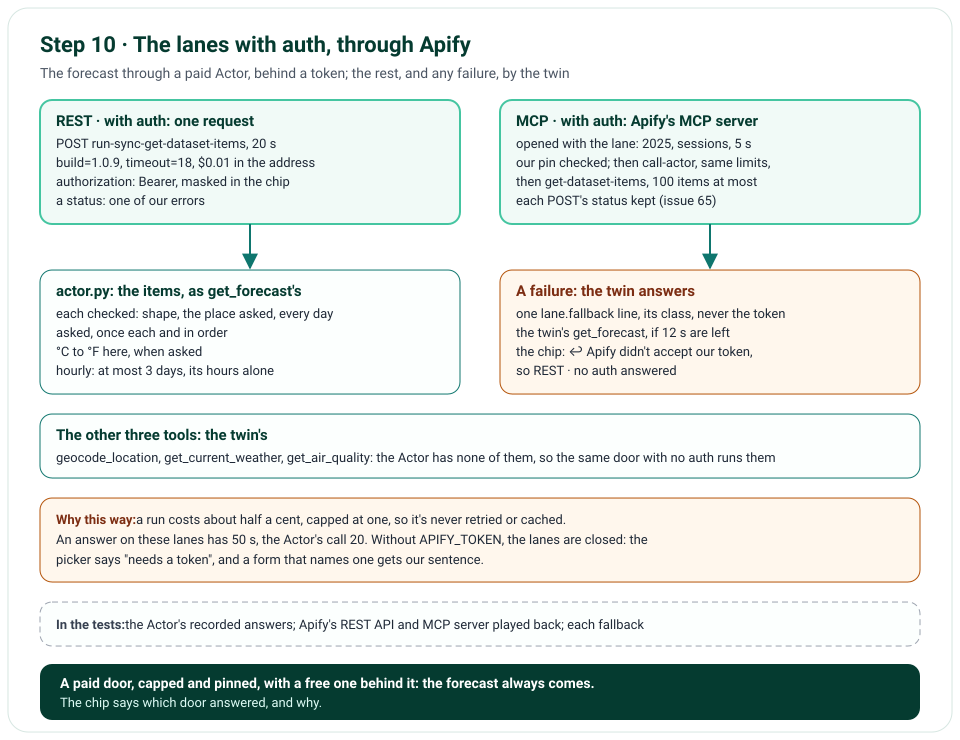

# Step 10 · The Lanes With Auth, Through Apify

Step 10 opens the last two lanes: REST · with auth and MCP · with auth. On both, `get_forecast` runs through Apify's
Actor `gochujang/open-meteo-weather-forecast`, which asks Open-Meteo itself, behind Apify's token: over Apify's REST
API, one request that runs the Actor and answers with its items; or over Apify's MCP server, `call-actor`, then
`get-dataset-items`. The Actor has no geocoding, no weather now and no air, so a lane's other three tools are its
twin's, the same door with no auth. When the Actor's call fails, the forecast doesn't: the twin's `get_forecast`
answers, and the chip says why. Without a token, the two lanes are closed.

**In one line:** a question on a lane with auth → three tools by the twin → `get_forecast` by the Actor, its build,
18 s and $0.01 pinned → its items read into the same forecast → a failure falls back to the twin, saying why.

## What you'll build

- `nimbus/actor.py`: the Actor's input, from `get_forecast`'s, and its items, read into the same forecast, in °F when
  asked, an answer we can't trust a ContractError.
- `nimbus/apify.py`: the two doors: Apify's REST API, and its MCP server, with sessions; the token only in a header;
  each status or error result one of our errors.
- `nimbus/auth_lanes.py`: the lanes: the forecast by the Actor, falling back to the twin's, the other three the twin's.
- The token, `APIFY_TOKEN`, in the settings; the picker's lanes with auth open only with it; an answer's 50 s on them.
- A chip's note when a forecast fell back; the compare view's two requests with auth; `run_tool ... --auth`.

## What you'll learn

- How one tool can run through a paid service and fall back to a free one, saying why.
- What to pin when you call someone else's code: the build, the time, the charge.
- How a token stays a secret: a header only, masked wherever a request is shown, never logged.
- How to read a third party's answer you can't fully trust: check its shape, its place and its days.
- What an MCP client does with an HTTP error status, and how to get it back.

## Before you start

- Step 9's project; no new package. `APIFY_TOKEN`, a Sensitive variable in Vercel's settings; on your computer, in
  `.env.local`, if you want these lanes to run, or none, and they're closed.

## The design



| Decision | Why |
|---|---|
| `get_forecast` by the Actor; the other three tools the twin's | The Actor gives forecasts only; the model sees the same four tools on every lane, and the same prompt |
| The Actor's build, 18 s and $0.01 pinned, on both doors | A new build can't change its answer under us; a run can't run or cost too much |
| The token only in a header, masked in the chip, never logged | An address goes in logs and chips; a header we choose what to show of; so is a session's id |
| Apify's MCP server opened with the lane | Its client runs in an anyio task group, which the task that entered it must leave; tool calls run in tasks of their own |
| A response hook keeps each POST's status | The SDK's client turns an error status into a JSON-RPC error without it (issue 65): 401 and 402 mean different things |
| The session left to expire | Its DELETE would have no time limit of its own, at the answer's end |
| Any failure falls back to the twin, saying why | The forecast still comes; the chip says what happened: the token, the credit, the time |
| A fallback only with 12 s of the answer left | The twin's 8 s, and time to write the answer |
| 50 s for an answer on these lanes | An Actor's run takes seconds: 20 for its call |
| Never retried or cached | Each run costs; the twin answers anyway |
| At most 2 runs an answer, 25 a day | Anyone can ask, until step 11's rate limit: "the forecast for 10 cities" would be 10 runs; past either cap, the twin answers with no run (issue 66) |
| A session's id masked too | Apify's session is opened with our token, and may honour its id alone (issue 67) |
| Closed without a token | A lane that can't run says so before anything opens |

## Files

| File | What it does |
|---|---|
| `nimbus/actor.py` | The Actor's input and its items |
| `nimbus/apify.py` | Apify's REST API and its MCP server: the requests, the pin, the errors |
| `nimbus/auth_lanes.py` | The lanes: the Actor's forecast, its fallback, the twin's other tools |
| `nimbus/lanes.py`, `nimbus/config.py`, `nimbus/chat.py` | Open with a token only; `APIFY_TOKEN`; the lane's tools and its deadline |
| `nimbus/tools.py`, `nimbus/mcp_lane.py`, `nimbus/answer.py` | A run that fell back; each lane's runs; 50 s on a lane with auth |
| `nimbus/errors.py`, `nimbus/constants.py` | AuthError, BudgetExceededError and the chips' reasons; ⑮ Apify's addresses and limits |
| `nimbus/chips.py`, `nimbus/pages.py`, `templates/`, `public/static/app.css` | The fallback's note; the picker; the compare view |
| `tools/run_tool.py` | `--auth`: `get_forecast` on REST · with auth |
| `tests/fixtures/apify/`, `tests/fakes.py` | The Actor's recorded answers; Apify's REST API and MCP server, played back |
| `tests/unit/test_actor.py`, `test_apify.py`, `test_auth_lanes.py` | The items, the doors, the fallback, a whole answer |
| `tools/mutation_check.py` | 15 more rules |

## How it works

### The Actor's input and items: `nimbus/actor.py`

`to_actor_input()` turns `get_forecast`'s input into the Actor's: one location, its point rounded and named by
itself; the days; daily, or hourly for at most 3 days. `to_forecast()` reads the items, one a day or an hour, each
checked: the shape, the place asked (within about 1 km), one name and time zone, every day asked, once each and in
order. They become `get_forecast`'s forecast, °C turned to °F when asked; hourly, its hours alone.

### The doors: `nimbus/apify.py`

Over REST, `run_actor_rest()` posts the input to `run-sync-get-dataset-items`, the three limits in the address, the
token in the `authorization` header; a status becomes an error: 401 or 403 AuthError, 402 BudgetExceededError, 408 a
timeout, 429 busy, 5xx unavailable, any other a ContractError; the log line keeps Apify's error type, and its message
for an account's problem only. Over MCP, `open_apify_mcp()` opens Apify's MCP server with the lane: the 2025
handshake and the tools within 5 s, then the pin: `call-actor` must take the Actor, its input, its wait and the three
limits; the Actor's own tool, its three fields; and `get-dataset-items`. A connection that fails holds its error, so
the forecast falls back. `run_actor()` sends `call-actor`, reads the run's status and dataset, then
`get-dataset-items`; an error result that speaks of payment is BudgetExceededError, any other a ContractError.

### The lanes and the fallback: `nimbus/auth_lanes.py`

`make_actor_run()` takes a run from the answer's budget, `RunBudget`: 2 an answer, and 25 a day across the app,
counted in the weather's cache until UTC midnight. An answer's forecasts, which LangGraph runs at once, take theirs
in turn, so each is counted; the day's count is near enough, as two answers at once may both take the last run, and a
read that fails starts it again. Then it runs the Actor within 20 s and reads its items. No run left, or a failure,
writes one `lane.fallback` line, an
error for a token or an answer we can't read, a warning otherwise, then, with 12 s of the answer left, the twin's
`get_forecast` answers, its run marked with the twin's lane and the reason: "Apify didn't accept our token, so REST ·
no auth answered". `to_auth_tools()` gives the lane's four tools, the forecast by the Actor and the other three by the
twin. `open_rest_with_auth()` and `open_mcp_with_auth()` open them for one answer.

## Run it

With a token that isn't one, set for this command only, the runner shows a fallback: Apify's own words, the
`lane.fallback` line, and the forecast REST · no auth gave. Nothing the app writes holds a token:

```text
$ APIFY_TOKEN=not-a-real-apify-token uv run python -m tools.run_tool get_forecast \
  '{"latitude": 48.85, "longitude": 2.35, "days": 2, "include_hourly": false, "units": "metric"}' --auth
{"upstream": "apify", "host": "api.apify.com",
 "path": "/v2/acts/gochujang~open-meteo-weather-forecast/run-sync-get-dataset-items", "status": "failed", "ms": 212,
 "httpStatus": 401, "errorClass": "AuthError",
 "apifyError": "user-or-token-not-found (User was not found or authentication token is not valid)",
 "event": "upstream.http", "level": "info", "ts": "2026-10-31T16:59:45.864605Z", "env": "local", "commit": null,
 "deploymentId": null}
{"fromLane": "rest-with-auth", "toLane": "rest-no-auth", "errorClass": "AuthError", "fellBack": true, "msLeft": 49777,
 "event": "lane.fallback", "level": "error", "ts": "2026-10-31T16:59:45.864738Z", "env": "local", "commit": null,
 "deploymentId": null}
Runtime Cache unavailable in this environment. Falling back to in-memory cache.
{"upstream": "open-meteo", "host": "api.open-meteo.com", "path": "/v1/forecast", "status": "ok", "httpStatus": 200,
 "ms": 256, "attempts": 1, "event": "upstream.http", "level": "info", "ts": "2026-10-31T16:59:46.121422Z",
 "env": "local", "commit": null, "deploymentId": null}
{"tool": "get_forecast", "lane": "rest-no-auth", "status": "ok", "ms": 476, "fallbackFrom": "rest-with-auth",
 "event": "tool.call", "level": "info", "ts": "2026-10-31T16:59:46.128506Z", "env": "local", "commit": null,
 "deploymentId": null}
↩ Apify didn't accept our token, so REST · no auth answered
GET https://api.open-meteo.com/v1/forecast?latitude=48.85&longitude=2.35&
  daily=weather_code,temperature_2m_max,temperature_2m_min,precipitation_probability_max,sunrise,sunset&timezone=auto&
  forecast_days=2
accept: application/json
→ 2 days · 6 to 16 °C · rain up to 0%
{
  "latitude": 48.85,
  "longitude": 2.35,
  "time_zone": "Europe/Paris",
  "local_now": "2026-10-31T17:59",
  "temperature_unit": "°C",
  "days": [
    {
      "date": "2026-10-31",
      "weekday": "Saturday",
      "condition": "Mainly clear",
      "temperature_min": 6.7,
      "temperature_max": 15.6,
      "rain_chance_percent": 0,
      "sunrise": "2026-10-31T07:35",
      "sunset": "2026-10-31T17:32"
    },
    {
      "date": "2026-11-01",
      "weekday": "Sunday",
      "condition": "Overcast",
      "temperature_min": 6.2,
      "temperature_max": 12.8,
      "rain_chance_percent": 0,
      "sunrise": "2026-11-01T07:37",
      "sunset": "2026-11-01T17:30"
    }
  ],
  "hours": null
}
```

With a real `APIFY_TOKEN` in `.env.local`, the same command runs the Actor, about half a cent; on the page, choose
REST · with auth or MCP · with auth, and ask about the forecast.

## Test it

```text
$ uv run ruff check .
All checks passed!
$ uv run ruff format --check .
96 files already formatted
$ uv run mypy
Success: no issues found in 64 source files
$ uv run pytest
516 passed in 8.06s
$ uv run pytest tests/e2e --browser-channel msedge
151 passed in 118.27s (0:01:58)
$ uv run python tools/mutation_check.py
...
caught: the Actor's Celsius turns to Fahrenheit when asked
caught: the Actor's items must be for the place asked
caught: the Actor's items must hold every day asked
caught: a run over REST carries the token in its header
caught: Apify's 401 is a token refused
caught: an error result about payment is a credit used up
caught: Apify's tools must match our pin
caught: a run still going is too slow
caught: nothing falls back with too little of the answer left
caught: a lane with auth's other tools are its twin's
caught: a lane with auth is closed with no token
caught: an answer on a lane with auth has 50 s
caught: a chip masks a session's id
caught: an answer starts two Actor runs at most
caught: the day's Actor runs are capped
caught: an answer's forecasts at once are each counted for the day
144 of 144 caught
```

The unit tests read the Actor's recorded answers for Dallas: its input; its items in our shape, in °F; seven answers
we can't trust. They play Apify back: over REST, the request, its limits and its header, masked for the chip, and
each status as its error, Apify's message kept for an account's problem only; over MCP, against a stand-in of Apify's
server with sessions, `call-actor` then `get-dataset-items`, the pin, an error result about payment, a run still
going or failed, a dataset too big, a token refused. The fallback, for each error, its line and its reason; too
little time, none; two runs an answer, and the day's 25, counted in the cache, two at once counted each; the twin's
other tools; 50 s; closed
with no token; and two whole answers on REST · with auth, one by the Actor, one falling back. The mutation check breaks
15 more rules (its first 128 lines are left out above).

## Deploy it

The push, 39bc9ca, was live on Vercel, and CI's checks had passed, within about three minutes. Checked on the live
site, https://weather-chatbot-hazel.vercel.app, on 31 October 2026, after a warm-up, with the token Vercel holds (two
runs of the Actor, about a cent):

- The picker showed all four lanes open.
- "Will it rain in Paris tomorrow?" on REST · with auth: the place by REST · no auth, from the cache; the forecast
  "REST · with auth · api.apify.com · 3.0 s", the Actor's run, nothing falling back. The answer: "In Paris, France,
  tomorrow (Sunday, November 1, 2026), the forecast shows overcast skies with a 0% chance of rain."
- The same question on MCP · with auth: the place by our own MCP server, from the cache; the forecast
  "MCP · with auth · mcp.apify.com · 7.5 s": Apify's real MCP server, its 2025 handshake, our pin, call-actor, then
  get-dataset-items, nothing falling back. The same answer.

## Things to take care of, and pitfalls

- **Pin what you run of someone else's:** the build, the run's time and its charge.
- **A paid service can fail for a reason that's yours:** a token refused, a credit used up; fall back, and say so.
- **Mask a token everywhere a request is shown, and keep it out of addresses and logs.**
- **An MCP client may hide the HTTP status:** keep it from a response hook.
- **An anyio task group must be left by the task that entered it:** open a connection where you'll close it.
- **Don't trust a third party's answer:** check its place and its days, not only its shape.
- **Never retry a paid run:** fall back instead.
- **Cap what anyone can make you spend:** runs an answer, and runs a day, before a rate limit exists (issue 66).
- **A session's id can be as good as its token:** mask it wherever a request is shown (issue 67).

## Issues we hit

65. The SDK's client turns an HTTP error status into a JSON-RPC error without it: the lane keeps each POST's status.
66. Paid runs had no cap, an answer's or a day's: 2 an answer and 25 a day, then the twin answers.
67. A chip showed Apify's session id: it's masked, as the token is.

Each is told in full, with how it was found and how it's checked, in [Issues and fixes](issues.md).

## Interview questions

**1. How do you call a paid API from an agent without risking its answer?**
Cap the call: its time and its charge. When it fails, fall back to a free source for the same data, say why, and
never retry the paid call.

**2. What do you pin when you call someone else's code?**
Its version, so its answer can't change under you; its time; its cost.

**3. How do you keep a token secret in a chat that shows its requests?**
Send it only in a header, mask it wherever a request is shown, keep it out of the logs, and read it only from the
environment.

**4. How do you check an answer from a service you don't control?**
Its shape, field by field, and its meaning: the place you asked for, the days you asked for, in order.

**5. Why open a connection in the task that will close it?**
Libraries built on anyio enter a task group on connecting; leaving it from another task fails.

## Things to try

- Run the runner with `--auth` and a token that isn't one: see the 401 and the fallback.
- With a real token, ask on both lanes with auth, and compare the chips' times with the lanes without.
- Open "Compare the lanes": the four requests one forecast call makes.

## What's next

Step 11 is security: the firewall's rate limit, which you set in Vercel, prompt-injection rules, and privacy checks.
