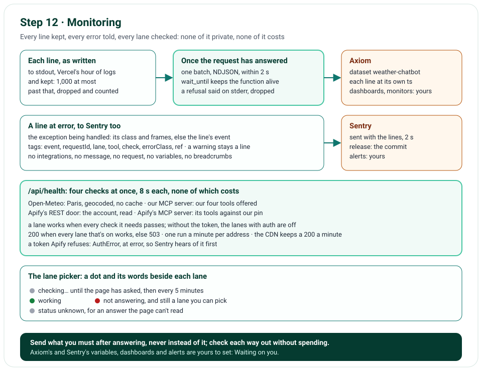

# Step 12 · Monitoring: Axiom, Sentry, the Health Check and the Status Dots

Step 12 makes the app say how it's doing, to you and to its visitors. Every line it logs now also goes to Axiom, which
keeps it long past Vercel's hour, and searches it; every failure it logs at error goes to Sentry, as its exception's
class and frames, with nothing private; `/api/health` checks each lane's way out, running nothing that costs; and
the lane picker shows each lane's health, a dot and its words.
LangSmith keeps tracing each run, with its five variables set (step 3), as the start line's `tracing` says, hiding a
failed run's error too (issue 68).

**In one line:** each line kept → sent at the request's end to Axiom, 2 s, while Vercel waits → each error to Sentry,
nothing private → `/api/health`: four checks, a lane's status from the checks it needs → a dot beside each lane.

## What you'll build

- `nimbus/axiom.py`: the lines' shipper, and `nimbus/sentry.py`: Sentry's settings and each error's event.
- The request middleware sending what each request leaves, once it has answered.
- `/api/health`, rebuilt: four checks, each lane's status, 200 or 503.
- The status dots in the lane picker.

## What you'll learn

- How a serverless function sends its logs after it has answered, without slowing the answer or failing it.
- How to keep an error tracker from collecting what your users typed.
- What a health check should check, how often, and what it should cost.

## Before you start

- Step 11's project, and `sentry-sdk==2.72.0`, which `uv sync` installs.
- In Vercel: Axiom's two variables and Sentry's DSN ([Waiting on you](waiting-on-you.md), part 3). Without them, the
  lines stay in Vercel's logs and Sentry stays off: nothing else changes.

## The design



| Decision | Why |
|---|---|
| The app sends its own lines to Axiom, one batch at each request's end | Vercel's Hobby plan keeps logs for an hour and can't forward them |
| Handed to Vercel's `wait_until`, 2 s at most | The request has answered already, and the function stays alive for it; a send never fails or slows a request |
| One POST of the lines as they were written, no Axiom library | Each line is already JSON; a library would parse it back and batch on a timer, in a function Vercel may freeze |
| A batch Axiom refuses is said on stderr | Through the logger, its own line would come back to the batch |
| Sentry hears only what the app sends: errors, each with its class and frames | None of the SDK's integrations, which read requests, logs and modules; a warning, a timeout or a fallback, stays a line |
| No message, no request, no frame's variables, no breadcrumbs | An exception's words can quote what was sent; Axiom's lines tell what led up to an error |
| Four checks, 8 s each, at once; none costs | Apify's REST door reads the account; its MCP server lists its tools; no Actor runs |
| A lane's status is the checks it needs; 200 only when every lane that's on works | An uptime monitor needs only the status; the body says which lane, and why |
| One run a minute per address, on each copy; Vercel's CDN keeps a 200 a minute | Every page asks; the checks stay cheap, and one address's report never answers for another's |
| A dot and its words beside each lane, never the colour alone | A colour says nothing to a screen reader, or to the colour-blind |

## Files

| File | What it does |
|---|---|
| `nimbus/axiom.py` | The lines' shipper: kept, sent in one batch, said on stderr when Axiom won't take it |
| `nimbus/sentry.py` | Sentry's settings, nothing private, and each error line's event |
| `nimbus/logger.py` | Each line to stdout and to the shipper; each line at error to Sentry |
| `nimbus/middleware.py` | What a request leaves for monitoring, sent once it has answered |
| `nimbus/__init__.py` | The vercel package's telemetry, off before any of our modules imports it (issue 69) |
| `nimbus/health.py`, `nimbus/apify.py` | The health check: four checks, each lane's status; Apify's account read |
| `templates/chat.html`, `public/static/chat.js`, `public/static/app.css` | The status dots |
| `nimbus/app.py`, `nimbus/constants.py`, `.env.example`, `pyproject.toml` | Wiring, the limits, the settings, the package |
| `tests/unit/test_axiom.py`, `test_sentry.py`, `test_health.py`, and the logger's, middleware's, cache's tests | Each piece, played back |
| `tests/e2e/test_chat.py`, `tests/e2e/conftest.py` | The dots on the page; the health check answered in the browser for the other tests (issue 75) |
| `tools/mutation_check.py` | 26 more rules |

## How it works

### The lines, to Axiom

1. **Kept as they're written.** structlog's logger writes each line to stdout, as before, and hands it to the
   shipper, which keeps up to 1,000; past that, a line is dropped and counted (`axiom.dropped`).
2. **Sent once the request has answered.** The request middleware, after its `http.request` line, sends what's kept:
   one POST of the lines as NDJSON, with a token that can only ingest, to Axiom's US edge
   (`us-east-1.aws.edge.axiom.co/v1/ingest/<dataset>?timestamp-field=ts`), which takes each line's `ts` as its time.
   Axiom fixes an organisation's edge when it's made: this one's is US East; another's would change
   `AXIOM_INGEST_HOST` in `constants.py`.
   On Vercel, the send goes to the vercel package's `wait_until`, which keeps the function alive for it after the
   response has gone; on a computer, it's awaited before the request's call ends.
3. **Never a failed request.** A batch has 2 s. One Axiom refuses is said on stderr by its status, one it can't be
   reached for by its class (`axiom.failed`), never with the token, and dropped.
4. **Shared, not mixed.** One copy of the function can serve several requests: a batch carries whatever lines are
   kept, each with its own request id.

### The errors, to Sentry

1. **Started once,** when the app is built, with `SENTRY_DSN`; without it, off. Its release is the commit, its
   environment Vercel's.
2. **Errors only.** A line at error is sent too: the exception being handled, with its class and its frames, or, with
   none, the line's event; tagged with the line's `event`, `requestId`, `path`, `status`, `lane`, `tool`, `check`,
   `errorClass`, `causeClass`, and the `ref` an error's sentence ends with. A warning stays a line.
3. **Nothing private.** None of the SDK's own integrations, but one that sends an exception once; `data_collection`
   with each category off (user, cookies, headers, query strings, bodies, AI inputs and outputs, a frame's
   variables); no breadcrumbs; and before an event goes, each exception's message, the request and the user are
   dropped. sentry-sdk 2.72 deprecates `send_default_pii`, which `data_collection` supersedes (issue 70).
4. **Sent with the lines,** at the same moment, within the same 2 s.

### The health check, `/api/health`

1. **Four checks, at once, each within 8 s; none costs.** Open-Meteo: Paris, geocoded, its cache skipped, so an
   outage shows. Our MCP server: connected to, offering our four tools, as the MCP lanes need, the bypass secret sent.
   Apify's REST door: the account behind the token, read (`GET /v2/users/me`), which runs nothing. Apify's MCP server:
   connected to with the token, its tools checked against our pin; no Actor runs.
2. **A lane works when every check its answers depend on passes.** REST · no auth needs Open-Meteo; MCP · no auth,
   our MCP server and Open-Meteo; REST · with auth, Apify's REST door and Open-Meteo, which its twin geocodes with;
   MCP · with auth, Apify's MCP server, our MCP server and Open-Meteo. Without Apify's token, the lanes with auth are
   off.
3. **200 when every lane that's on works, 503 when one doesn't,** with the same report; a 200 says `public,
   max-age=0, s-maxage=60`, so Vercel's CDN keeps it a minute; a 503, `no-store`.
4. **One run a minute per address, on each copy.** A run's report answers every request through the same address
   within a minute of its start, waited for if it's still going; one address's report never answers for another's.
5. **Its lines:** one `health.check` a check, a failure at its class's level, so a token Apify refuses is an
   `AuthError`, at error, which Sentry hears of before anyone picks a lane with auth: once on each copy of the app,
   until the check passes, then a warning, so a monitor asking every 5 minutes can't use up Sentry's quota (issue 74);
   and one `health.done`.

### The status dots

1. **Asked when the page opens,** then every 5 minutes while it's open; a 503 carries the same report.
2. **A dot and its words** beside each lane that's open: *checking…* until the answer comes, then green and
   *working*, red and *not answering*, or grey and *status unknown* for an answer the page can't read. A lane closed
   for want of a token still says so.
3. **A lane not answering can still be picked:** its answer may fall back to its twin, or the lane may be back.

### The settings

| Variable | What it's for | Set as |
|---|---|---|
| `AXIOM_TOKEN` | An Axiom API token that can only ingest into the dataset | Production, Sensitive |
| `AXIOM_DATASET` | The dataset's name: `weather-chatbot` | Production |
| `SENTRY_DSN` | Where Sentry's events go | Production |
| `LANGSMITH_TRACING`, `LANGSMITH_API_KEY`, `LANGSMITH_PROJECT`, `LANGSMITH_HIDE_INPUTS`, `LANGSMITH_HIDE_OUTPUTS` | LangSmith's tracing (step 3): only with both hides true | Production, the key Sensitive |

## Dashboards and alerts, ready to set up

They live in your Axiom and Sentry accounts ([Waiting on you](waiting-on-you.md), part 4). Each query runs against the
`weather-chatbot` dataset, on the lines' own field names.

| Chart, on a dashboard named `Nimbus` | Query |
|---|---|
| Questions, by lane | `['weather-chatbot'] \| where event == "chat.request" \| summarize count() by bin_auto(_time), lane` |
| Answer time, p50 and p95 | `['weather-chatbot'] \| where event == "chat.done" \| summarize p50 = percentile(ms, 50), p95 = percentile(ms, 95) by bin_auto(_time)` |
| How answers end | `['weather-chatbot'] \| where event in ("chat.done", "chat.failed", "chat.aborted", "chat.rejected") \| summarize count() by bin_auto(_time), event` |
| Tool calls and fallbacks | `['weather-chatbot'] \| where event in ("tool.call", "lane.fallback") \| summarize count() by bin_auto(_time), event, status` |
| Open-Meteo: from the cache, or fetched | `['weather-chatbot'] \| where upstream == "open-meteo" and event in ("upstream.cache", "upstream.http") \| summarize count() by bin_auto(_time), event` |
| Open-Meteo calls a day, against its free 10,000 | `['weather-chatbot'] \| where event == "upstream.http" and upstream == "open-meteo" \| summarize calls = sum(attempts) by bin(_time, 1d)` |
| Apify runs a day | `['weather-chatbot'] \| where (event == "upstream.http" and path endswith "run-sync-get-dataset-items") or (event == "upstream.mcp" and tool == "call-actor") \| summarize runs = count() by bin(_time, 1d)` |
| Tokens a day | `['weather-chatbot'] \| where event == "chat.done" \| summarize sum(tokensIn), sum(tokensOut) by bin(_time, 1d)` |
| Health | `['weather-chatbot'] \| where event == "health.done" \| summarize runs = count(), down = countif(status == "down") by bin_auto(_time)` |

| Where | Alert | When |
|---|---|---|
| Axiom monitor | The site down | `['weather-chatbot'] \| where event == "health.done" and status == "down" \| summarize count()` above 0, every 5 minutes |
| Axiom monitor | Answers slow | `['weather-chatbot'] \| where event == "chat.done" \| summarize answers = count(), p95 = percentile(ms, 95) \| where answers >= 5 \| project p95` above 15,000 over 15 minutes |
| Axiom monitor | Rate-limited | `['weather-chatbot'] \| where errorClass in ("UpstreamRateLimitedError", "ModelBusyError") \| summarize count()` above 0 over 15 minutes: Open-Meteo, Apify or Gemini said 429 |
| Axiom monitor | Apify's credit gone | `['weather-chatbot'] \| where errorClass == "BudgetExceededError" \| summarize count()` above 0 over 15 minutes |
| Axiom monitor | Fallbacks | `['weather-chatbot'] \| where event == "lane.fallback" \| summarize count()` above 5 over 15 minutes |
| Sentry | A high-priority issue | Sentry's default alert, already on |
| Sentry | `AuthError` | An issue alert on the tag `errorClass` equals `AuthError`, at most once a day: Apify refused the token, in an answer (its fallback's line) or in the health check |
| Uptime monitor | `/api/health` | Every 5 minutes, alerting on anything but `200` |

## Run it

The health check, on a computer, with no Apify token: the lanes with no auth checked, those with auth off. It
answered `200`, with `cache-control: public, max-age=0, s-maxage=60`; its body, made readable:

```text
$ curl -s http://127.0.0.1:8000/api/health | python -m json.tool --indent 2
{
  "status": "ok",
  "checkedAt": "2026-10-31T20:01:43.024Z",
  "commit": null,
  "environment": "local",
  "checks": {
    "open-meteo": {
      "status": "ok",
      "ms": 746
    },
    "our-mcp": {
      "status": "ok",
      "ms": 9
    },
    "apify-rest": {
      "status": "off"
    },
    "apify-mcp": {
      "status": "off"
    }
  },
  "lanes": {
    "rest-no-auth": "ok",
    "rest-with-auth": "off",
    "mcp-no-auth": "ok",
    "mcp-with-auth": "off"
  }
}
```

## Test it

```text
$ uv run ruff check .
All checks passed!
$ uv run ruff format --check .
104 files already formatted
$ uv run mypy
Success: no issues found in 69 source files
$ uv run pytest
562 passed in 12.61s
$ uv run pytest tests/e2e --browser-channel msedge
167 passed in 129.51s (0:02:09)
$ uv run python tools/mutation_check.py
...
caught: a batch Axiom refuses is said
caught: a batch goes with Axiom's token
caught: past the lines that may wait, the rest are dropped
caught: a batch has 2 s
caught: each line waits for Axiom
caught: a warning never reaches Sentry
caught: an exception's message never reaches Sentry
caught: a frame's variables never reach Sentry
caught: Sentry keeps no breadcrumbs
caught: an error's ref is one of its tags
caught: on a computer, a request's lines go to Axiom
caught: on Vercel, a request's lines go once it has answered
caught: the vercel package's telemetry is off
caught: a lane with a check that failed is down
caught: a lane with a check that's off is off
caught: a 503 is never kept
caught: a lane down is a 503
caught: each check has its 8 s
caught: a token Apify refuses is an error
caught: one address's report never answers for another's
caught: a run answers its address for a minute
caught: with Apify's token, its REST door is checked
caught: the health check's token Apify refuses is AuthError
caught: each open lane shows its status
caught: a request that raises still sends its lines
caught: a check that keeps failing reaches Sentry once on each copy
177 of 177 caught
```

The shipper's batch as Axiom gets it, a refusal, an Axiom out of reach, a batch past its time, and lines past the
limit; Sentry's events, kept by a transport of the tests' own: an error's class, frames and tags, never its words; a
warning, never; each line to the shipper; a request's lines sent at its end, on a computer and on Vercel; the health
check's lanes, each way it can fail, its minute and its address; a request that raises, its lines and its error
still sent; a check that keeps failing, at error once; Apify's MCP server against our pin; and in the browser, the
dots: working, not answering, and status unknown. The mutation check breaks 26 more rules (its first 151 lines are left
out above).

## Things to take care of, and pitfalls

- **A function that answers may be frozen:** hand what must still be sent to the platform's `wait_until`, with a time
  limit, and never let it fail the request.
- **Never log your own logger's failures through it:** the line would come back to the batch it's about.
- **An error tracker collects a lot by default:** turn its integrations off, say each category of data, and drop an
  exception's message, which can quote what was sent.
- **A library's deprecation is a test failure, when warnings are errors:** read the new option before upgrading
  (issue 70).
- **A health check must cost nothing:** read an account, list tools; never run what bills you.
- **Cache a health check briefly, and per address:** a report through one deployment's address isn't another's.
- **A package that reads a variable at import:** set it before any of your modules imports the package (issue 69).

## Issues we hit

69. The vercel package's telemetry was off only because `cache.py` happened to be imported first: it's set in the
    package's own `__init__.py`, now that `middleware.py` imports the package too.
70. sentry-sdk 2.72 deprecates `send_default_pii`, and `sentry_sdk.init` as a context manager: the options say
    `data_collection`, and the tests close the client themselves.
71. The unit tests' shared client reached for a real MCP server once the health check called ours: its MCP client
    calls the app in the same process.

72. Issue 60's fix never reached Vercel: there, the runtime gives each request its cache through the request's
    context, and the variables a store of our own was built from aren't in the function's environment, as the live
    start line said. Undone; issue 60 stays open.
73. A request that raised never sent what it left for monitoring: the send came after the request's own `finally`,
    which its error leaves by. It's in the `finally` now, after the request's line.
74. A token Apify refuses would have sent Sentry two events a health run, with no CDN to keep a 503: an uptime monitor
    alone could use up Sentry's free quota in days. A failure is an error once on each copy, then a warning.
75. A browser test failed on Python's warning about a connection left open on the tests' own server, once in four
    runs: likeliest, the page's new ask for each lane's health, closed with the page before its answer came. The
    browser tests answer that ask in the browser; the test of the real dots asks the app.

Each is told in full, with how it was found and how it's checked, in [Issues and fixes](issues.md).

## Interview questions

**1. Why would an app send its own logs to a log service?**
When its platform keeps logs only briefly and can't forward them, as Vercel's Hobby plan: the app keeps each line and
sends a batch at the end of each request.

**2. How does a serverless function send something after it has answered?**
By handing it to the platform's `wait_until`, which keeps the function alive for it, with a time limit; it must never
fail the request, and its own failures can't go through the logger it serves.

**3. How do you keep an error tracker from collecting private data?**
Turn off its integrations, set each category of data collection off, drop each exception's message before it's sent,
and send only tags you chose.

**4. What should a health check check?**
Each way out the answers depend on, as cheaply as it can be checked, mapped to what users pick; 200 or 503, so a
monitor needs only the status; cached briefly; never anything that costs.

**5. Why can a status dot be a minute or two old?**
A run's report answers its address for a minute on each copy, and the CDN keeps a 200 for another; the dot is a
hint, so the lane can still be picked.

## Things to try

- Open `/api/health` twice within a minute: the same `checkedAt`.
- In Axiom, find one question's lines by its request id: `['weather-chatbot'] | where requestId == "…"`.
- Run the app with no network: Open-Meteo's check fails, and every lane says *not answering*.

## What's next

Step 13 is evals and release: golden questions as LangSmith datasets, a load test, rollback, the Technical details
page, and the TypeScript backup deleted.
