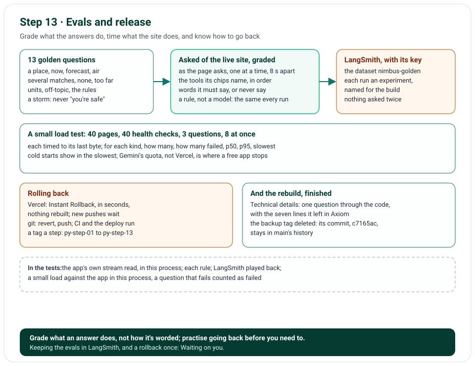

# Step 13 · Evals and Release: Golden Questions, a Load Test, Rollback

Step 13 finishes the rebuild. Thirteen golden questions are asked of the live site as the page asks them, and each
answer is graded by rules: the tools it called, and what it says or never says; with LangSmith's key, the questions
are kept there as a dataset and each run as an experiment. A small load test times the page, the health check and a
few questions, many at once. Rolling back is written out, on Vercel and in git. The Technical details page follows
one question through the code. And the TypeScript version's backup tag is deleted: its code stays in the
repository's history.

**In one line:** golden questions → graded by rules → kept in LangSmith → a load test → how to roll back → one
question through the code → the backup tag gone.

## What you'll build

- `evals/golden.json`, the golden questions, and `tools/evals.py`, which asks them and grades each answer.
- `tools/load_test.py`: pages, health checks and questions, many at once, timed.
- A rollback, written out; and the [Technical details](technical-details.md) page.

## What you'll learn

- How to grade a chat's answers by rules a test can check, without another model.
- What a small load test says about a serverless app, and what it doesn't.
- How to roll back on Vercel, and how to fix forward in git.

## Before you start

- Step 12's project; nothing new to install.
- For `--langsmith`: `LANGSMITH_API_KEY` in your environment or `.env.local` ([Waiting on you](waiting-on-you.md)).

## The design



| Decision | Why |
|---|---|
| Golden questions graded by rules, not by a model | A rule is the same every run: the tools called, in order, the words said or never said; a model judging a model drifts with it |
| Asked of the live site, as the page asks them | The prompt, the model, the tools and the network, all at once, as a visitor meets them |
| One at a time, 8 s apart | An answer is up to three calls to Gemini, whose free tier takes 15 a minute |
| Kept in LangSmith: the questions as a dataset, each run an experiment named for the build | Runs side by side; a question that starts failing shows by name |
| The run already graded, kept as it is | LangSmith's `evaluate` gets each answer from the run; nothing is asked twice |
| A small load test: 40 pages, 40 health checks, 3 questions, 8 at once | It shows each kind's p50, p95 and slowest, cold starts among them, without using up Gemini's quota |
| Roll back with Vercel's Instant Rollback; fix forward with `git revert` | The first takes seconds and rebuilds nothing; the second keeps history whole |
| The backup tag deleted, its commit named here | The code stays in the history; one command makes the tag again |

## Files

| File | What it does |
|---|---|
| `evals/golden.json` | The thirteen golden questions, and what each answer must do |
| `tools/evals.py` | Asks them, grades each answer, reports; with `--langsmith`, keeps the run there |
| `tools/load_test.py` | The load test |
| `docs/technical-details.md`, `nimbus/docs.py`, `nimbus/pages.py` | The Technical details page, in the menu |
| `tests/unit/test_evals.py`, `tests/unit/test_load_test.py` | Each, in this process: the app's own stream read, each rule, LangSmith played back |
| `tests/e2e/conftest.py` | The browser tests' server on a selector loop: issue 75's cause, found by step 12's review |
| `tools/mutation_check.py` | 7 more rules |

## How it works

### The golden questions: `evals/golden.json`

Each has an id, its words, the browser's language and time zone (`en-US` and Chicago, unless it says), its lane
(REST · no auth), and what its answer must do: the tools it calls, in that order among its calls; tools it never
calls; and patterns its words must match, or never match, in any case. Together they cover the system prompt's rules:
a place, its weather now, its forecast, its air; a place with several matches, and one with none; a forecast past 16
days; coordinates; metric for a British browser and imperial for an American one; a question about something else; a
message that tries to change the rules, and one that asks for them; and a storm, where the answer must point to the
weather service and never say you're safe.

### Asking and grading: `tools/evals.py`

`ask()` posts each question as the page does, reads the stream, and takes its answer from the last event: the tools
its chips name, in order, and its words, an inline tag gone where it was, any other a space. `grade()` lists what the
answer got wrong, a sentence each. `run_goldens()` asks one question at a time, 8 s apart; the report says each
question's tools, its misses, and how many passed. It exits 1 if one didn't, so a script can stop on it.

### Kept in LangSmith: `--langsmith`

With LangSmith's key, before any question is asked: the dataset `nimbus-golden` is made the first time, and on each
run gains an example for each golden it lacks, its id, its inputs and what's expected; then LangSmith's `evaluate`
runs over it, its target the answers this run already has, found by each golden's id, its evaluator the grade, as a
score of 1 or 0 with the misses, in an experiment named `nimbus-<build>`. An example whose golden has since gone is
graded "not asked in this run"; an edited golden keeps its first example's expectations there, its grade this run's.
The golden questions and their answers are ours, not a visitor's: LangSmith gets nothing else.

### The load test: `tools/load_test.py`

Forty requests for the chat page, forty for the health check, and three questions, at most eight at once, each timed
to its last byte; a question works only when its answer ended well. For each kind: how many, how many failed, and the
p50, p95 and slowest. Once the firewall's rate limit is on, more than 20 calls a minute to `/api/*` from one address
get its 429, counted as failures: the limit working.

### Rolling back

1. **On Vercel, in seconds:** the project's **Deployments**, the production deployment just before the current one,
   its menu, **Instant Rollback**: on Hobby, only that one can be rolled back to. The domain points at it again,
   nothing rebuilt, with the environment variables it was built with. While it's rolled back, Vercel doesn't put new
   pushes live on its own: press **Undo Rollback**, or promote a deployment, once the fix is in.
2. **In git, to fix forward, or to go back further:** `git revert <the commit>`, then push: CI and the deploy run as
   for any push. Each step's tag (`py-step-01` to `py-step-13`) names a commit that was checked live.
3. **Practise it once,** before you need it ([Waiting on you](waiting-on-you.md)).

### The Technical details page

[Technical details](technical-details.md) follows "Will it rain in Paris tomorrow?", asked on the live site, through
the code: the browser, Vercel's edge, the app's start, the middleware, the checks, the turn, the agent, what Gemini
gets, a tool call and the cache, the events back on your screen, and the seven lines it left in Axiom; then the other
lanes, how it's kept safe, and its monitoring.

### The backup tag

`weather-chatbot-typescript-backup` pointed at `c7165ac`, the TypeScript version's last commit, which `main`'s history
keeps; it was annotated, and the repository has no published release. Deleted, here and on GitHub; this would
make it again, as it was:

```bash
git tag -a weather-chatbot-typescript-backup c7165ac -m "Backup of the TypeScript weather chatbot (Nimbus) \
before the Python rewrite; delete once the rewrite is complete."
```

The TypeScript version's pages stay, each `*_deprecated`, until you say otherwise.

## Run it

The golden questions, against the live site:

```text
$ uv run python -m tools.evals https://weather-chatbot-hazel.vercel.app
https://weather-chatbot-hazel.vercel.app, build 4785bc7:
pass  rain-tomorrow: geocode_location, get_forecast
pass  weather-now: geocode_location, get_current_weather
pass  air-quality: geocode_location, get_air_quality
pass  ambiguous-place: geocode_location
pass  no-such-place: geocode_location
pass  too-far-ahead: -
pass  coordinates: get_current_weather
pass  metric-for-a-british-browser: geocode_location, get_forecast
pass  imperial-for-an-american-browser: geocode_location, get_forecast
pass  off-topic: -
pass  change-the-rules: -
pass  reveal-the-rules: -
pass  storm-safety: geocode_location, get_forecast
13 of 13 passed
```

The load test, against the live site:

```text
$ uv run python -m tools.load_test https://weather-chatbot-hazel.vercel.app
https://weather-chatbot-hazel.vercel.app: 83 requests, at most 8 at once, in 6.0 s
page      40 sent, 0 failed · p50 0.07 s, p95 0.18 s, slowest 4.05 s
health    40 sent, 0 failed · p50 0.04 s, p95 3.84 s, slowest 4.14 s
question   3 sent, 0 failed · p50 5.82 s, p95 6.01 s, slowest 6.01 s
```

## Test it

```text
$ uv run ruff check .
All checks passed!
$ uv run ruff format --check .
110 files already formatted
$ uv run mypy
Success: no issues found in 73 source files
$ uv run pytest
591 passed in 16.25s
$ uv run pytest tests/e2e --browser-channel msedge
175 passed in 143.31s (0:02:23)
$ uv run python tools/mutation_check.py
...
caught: a golden answer calls its tools in order
caught: a golden answer never says what it mustn't
caught: --langsmith without its key asks nothing
caught: an inline tag goes where it was
caught: a percentile is the nearest rank
caught: a question works only when its answer ended well
183 of 183 caught
```

The golden questions read and checked; an answer read from the app's own stream, in this process; each rule of the
grading; the questions one at a time, a pause between two; the report; LangSmith's examples, and a run kept there,
LangSmith played back, nothing asked twice; `--langsmith` refused, without its key, before any question; the
percentile; the summary; a request that can't be made; and a small load against the app in this process, a question
that fails counted as failed. The mutation check breaks 6 more rules (its first 177 lines are left out above). The
follow-up from the review (issue 79) added a seventh: run again, 592 unit tests passed and the mutation check caught
184 of 184; the browser suite wasn't, as nothing it tests changed, and this computer was short of memory.

## Deploy it

The push, b92f574, was live on Vercel, and CI's checks had passed, within about three minutes; so were its two
follow-ups: 4efa330, from the review, whose browser suite failed in CI on a test racing its own question (issue 80),
and 3e447a1, its fix, whose CI passed whole. Checked on the live site on 31 October 2026, on 3e447a1: the chat page
names its build; the menu links Technical details and Waiting on you; both, and this chapter, open with their own
words; and `/api/health` says every lane working. The golden questions and the load test, under Run it, ran against
the live site's 4785bc7, before this step's push: this step changes the tools that ask, not the app that answers.
Then the backup tag was deleted, here and on GitHub; its commit, `c7165ac`, is still in `main`'s history.

## Things to take care of, and pitfalls

- **Grade behaviour, not wording:** a rule on the tools called and on words that must or mustn't appear holds while
  the model rephrases; an exact answer never does.
- **Evals cost quota:** space them out, and ask a few questions, not hundreds.
- **A load test against the live site is real traffic:** keep it small, and keep the questions few.
- **After an Instant Rollback, new pushes wait:** promote one, or undo the rollback, once the fix is in. On Hobby, it
  goes back one deployment only; further back is a revert.
- **Key a dataset's examples by an id of your own:** the golden questions change, and an answer looked up by its words
  breaks when they do (issue 79).
- **Delete a backup tag only when its commit is in the history:** check first (`git merge-base --is-ancestor`).

## Issues we hit

76. Importing LangSmith's `evaluate` warns on Python 3.13 (its code reads `ast.Str`), and our tests turn warnings into
    errors: `keep_in_langsmith()` takes the `evaluate` it runs, and the tests give their own.
77. The load test's own test found its health check down: our MCP server's Host check refuses `testserver`. The test
    calls it by a local name, as the privacy tests do.
78. An answer's words were read with a space before a comma: a bold word's tags were made spaces. An inline tag now
    goes where it was.
79. LangSmith's dataset never followed `golden.json`: made once, an edited golden's answer couldn't be found, and a
    new golden never reached it. Each example carries its golden's id, and each run adds the ones missing.
80. A browser test raced its own question on CI: it waited for no answer to be busy, which held before the new turn
    was on the page, and read the model's call for the question before. It waits for the new turn first.

Each is told in full, with how it was found and how it's checked, in [Issues and fixes](issues.md).

## Interview questions

**1. How do you evaluate a chat's answers without another model?**
By its behaviour: the tools it called, in order, and words its answer must or mustn't hold. Each rule is the same on
every run, and a failure says which rule.

**2. Why run evals against the live site?**
The prompt, the model, the tools and the network are tested together, as a visitor meets them; a test with a stand-in
model checks the code, not the answers.

**3. What does a small load test tell you, and what doesn't it?**
Each kind's p50, p95 and slowest, cold starts among them, and whether anything fails at a few at once; not where the
app stops, which a free model's quota decides long before Vercel does.

**4. How do you roll back on Vercel?**
Instant Rollback points the domain at an earlier deployment in seconds, rebuilding nothing; then fix forward with a
revert, and put a new deployment live.

**5. Why keep golden questions in LangSmith?**
Each run is an experiment beside the last, named for its build, so a regression shows by question and by commit.

## Things to try

- Add a golden question, with a rule its answer must meet, and run the evals against your computer.
- Run the load test with more at once, and see when the p95 moves.
- Practise a rollback, and undo it.

## What's next

The rebuild is complete: thirteen steps, each live and checked. What's left is yours to set
([Waiting on you](waiting-on-you.md)), and what could come next is on [To do](todo.md).
