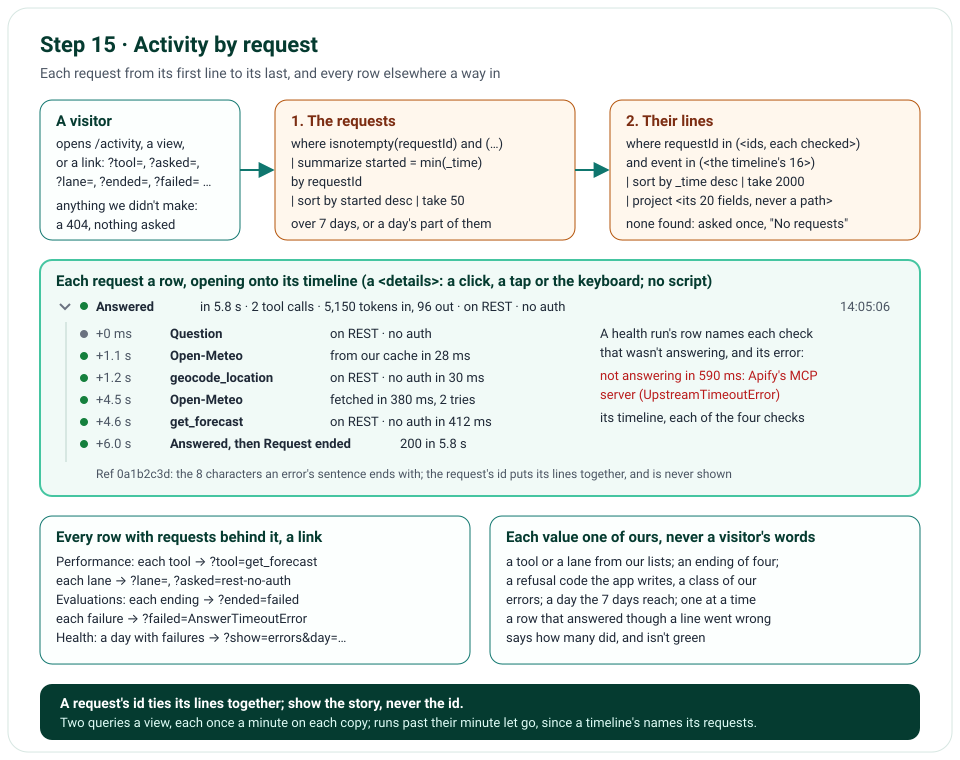

# Step 15 · Activity by Request, and Rows That Lead to It

Step 15 tells each request's story. Step 14's Activity showed the latest 50 lines, each on its own: a question here,
a tool call there, an answer further up, and nothing to say which went with which. Now each row is one request, a
question, a health run or a call to our MCP server, saying what it was and how it ended; open it, and it shows every
line of its own a timeline shows, from its first to its last, each with its time since the first. The request's id
puts its lines together and is never shown; only its ref is, the 8 characters an error's sentence ends with. And the
other Observability pages lead to it: each tool, lane, ending, reason and day is a link to the requests behind it,
and each golden question opens onto the tools it called.

**In one line:** a view or a link of ours → the requests its lines pick → every line of theirs a timeline shows →
one row a request, opening onto its timeline → every row elsewhere a way in.

## What you'll build

- Activity by request: Questions, Errors and Health, each the latest 50 requests, each a row that opens onto its
  timeline; a health run's row names the checks that weren't answering, and an answer that came despite a line that
  went wrong says how many did.
- Links into it: Performance's tools and lanes, Evaluations' endings, refusals, failures and fallbacks, Health's days;
  each narrows Activity to the questions behind it, and says so.
- The golden questions' results, each opening onto the tools it called.

## What you'll learn

- How to put a request's log lines back together by its id, without ever showing the id.
- How to let a link narrow a query while nothing a visitor types reaches it, or costs a query.
- How to make a row open and close with no script of your own, for a mouse, a finger or a keyboard.

## Before you start

- Step 14's project, with Axiom's query token set ([Waiting on you](waiting-on-you.md), part 6); nothing new to
  install. Without the token, Activity says it can't read Axiom yet, as every Observability page does.

## The design



| Decision | Why |
|---|---|
| Two queries a view: the latest 50 requests its lines pick, by their ids; then every line of theirs | A view picks a request by one line (its question, a failure, a health run's end); its timeline is every line of its own, which the first query can't hold |
| The requests found by `summarize started = min(_time) by requestId`, the latest first, a line with no id left out | Step 14's operators, with `min()` of a time and `isnotempty()`, both in Axiom's APL; one row a request, whatever its lines |
| Each id checked against the request id's own pattern before it goes into the second query | The ids come back from Axiom; one that isn't an id never reaches a query's quotes |
| The id read to put lines together; only its ref shown | A visitor who gets "(ref 33a7af21)" can find their request; nobody learns another's id |
| A timeline names its 20 fields: never a path, a host, a question's length or a deployment | Step 14's rule: a field a later step adds can't reach a public page by accident |
| A row is a `<details>`, its timeline inside it, its arrow drawn | It opens with a click, a tap or the keyboard, and screen readers announce it, with no script; the Content Security Policy is unchanged |
| A link's value is one of ours: a tool, a lane, one of four endings, a refusal code the app writes, a class of our errors; one narrowing at a time, a day beside it; anything else a 404 | Nothing a visitor types reaches a query or a page; a made-up link costs nothing, where any word of a safe pattern would cost a query each |
| Each link picks what its row counted: questions asked on a lane, or whose tools ran on it; refusals, failures and fallbacks each by their own event | A row's link should lead to the questions its number counts, not more |
| A row whose end went well, though a line on the way didn't, says how many didn't, and isn't green | Errors picks a request by any line that went wrong; its row should say why it's there |
| A day with failures links to its errors | A busy day's runs pass the 50 shown; its failures shouldn't be under the runs that passed |
| At the cap of 2,000 lines, the oldest request found is left out, and the page says so | That request may have lost its first lines; a row that starts halfway would say the wrong thing |
| A day narrows the query's time range, not its words | The range is the query API's own `startTime` and `endTime`, which step 14 already sends |
| Runs past their minute are let go before a new one is kept; each query named by its view, its narrowing and its day | A timeline's query names its requests, so it changes every minute; and one narrowing's failure mustn't seem new when another answers (issue 84) |
| Health runs have their own view | Every page's dots and every uptime ping add one, and would bury the questions (issue 87) |

## Files

| File | What it does |
|---|---|
| `nimbus/observability.py` | The views and the links; the two queries; a day's range; runs let go; each line in words; the requests put together, each with its row and its timeline; every bar's link |
| `nimbus/constants.py` | 50 requests a view, 2,000 lines at most |
| `templates/activity.html` | The views, what a link narrowed it to, each request a `<details>` row with its timeline and its ref, and what wasn't shown |
| `templates/observability_parts.html` | A bar with requests behind it is a link |
| `templates/evaluations.html` | Each golden question's result opens onto its tools |
| `templates/performance.html`, `templates/health.html` | Their headers say which rows link |
| `public/static/app.css` | The rows, the drawn arrow, the timeline, at a computer's width and a phone's |
| `tests/unit/test_observability.py`, `tests/fakes.py` | Six requests played back: each row and timeline, each view, each link, each day, each 404, the cap, runs let go |
| `tests/e2e/test_site.py` | A link from Performance, a row opened, the way back; a link's page with axe and at a phone's width |
| `tools/mutation_check.py` | 22 more rules, and step 14's five that moved |

## How it works

### The views and the links: `nimbus/observability.py` ①

`ACTIVITY_VIEWS` holds each view's lines: a question's first line, `chat.request`, or `chat.rejected`, written before
a question is taken; any line that went wrong, as step 14's errors filter; a health run's last line, `health.done`.
`NARROWINGS` holds each link's: `?tool=get_forecast`, a `tool.call` of that tool; `?asked=rest-no-auth`, a question
asked on it; `?lane=rest-no-auth`, a tool call run on it, which on a lane with auth the three tools other than the
forecast always are; `?ended=failed`, a `chat.failed`; `?refused=question_too_long`, a refusal for that code;
`?failed=AnswerTimeoutError`, a failure with that class; `?fellback=AuthError`, a fallback after it. Each value is
checked against a list of ours: our tools, our lanes, the four endings, `REFUSAL_CODES` (each `InputError` the app
raises, which a test reads from the code), and `ERROR_CLASSES` (every class under `NimbusError`). Two narrowings at
once, or one with another view, is a 404; `to_day()` takes `?day=2026-11-02` only when the 7 days before now reach it.

The two queries:

| Query | APL |
|---|---|
| The requests | `where isnotempty(requestId) and (<the view's or the link's lines>) \| summarize started = min(_time) by requestId \| sort by started desc \| take 50` |
| Their lines | `where requestId in (<each id found>) and event in (<the timeline's 16>) \| sort by _time desc \| take 2000 \| project _time, requestId, event, level, status, ms, lane′, tool′, check′, upstream′, errorClass′, causeClass′, code′, attempts′, toolCalls′, tokensIn′, tokensOut′, fromLane′, toLane′, fellBack′` |

A timeline's 16 events are the question's five, a tool call, a fallback, a call our MCP server answered, a lane's
connection, each call out's answer, from our cache or fetched, Open-Meteo's and Apify's alike, Apify's MCP calls, a
cache failure, a health run's checks and its end, and the request's own `http.request`, written last. `requestId`
joins the fields every request's line has, read as it is. The second query takes the latest 2,000 lines, so a cap
reached cuts into the oldest requests, never the ones shown first; each request's lines are put back in the order
they were written.

### A day, and runs let go ②

`to_window()` gives a query its time: the 7 days before now, or a day's part of them, so a day 7 days back starts at
now less 7 days, and today ends now. A day's run is kept under its query and its day: the words are the same each
day. `ask()` lets go of every run past its minute before it looks for one: Activity's second query names its
requests, so each minute brings a new one, and a copy that kept them all would grow for as long as it lives.

### Each line in words, each request put together ④

`to_activity_line()` says each line in words, as step 14's did, and now the timeline's new ones too: "Open-Meteo from
our cache in 28 ms", "Open-Meteo fetched in 380 ms, 2 tries", "Apify's MCP server connected in 900 ms", "Our MCP
server get_forecast in 430 ms", "Apify's MCP server check not answering: UpstreamTimeoutError, after 590 ms",
"Request ended 200 in 5.8 s". A fallback written with too little time left, `fellBack` false, is "Couldn't fall
back": the forecast failed instead. `to_request_ids()` keeps the ids the first query found, each once, each of the
request id's own pattern. `to_activity_requests()` gathers each request's lines, puts them in the order they were
written, times each from the first, gives the request its row through `to_summary()`, and lists the requests the
latest begun first: a health run by how it ended and each check that wasn't answering; a question by how it ended
and the lane it was asked on; a call to our MCP server by its tool; else the request's own end. `with_problems()`
adds, to a row whose end went well, how many lines didn't, and makes it a warning. A request none of whose lines a
timeline shows is left out. `to_days()` groups the requests by the day they began, in UTC.

On the MCP lanes, a tool runs in our MCP server's own request, with an id of its own: the question's timeline shows
the tool call, and the server's request, a row of its own, its fetches. Joining the two is on [To do](todo.md).

### Every row a way in ⑤

A `Bar` now has an `href`, from `to_narrowed_href()`, which links a value of ours and nothing else.
`to_tool_bars()` links each tool to `?tool=` and each lane to `?lane=`; Performance's questions on each lane, to
`?asked=`; `to_endings()` each ending to `?ended=`; `to_reasons()` each refusal, failure or fallback to its own
narrowing, and "none given" to nothing; Health's days, to that day's runs, or, on a day with failures, to its
errors. The breakdown's label is then a link, which the meter beside it still names.

### The page ⑥

`activity_page()` checks the view, the link and the day before anything is asked; asks for the requests, over the
day's range if there is one, under a name of the view's, its narrowing's and the day's; then, if any were found, for
their lines; at the cap, leaves out the oldest request found; and renders them. The views keep a day; a link says
what it narrowed the list to, with "Show them all", and, finding nothing, "None like these". When 50 were found, or
the cap was reached, the page says older ones aren't shown. Each request is a `<details>` row: its dot, what it was,
how it ended and when; open, its timeline, each line with its time since the first, and its ref. The arrow is drawn by
CSS and turns when the row is open, on Evaluations' rows too; on a phone, each line's words go under its name.

## Run it

On a computer with no query token, Activity says so and isn't kept; a link of ours answers, and one we didn't make is
a 404 (the tests show it asks nothing):

```text
$ curl -s -o /dev/null -w "%{http_code} %header{cache-control}\n" http://127.0.0.1:8000/activity
200 no-store
$ curl -s http://127.0.0.1:8000/activity | grep -o "read Axiom yet[^<]*"
read Axiom yet: it needs a token that can query its dataset. The token's steps are on
$ curl -s -o /dev/null -w "%{http_code}\n" "http://127.0.0.1:8000/activity?tool=get_forecast"
200
$ curl -s -o /dev/null -w "%{http_code}\n" "http://127.0.0.1:8000/activity?show=health&day=2026-11-02"
200
$ curl -s -o /dev/null -w "%{http_code}\n" "http://127.0.0.1:8000/activity?tool=get_tides"
404
$ curl -s -o /dev/null -w "%{http_code}\n" "http://127.0.0.1:8000/activity?show=health&tool=get_forecast"
404
$ curl -s -o /dev/null -w "%{http_code}\n" "http://127.0.0.1:8000/activity?day=2020-01-01"
404
```

## Test it

```text
$ uv run ruff check .
All checks passed!
$ uv run mypy
Success: no issues found in 79 source files
```

The unit and browser tests ran in CI on the push, below under Deploy it. Six requests played back, as Axiom would
answer: a question answered through the cache and a fetch, one failed on MCP · no auth, one that fell back from REST
· with auth, a health run with Apify's MCP server down, a refusal and a stop; an id with no lines, and one that isn't
an id. Each request's row and its timeline, in order, each line timed from the first; never the id, only its ref;
never a field the query doesn't name. Each view's where clause and tab; each link's where clause and words; a day's
range, and its views keeping it; each address we don't make a 404 with nothing asked; the cap; a timeline Axiom
couldn't answer; runs let go after their minute; each query's name; every bar's link, and none for a value that isn't
ours; the refusal codes read from the code. In the browser: a link from Performance, a row opened onto its timeline,
the way back, and a day's link; a link's page with axe and at a phone's width. The mutation check has 22 more rules;
the step's first 15 were each caught before the reviews.

## Deploy it

The push, 0479637, was live on Vercel within about a minute; CI's unit tests failed on it: Performance's questions on
each lane linked to `?lane=` (the questions whose tools ran there), not `?asked=`. 731f95c fixed it, and CI's checks
passed: Ruff, mypy, the unit tests, the browser tests, and the audit. The unit tests, run here: `750 passed in
12.95s`. Checked on the live site, https://weather-chatbot-hazel.vercel.app, on 2 November 2026 at about 20:05 UTC
(0479637) and 20:10 UTC (731f95c):

- Activity, its Errors and Health views, Performance, Evaluations and Health each answered `200`, kept a minute by
  the CDN, with no Axiom notice: both of Activity's queries ran against the live dataset. Activity showed 50 requests
  with 303 timeline lines, Health's view 50 runs with 450, and "The latest 50; older ones aren't shown". A question's
  timeline read "+0 ms Question on REST · no auth", "+1.2 s Open-Meteo fetched in 423 ms", "+1.3 s geocode_location
  on REST · no auth in 481 ms", through "+3.8 s Request ended 200 in 3.8 s", and "Ref 1f96c633".
- Each link landed on its row's own number: `?asked=mcp-no-auth` 9 questions, as Performance's MCP · no auth 9;
  `?failed=AnswerTimeoutError` 12 and `?failed=UpstreamTimeoutError` 1, as Evaluations' failures;
  `?refused=form_unreadable` 4; Health's Sunday 1 November, its 2 runs. Health's days with failures linked to their
  errors. `?refused=CallUsAt5551234`, `?tool=get_tides` and `?day=2020-01-01` answered `404`.
- Issue 95's answer: of this app's failed health runs in Errors, all 23 named the same check, "Our MCP server
  (McpLaneError)"; the 11 that name no check are the TypeScript app's, of 30 October. The two opened, at 20:04 UTC,
  just after 0479637 went live, failed that check after 139 and 344 ms while the other three worked.
- One page fetched just after a deploy was the CDN's copy from the build before, for up to its minute.

## Things to take care of, and pitfalls

- **An id that ties lines together needn't be shown:** read it to group, and show a short ref a visitor already has.
- **Anything that came back from a query is input too:** check an id before it goes into the next query's quotes.
- **A pattern that keeps a value inside its quotes still lets each new word cost a query:** take values from your
  own lists.
- **A count's link should pick what the count counted:** the same event, the same field.
- **A cache keyed by a query that names its data grows:** let old entries go, or every new minute is a new key.
- **A `<summary>` laid out as a grid, or with its marker hidden, shows no arrow:** draw your own.

## Issues we hit

96. In a health run's timeline, "Open-Meteo working in 420 ms", the check, sat under "Open-Meteo fetched in 400 ms",
    the call it made, and read the same. A check's line now says it's a check.
97. While building: a timeline's query names its requests, so the minute's memo would have kept a new query every
    minute on each copy, for as long as it lived. Runs past their minute are let go.
98. Both reviewers: `?reason=` took any word of a safe pattern, which reached the query and the page, each new word
    a query of its own. A link's values are now ours only.
99. Both reviewers: a reason's link brought in refusals, failures and fallbacks alike, and a lane's both the questions
    asked on it and those whose tools ran there. Each link now picks what its row counted.
100. Both reviewers: a row in Errors could be a green "Answered", and a call to our MCP server a bare "Request". A row
     now says how many lines went wrong, and a call to our server names its tool.
101. Both reviewers: at the cap, the oldest request kept could start halfway. It's left out, and the page says older
     ones aren't shown.
102. Both reviewers: a Health day's link opened its runs, passed and failed alike, 50 at most. A day with failures
     opens its errors.
103. Reviewer A: a forecast that had too little time to fall back still wrote its fallback line, which read "Fell
     back". It reads "Couldn't fall back".
104. Both reviewers: on the MCP lanes, a question's timeline holds the tool call but not its fetches, which are in
     our MCP server's own request. Not fixed: on [To do](todo.md).

Each is told in full, with how it was found and how it's checked, in [Issues and fixes](issues.md).

## Interview questions

**1. How do you show one request's story from logs written line by line?**
Give every line the request's id when it's written, then ask for the requests a view picks by that id, and for every
line of theirs, in the order they were written; group them by the id, and time each from the first.

**2. A request's id is the key that groups its lines. Why not show it?**
The page is public: a short ref, the one an error's message already gives the visitor, finds their request, and
nobody learns another's whole id.

**3. How do you let a link narrow a query without letting a visitor write it?**
Take only values from your own lists: a pattern that keeps a value inside its quotes still lets every new word cost a
query, and puts it on the page. One narrowing at a time; anything else a 404 before anything is asked. And check what
came back from the first query before it goes into the second.

**4. Why use a `<details>` element for an expanding row rather than a script?**
It opens with a click, a tap or the keyboard, screen readers announce it as open or closed, it works with no script
under a strict Content Security Policy, and the server renders it once for every visitor.

**5. What goes wrong when a cache is keyed by a query that names its data?**
Each new set of data is a new key, so the cache grows without end; let entries past their time go before adding one.

## Things to try

- Open Performance, follow `get_forecast`, open a question on REST · no auth, and find its forecast's fetch in its
  timeline.
- Open Health, follow a day that had a failure: its errors, its failed health runs among them, each naming the check
  that wasn't answering.
- Try `/activity?refused=anything`: a 404, and nothing asked of Axiom.

## What's next

What could come next is on [To do](todo.md), and what's yours to set is on [Waiting on you](waiting-on-you.md).
