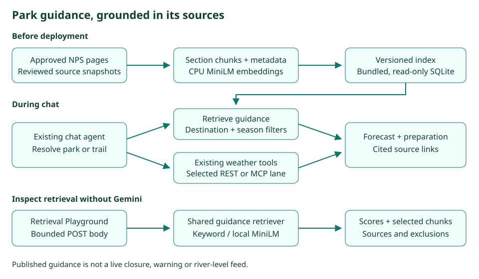

# Step 16 · Park Guidance with Retrieved Sources

Step 16 adds reviewed National Park Service preparation guidance for Zion, Grand Canyon and Yosemite, including
selected trails. The agent resolves an explicit destination, retrieves applicable passages and combines them with
weather when requested. Source cards and the Knowledge pages expose the evidence and retrieval decisions.
This implementation is local and uncommitted; production release remains pending.

**In one line:** resolve the complete place name → retrieve scoped guidance and optional weather → cite the evidence.

## What you'll build

- A versioned read-only SQLite collection with attributed source passages and optional stored embeddings.
- Destination and seasonal constraints, keyword retrieval and optional local CPU MiniLM semantic retrieval.
- Shared park tools, source cards, source/vector browsers and a protected Retrieval Playground.
- Failure visibility, citation restrictions, health coverage and independently graded retrieval and answer checks.

## What you'll learn

- Why applicability metadata must be reviewed separately from relevance scores and document names.
- How deployment profiles, native inference and missing weights affect a local-versus-hosted design.
- How to inspect actual ranking decisions and test failures without depending on a language model.
- Why citation presence, evidence retrieval and answer faithfulness are different measurements.

## Before you start

Use Python 3.13 and the committed lockfile. `uv sync --locked` installs the normal development environment; add
`--group ml` for local semantic inference or offline embedding generation. Production installation uses
`uv sync --locked --no-dev` and excludes the optional ML group. No embedding API key is needed. Chat answers still
need Gemini's configured key. Download model weights through the offline builder before enabling local inference.

## The design



| Decision | Why |
|---|---|
| Reviewed sources, exact destination IDs and explicit section-season metadata | A similarly named place or waterfall must not inherit another place's forecast or a seasonal restriction |
| Keyword retrieval by default on Vercel | The deployment omits the large ML stack and does not assume ignored weights exist |
| Optional local CPU MiniLM with pinned weights | Local semantic retrieval preserves the requested model and verifies model/dimension compatibility |
| One inference worker with no queued requests | Timed-out native work cannot consume the shared DNS executor or accumulate model-lock waiters |
| Bounded offline subprocess | The embedding/download deadline terminates and reaps the operation rather than only stopping its await |
| Questions in bounded POST bodies under `/api/` | Questions stay out of generated URLs and the planned edge rule covers execution |
| Shared retrieval with optional diagnostics | Playground scores and selected context cannot drift from chat search |
| Generated park links restricted to retrieved URLs | Source cards and answer links follow the same evidence boundary |
| Weather failures retain their class | Partial guidance remains visible while Activity and failure links still report the outage |

## Files

| File | What it does |
|---|---|
| `nimbus/parks.py` | Corpus validation, conservative destination resolution, scoped scoring and context selection |
| `nimbus/park_ingest.py`, `data/parks/manifest.json` | Explicit source/section review and season metadata |
| `nimbus/park_embeddings.py`, `tools/build_park_index.py` | Optional CPU inference, bounded indexing and publication |
| `nimbus/park_tools.py`, `nimbus/answer.py`, `nimbus/chat.py` | Agent composition, source artifacts, failure state and citation rendering |
| `nimbus/knowledge.py`, `nimbus/retrieval_gate.py` | Browsing, body-only retrieval requests and resource limits |
| `templates/knowledge_*.html`, `public/static/knowledge.css`, `public/static/retrieval.css` | Escaped, accessible server-rendered views |
| `nimbus/config.py`, `nimbus/app.py`, `pyproject.toml`, `uv.lock` | Hosted/local profiles and optional dependencies |
| `nimbus/health.py`, `nimbus/observability.py` | Index health, knowledge calls and weather setup failures |
| `tools/eval_parks.py`, `evals/parks.json`, `evals/golden.json` | Retrieval metrics and separate live-answer requirements |

## How it works

### `nimbus/park_ingest.py`

① Missing reviewed headings stop publication. ② Complete paragraphs and their qualifiers remain together.
`SourceSpec.section_seasons` explicitly marks seasonal sections; other sections inherit the source's reviewed
applicability. No season is inferred from a substring such as “Nevada Fall.” Publication validates all records and
atomically replaces the index. Source publication dates and fetch timestamps remain distinct.

### `tools/build_park_index.py`

The default build reads reviewed snapshots. `--refresh` downloads allowlisted NPS pages with a 15-second source
limit and requires review before publication. Embedding preparation reserves title/heading tokens and fits the
actual MiniLM tokenizer budget. A subprocess owns downloading, tokenizing and embedding, with a 60-second overall
limit; timeout or cancellation kills and reaps it. Unchanged content vectors can be reused. Failure leaves the
published index intact. `--lexical-only` builds without ML dependencies.

### `nimbus/parks.py`

Resolution matches reviewed aliases and rejects unknown geographic qualifiers. For example, Yellowstone's Grand
Canyon and Kanarra Creek narrows do not resolve to the covered Grand Canyon or Zion destinations. The resolver is
conservative and is not a global geographic search service; the agent should pass the complete place name.

Retrieval ① filters by destination and explicit season, ② scores keyword relevance and optional full-vector cosine
similarity, and ③ selects at most four passages within 10,000 text characters. Keyword scoring is BM25-style with
stop words and small concept expansions. The fusion formula is `keyword / (1 + keyword) + cosine`. Positive keyword
matches qualify; semantic-only matches require cosine of at least 0.65. Ties use chunk ID. SQLite persists the
records; candidate ranking is an exact in-memory scan, without an approximate-nearest-neighbor service.

`search(..., explain=True)` adds the same raw scores, ranks and exclusion decisions used by normal search.
A missing semantic score is distinct from zero similarity. The corpus and per-request diagnostics do not store
visitor conversations or query history.

### `nimbus/park_embeddings.py`

`SentenceTransformer("all-MiniLM-L6-v2", device="cpu")` uses pinned weights and normalized 384-dimensional vectors.
Capability checks inspect dependencies and cached files without importing native ML. Runtime never downloads.
① A dedicated single-worker executor accepts no queued requests; a timed-out operation may finish, but subsequent
requests fall back immediately while it is busy. Completed query state is released. This bounds native work and
keeps it out of the default executor used by DNS. It does not claim to interrupt arbitrary native inference.

### `nimbus/config.py` and `pyproject.toml`

`PARKS_RETRIEVAL_MODE=auto` chooses keyword retrieval on Vercel. Locally it attaches semantic inference only when
dependencies, cache, model revision and dimensions agree. `lexical` forces keywords; `hybrid` explicitly opts into
a provisioned ML host. `PARKS_ENABLED=false` disables park tools and playground execution. Torch, Transformers,
SentenceTransformers and their supporting pins live in the optional `ml` group, not direct production dependencies.
`truststore` remains a legitimate transitive HTTP/TLS dependency.

### `nimbus/app.py`

② The app creates one shared knowledge service and one playground request gate. The existing weather lanes retain
their contracts. Source browsing remains available independently of Gemini; no index download, ingestion or model
load occurs while creating the service.

### `nimbus/park_tools.py`

① Validated destination/search operations run within their existing deadline. ② Returned passages retain source
URLs and dates in a separate artifact. `knowledge.call` logs contain tool names, outcomes, versions and timings,
never question text, query vectors or passage bodies. Missing guidance does not manufacture a live weather result.

### `nimbus/answer.py`

① A weather lane opens only if a weather tool is invoked; concurrent calls share its lifetime. A document-only
request does not connect to MCP. Setup failures retain their original Nimbus error class in per-turn state while
being returned to the model as a sanitized tool failure. The SDK context opens and closes in its owner task.
The final Markdown renderer removes unsupported park citation targets, preserving readable labels; explicitly
reviewed weather-authority links remain available for warning references. Raw HTML and unsafe protocols stay disabled.

### `nimbus/chat.py`

② Tool events collect source URLs from this turn's successful retrieval. ③ Completion renders citations against
that set. A retained weather-setup failure finishes through the existing failure branch with `chat.failed`, its
original class and a visible note, while preserving any supported guidance. It cannot be logged as `chat.done`.
The fixed park prompt extensions preserve instruction-injection rules and city-weather behavior in both feature modes.

### `nimbus/knowledge.py` and `nimbus/retrieval_gate.py`

`/knowledge/sources` and `/knowledge/chunks` inspect the public corpus without model inference. The PCA map uses
actual stored vectors, keeps its projection stable across filters and is not the retrieval algorithm.
`GET /knowledge/retrieval` displays an empty form; query-string submissions do not run retrieval.

① `POST /api/knowledge/retrieval` reads at most 16 KiB, rejects duplicate/unknown fields and foreign browser origins,
and validates the question, destination and date. ② The page calls the same shared search with diagnostics. The gate
permits twelve requests per minute per caller and two in flight per app instance, with bounded expiring bookkeeping.
The existing planned `/api/` edge rule additionally limits requests across serverless instances; verify it before
release. In-process limits alone are not a distributed firewall. Inputs/results are not persisted or cached.

Templates escape source and question text. Native forms and links need no JavaScript or inline styles. Semantic
capability failures are shown separately from transient startup/busy conditions; permanently missing weights do
not prompt a futile retry. The score table scrolls within its region on a phone.

### `nimbus/health.py` and `nimbus/observability.py`

Health includes a `park-index` check when parks are enabled. An invalid index makes overall health fail while
working weather lanes retain their own statuses. The check loads no model and makes no extra network request.
Activity includes `knowledge.call` and `lane.open.failed`, and tool filters accept knowledge operations. MCP setup
failures appear through the existing Errors and `?failed=McpLaneError` views. Questions and evidence remain absent
from operational logs.

### `tools/eval_parks.py` and the evaluation records

The 41 retrieval cases include six paraphrases, name collisions, unsupported questions and dated Mist Trail safety
checks. A source and its labeled evidence must appear in the same scoped passage. Reports include evidence recall@4,
top-1 evidence and MRR@4; rank-sensitive cases can require an earlier result. Small candidate sets remain weak tests
of ordering. These checks measure retrieval, not whether Gemini faithfully uses the evidence.

The original thirteen weather goldens remain, plus five park-answer scenarios. Three require official citations;
two check an unsupported geographic name and ambiguity. The answer evaluator preserves actual citation targets
and can require or restrict them. Live runs still need Gemini and a deployment/local instance of this code.

## Run it

```bash
uv sync --locked --group ml
uv run --group ml python -m tools.build_park_index
uv run --group ml uvicorn main:app --host 127.0.0.1 --port 8000 --no-access-log
```

Open `/knowledge/retrieval`, choose a destination and optionally a date, then submit a question. Results include
candidate scores, selected context, exclusions, timing and provenance. The native form submits to the API path
without putting the question in the address. Source refreshes and index writes remain separate operator actions.

## Test it

```bash
uv run ruff check .
uv run ruff format --check .
uv run mypy
uv run pytest
uv run pytest tests/e2e --browser-channel msedge
uv run python tools/mutation_check.py --hardening
uv run python -m tools.eval_parks --lexical-only
uv run --group ml python -m tools.eval_parks
```

Final local validation: 853 unit tests pass both with and without the optional ML group; 227 Edge browser tests
(including accessibility and phone layout) pass; all 270 mutations are caught, including 18 new hardening rules.
Ruff, formatting and strict mypy pass. The CPU index rebuild reproduces version `d93691d32a848853` with 40 chunks,
and genuine POST hybrid retrieval was checked for the Narrows, summer Mist Trail and Grand Canyon.

A clean production-only installation has no Torch, Transformers or SentenceTransformers and serves all Knowledge
pages and POST retrieval. Its Windows package directory measured 136.0 MB; this is not a Linux/Vercel function-bundle
measurement. `truststore` remains transitively required by the HTTP clients. Desktop, phone and diagram views were
inspected. Question-bearing GET submissions are rejected, and model/corpus data remain outside request URLs.

Both retrieval profiles pass 41 cases with recall@4 of 100% and top-1 evidence of 81.2%; MRR@4 is 0.893 for keywords
and 0.906 for local hybrid search. This small benchmark does not establish a broad semantic-search advantage.
The eighteen live-answer goldens were not run: Gemini credentials are absent. A Vercel preview and production
validation were not performed; no deployment is authorized. The preceding saved thirteen-case live run is retained
as historical evidence and does not validate Step 16.

## Deploy it

No production commit, push or deployment is authorized by this work. Before release, build a clean production-only
environment, inspect its dependency set and function artifact, verify the `/api/` firewall rule, and run all eighteen
answer goldens against this version with Gemini configured. Preserve the preceding index for rollback.

Vercel's standard Python function limit is 500 MB uncompressed. Eligible Fluid Compute projects can use the Large
Functions public beta up to 5 GB; do not assume that setting is enabled. The default hosted profile avoids the ML
stack either way. A host explicitly opting into hybrid retrieval must provision the pinned model cache and measure
its package size, memory and cold start. A local Windows install is not proof of a Linux/Vercel bundle size.

## Things to take care of, and pitfalls

- Published preparation advice does not establish current closures, warnings, water availability or river conditions.
- A forecast reference does not represent every elevation or the upstream watershed; never infer that a trip is safe.
- A heading can contain a place name such as Nevada Fall; applicability must come from reviewed metadata.
- Changing the embedding model requires compatible document and query vectors and a rebuilt index.
- Citation-target validation cannot establish that every generated claim is supported; live answer review is separate.
- A timed-out native request may finish; resource bounds prevent queued work rather than promising native cancellation.

## Issues we hit

The review found deployment-weight assumptions, missing MCP failure visibility, a waterfall/season collision,
question URLs, over-permissive aliases, prompt-only citation targets and weak test assertions. Issues 111–118 in
[Issues and fixes](issues.md) record their fixes and checks. The original dependency advisories, tokenizer budget,
source-review findings and browser-stream timing issue remain recorded there as issues 105–110.

## Interview questions

**Why filter by destination before ranking passages?** Because semantically similar advice can describe a different
trail. Identity and applicability are constraints, while relevance determines which applicable passages to return.

**Does RAG require a vector database?** No. Retrieval can use keywords, embeddings or both. This small collection uses
a versioned SQLite artifact and an in-memory ranking step; its text and provenance remain the evidence.

**Why keep document retrieval separate from weather APIs?** Weather tools supply current conditions and forecasts.
Published guides supply preparation advice. Combining them must not turn a document into a claim about live status.

**What does the offline evaluation prove?** That retrieval finds labeled evidence for the correct destination and
abstains on the selected unsupported cases. It does not prove a language model faithfully uses that evidence.

**How do you keep a retrieval playground faithful to production search?** Add optional diagnostics to the shared
retriever, rather than duplicating its ranking algorithm in the page. Report the actual scores and selection limits,
and distinguish unavailable semantic scores from zero similarity. Tests compare explained and normal search results
on the same corpus, including keyword fallback, scoped candidates and context-budget exclusions.

## Things to try

- Compare keyword and local hybrid scores for the same question without calling Gemini.
- Ask about Mist Trail spray with spring and summer dates and inspect the safety passage.
- Try Yellowstone's Grand Canyon and Kanarra Creek narrows; no covered park should be substituted.
- Inspect the difference between a below-threshold candidate, the four-result limit and the context-character budget.
- Disable parks or use a missing index and inspect explicit UI and health states.

## What's next

Review corpus changes before publication and expand the benchmark before adding more destinations. A production
preview and live Gemini/citation evaluation remain required. Live alerts and river-level services are separate
future tools, rather than claims derived from stored documents.
