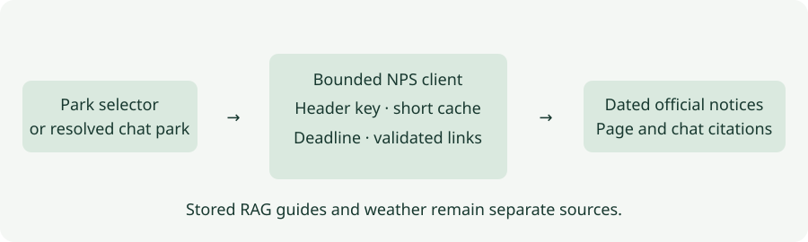

# Step 17 · Official Park Notices

Official NPS notices complement the stored preparation guides for Zion, Grand Canyon and Yosemite. The chat can
check notices without opening a weather connection; a separate Park alerts page works without Gemini. Results show
their source, fetch time and completeness. Nothing in this feature determines whether a trip is safe.

**In one line:** select or resolve a supported park → check official NPS notices → show attributed, dated results.

## What you'll build

- A fixed-origin NPS client with server-side authentication, deadlines, validation and short public-result caches.
- One shared `get_park_alerts` tool, available beside the park tools in each of the four weather lanes.
- An App → Park alerts page, with explicit empty, missing-configuration, incomplete and unavailable states.

## What you'll learn

- Why published preparation guidance and recently fetched notices need distinct provenance and freshness labels.
- How to bound external responses and model context separately, and preserve exact citation boundaries.
- How to build and test a keyed API integration using synthetic recordings without a real credential.

## Before you start

Use the existing locked development environment. No package or embedding model is added. Put `NPS_API_KEY` only in
ignored `.env.local`; keep `.env.example` blank. Settings reads it as a `SecretStr`. Restart the local server after
changing it. No NPS key is required to run mock tests; the app displays missing configuration honestly without one.
Gemini's key is still required for generated chat answers, while the standalone notices page needs no Gemini key.

## The design



| Decision | Why |
|---|---|
| Fixed NPS HTTPS origin and three reviewed park codes | No user URL, question or secret enters upstream query parameters |
| `X-Api-Key` header, never browser configuration | The credential stays on the server |
| Six-second deadline, three pages of 50, one MB per response | Slow or unusually large responses remain bounded |
| Five-minute complete-result cache; one-minute incomplete/failure cache | Reduce quota use without silently serving expired notices |
| Coalesce concurrent checks per park | Many visitors do not trigger duplicate requests during a cold fetch |
| Bounded POST under `/api/` with origin and application limits | Execution fits the API firewall scope and rejects unbounded form input |
| Up to eight notices and 12,000 serialized notice characters in model context | A large public report cannot consume an unbounded prompt |
| Validated NPS links and exact returned citation URLs | Generated answers cannot invent park evidence links |

Caches and request limits are per app instance; they are not a deployment-wide quota. NPS describes a default
1,000-request hourly limit. Its API can lag the website by about two hours; recently fetched does not mean real time.
See the [NPS guides](https://www.nps.gov/subjects/developer/guides.htm) and
[NPS FAQ](https://www.nps.gov/subjects/developer/faqs.htm).

## Files

| File | What it does |
|---|---|
| `nimbus/nps_alerts.py` | Validates, fetches, caches and logs public reports without credentials or notice text |
| `nimbus/alerts_page.py` | Validates the selector POST and renders the independent page |
| `nimbus/forms.py`, `nimbus/utils.py` | Shared bounded form reading and pure origin, field and canonical URL validation |
| `nimbus/park_tools.py` | Gives the agent bounded notice context and a separate public artifact |
| `nimbus/answer.py`, `nimbus/chat.py`, `nimbus/chips.py` | Composes tools, retains artifacts and enforces citation boundaries |
| `nimbus/prompts.py` | Distinguishes forecasts, preparation guides and notices; preserves instruction guards |
| `templates/park_alerts.html`, `templates/nps_alert_parts.html`, `public/static/alerts.css` | Escaped accessible notice cards |
| `nimbus/config.py`, `nimbus/app.py`, `nimbus/pages.py`, `nimbus/observability.py` | Configuration, lifecycle, navigation and Activity visibility |
| `tests/unit/test_nps_*.py`, `tests/e2e/test_nps_alerts.py`, `tools/mutation_check.py` | Mocked API, integration, accessibility and mutation checks |

## How it works

### `nimbus/nps_alerts.py`

① Reuse an unexpired public report and preserve its original fetch time. Share an in-flight request for the same
park. ② Authenticate to a fixed HTTPS endpoint without redirects. Validate the response size, total, offset, park
code and notice category. ③ Empty means a complete successful check returned zero records. A failed check cannot
become an empty success. A malformed record is omitted without discarding valid same-park notices; omissions and
later-page failures leave an explicitly incomplete report. Failed and incomplete reports expire after 60 seconds.
Every executed check logs only caller name, park ID, status, elapsed time, count, cache/completeness flags and a
fixed failure-reason code. Network failures, authentication failures and invalid responses are distinct.

### `nimbus/alerts_page.py`

① Validate same-origin form input, one supported park and at most 1,024 body bytes before reserving request capacity.
② Render public reports with `no-store`, using the canonical navigation path even after POST. GET only displays
the selector; it does not spend NPS quota or log a chat-tool call, even when no key is configured. The existing
request gate permits 12 checks per caller per minute and two active checks per instance. Rate-limit refusals retain
the selector and return readable HTML with HTTP 429 and Retry-After. `PARKS_ENABLED=false` disables execution and
chat park tools. Page checks log under `park_alerts`; chat checks log under `get_park_alerts`.

### `nimbus/forms.py` and `nimbus/utils.py`

The form reader shares origin, content-type, byte and field checks between notices and the Retrieval Playground.
Pure validation lives in `utils.py`; request streaming stays in `forms.py`. One HTTPS NPS URL policy rejects
credentials, foreign hosts, nonstandard ports and query strings, preserves valid fragments, and normalizes Unicode,
spaces, host case and port 443 to match Markdown citation targets.
Offline ingestion also uses this policy, then enforces its reviewed `www.nps.gov` document identity without fragments.

### `nimbus/park_tools.py`

③ `alerts_context` bounds notice text separately from the full report. It labels truncated text and omitted records
with `context_limited`. The artifact keeps full public notices for inspection and only the model-exposed URLs for
answer citations. API completeness and model-context completeness remain separate concepts.

### Chat, templates and monitoring

`answer.py` composes the same notice tool in every weather lane. `chat.py` adds its exact exposed sources to the
existing citation allowlist. `chips.py` distinguishes unavailable checks from completed notice results. Templates
escape titles and descriptions, show fetch time, and label `lastIndexedDate` as indexing time with no supplied time
zone. Unsafe or missing links fall back to the known official park homepage. `observability.py` includes the
`nps.alerts` event in Activity and Errors; no private query or wire authentication is rendered.

## Run it

```bash
uv run uvicorn main:app --host 127.0.0.1 --port 8000
```

Open `/parks/alerts`, select a park and choose Check alerts. In chat try “Check official notices for Zion” or
“Give me weather, preparation guidance and current notices for Yosemite.” A future visit still gets only notices
available now; the app cannot predict a future closure. Notices are not embedded or added to the SQLite corpus.

## Test it

```bash
uv run pytest tests/unit/test_nps_alerts.py tests/unit/test_nps_integration.py tests/unit/test_nps_review.py
uv run pytest tests/e2e/test_nps_alerts.py --browser-channel msedge
uv run python tools/mutation_check.py --nps
uv run ruff check .
uv run ruff format --check .
uv run mypy
uv run pytest
```

Mock responses cover authentication, unsupported parks, malformed data, unsafe links, empty results, pagination,
timeouts, cache expiry, request coalescing, model-context limits and all four lanes. Browser checks cover successful,
empty and failed reports at phone width, with axe. These checks do not establish live Gemini instruction adherence.

Local validation on 3 November 2026:

| Check | Result |
|---|---|
| Complete unit suite | 925 passed |
| Complete Edge browser suite, including accessibility and phone checks | 235 passed |
| NPS and shared-validation mutations with focused service and integration guards | 38 of 38 caught |
| Ruff lint, formatting and strict mypy | Passed |
| Real NPS requests and rendered local pages | All three supported parks returned notices |

Live Gemini answer checks were not part of this recorded validation run. The local API checks also verified blank
example configuration, ignored local credentials and credential-free public HTML.

## Deploy it

Configure `NPS_API_KEY` as a server-side secret in each intended Vercel environment, as described on
[Waiting on you](waiting-on-you.md#3-vercels-environment-variables), then verify its `/api/` firewall
limit. No new runtime dependency or native ML bundle is needed. Validate a preview before production and run the
existing live-answer goldens plus attributed notice scenarios. Never publish the key in `.env.example`.

## Things to take care of, and pitfalls

An absent notice does not establish that a trail is open. A park-level notice does not close every trail. Indexing
time is not publication, closure start or expiry. The API may lag the official website; check that website and
follow on-site instructions. Short caches reduce calls, but multiple serverless instances still share NPS quota.

## Issues we hit

The key was initially placed in the tracked example file. It was moved into ignored `.env.local` before feature
application, and the template was restored to a blank variable. Mock tests and output checks exclude credentials.
See [Issues and fixes](issues.md), issue 119.

## Interview questions

**Why fetch park notices separately from RAG guidance?** Preparation guides are reviewed reference material; notices
can change independently. Separate fetching and provenance avoid treating an old passage as current operating status.

**Why distinguish no notices from an unavailable check?** An empty successful response describes what NPS returned.
A failed or incomplete check cannot establish that no notices exist, and neither result establishes safety.

**Why cap model context separately from API results?** Public inspection can show the bounded full report while the
model receives a smaller labeled subset. Citation validation must allow only URLs actually included in that subset.

## Things to try

Remove the local NPS key and restart to inspect missing configuration. Run mocked outage and oversized-response
tests without a real key. Compare notice fetch times with NPS indexing timestamps, keeping their meanings separate.

## What's next

Validate a preview before production, monitor quota, and consider shared public caching if usage grows.
