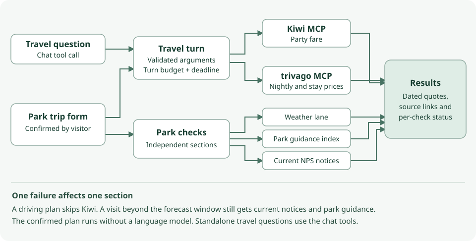

# Step 18 · Flights, Hotels and National Park Trips

A visitor planning a trip to Zion, Grand Canyon or Yosemite can compare current flights and hotels alongside the
park forecast, preparation guidance and official notices. A confirmed form runs the plan. A visitor who only
wants a flight or a hotel can ask chat directly.

**In one line:** confirm the dates, party and route → run eligible checks together → compare sourced results.

## What you'll build

- Two optional travel tools for the existing chat, backed by Kiwi and trivago over MCP.
- One trip form reachable from the navigation or a park-planning question in chat.
- Five result sections with independent outcomes, source links and price units.

## What you'll learn

- How to consume narrow operations from an external MCP server using the SDK already in the weather application.
- Why a flight's total for a party and a hotel's total for a stay require separate price labels.
- How to test the model's decision to call a tool separately from a provider's ability to return inventory.

## Before you start

Use the project's locked Python environment. In ignored `.env.local`, set `FLIGHTS_ENABLED=true` for Kiwi,
`HOTELS_ENABLED=true` for trivago, or both. Restart Nimbus after changing settings. Both default to false.
The planner also requires `PARKS_ENABLED=true`. The two external MCP services accepted searches without a key in
the recorded checks. Gemini is used for model-led chat. The confirmed planner itself can run without Gemini.
Configure the existing park index and `NPS_API_KEY` for guidance and current notices.

## The design



| Decision | Why |
|---|---|
| Confirm itinerary fields in an editable form | Airport choice, dates, occupants and children's ages affect quotes |
| Search for lodging around the park | The selected airport can be hours from the park entrance |
| Inject one adapter per enabled provider | Chat and planner use the same fields, error handling and source checks |
| Isolate search sessions and cap each response at one MiB | Bound resource use and keep cookies and credentials separate |
| One shared cutoff for the five checks | A slow integration costs at most the remaining budget for that plan |
| Render typed offers and validated links | A provider's prose cannot add a tool, change the endpoint or set a price |
| Keep lookup budgets per turn and concurrency per app instance | Suppress duplicate work without sharing private searches across visitors |

The services can throttle callers. Nimbus's local limits describe this app. Neither a daily free allocation nor a
service-level guarantee was established by the live checks.
[Kiwi connector](https://www.kiwi.com/stories/kiwi-mcp-connector/) · [trivago MCP documentation](https://mcp.trivago.com/docs)

## Files

| File | Role |
|---|---|
| `nimbus/travel/models.py` | Typed input, limits, money, quotes and explicit result states |
| `nimbus/travel/mcp_client.py` | Fixed endpoints, allowed operations, bounded streams and timed discovery |
| `nimbus/travel/providers.py` | Price and URL validation, deduplication and finite result sets |
| `nimbus/travel/kiwi.py` | Kiwi itinerary request and response translation |
| `nimbus/travel/trivago.py` | Location/coordinate search, occupancy and hotel-deal translation |
| `nimbus/travel/service.py`, `tools.py` | Shared lookup budget, privacy-safe telemetry and chat declarations |
| `nimbus/travel/planner_intake.py`, `planner_page.py` | Recognize a park-planning question, show and validate trip intake |
| `nimbus/travel/planner.py` | Run the five checks and select forecast days and guidance for the visit |
| `templates/planner_form.html`, `park_trip.html`, `travel_parts.html` | Shared form, report and quote cards |
| `evals/travel.json`, `tools/eval_travel.py` | Predeclared tool, routing, citation and price expectations |

## How it works

### `planner_intake.py` and `planner_page.py`

Intake ① uses the same destination resolver as park guidance. For an unsupported rim or ambiguous park, the
visitor chooses a supported destination explicitly. Declining an itinerary keeps the question in ordinary chat.
Intake ② prefills explicit trip details and leaves uncertain travel preferences for the visitor to choose.
Room counts apply only when lodging is enabled. A flying
visitor also confirms the departure point and gateway. Submitting the form sends a bounded, origin-checked POST
to `/api/parks/trip`. Page ① validates the inputs before invoking a provider. Page ② starts one bounded turn.

### `planner.py`

The planner starts its five checks at ①–②. Driving skips flights. Lodging is searched near the park, and
weather comes from the selected weather lane at the park's labeled reference point. Forecasts cover only
available visit dates inside the 16-day forecast window. Matched preparation passages link to NPS sources.
The notice section checks current NPS notices, even for a future trip. A failed section keeps its own reason.

### `models.py`, `service.py` and `tools.py`

The agent gets local `search_flights` and `search_hotels` declarations for the enabled providers.
Models validate dates, occupancy and budget units. Service ① shares duplicate lookups in the same turn.
At ② a fresh lookup claims a slot and a turn allowance. Each provider allows two distinct searches per turn
and two concurrent requests per instance. At ③ telemetry records the provider, status, count and duration.

### `mcp_client.py` and `providers.py`

Transport ① creates a fresh HTTP client. Transport ② negotiates the protocol with the SDK. Requests may call
only the reviewed search operations on each fixed HTTPS endpoint. Health checks discover capabilities without
sending an itinerary. Transport ③ propagates cancellation and maps errors to public reason
codes. A search has up to 14 seconds including setup, subject to the turn's remaining time.

### `kiwi.py` and `trivago.py`

Kiwi ① translates the dates, route, passengers and optional stop or party-price limit. Each accepted result
identifies its actual airports, local times and stops. A party fare requires matching adult, child and infant
counts in Kiwi’s response. A contradictory count invalidates the quote. With missing counts, an unpriced route
can appear as partial, unless the visitor set a budget requiring a verified fare.
Airport codes are checked in both directions. NYC, LON and WAS support their metro airports.
[Kiwi routes](https://www.kiwi.com/en/cheap-flights/london-united-kingdom/new-york-city-new-york-united-states/) ·
[IATA location codes](https://www.iata.org/en/iata-repository/pressroom/fact-sheets/fact-sheet-iata-location-codes/)

Trivago ① sends a named destination
or park coordinates, occupancy and any nightly budget. It chooses a comparable deal for each hotel and preserves
the returned nightly and stay prices. Both adapters keep up to five distinct offers. Invalid rows can yield a
partial report. Link targets must match the provider-specific HTTPS allowlist.

## Run it

```bash
uv run uvicorn main:app --host 127.0.0.1 --port 8000
```

Open [/parks/trip](/parks/trip), or ask “Help me plan a trip to Zion National Park.” Choose future dates,
confirm the party, and select flying or driving. To try a single provider in chat, ask for flights with airports,
dates and traveler counts, or hotels with destination, check-in, check-out and occupancy.

## Test it

```bash
uv run pytest tests/unit -k "travel or planner"
uv run pytest tests/e2e/test_travel.py --browser-channel msedge
uv run python tools/mutation_check.py --travel
uv run python -m tools.eval_travel http://127.0.0.1:8000 --repeats 3
```

Unit tests use sanitized fixtures and exercise normalization, source links, response bounds, budgets and failure
isolation. Browser tests exercise the rendered flow. The last command is a separate, live chat evaluation. Set up
Gemini and enable the two providers on the target first. The runner retains each attempt and distinguishes
model or provider timeouts, throttling, empty inventory, missed tools and incorrect routing. It checks each
travel call against the expected trip and ties quoted amounts to the returned offer, currency and price basis.
Rendered paragraphs and list items keep their price qualifiers and property headings. Unresolved price wording
is flagged for review. This English-language grader covers the synthetic scenarios.

In local live provider checks on 6 November 2026, the actual adapters searched a synthetic round trip from ORD
to LAS for two adults and hotels near Zion for 27–30 November. Kiwi returned five priced offers with five
validated links in 7.49 seconds. Trivago returned five priced stays with five validated links in 3.61 seconds.
Those figures describe one concurrent run. A separate local planner POST using the live services returned HTTP
200 in 2.75 seconds, with five flights, one hotel, three forecast days, three cited park-preparation passages
for a hiking trip and current notices. These are observed runs. Availability, prices and latency change.

A later local review on the same date exercised the five fixes against Gemini. In the first travel batch,
19 of 30 attempts passed, eight quotes needed review and three out-of-range trips called a weather tool.
After the forecast instructions and list grading changed, all 30 attempts used the expected tools and arguments.
Twenty-one passed automatically. Nine needed quote review. The quoted hotel amounts matched their returned
properties and the flight amounts matched the returned fares in all nine. The automatic scores were retained.
With the final quote-format checks, the five affected scenarios ran three more times each. Twelve passed
automatically. All three Denver hotel responses for the trip beyond the forecast horizon remained in quote
review. The final offline checks passed 1,127 unit tests, 241 browser tests and 25 travel mutations. The park
retrieval suite passed all 41 cases in each of the lexical and hybrid profiles.

The existing 18-question suite passed 15 cases on the updated local app. The three misses were an unnecessary
geocoding call beyond the forecast horizon, disallowed wording in the instruction-disclosure test, and looking
up guidance for two parks before the undecided visitor chose one. This is local evidence for the working tree.

## Deploy it

The live Gemini and provider results above came from the local working tree. On the intended preview, enable
the providers, verify the
`/api/` firewall limit, inspect the enabled providers on Health, and submit one flying and one driving plan.
Check that a disabled provider is skipped, prices have units, and an unavailable section preserves its neighbors.
Run the repeated chat evaluation against that preview and record every attempt with the tested commit and
deployment ID before promoting it. See [Waiting on you](waiting-on-you.md).

## Things to take care of, and pitfalls

Prices are search-time quotes. Follow the displayed provider link to check current availability, taxes, baggage
and booking terms. Search has no booking or payment operation. The forecast reference point may differ from a
trail's elevation. Recheck official notices near the visit. A successful empty notice check cannot establish
that a park is safe or open.

## Issues we hit

The servers used an initialization handshake supported by the SDK's legacy mode. Trivago also returned
provider-authored instructions alongside its inventory. The client negotiates the supported protocol and each
adapter selects only the fields it needs. Tests cover MCP structured content, JSON text content and malformed
or unexpected data. See [Issues and fixes](issues.md).

## Interview questions

**Why confirm the gateway airport?** Flying into a gateway and staying near a park are different decisions.
The traveler confirms both endpoints before Nimbus searches fares. Lodging uses the park location.

**Why render the five sections independently?** An upstream timeout answers only whether that check finished.
A flight timeout can coexist with a useful forecast, hotel quote, preparation passage or official notice.

**How do you evaluate an answer when inventory changes?** Check the requested tool, routing, source link and
price against the offers returned in that attempt. Record throttling, timeouts and empty inventory separately.

## Things to try

Submit the same future trip first as a driver and then as a flyer. Compare the dates in the forecast with the
date the current notices were checked. In a local fixture test, replace a deal link with a lookalike host and
verify that the unsafe target is removed.

## What's next

Collect repeated runs on the target preview and review the separate failure categories before enabling travel
on a public deployment.
