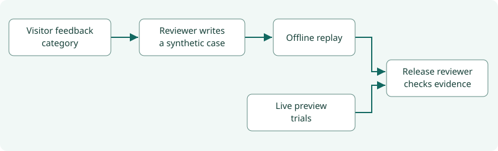

# Step 19 · The Evaluation Harness

A visitor reports a wrong return time. A reviewer writes a synthetic example with the expected Sunday deadline.
Replay now checks that deadline every time the project changes. A separate live run measures whether a preview
calls the right tools when the model and providers are actually involved.

The quick demonstration starts in **Run it** below.

## What you'll build

- A repeatable replay command, an opt-in live runner and an evidence check for a release reviewer.
- A scorecard under **Observability → Evaluations**, with failures tied to case IDs and individual attempts.
- A category-only feedback form and a maintainer command that adds reviewed intake cases to the replay suite.

## What you'll learn

How to distinguish a wrong date from a timeout, use one visitor signal to create a durable test, and tell
whether evidence applies to the exact build under review.

## Before you start

From the weather-chatbot directory run `uv sync --locked`. Replay uses the bundled SQLite index, fixed clocks,
synthetic questions and provider fixtures. The local demonstration works without provider credentials.
For network-backed chat trials, configure a dedicated preview using [Waiting on you](waiting-on-you.md).

## The design



| Decision | Why |
|---|---|
| Freeze independent expected dates at 23:30 across four US time zones and all seven weekdays | A single Thursday run misses weekend choices and the point when the park’s local date changes |
| Hash the golden weather recording’s model inputs | A changed prompt or tool message forces a deliberate review before that recording can pass again |
| Keep curated examples, code graders and all live attempts | Reviewers can see which tool, evidence or trip field failed, even when another attempt passes |
| Keep chat content out of feedback | A visitor can flag an answer with a category. An answer reference connects it to existing request metadata |
| Bind the release check to fresh preview evidence | A green local replay and an unrelated deployment cannot qualify a release |

## Files

| File or directory | Role |
|---|---|
| `tools/harness.py` | Runs the suites, writes scorecards atomically and checks release evidence |
| `tools/harness_replay.py`, `tools/harness_recordings.py` | Grade the intake matrix, model transcript, official conditions, provider responses and adversarial inputs |
| `tools/harness_live.py` | Adapts the golden, travel and lexical park graders to one attempt format |
| `tools/harness_review.py`, `evals/harness/regressions/` | Validate and promote human-written intake cases with explicit expected fields |
| `nimbus/feedback.py`, `nimbus/observability.py` | Accept a visitor-selected category and show feedback and evidence in Nimbus |
| `nimbus/harness_scorecard.py`, `templates/harness_scorecard.html` | Validate attempt records, recompute statistics and render the scorecard |
| `tests/unit/test_harness_feedback.py`, `tests/e2e/test_feedback.py` | Check the review workflow, consent, payload, rate limit and retry behavior |

## How it works

### Replay and live evaluation

The matrix sends each phrasing through the app’s destination and date parser, then compares named fields against
the expected park, dates and travel windows. A separate recorded Zion briefing exercises the actual forecast,
NPS and NWS adapters. The replay clock fixes the time of the question. Durations measure local execution time.

Red-team cases feed a deliberately planted instruction to the hotel adapter, attempt a link carrying chat content,
inject instructions into the locale and request excessive tool calls in a model turn. Each checks the actual
adapter, renderer or agent boundary. The model transcript covers a recorded conversation and uses synthetic data.

The live runner sends public, synthetic cases to one Nimbus origin. The golden grader checks required tools
and wording. The travel grader also checks itinerary arguments, links and prices against the returned offers.
Provider statuses distinguish empty inventory, partial results and outages. These graders cover their declared
expectations. General numerical entailment, helpfulness and tone need other evidence. Token usage is unavailable
from the public chat stream. The scorecard leaves it unmeasured.

### Feedback and reviewed cases

Visitors open **Give feedback**, choose a category and decide whether to submit it. Public Activity receives
the category and an answer reference. The reference on the corresponding chat timeline helps a reviewer investigate.
The app accepts two bounded form fields and rate-limits submissions. A signal warrants investigation.
A reviewer supplies a fresh synthetic input, a fixed instant, a time zone and expected fields. The CLI adds a
new ID once. A second writer cannot overwrite that case. A failing case closes replay until the behavior or a
mistaken expectation is corrected through review. Promotion currently supports park intake regressions.

### `tools/harness.py` and the scorecard

Runner ① records the source and, for live trials, reads the target identity. At ② it builds the scorecard
and writes the complete report. Gate ③ replays the current checkout and compares the expected catalogs and
identities with the evidence submitted for release.

Each case has one row per attempt. First-try counts the cases that passed on attempt one. All-three counts cases
that passed each of the first three tries. Latency percentiles include failed attempts. Replay and live timings
appear separately. The page reads `last-replay.json` and `last-live.json` under `evals/harness/` and recomputes
their summaries from the rows. A CI artifact written to `harness-output/` stays with its workflow run.
To show that run in a local demo, put its validated report at the corresponding `last-*.json` path.

## Run it

### A three-minute demonstration

Before the demo, open a second terminal in this directory and start the app with
`uv run uvicorn main:app --host 127.0.0.1 --port 8000`.

1. **Replay.** Run `uv run python -m tools.harness run --mode replay`. Open
   [Evaluations](/evaluations) and expand **Explore the weekend matrix**. Compare Friday
   evening in Los Angeles with Saturday at Zion. The matrix grades intent and dates. The late-Friday recording
   separately checks which dates the weather and lodging use.
2. **Ask and flag.** In chat, ask “Plan a trip to Zion this weekend from DFW, back by 3pm Sunday.” The deadline
   is specific enough to use directly. If the weekend has started, choose dates first. Open **Give feedback** to
   see exactly what would be sent. With Axiom configured, submitted signals appear under **Activity → Feedback**
   after the next query refresh. Without it, the local app logs the category event.
3. **Make a test fail.** Use the PowerShell example below on a disposable checkout. It starts with a reviewed
   fixture, then changes the synthetic question to require a noon return. Its previous 15:00 expectation should
   fail with `return_window`. Update the expected value, preview again and then promote it. This deliberately
   mismatched label demonstrates the grader. For an app bug, keep the human-reviewed expectation and fix the code.

```powershell
New-Item -ItemType Directory -Force harness-output | Out-Null
$d = Get-Content -Raw evals/harness/regressions/zion-sunday-deadline.json | ConvertFrom-Json
$d.case.case_id = 'demo-sunday-noon'
$d.case.question = 'Plan a trip to Zion this weekend from DFW, back by noon Sunday.'
$f = Join-Path (Get-Location) 'harness-output/demo.json'
[IO.File]::WriteAllText($f, ($d | ConvertTo-Json -Depth 8))
uv run python -m tools.harness_review preview $f
$d.case.expected.return_window = 'by_noon'
[IO.File]::WriteAllText($f, ($d | ConvertTo-Json -Depth 8))
uv run python -m tools.harness_review preview $f
uv run python -m tools.harness_review promote $f --synthetic
uv run python -m tools.harness run --mode replay
```

The promotion writes `evals/harness/regressions/demo-sunday-noon.json`. A maintainer reviews this file like
application code. For repeat demonstrations, start with a fresh disposable checkout.

## Test it

```sh
uv run pytest tests/unit -k harness
uv run pytest tests/e2e/test_feedback.py --browser-channel msedge
uv run python tools/mutation_check.py --harness
```

The feedback browser test checks the opt-in boundary, the exact payload and recovery from a failed request.
A unit test promotes a deliberately wrong deadline in a temporary directory and grades it against the real parser.
The harness mutations exercise the feedback allowlist, the reviewer’s expected fields, the required third trial
and full case coverage.

On 6 November 2026, all 446 offline cases passed on the local working tree. The first live smoke found Gemini
rejecting the flight tool declaration before any tool ran. The optional departure window had exposed an empty
string as an enum member. The corrected declaration keeps “Any time” available in the planner, and a permanent
provider replay checks the serialized Gemini declaration. On the fresh local server, three of three weather
answers and two of three hotel answers passed. Trivago returned inventory on all three calls. One hotel quote
required review, so the live result stayed red. All three attempts in a separate hotel-only rerun passed.
The earlier answer was not retained. Future reviews include the specific pricing check that needs attention,
without storing names, quotes or links. These runs used local Nimbus with real provider calls.

## Deploy it

CI runs replay when the app changes and saves its JSON artifact. The nightly live smoke requires the repository
variable `NIMBUS_HARNESS_PREVIEW_URL`. It defaults to three tries per case with 40 seconds between requests.
For a full run, dispatch the workflow at the candidate revision and supply the preview’s `release_deployment` ID.

To reproduce that check from a clean candidate checkout, set `$preview` to its immutable HTTPS origin and
`$deployment` to the expected Vercel ID. The commands below put evidence under the ignored output directory.

```powershell
$commit = git rev-parse HEAD
uv run python -m tools.harness run --mode replay --output harness-output/replay.json
uv run python -m tools.harness run --mode live --require-preview --base-url $preview --output harness-output/live.json
uv run python -m tools.harness gate --replay harness-output/replay.json --live harness-output/live.json `
  --commit $commit --deployment $deployment
```

The CLI gate compares the full catalogs, all outcomes, the clean source revision, at least three live trials,
the preview deployment ID and a 24-hour evidence window. The target serves its build identity at `/api/build`.
Passing this check makes the evidence available to a releaser. Hosted approval and control of the production domain
require the operator steps in [Waiting on you](waiting-on-you.md).

## Things to take care of, and pitfalls

- Keep release evidence in the trusted workflow that created it. A JSON report is inspectable and reproducible.
  A locally edited report does not prove that a CI runner contacted a preview.
- Vercel can rebuild when promoting a preview, with production settings. Record the resulting deployment ID and
  verify production health and a synthetic park trip before tagging. [Vercel promotion guide][vercel-promote]
- The park briefing checks conditions before offering quotes. A severe overlapping warning pauses those options.
  Direct flight and hotel chat requests have their own search behavior. A signed proposal protocol covering all
  outbound searches, and cryptographically signed browser chat history, remain future work.
- Feedback shares metadata. Moving visitors’ original questions, responses or traces into a review service
  would require separate consent, access controls and retention rules.

## Issues we hit

An optional deadline could be lost when the question was rephrased. Checking the normalized deadline, and then
running the Kiwi adapter with a recorded itinerary, separates those two failure points. An error appearing only
on try two still lowers the all-three score. A preview alias can move, so live trials check the answering
deployment as well as the identity before and after the run.

## Interview questions

**What does passing three times measure?** It measures consistency on the three recorded attempts for each case.
A first-try score can hide an intermittent missed tool call. Neither score predicts every visitor’s experience.

**Why write a synthetic regression?** A public category tells a reviewer where to investigate. A fresh example
can express the intended behavior precisely and travel with the code while the visitor’s words stay private.

**Why check a deployment ID as well as a commit?** Two deployments of one commit can have different settings.
Nimbus checks the answering preview during live trials and binds release evidence to that deployment.

## Things to try

Ask for “Yosmite next weekend” or “a weekend trip from Dallas,” then compare the diagnostic fields in a synthetic
review case. Try an intentionally overlong feedback form in the supplied negative tests and inspect the safe error.

## What's next

Collect full preview evidence, compare repeated misses with visitor categories, and extend the grader for a new
failure only after a reviewer can define a reproducible expected result.

[vercel-promote]: https://vercel.com/docs/deployments/promoting-a-deployment
