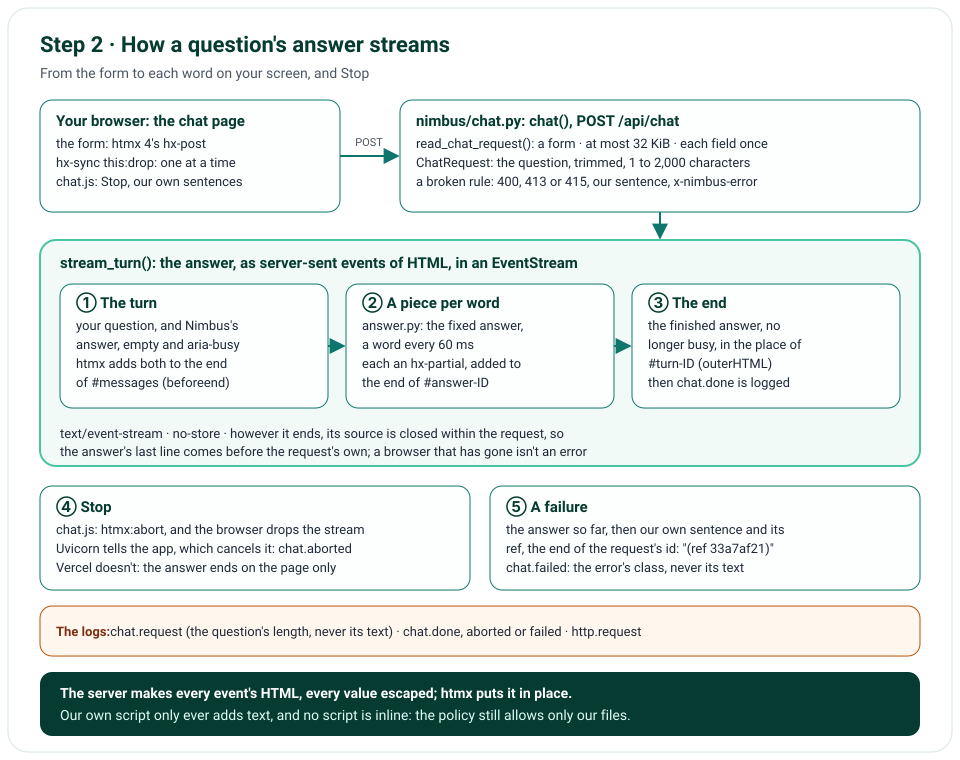

# Step 2 · The Chat Streams Its Answer

Step 2 makes the chat answer. The form posts your question to `POST /api/chat`, and the answer comes back as
server-sent events, each holding HTML that htmx puts into the page: first your question and Nimbus's answer, empty;
then the answer, a word at a time; then the finished answer. Stop ends it where it is, on the page and on the server.
A request that breaks a rule, and a failure, each get our own sentence, and nothing else ever reaches the page. The
answer is a fixed one for now, the same for every question: Gemini comes in step 3.

**In one line:** the form → htmx posts the question → `chat()` checks it → `stream_turn()` sends events of HTML →
htmx puts each one in place → the answer, a word at a time; Stop → the server hears the browser go → `chat.aborted`.

## What you'll build

- `POST /api/chat`: a question in; its answer out, as server-sent events of HTML, never cached.
- The checks on what the form sends, each broken rule with its own sentence and status: 400, 413 or 415.
- The chat's form, with htmx 4 and its stream extension: the answer arrives a word at a time.
- Stop, which ends an answer where it is, on the page and on the server.
- Our own sentence for everything that can go wrong: a failure (with a ref that finds its log lines), an answer cut
  off, a chat that can't be reached, and another service's error page, which is never shown.
- A log line for each answer: its question's length, never its text, and how it ended.

## What you'll learn

- Server-sent events: their format, and how to stream them from FastAPI with an async generator.
- htmx 4: posting a form, and putting each event of a stream into the page, `<hx-partial>` included.
- How a server hears that the browser has gone, and how to stop the work then.
- How to check a request at the edge: its type and its size before reading it, then its fields with Pydantic.
- How to show errors without leaking them, and how to tell your own error pages from anyone else's.
- How to keep an enforced Content Security Policy with scripts on the page: no inline code, and text only.
- How to test a stream: in memory, at the ASGI level, and in a real browser.

## Before you start

- Step 1's project. Step 2 adds no Python package: the form is read with the standard library, and htmx is two
  files in `public/static/`.
- `curl` to watch a stream arrive: on Windows it comes with the system; in PowerShell, type `curl.exe`.

## The design



| Decision | Why |
|---|---|
| Server-sent events, not WebSockets | The answer flows one way, from the server; SSE is plain HTTP, through Vercel's edge and any proxy, and ends when the answer ends |
| htmx 4, not htmx 2 | htmx 2's stream extension opens its own `EventSource`, which can only `GET`, so the question would ride in the address. htmx 4 streams the answer to the form's own `POST` |
| HTML in each event, made on the server | The page stays thin: htmx puts each event in place, Jinja2 escapes every value, and our own script never builds HTML |
| `<hx-partial>` for each word | An event names its own target, so each word goes to the end of its own answer, wherever that is on the page |
| A form, read with the standard library | It's what the page sends with no script of ours, and `urllib.parse` reads it: no new package |
| The size checked before the body is read | A body too large is refused from its declared length, before a byte of it is read |
| Our own error pages carry `x-nimbus-error` | The page shows only what we wrote: another service's error page becomes "The chat couldn't be reached" |
| A failure's sentence ends with a ref | The last 8 letters and digits of the request's id: short enough to read out, and it finds the request's log lines |
| `hx-sync="this:drop"` | One answer at a time: Enter while an answer streams sends nothing |
| htmx's two files in our own `public/static/` | The policy runs only our own files; a test checks they're npm's, byte for byte |

## Files

| File | What it does |
|---|---|
| `nimbus/chat.py` | `POST /api/chat`: the checks (`read_chat_request()`), and the stream (`stream_turn()`, `EventStream`) |
| `nimbus/answer.py` | The fixed answer, a word at a time |
| `nimbus/errors.py` | The app's own errors (`NimbusError`, `InputError`), and every sentence a visitor sees |
| `nimbus/constants.py` | The chat's limits and media types, added |
| `nimbus/utils.py` | `to_sse_message()`, `to_ref()`, `new_turn_id()` and `to_ms()`, added |
| `nimbus/middleware.py` | The request's id, now in its state too, for the ref |
| `nimbus/pages.py`, `nimbus/app.py` | The chat's page gets its sentences; the app gets the chat's route |
| `templates/chat.html` | The form, with htmx; the conversation, which holds the page's own sentences |
| `templates/chat_parts.html` | The messages, as macros the page and each event share |
| `templates/chat_turn.html`, `chat_piece.html`, `chat_end.html`, `chat_rejected.html` | Each event's HTML, and a rejected request's |
| `public/static/htmx.min.js`, `public/static/hx-sse.min.js` | htmx 4.0.0 and its stream extension: npm's files, unchanged |
| `public/static/chat.js` | Stop, and our own sentences when no answer can come from us |
| `public/static/app.css` | Your messages, an answer's note, an error's colours, and Stop |
| `tests/unit/test_chat.py`, `test_errors.py`, `test_static.py`, `tests/e2e/test_chat.py` | The new tests |
| `tools/mutation_check.py` | 22 more rules, each broken on purpose |

## How it works

Each section is one file; the circled numbers are the ones in its code.

### The form: `templates/chat.html`

The form is plain HTML with htmx's attributes. `hx-post` sends the question to `/api/chat` as a form;
`hx-target="#messages"` and `hx-swap="beforeend"` add what comes back to the end of the conversation; and
`hx-sync="this:drop"` drops a second question while an answer streams. The box takes at most 2,000 characters.
`method="post"` and `action="/api/chat"` are for a browser without htmx: it posts the form itself, so a question never
goes into the address, where history and logs would keep it (issue 28).

```html
<form id="chat-form" class="chat-input" method="post" action="/api/chat" hx-post="/api/chat"
  hx-target="#messages" hx-swap="beforeend" hx-sync="this:drop" aria-label="Ask about the weather">
```

Three scripts load, deferred, all from our own site: htmx, its stream extension, and our `chat.js`. A
`<meta name="htmx-config">` lets in only the `sse` extension, and turns off htmx's own indicator styles, which it
would add from a script, and its history handling, which the chat doesn't use. The conversation, `<ol id="messages">`,
is a polite live region, and the answer being written is marked `aria-busy`, so a screen reader can wait for the
finished answer; it also holds the three sentences the page shows by itself, in `data-*` attributes, so every
sentence is the server's.

### The checks: `nimbus/chat.py`, `read_chat_request()`

Before any work, the request must be the form the page sends (①): its type `application/x-www-form-urlencoded`
(else 415). Its body is read at most to 32 KiB (②): refused (413) from its declared `content-length` alone when
that's longer, before a byte is read, or, sent in chunks with no length, as soon as what's read passes 32 KiB; then
`urllib.parse.parse_qsl()` reads it as strict UTF-8, at most 10 fields, and each field must come once. Last (③),
Pydantic checks the fields: the question, trimmed, 1 to 2,000 characters, and no field we don't know.

```python
class ChatRequest(BaseModel):
    model_config = ConfigDict(frozen=True, extra="forbid")

    question: Annotated[str, StringConstraints(strip_whitespace=True, min_length=1, max_length=QUESTION_MAX_CHARS)]
```

`to_input_error()` turns Pydantic's account of a broken rule into one of ours: a field we don't know first (the
form can't be read), then too long a question, or none. The route (①) logs it as `chat.rejected`, with the rule's
code and the status, and answers with `chat_rejected.html`: Nimbus's message holding our sentence, marked with
`x-nimbus-error: 1`. A browser that goes while it's still sending its question gets `chat.aborted` and a 499, the
status nginx logs for it, which no one reads.

### The stream: `stream_turn()` and `EventStream`

`stream_turn()` is an async generator: each `yield` is one event, which `to_sse_message()` (`utils.py`) writes as
`data:` lines and a blank line. It sends the turn (①: your question, and Nimbus's answer, empty and marked
`aria-busy`); a piece per word (②), each an `<hx-partial>` that adds it to the end of that answer; and the end (③),
the finished answer in place of the busy one, then logs `chat.done` with the answer's length and the time it took.

```python
async for piece in stream_fixed_answer():
    pieces.append(piece)
    yield to_sse_message(render_part("chat_piece.html", {"turn_id": turn_id, "text": piece}))
```

When you press Stop, or close the page (④), the stream ends early. The server tells the app with an
`http.disconnect` message, and under ASGI 2.3, which Uvicorn speaks, Starlette listens for it while it streams, and
cancels the stream: `asyncio.CancelledError` lands in the generator, which logs `chat.aborted`. ASGI 2.4 adds a second
sign: a send to a closed connection raises `OSError`; relying on it, Starlette stops listening, and turns the failed
send into `ClientDisconnect`. A failure (⑤) logs `chat.failed` with the error's class, never its text, and sends the
answer so far with our own sentence and the request's ref.

The route makes the turn's first event itself (②), before the response starts: a generator closed before it has
started runs none of its code, so without it, a browser that left before the first event would leave no line saying
how the answer ended (issue 27). From then on, every end runs through `stream_turn()`'s own `except`.

```python
turn = stream_turn(chat_request.question, request.state.request_id)
first = await anext(turn)
return EventStream(first, turn)
```

`EventStream` is Starlette's `StreamingResponse` with three things more: the type `text/event-stream` and
`cache-control: no-store`; its source closed as soon as the response ends, however it ends, so the source logs how the
answer ended within its own request, before the request's own line, never later; and `ClientDisconnect` taken as the
browser leaving, not as an error.

### The events' HTML: `templates/chat_*.html`

`chat_parts.html` holds the messages as macros: yours, Nimbus's (busy, finished or failed), and one that's only an
error. Each event has its own small template: `chat_turn.html`, `chat_piece.html`, `chat_end.html`; and
`chat_rejected.html` answers a broken rule. Jinja2 escapes every value, so a question like `<script>` shows as text.

```html
<hx-partial hx-target="#answer-{{ turn_id }}" hx-swap="beforeend">{{ text }}</hx-partial>
```

### The fixed answer: `nimbus/answer.py`

`stream_fixed_answer()` yields the same answer for every question, a word at a time, the space before each word
included, after 60 ms each: long enough to watch it arrive and to press Stop. Step 3 puts Gemini's words in its place.

### The sentences: `nimbus/errors.py`

`NimbusError` carries a short code for the logs, the sentence the visitor sees, and the HTTP status; `InputError` is
the one for a broken rule. `to_user_message()` gives an error's own sentence, or, for an error the app doesn't expect,
the fixed "Something went wrong. Please try again." The error's own text, which can hold anything, never reaches the
page or the logs. The three sentences the page shows by itself are here too, and the chat's page hands them on.

### Our script: `public/static/chat.js`

It does what htmx doesn't, listening for htmx's events, and only ever puts text into the page (`textContent`):

1. **Stop** triggers `htmx:abort` on the form: htmx aborts the request.
2. When a question is sent, Send hides itself while the answer streams, so the focus goes to the box.
3. When the answer's first event is in the page, your question with it, the box is cleared for the next one; a
   rejected question stays in it, and so does one whose answer never began (issue 29).
4. Each event put into the page scrolls the newest message into view.
5. When the stream closes, an answer still busy never got its end: it was stopped, or cut off on the way. It gets
   "Stopped." or "The answer was cut off. Please try again." A stream that closed before its first event gets the
   cut-off sentence too.
6. A response that isn't ours, neither our stream nor marked `x-nimbus-error`, is never put into the page: "The chat
   couldn't be reached. Please try again." instead.
7. A request that fails outright, with no response, gets the same sentence, unless Stop came before the answer did.

### htmx's files: `public/static/htmx.min.js` and `public/static/hx-sse.min.js`

htmx 4.0.0, released on 28 August 2026, and its stream extension, copied unchanged from npm's package, whose
integrity hash matched the registry's; `test_static.py` holds each file's SHA-256, so a changed byte fails a test.
Vercel's CDN serves them, with `vercel.json`'s security headers.

## Run it

Start the app as in step 1 (`uv run uvicorn main:app --reload --no-access-log`), and open http://127.0.0.1:8000. Or
watch an answer arrive with `curl -N`, which prints each event as it comes
(43 of its 48 pieces and its five security headers left out, its last long line cut short):

```text
$ curl -N -i --data-urlencode "question=Will it rain in Paris tomorrow?" http://127.0.0.1:8000/api/chat
HTTP/1.1 200 OK
date: Sat, 31 Oct 2026 05:04:27 GMT
server: uvicorn
cache-control: no-store
content-type: text/event-stream; charset=utf-8
x-request-id: a205c8bed3d741ef
Transfer-Encoding: chunked

data: <li class="message message-user">
data:   <p class="message-meta"><span>You</span></p>
data:   <div class="bubble bubble-user"><p>Will it rain in Paris tomorrow?</p></div>
data: </li>
data: <li class="message message-bot" id="turn-a2a37815890d4359" aria-busy="true">
data:   <p class="message-meta"><span class="avatar" aria-hidden="true">N</span><span>Nimbus (Weather)</span></p>
data:   <div class="bubble bubble-bot">
data:     <p class="answer" id="answer-a2a37815890d4359"></p>
data:   </div>
data: </li>

data: <hx-partial hx-target="#answer-a2a37815890d4359" hx-swap="beforeend">Hi,</hx-partial>

data: <hx-partial hx-target="#answer-a2a37815890d4359" hx-swap="beforeend"> I&#39;m</hx-partial>

data: <hx-partial hx-target="#answer-a2a37815890d4359" hx-swap="beforeend"> Nimbus.</hx-partial>

data: <hx-partial hx-target="#answer-a2a37815890d4359" hx-swap="beforeend"> Weather</hx-partial>

data: <hx-partial hx-target="#answer-a2a37815890d4359" hx-swap="beforeend"> Stop.</hx-partial>

data: <hx-partial hx-target="#turn-a2a37815890d4359" hx-swap="outerHTML">
data: <li class="message message-bot" id="turn-a2a37815890d4359">
data:   <p class="message-meta"><span class="avatar" aria-hidden="true">N</span><span>Nimbus (Weather)</span></p>
data:   <div class="bubble bubble-bot">
data:     <p class="answer" id="answer-a2a37815890d4359">Hi, I&#39;m Nimbus. Weather answers come…</p>
data:   </div>
data: </li>
data: </hx-partial>
```

The events, as htmx gets them, each `data:` line a line of HTML. A question that breaks a rule gets our sentence:

```text
$ curl -i -d "question=" http://127.0.0.1:8000/api/chat
HTTP/1.1 400 Bad Request
date: Sat, 31 Oct 2026 05:04:31 GMT
server: uvicorn
x-nimbus-error: 1
content-length: 251
content-type: text/html; charset=utf-8
x-request-id: 24a7d21fc7bd4b6b

<li class="message message-bot message-error">
  <p class="message-meta"><span class="avatar" aria-hidden="true">N</span><span>Nimbus (Weather)</span></p>
  <div class="bubble bubble-bot"><p class="message-note">Please type a question.</p></div>
</li>
```

And the app's lines for the two, which hold the question's length, never its text:

```json
{"questionChars": 31, "event": "chat.request", "level": "info", "ts": "2026-10-31T05:04:27.889911Z", "env": "local",
 "commit": null, "deploymentId": null, "requestId": "a205c8bed3d741ef"}
{"answerChars": 244, "ms": 3271, "event": "chat.done", "level": "info", "ts": "2026-10-31T05:04:31.160844Z",
 "env": "local", "commit": null, "deploymentId": null, "requestId": "a205c8bed3d741ef"}
{"method": "POST", "path": "/api/chat", "status": 200, "ms": 3273, "event": "http.request", "level": "info",
 "ts": "2026-10-31T05:04:31.161492Z", "env": "local", "commit": null, "deploymentId": null,
 "requestId": "a205c8bed3d741ef"}
{"code": "question_empty", "status": 400, "event": "chat.rejected", "level": "info",
 "ts": "2026-10-31T05:04:31.195670Z", "env": "local", "commit": null, "deploymentId": null,
 "requestId": "24a7d21fc7bd4b6b"}
{"method": "POST", "path": "/api/chat", "status": 400, "ms": 2, "event": "http.request", "level": "info",
 "ts": "2026-10-31T05:04:31.197690Z", "env": "local", "commit": null, "deploymentId": null,
 "requestId": "24a7d21fc7bd4b6b"}
```

## Test it

```text
$ uv run ruff check .
All checks passed!
$ uv run ruff format --check .
57 files already formatted
$ uv run mypy
Success: no issues found in 33 source files
$ uv run pytest
193 passed in 1.19s
$ uv run pytest tests/e2e --browser-channel msedge
109 passed in 74.17s (0:01:14)
$ uv run python tools/mutation_check.py
...
caught: a question is at most 2,000 characters
caught: a body over 32 KiB is refused
caught: a body too large is refused from its declared length alone
caught: a body too large is refused as it's read
caught: a form with a field the chat doesn't know can't be read
caught: a browser gone while sending its question isn't an error
caught: an answer starts before its response
caught: each field of the form comes once
caught: a field the chat doesn't know is refused
caught: a question is never logged
caught: Stop is logged however the server reports it
caught: an answer's end is logged within its request
caught: a browser that has gone isn't an error
caught: a failure never shows its own text
caught: an answer's stream is never cached
caught: our own error pages are marked as ours
caught: any other error gets the fixed sentence
caught: an event's lines break where the browser's do
caught: a ref is the end of the request's id
caught: the app finds the request's id in its state
caught: Enter while an answer streams sends nothing more
caught: without htmx, a question never goes into the address
38 of 38 caught
```

The unit tests drive the chat in memory: every event of a stream and its HTML, each broken rule's sentence and
status, the logs (never the question), and a failure's sentence and ref. Five more call the app as a server would:
the browser goes during the answer, told by `http.disconnect` (ASGI 2.3) or by a failed send (ASGI 2.4); before the
response starts, under each; and while the question is still being sent. Each must end with `chat.aborted`, before
the request's own line, and no error. The browser tests run the real chat in Edge: an answer streams in, Stop ends
it, Enter while it streams sends nothing, the focus stays in the box; a question too long, a chat that can't be
reached (a blocked request), another service's error page, an answer cut off and a stream with no event each show our
sentence; and with an answer on it, the page logs no error, passes axe's checks and fits a phone. The mutation check
breaks 22 more rules (its first 16 lines, step 1's rules, are left out above; each says caught); two weren't caught at
first (issue 24).

## Things to take care of, and pitfalls

- **htmx 2 can't stream a `POST`.** Its stream extension opens an `EventSource`, which only sends `GET`; the question
  would ride in the address, where logs and proxies keep it. htmx 4 streams the answer to any request.
- **htmx 4 puts error responses into the page too:** it swaps every status but 204 and 304. Another service's error
  page would land in the chat; `chat.js` lets in only our stream and responses marked `x-nimbus-error`.
- **`hx-on` attributes and inline handlers need `eval`,** which the policy refuses; our script listens for htmx's
  events instead.
- **htmx 4 adds its own indicator styles from a script;** the meta config leaves them out, and our stylesheet styles
  the form while it waits (`.htmx-request`).
- **Python's `str.splitlines()` breaks lines where a browser doesn't,** at `\u2028` among others, which would change
  an event's text; `to_sse_message()` breaks only at `\r\n`, `\r` and `\n`.
- **Starlette's stream hears the browser go in one of two ways,** by the server's ASGI version: under 2.3 it listens
  for `http.disconnect` and cancels the stream; under 2.4 it stops listening, and a failed send raises
  `ClientDisconnect`, which would reach the middleware as an error (issue 22).
- **A generator stopped mid-send isn't closed until it's collected,** outside its request and after the request's
  line; `EventStream` closes it as soon as the response ends.
- **A generator closed before it has started runs none of its code,** its `except` and `finally` included; so the route
  starts the turn before the response does (issue 27).
- **Under ASGI 2.3, Starlette keeps asking the server for messages while it streams:** a test that plays the server
  must make that wait, or the stream never gets a turn to run.
- **Building the app sets logging up afresh,** so a test builds it before `capture_logs()` (issue 23).
- **A test that takes its numbers from the code's constants follows any change to them;** one test states the limits in
  numbers (issue 24).
- **`round()` rounds a half to even:** 1.2345 × 1000 comes out as exactly 1234.5, which rounds to 1234 (issue 25).
- **FastAPI's `Form()` needs the `python-multipart` package;** `urllib.parse.parse_qsl()` reads a form without it.
- **The box's `maxlength` counts UTF-16 units, Python's `len()` code points:** an emoji is 2 in the browser and 1 on
  the server, so the server's check is the one that counts.

## Issues we hit

22. Stop would have been an error on some servers, and logged late on others: `EventStream` closes its source and takes
    a browser leaving as no error.
23. A test caught no log lines: the app is built before the capture starts.
24. Two limits no test held: a test states them in numbers.
25. A test's number rounded the other way: the test uses 1.2346.
26. An escape arrived as the character itself: written back by a script.
27. A browser that left before the first event left no line saying how the answer ended: the route starts the turn.
28. Without htmx, the form would have put the question in the address: it posts.
29. A question could vanish from the box with nothing shown: the box is cleared on the answer's first event.
30. Wrong explanations, and a raw line separator, in this chapter: corrected, and a test checks every page.
31. Smaller review findings.

Each is told in full, with how it was found and how it's checked, in [Issues and fixes](issues.md).

## Interview questions

**1. Why server-sent events, and not WebSockets?**
The answer flows one way, from the server to the page, and ends when the answer does. Server-sent events are plain
HTTP: one request, one response that keeps coming, through Vercel's edge and any proxy, with no protocol upgrade and
nothing to keep open between questions. WebSockets pay off when both sides talk at once, as in a game or a shared
editor.

**2. Why htmx, and why version 4?**
The server already renders the page, so it renders each event too, and htmx puts it in place: no client-side state
and almost no JavaScript of ours. htmx 2's stream extension can only `GET` (it opens an `EventSource`), which would put
the question in the address; htmx 4 streams the answer to the form's own `POST`, and its `<hx-partial>` lets each
event name its own target.

**3. How does the answer stream through FastAPI?**
The route returns a `StreamingResponse` over an async generator; each `yield` is one event, written as `data:` lines
and a blank line, and Starlette sends it as soon as it's made. The response's type is `text/event-stream` and it's
never cached, and nothing between the app and the browser waits for the end, since the middleware is plain ASGI.

**4. How does Stop work, end to end?**
The page's script triggers `htmx:abort`; htmx aborts its `fetch`, and the browser drops the connection. The server
tells the app with an `http.disconnect` message, and Starlette, listening for it, cancels the stream, so
`asyncio.CancelledError` lands in the generator; it logs `chat.aborted` and stops. On the page, the answer that never
got its end gets "Stopped.".

**5. What if the server speaks ASGI 2.4?**
ASGI 2.4 adds a second sign that the browser has gone: a send to a closed connection raises `OSError`. Relying on it,
Starlette stops listening for `http.disconnect`, and the failed send becomes `ClientDisconnect`, which would reach the
middleware and be logged as an error. `EventStream` takes it as the browser leaving, and closes the generator at once,
so the answer's end is logged within its request either way; a test plays each kind of server.

**6. How do you keep streamed HTML safe?**
The server makes all of it, and Jinja2 escapes every value, so a question like `<script>` is text. The page's own
script only ever sets `textContent`. The Content Security Policy runs only our own files, with no inline script and no
`eval`, which also rules out `hx-on` attributes; htmx is served from our own site, checked by hash.

**7. Why does each event carry HTML rather than JSON?**
The server already has the templates and escapes every value; the browser only puts each event in place. With JSON,
the page would need code to build the same HTML, a second copy of the templates, and its own escaping to get right.

**8. How do you show errors without leaking them?**
Each error the app expects has its own sentence; any other gets one fixed sentence, and the error's own text stays out
of the page and the logs, which get its class. A failure's sentence ends with a ref, the last 8 letters and digits of
the request's id, so a visitor can read it out and we can find the request's lines.

**9. How does the page tell our errors from someone else's?**
Our error pages carry `x-nimbus-error: 1`. The script lets into the page only our stream (`text/event-stream`, 200)
or a response with that header; anything else, such as a proxy's 502 page, becomes "The chat couldn't be reached.
Please try again.". A request that fails outright gets the same sentence.

**10. How do you check the request at the edge?**
In order, cheapest first: its type must be the form's (else 415); its declared length at most 32 KiB, refused before
a byte is read, and its body read only that far (413); its fields strict UTF-8, at most 10, each once; then Pydantic:
the question trimmed, 1 to 2,000 characters, and no field we don't know (400). Each broken rule has its own sentence.

**11. How do you test a stream, and a disconnect?**
In memory, `TestClient` reads a whole stream, so the tests check each event's HTML. For a disconnect, a test calls the
app as an ASGI server would, with its own `receive` and `send`: one says the browser has gone after a few events, the
other fails the next send; both must end with `chat.aborted`, before the request's own line, and no error. In the
browser, Playwright presses Stop, blocks the request, and stands in another service's error page.

**12. Why serve htmx from your own site instead of a CDN?**
The policy allows scripts from our own site only, and a third-party CDN would be one more place that can change the
code we run. The two files are npm's, copied unchanged after the package's integrity hash matched the registry's, and
a test fails if a byte of either changes.

## Things to try

- **Watch it stream:** `curl -N --data-urlencode "question=Hi" http://127.0.0.1:8000/api/chat`, and see each event
  arrive.
- **Slow it down:** set `WORD_DELAY_SECONDS` to `0.5` in `nimbus/answer.py`, ask, and press Stop; the app's lines say
  `chat.aborted`.
- **Send JSON:** `curl -i -H "content-type: application/json" -d "{}" http://127.0.0.1:8000/api/chat` gets 415 and
  our sentence.
- **Block the chat:** in the browser's developer tools, block `/api/chat` (Network, then Block request URL), and ask:
  "The chat couldn't be reached. Please try again."
- **Two at once:** remove `hx-sync` from the form and press Enter twice; htmx queues the second question.

## What's next

Step 3 replaces the fixed answer with Gemini's, through LangChain, streamed the same way: the system prompt, the model's
input rules, and time limits on the call. The roadmap for every step is in
[PLAN.md](https://github.com/EasyLearnJava/AgenticProgramming/blob/main/projects/Agentic/weather-chatbot/PLAN.md).
