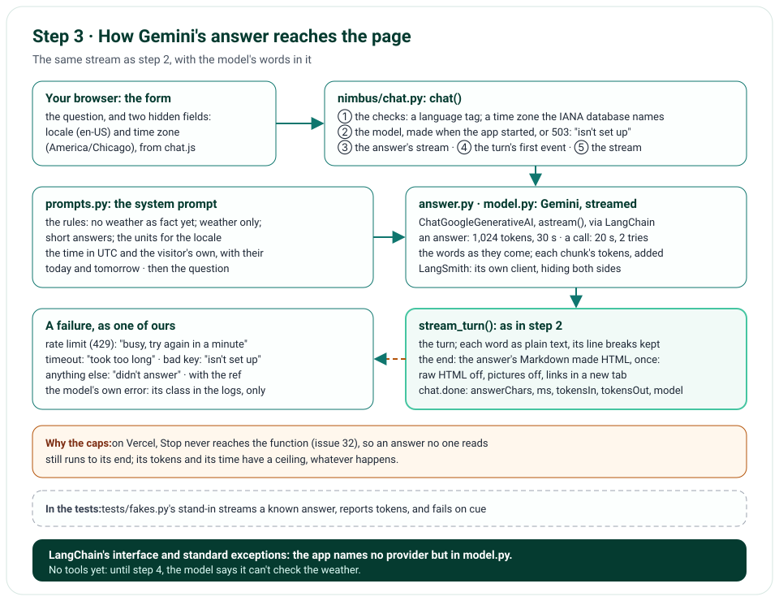

# Step 3 · Gemini Answers, Streamed

Step 3 puts Gemini in place of the fixed answer: LangChain's `ChatGoogleGenerativeAI` streams the model's words, and
they reach the page exactly as step 2's did, a piece at a time, then the finished answer, its Markdown made HTML. The
model gets a system prompt with its rules, the units for the visitor's locale and their own today and tomorrow, from
two fields the page now sends. Each answer is capped, since on Vercel Stop never reaches the function (issue 32), and
every way the model can fail becomes our own sentence. LangSmith may trace the model's runs only with their inputs and
outputs hidden. There are no tools yet, so the model says it can't check the weather: that's step 4.

**In one line:** the form, with the browser's locale and time zone → `chat()` checks them → the system prompt and the
question → Gemini, through LangChain, streamed → each word to the page → the finished answer, its Markdown made HTML;
a failure → our own sentence and its ref.

## What you'll build

- Gemini's answer, streamed through LangChain, from a model made once, when the app starts.
- The system prompt: who Nimbus is, its rules (no weather as fact yet), the units for the visitor's locale, and the
  visitor's own time, today and tomorrow.
- Two more fields from the page, the browser's locale and time zone, each checked, and the default when it can't
  be used.
- Caps on every answer: 1,024 tokens and 30 seconds; each call to Gemini waits 20 s, and is tried once more.
- Our own sentence for each way the model can fail: busy, too slow, not set up, or no answer at all.
- The finished answer's Markdown as HTML: no raw HTML, no pictures, and links that open in a new tab.
- LangSmith's tracing, only through the app's own client, which hides both a run's inputs and its outputs.
- The answer's tokens, in its log line.

## What you'll learn

- LangChain's chat models: one interface over every provider, streaming with `astream()`, and token counts.
- LangChain's standard exceptions, which let the app map any provider's failures without naming the provider.
- How to write a system prompt that carries the user's context: their locale and time zone.
- How to cap a model's cost and time: a token limit, an overall timeout, a timeout per call, and few retries.
- How to render a model's Markdown so it can only ever be text and links.
- How to test a model's answers with a stand-in model.
- What LangSmith traces, and how to keep every question out of it.

## Before you start

- Step 2's project, with `uv sync` run again: it installs `langchain-core`, `langchain-google-genai` and `tzdata`.
- For real answers on your computer, a Gemini API key from Google AI Studio, in `.env.local` as `GOOGLE_API_KEY`
  (copy `.env.example`; git never sees `.env.local`). Without one, the chat says it isn't set up. The tests never need
  one: they answer with a stand-in model.

## The design



| Decision | Why |
|---|---|
| LangChain's `ChatGoogleGenerativeAI`, not Google's SDK itself | One interface for any model: `astream()`, token counts, standard exceptions; steps 4 and 5 build the agent on it |
| The model made once, when the app starts | Its client is reused by every question; a deployment without a key gets `None`, and the chat says it isn't set up |
| Gemini 3.5 Flash-Lite | Fast and cheap, as the TypeScript version chose; `GEMINI_MODEL` names another |
| The page sends its locale and time zone | "Tomorrow" is the visitor's tomorrow, and the units are their region's; the server checks both: a language tag, and a time zone the IANA database names |
| Caps: 1,024 tokens and 30 s an answer; 20 s and two attempts a call; the least thinking | On Vercel, Stop never reaches the function (issue 32): an answer no one reads still runs, so its cost has a ceiling |
| LangChain's standard exceptions | Our mapping to sentences names no provider: Gemini's 429 is a `ModelRateLimitError`, as anyone's would be |
| Plain words while streaming, Markdown at the end | Half-written Markdown is half-formed; the finished answer is rendered once, safely, in place of the plain one |
| Tracing only through the app's own client, which hides inputs and outputs | LangChain traces by itself whenever LangSmith's variables say so (issue 33), and LangSmith's client trusts their spelling (issue 34): the app's own client hides whatever they say |
| A stand-in model in the tests | The real one needs a key and costs quota; the stand-in streams a known answer, reports tokens, and fails on cue |

## Files

| File | What it does |
|---|---|
| `nimbus/model.py` | `make_chat_model()`: Gemini with the caps; `is_tracing_allowed()`; `make_tracer()`, LangSmith's client |
| `nimbus/prompts.py` | The system prompt, and `to_messages()`: the prompt, then the question |
| `nimbus/answer.py` | `stream_answer()`, `render_answer()` and `AnswerStats`; the fixed answer is gone |
| `nimbus/chat.py` | The locale and time zone fields; the model's answer in the turn; a deployment with no model |
| `nimbus/errors.py` | `ConfigError`, `ModelBusyError`, `AnswerTimeoutError`, `ModelFailedError`, and their sentences |
| `nimbus/config.py`, `nimbus/constants.py` | The model's key and name, LangSmith's variables; the caps, the locale's and time zone's rules |
| `nimbus/app.py` | The model, made once |
| `templates/chat.html`, `templates/chat_parts.html` | Two hidden fields; the answer, now a `<div>` that holds Markdown's HTML |
| `public/static/chat.js`, `public/static/app.css` | The two fields filled (⑧); the answer's Markdown styled |
| `.env.example` | The new settings, empty |
| `pyproject.toml`, `uv.lock` | `langchain-core` 1.6.12, `langchain-google-genai` 4.4.2, `tzdata` 2026.5 |
| `tests/fakes.py` | The stand-in model |
| `tests/unit/test_answer.py`, `test_prompts.py`, `test_model.py` | New; the chat's unit and browser tests answer with the stand-in |
| `nimbus/logger.py`, `nimbus/utils.py` | Other libraries' lines: warnings and worse only, as ours (issue 43); `to_redacted_urls()` |
| `tools/mutation_check.py` | 32 more rules |

## How it works

Each section is one file; the circled numbers are the ones in its code.

### The model: `nimbus/model.py`

`make_chat_model()` makes Gemini through LangChain, with the caps that hold for every answer: at most 1,024 tokens
out, each call waiting at most 20 s, two attempts at most (for Gemini, LangChain's `max_retries` counts every attempt,
the first one included: issue 36), and the least thinking there is, since thinking's tokens count against the 1,024.
Without `GOOGLE_API_KEY` it gives back `None`; `create_app()` keeps whichever it gets in `app.state.chat_model`. The
key is a `SecretStr`, so it never shows in a log or a `repr()`.

```python
return ChatGoogleGenerativeAI(
    model=settings.gemini_model,
    api_key=settings.google_api_key,
    max_output_tokens=MAX_OUTPUT_TOKENS,
    timeout=MODEL_REQUEST_TIMEOUT_SECONDS,
    max_retries=MODEL_MAX_ATTEMPTS,
    thinking_level=MODEL_THINKING,
)
```

`is_tracing_allowed()` is true only when LangSmith's tracing is on, with a key, and its variables say to hide both
each run's inputs and its outputs; `make_tracer()` then makes a `Tracer`, LangSmith's client and the project to trace
into, which the app keeps in `app.state.tracer` (see LangSmith, below).

### The system prompt: `nimbus/prompts.py`

The rules come first (①): Nimbus is a weather assistant; it can't look up the weather yet, so it never gives weather as
fact; it may explain weather in general; it answers only about the weather, briefly, in the units for the visitor's
locale: imperial where the locale's region uses them (the United States, Liberia, Myanmar), else metric. The region is
the tag's subtag of two letters or three digits, before any extension: `en-US-u-hc-h23` is the United States. Then the
time (②), in UTC and in the visitor's own zone, with their today and tomorrow, so "tomorrow" means theirs, wherever
the server runs. `to_messages()` gives the model the prompt, then the question.

### The two new fields: `nimbus/chat.py`, `ChatRequest`

The page sends `locale` (`navigator.language`) and `time_zone` (`Intl.DateTimeFormat().resolvedOptions().timeZone`),
which `chat.js` puts into two hidden fields (⑧). The locale must be a language tag of letters, digits and hyphens, at
most 35 characters, so nothing in it can read as an instruction in the system prompt; the time zone must be one the
IANA database names, from the `tzdata` package, so a path like `../../etc/passwd` is never a time zone. Both come from
the browser, not the visitor, and some browsers send ones we can't use (ICU's `Etc/Unknown`): those, and empty ones,
take the default, `en-US` and `UTC`, rather than lock the visitor out (issue 40). `chat.request` says which did, as
`defaulted`.

### The answer: `nimbus/answer.py`

`stream_answer()` streams the model's answer with LangChain's `astream()`, inside a 30-second deadline for the whole
answer. Only the model's own waits are timed (①): each `anext()` runs inside `asyncio.timeout_at(deadline)`, never the
time the page takes between two pieces, so a deadline that passes always lands here, as ours to name, never in the
page's code as a cancel (issue 38). Each chunk carries its share of the tokens in and out, which it adds up (②), in an
`AnswerStats` for the logs (issue 35); and its words, which it gives on (③). The model's stream is closed however
the answer ends (`aclosing()`), so on your computer Stop ends Gemini's work at once (issue 39). A failure becomes one
of ours (④), the model's own error kept as its cause:

| The model raised | The visitor reads |
|---|---|
| `ModelRateLimitError` (Gemini's 429: the quota or the rate) | "The assistant is busy right now. Please try again in a minute." |
| `TimeoutError` (our 30 s), `ModelTimeoutError` | "The assistant took too long to answer. Please try again." |
| `ModelAuthenticationError`, `ModelPermissionDeniedError`, `ModelNotFoundError` (a wrong `GEMINI_MODEL`), or Gemini's 400 for a bad key (`API_KEY_INVALID`) | "The assistant isn't set up on this deployment yet." |
| anything else | "The assistant didn't answer. Please try again." |

These are LangChain's standard exceptions, which `langchain-google-genai` raises for Gemini's errors: the mapping
would hold for any provider, but for the bad key, which Gemini answers with a 400 (issue 37). `render_answer()` makes
the finished answer's Markdown HTML with markdown-it: raw HTML off, pictures off (so nothing is ever fetched from
wherever the model pointed), and each link opening in a new tab with `rel="nofollow noopener noreferrer"`.

### The turn: `nimbus/chat.py`

The route checks the question (①); takes the model (②), or answers 503 and "The assistant isn't set up on this
deployment yet." when there is none; and makes the answer's stream (③): the system prompt and the question, to the
model, with the app's tracer, if it has one. Then, as in step 2, it starts the turn before the response does (④) and
streams it (⑤). `stream_turn()` takes the answer's stream as it is, whatever writes it: the model's words go into the
page as plain text, which `.answer-streaming` keeps the line breaks of, and the last event swaps in the finished
answer's HTML. Every line about an answer's end holds its length, its time, its tokens and the model; a failure's
adds the model's own error's class, `causeClass`.

### LangSmith: its own client, which hides

LangChain traces every model run by itself whenever `LANGSMITH_TRACING` is set, reading LangSmith's variables on its
own (issue 33); and LangSmith's client hides a run's inputs and outputs only when its variables hold exactly the string
`true`, while the app's settings take any true value, `True` or `1` too (issue 34). So the app makes its own client,
`Client(api_key=..., hide_inputs=True, hide_outputs=True)`, which hides both whatever the variables say, and runs the
model inside `tracing_context(enabled=..., client=..., project_name=...)`: with that client, into the project the app's
settings name (issue 42), when tracing is allowed; else not at all. In Vercel, all of LangSmith's variables are set:
each answer's run reaches LangSmith with its timing, its tokens and the model, and none of its words.

## Run it

Start the app as before (`uv run uvicorn main:app --reload --no-access-log`). With no `GOOGLE_API_KEY` in
`.env.local`, the chat answers every question with our sentence and a 503, before the model is ever called
(the five security headers left out, one long line wrapped):

```text
$ curl -N -i --data-urlencode "question=Will it rain in Paris tomorrow?" http://127.0.0.1:8000/api/chat
HTTP/1.1 503 Service Unavailable
date: Sat, 31 Oct 2026 07:58:06 GMT
server: uvicorn
x-nimbus-error: 1
content-length: 282
content-type: text/html; charset=utf-8
x-request-id: 59c83fb4c4ca426c

<li class="message message-bot message-error">
  <p class="message-meta"><span class="avatar" aria-hidden="true">N</span><span>Nimbus (Weather)</span></p>
  <div class="bubble bubble-bot">
    <p class="message-note">The assistant isn&#39;t set up on this deployment yet.</p></div>
</li>
```

```json
{"model": "gemini-3.5-flash-lite", "modelSetUp": false, "tracing": false, "event": "app.started", "level": "info",
 "ts": "2026-10-31T07:58:05.076329Z", "env": "local", "commit": null, "deploymentId": null}
{"questionChars": 31, "event": "chat.request", "level": "info", "ts": "2026-10-31T07:58:06.388554Z", "env": "local",
 "commit": null, "deploymentId": null, "requestId": "59c83fb4c4ca426c"}
{"errorClass": "ConfigError", "answerChars": 0, "ms": 0, "event": "chat.failed", "level": "error",
 "ts": "2026-10-31T07:58:06.388618Z", "env": "local", "commit": null, "deploymentId": null,
 "requestId": "59c83fb4c4ca426c"}
{"method": "POST", "path": "/api/chat", "status": 503, "ms": 4, "event": "http.request", "level": "info",
 "ts": "2026-10-31T07:58:06.392102Z", "env": "local", "commit": null, "deploymentId": null,
 "requestId": "59c83fb4c4ca426c"}
```

With your own key in `.env.local`, restart, and the same request streams Gemini's answer, as on the live site
(Deploy it shows one).

## Test it

```text
$ uv run ruff check .
All checks passed!
$ uv run ruff format --check .
64 files already formatted
$ uv run mypy
Success: no issues found in 39 source files
$ uv run pytest
269 passed in 4.15s
$ uv run pytest tests/e2e --browser-channel msedge
113 passed in 77.27s (0:01:17)
$ uv run python tools/mutation_check.py
...
caught: an answer is at most 1,024 tokens
caught: an answer stops at 30 seconds
caught: a failed call to Gemini is tried once more, not five times
caught: the least thinking
caught: the tracer hides inputs and outputs, whatever LangSmith's variables say
caught: the tracer's project is the app's setting
caught: the run is traced into the tracer's project
caught: another library's info lines are never written
caught: the root logger has only our handler
caught: the handler's own level holds, whatever level a library sets
caught: a library's line loses its query strings
caught: of a library's exception, only its class
caught: a library's exception keeps its frames
caught: a web address loses its query string
caught: a web address is found in any case
caught: an exception's innermost frames are the ones kept
caught: LangSmith traces only when it hides both inputs and outputs
caught: a model's rate limit says the assistant is busy
caught: a key the model refuses says the assistant isn't set up
caught: a model's own error is kept as the cause
caught: a model name the provider doesn't know says the assistant isn't set up
caught: Gemini's 400 for a bad key says the assistant isn't set up
caught: each chunk's tokens add up
caught: an answer never loads a picture
caught: an answer's link tells the other site nothing
caught: today and tomorrow are the visitor's own
caught: the units follow the locale
caught: a locale's region comes before any extension
caught: a time zone must be a known one
caught: a locale the chat can't use takes the default
caught: a deployment without a key says it isn't set up
caught: the finished answer's Markdown is HTML
70 of 70 caught
```

The unit tests answer with `tests/fakes.py`'s stand-in, a LangChain chat model that streams a known answer a word at a
time, reports its tokens as Gemini does, and fails on cue: the chat's events and logs as before, now with the tokens
and the model; the system prompt and the question, as the model gets them; the locale and time zone, checked, and
the default when they can't be used, logged; a deployment with no model; each kind of failure, mapped, the bad key's
400 and a wrong model's 404 among them; the 30-second limit, even when the page is slow between pieces; the model's
stream, closed with the answer; the tokens, added up; the Markdown's rules; the model's caps, in numbers; and the
tracer, allowed only with both hidden, hiding both itself, into its project; tracing off without it; and other
libraries' lines, made ours. The browser tests run the real chat with the stand-in, pausing 60 ms a word. The mutation
check breaks 32 more rules (its first 38 lines are left out above; each says caught).

## Deploy it

The push, 06327e5, was live on Vercel within 32 seconds, while CI ran its checks, which passed in about two minutes.
Checked on the live site, https://weather-chatbot-hazel.vercel.app, on 31 October 2026, once a health check and an
empty question had warmed the function up:

- The page had the two new fields, and the CDN served `chat.js` and `app.css` byte for byte the repository's, with
  `vercel.json`'s security headers.
- "What does the dew point tell me?", posted with `en-US` and `America/Chicago`, streamed Gemini's answer through
  Vercel's edge: the turn's first event 0.15 s after the question was sent, the first words after 0.88 s, in 4
  pieces, the last after 1.13 s. It gave its example in °F, the units rule 5 gives `en-US`: "When the dew point is
  high, usually above 60°F, the air feels sticky and humid".
- An empty question got 400, and JSON 415, each with our sentence and `x-nimbus-error: 1`.
- In Edge, whose page sent `en-US` and `America/Chicago`, "Will it rain in Paris tomorrow?" got "I can't check the
  weather yet, as live forecasts will come in a later version of this chat.": rule 1 held. The answer ended as HTML,
  axe found no violation, and the console held no error.
- Vercel's logs, searched for the first question's id, held its three lines, its tokens among them:

```json
{"questionChars": 32, "event": "chat.request", "level": "info", "ts": "2026-10-31T07:27:45.111247Z",
 "env": "production", "commit": "06327e5", "deploymentId": "dpl_3Skpc45W95wt8KS1MyuNKwPsM2hQ",
 "requestId": "cle1::dlspq-1793431665072-b0db15ba80dd"}
{"answerChars": 290, "ms": 989, "tokensIn": 294, "tokensOut": 63, "model": "gemini-3.5-flash-lite",
 "event": "chat.done", "level": "info", "ts": "2026-10-31T07:27:46.100500Z", "env": "production", "commit": "06327e5",
 "deploymentId": "dpl_3Skpc45W95wt8KS1MyuNKwPsM2hQ", "requestId": "cle1::dlspq-1793431665072-b0db15ba80dd"}
{"method": "POST", "path": "/api/chat", "status": 200, "ms": 990, "event": "http.request", "level": "info",
 "ts": "2026-10-31T07:27:46.100994Z", "env": "production", "commit": "06327e5",
 "deploymentId": "dpl_3Skpc45W95wt8KS1MyuNKwPsM2hQ", "requestId": "cle1::dlspq-1793431665072-b0db15ba80dd"}
```

- Each copy of the app said, as it started, `"modelSetUp": true, "tracing": true`: Vercel holds the key, and
  LangSmith's variables allow tracing, both sides hidden.
- LangSmith's project, `weather-chatbot`, held the day's four runs, each a `ChatGoogleGenerativeAI` run with "No
  inputs" and "No outputs": only its time (0.63 to 1.01 s), its tokens and the model's settings, such as
  `max_output_tokens: 1024`.

**The libraries wrote lines of their own.** Each question also left two lines in Vercel's logs that weren't ours,
plain text, without the request's id (the second wrapped here):

```text
AFC is enabled with max remote calls: 10.
HTTP Request: POST https://generativelanguage.googleapis.com/v1beta/models/gemini-3.5-flash-lite:streamGenerateContent
 ?alt=sse "HTTP/1.1 200 OK"
```

The first is google-genai's, the second httpx's, which logs each request it sends: from step 4, the calls to
Open-Meteo would have put each place's coordinates into the logs, in their query strings. On a computer, neither ever
showed: Python writes another library's info lines nowhere until something sets its logging up, which Vercel's
runtime does. So the app now sets the standard logging up itself: another library's warnings and errors only, each
written as a line of ours, with the build's fields and the request's id, any web address's query string cut off, and
of an exception only its class and where it went (issue 43).

## Things to take care of, and pitfalls

- **LangChain traces by itself** whenever `LANGSMITH_TRACING` is true, reading LangSmith's variables, not the app's
  settings: turn it off or on explicitly with `tracing_context()` (issue 33).
- **LangSmith's client hides only for the exact string `true`:** pass `hide_inputs=True, hide_outputs=True` to a
  client of your own, rather than trust each variable's spelling (issue 34).
- **Gemini reports each chunk's share of the tokens, not a running total:** add them up (issue 35).
- **For Gemini, LangChain's `max_retries` counts attempts, the first one included:** `1` means no retry at all, and the
  default, `6`, means six attempts, minutes for one answer with a 20-second timeout (issue 36).
- **Gemini answers a bad key with a 400, not a 401:** `INVALID_ARGUMENT`, with the reason `API_KEY_INVALID` (issue 37).
- **Never wrap a `yield` in `asyncio.timeout()`:** the deadline cancels whichever code is running when it passes,
  which may be the code reading the generator, not the generator (PEP 789). Time each wait instead, with
  `asyncio.timeout_at()` and one deadline (issue 38).
- **Closing a generator doesn't close the one it was reading:** read the model's stream through `aclosing()`, or its
  HTTP call outlives the answer (issue 39).
- **A browser can send a locale or a time zone you can't use** (`Etc/Unknown`, long tags with extensions): fall back
  rather than refuse, and find a tag's region by its form, not its place (issue 40).
- **LangSmith's client starts a thread that calls LangSmith:** a test that makes one reaches the network; record how
  it's made instead (issue 41).
- **A model's error can quote what it was sent.** Log its class (`causeClass`), never its message.
- **A platform can set Python's logging up for you:** on Vercel, other libraries' info lines reached the logs as
  plain text; on a computer they never showed. Set the root logger up yourself, with a level and a handler of your own
  (issue 43).
- **The question goes to Google as typed.** It's never logged or traced by us; Google's own terms cover what it keeps.
- **`chunk.text` is a property in LangChain 1.x;** in 0.3 it was a method.
- **Pictures off still leaves a link:** `` becomes `!` and a link to the picture's address, never the picture.
- **Day names follow the process's locale** (`strftime("%A")`): English on Vercel, as the prompt needs.
- **`zoneinfo` needs a time zone database;** Windows and slim containers have none, so `tzdata` comes with the app.
- **The model makes things up when it has no data:** rule 1 tells it to give no weather as fact, until step 4 gives it
  the tools.

## Issues we hit

33. LangSmith would have traced every model run by itself: the app now traces only through its own client, when
    allowed.
34. LangSmith's client and the app read "hide" differently: the app's client hides inputs and outputs itself.
35. The answer's tokens would have been wrong: Gemini reports each chunk's share, now added up.
36. "Tried once more" was no retry at all: two attempts now, as LangChain counts them.
37. A key Gemini refuses would have said "didn't answer": a bad key, or a wrong model, says "isn't set up".
38. The 30-second limit could have landed in the page's code: only the model's waits are timed.
39. Stop left Gemini's stream open: the model's stream is closed with the answer.
40. A browser's unusual locale or time zone locked its visitor out: they take the defaults; the units follow the
    region.
41. A test reached out to LangSmith: it records how the client is made instead.
42. The LangSmith project was read but never used: the tracer traces into it.
43. The libraries' own lines reached Vercel's logs, as plain text: only their warnings and errors now, as ours.

Each is told in full, with how it was found and how it's checked, in [Issues and fixes](issues.md).

## Interview questions

**1. Why LangChain's chat model rather than Google's SDK directly?**
One interface for any provider: `astream()` for the words, `usage_metadata` for the tokens, and standard exceptions
such as `ModelRateLimitError`. Our mapping from failures to sentences names no provider, the stand-in model in the
tests plugs into the same interface, and the agent in steps 4 and 5 is built on it.

**2. How do you stream a model's answer to the page?**
`model.astream(messages)` yields chunks as the model writes; each one's text goes straight into the same server-sent
events as step 2's fixed answer, as plain text. When the stream ends, the last event swaps in the finished answer, its
Markdown made HTML once, safely.

**3. Why cap tokens and time, and how?**
On Vercel, Stop never reaches the function, so an answer no one reads still runs. `max_output_tokens=1024` caps what
the model writes, its thinking included, which is set to the least there is; one 30-second deadline caps the whole
answer; each call waits 20 s, with two attempts at most, where LangChain's default would make six.

**4. How do you turn a model's failures into messages a user can act on?**
LangChain's standard exceptions: a rate limit becomes "busy, try again in a minute", a timeout "took too long", an
authentication error "isn't set up", anything else "didn't answer". The model's own error is kept as the cause, and
logged by its class only: its message could quote the question.

**5. What goes into the system prompt, and why the visitor's time zone?**
The rules (no weather as fact without tools, weather only, short answers, the units), then the time in UTC and in the
visitor's zone, with their today and tomorrow. Without the zone, "tomorrow" would be the server's tomorrow, which near
midnight is a different day.

**6. How do you check a time zone that comes from the browser?**
It must be one the IANA database names, from `zoneinfo.available_timezones()` with the `tzdata` package: a fixed set,
read once, so no string from the browser ever becomes a path the library opens.

**7. How do you render a model's Markdown safely?**
markdown-it with raw HTML off, so tags show as text; pictures off, so the page never fetches from wherever the model
pointed; `javascript:` addresses are never linked; and each link opens in a new tab with `noopener noreferrer`.

**8. How do you keep questions out of LangSmith?**
The app traces only when LangSmith's variables say to hide both inputs and outputs, and then through a client of its
own, `Client(hide_inputs=True, hide_outputs=True)`, passed in `tracing_context()`: LangSmith's default client would
hide only if each variable held exactly the string `true`.

**9. How do you test code that calls a model?**
With a stand-in: a small `BaseChatModel` that streams a known answer a word at a time, reports tokens, and raises on
cue. The app takes its model from `app.state`, so a test puts the stand-in there; the real model never runs in a test.

**10. Why not put an async generator's whole body inside `asyncio.timeout()`?**
The deadline cancels whichever code is running when it passes. Between two `yield`s, that's the code reading the
generator, the page's sending here, not the generator: the answer would end as if the browser had gone. So one
deadline is set, and only the generator's own waits are timed, with `asyncio.timeout_at()` around each `anext()`.

**11. Why did Vercel's logs show lines your computer never did?**
Python writes another library's info lines nowhere until something sets its logging up, and Vercel's runtime does: on
Vercel, httpx's line for each request it sent, and google-genai's, came out as plain text. So the app sets the root
logger up itself, with its own handler and level: warnings and errors only, each as one of our JSON lines, with any
query string cut off.

## Things to try

- **Ask something off-topic,** such as a recipe: the model says, in one sentence, what it can do.
- **Ask about the weather in a city:** it says it can't check the weather yet, until step 4.
- **Change the units:** set your browser's language to English (United Kingdom) and ask what to wear for 30 degrees.
- **Break the key:** put a wrong `GOOGLE_API_KEY` in `.env.local`: "The assistant isn't set up on this deployment yet."
- **Try another model:** `GEMINI_MODEL=gemini-3.5-flash` in `.env.local`, and compare the answers.

## What's next

Step 4 gives the model four weather tools, through a prebuilt LangGraph agent: the REST · no auth lane, which calls
Open-Meteo directly, with a chip for each tool call and the request it sent. The roadmap for every step is in
[PLAN.md](https://github.com/EasyLearnJava/AgenticProgramming/blob/main/projects/Agentic/weather-chatbot/PLAN.md).
