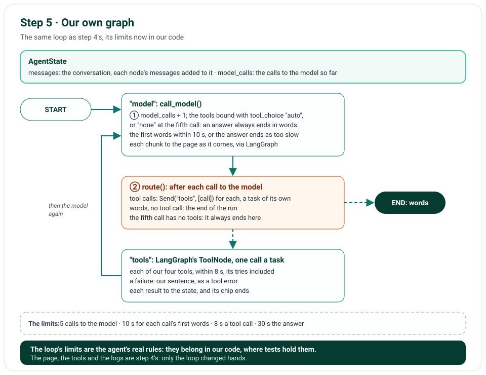

# Step 5 · The Agent as a Graph of Our Own

Step 5 replaces LangChain's prebuilt agent with a LangGraph graph of our own: the same two nodes, `model` and `tools`,
in the same loop, now with its limits in our code. The fifth call to the model has its tools turned off, so every
answer ends in words, never on a failure. Each call's first words must come within 10 s, and each tool call ends within
8 s, its tries included, inside the answer's 30 s. Each tool call is still a task of its own, so each chip ends as its
call does. The page, the tools and the logs are step 4's; only the loop changed hands.

**In one line:** the question → our graph: `model` (Gemini, with the tools; the fifth time without) → `tools`, each
call a task, each within 8 s → `model` again → words end the run.

## What you'll build

- The agent as a `StateGraph`: its state, the conversation and the number of calls to the model; two nodes; a route
  after each call to the model.
- The last call to the model with its tools turned off (`tool_choice="none"`), so an answer always ends in words.
- Time limits inside the run: 10 s for each call's first words, 8 s for each tool call.
- Each tool call sent to the tools node on its own (`Send`), so each chip ends when its call does.

## What you'll learn

- How to build an agent loop with LangGraph: a state with a reducer, nodes, a conditional edge, `Send`.
- What a prebuilt agent decides for you, and how to decide it yourself: when the loop ends, and how.
- How to turn a model's tools off for one call, and why that's better than a step limit that fails.
- Where to put a time limit: on each wait, never around a `yield`.

## Before you start

- Step 4's project, with `uv sync` run again: it removes `langchain`, whose `create_agent()` was the only part used;
  `langgraph` and its prebuilt tool node stay.

## The design



| Decision | Why |
|---|---|
| A `StateGraph` of our own, not `create_agent()` | The loop's limits are the agent's real rules: they belong in our code, where a test can hold them |
| The same two nodes, `model` and `tools`, by the same names | The answer's stream (`stream_mode=["messages", "updates"]`) and the chips need no change |
| The state counts the calls to the model | The fifth call is known by count, not by the messages, which from step 6 hold the earlier conversation too |
| The fifth call with `tool_choice="none"`, its tools still declared | Gemini can't call a tool, so it must answer in words from what it has; the prebuilt agent failed the answer instead (issue 50) |
| `Send("tools", [call])` for each tool call | Each call is a task of its own: its chip ends when it does, not when the round's slowest does |
| 10 s for each call's first words | Gemini's first chunk comes in about a second; a call that hangs ends the answer as too slow long before 30 s |
| 8 s for each tool call | A backstop over Open-Meteo's two tries of 3 s: a call that hangs anywhere else still fails as too slow, in time for the model to answer |
| The recursion limit kept, at 10 | It can't be reached now; if a change ever broke the loop, it would still end it |

## Files

| File | What it does |
|---|---|
| `nimbus/agent.py` | Our graph: `AgentState`, `make_agent()`, the model's call with its first words timed, the route |
| `nimbus/tools.py` | A tool call's 8 s |
| `nimbus/constants.py` | `MODEL_FIRST_CHUNK_SECONDS`, `TOOL_TIMEOUT_SECONDS` |
| `pyproject.toml`, `uv.lock` | `langchain` removed |
| `tests/fakes.py` | The stand-in model keeps each call's tool choice, and calls no tool when it's "none" |
| `tests/unit/test_agent.py` | New: the graph, the fifth call, the tasks, the time limits |
| `tools/mutation_check.py` | 4 more rules; each rule runs its module's tests, two at once, each in a copy of the project (issue 55) |

## How it works

### Our graph: `nimbus/agent.py`

`AgentState` is LangGraph's `MessagesState`, the conversation, whose reducer adds each node's messages to it, and
`model_calls`, the calls to the model so far. `make_agent()` builds the graph for one answer, from the model and the
answer's tools:

- **`model`** (①) counts the call, and binds the tools to the model with `tool_choice="auto"`, or, at the fifth call,
  `"none"`: Gemini still sees the tools, but can't call them. `_first_words_in_time()` streams the call: its first
  chunk within 10 s, or the answer ends as too slow; the rest within the answer's own 30 s. LangGraph passes each chunk
  on to the page as it comes, and the node gives the whole message to the state.
- **The route** (②), after each call to the model: a `Send("tools", [call])` for each tool call the model asked for,
  so each runs as a task of its own; or the end, when the model answered in words.
- **`tools`** is LangGraph's `ToolNode`, which runs the call it's sent; each of our tools turns its failure into our
  sentence, and now stops at 8 s, its tries included.

The edges (③): the start goes to `model`, `tools` back to `model`. The graph is compiled with our name, `nimbus`,
which LangSmith shows as the run's.

### What didn't change

The answer's stream reads the same two kinds of item from the run, words and node updates, so the chips, the words,
the tokens and the logs are step 4's. The recursion limit stays, at 10, as a backstop the graph never reaches.

## Run it

The graph can draw itself: LangGraph writes it as Mermaid, which GitHub and many editors show as a picture. With the
tests' stand-in model in place of Gemini, it needs no key:

```text
$ uv run python -c "from nimbus.agent import make_agent; from tests.fakes import FakeModel
print(make_agent(FakeModel(), []).get_graph().draw_mermaid())"
---
config:
  flowchart:
    curve: linear
---
graph TD;
	__start__([<p>__start__</p>]):::first
	model(model)
	tools(tools)
	__end__([<p>__end__</p>]):::last
	__start__ --> model;
	model -.-> __end__;
	model -.-> tools;
	tools --> model;
	classDef default fill:#f2f0ff,line-height:1.2
	classDef first fill-opacity:0
	classDef last fill:#bfb6fc
```

The solid edges are fixed; the dotted ones are the route's choices. Start the app as before; with your key in
`.env.local`, ask a question that needs two places' weather, and watch the chips of a round end one by one.

## Test it

```text
$ uv run ruff check .
All checks passed!
$ uv run ruff format --check .
77 files already formatted
$ uv run mypy
Success: no issues found in 50 source files
$ uv run pytest
367 passed in 9.11s
$ uv run pytest tests/e2e --browser-channel msedge
125 passed in 93.10s (0:01:33)
$ uv run python tools/mutation_check.py
...
caught: a Retry-After is read from ASCII digits only
caught: a failed chip shows only our own sentences
caught: stopping marks a running chip only
caught: a call still running when the answer ends is marked stopped
100 of 100 caught
```

The new unit tests build the graph with the stand-in model: its two nodes and four edges; an answer that needs no
tool, in one call; a model that would ask for a tool forever, whose fifth call has its tools turned off and answers in
words; two calls in one round, each a task of its own; a tool call past its 8 s, read by the model as "too slow"; and
a call whose first words come late, which ends the answer as too slow. Every earlier test passes unchanged on the new
graph. The mutation check breaks 4 more rules (its first 96 lines are left out above; each says caught), and now runs
each rule against its module's own test files, two at a time, in copies of the project: 3 minutes in all.

## Deploy it

The push, 9195641, was live on Vercel within a minute, while CI ran its checks, which passed in about two minutes.
Checked on the live site, https://weather-chatbot-hazel.vercel.app, on 31 October 2026, after a warm-up, with the
same checks as step 4's, now on our own graph:

- "Will it rain in Paris tomorrow?", with `en-US` and `America/Chicago`: the `geocode_location` chip 1.77 s after the
  question was sent, done at 2.19 s; the `get_forecast` chip at 2.92 s, imperial, done at 3.01 s; the words from 3.94 s
  to 4.08 s: "In Paris, Île-de-France Region, France, tomorrow (Sunday, November 1, 2026), the forecast shows overcast
  skies with a 0% chance of rain." Three calls to the model, the last one answering in words, as before.
- An empty question got 400, and JSON 415, each with our sentence.
- In Edge, "How's the air in Delhi right now?" ran `geocode_location` and `get_air_quality`, each done in 0.4 s; the
  opened chip showed its request, the point rounded to 28.65, 77.23; axe found no violation, and the console held no
  error.
- Vercel's logs, searched for the Paris question's id, held its lines under commit 9195641: `chat.request`, then
  `upstream.http` and `tool.call` for each tool, `chat.done` and `http.request`, as in step 4.

Nothing changed for a visitor: the loop changed hands, and its limits, which a live question doesn't reach, are held
by the unit tests.

## Things to take care of, and pitfalls

- **A step limit that fails the answer isn't a step limit:** turn the tools off for the last call instead, and the
  model answers with what it has.
- **Count the calls in the state, not in the messages:** from step 6, the messages hold the earlier conversation too.
- **`tool_choice="none"` keeps the tools declared:** Gemini still knows what they are, and a conversation that holds
  tool calls stays valid; it just can't call one.
- **Never put a `yield` inside `asyncio.timeout()`:** the first words' limit wraps the one wait for the first chunk,
  inside the node, which yields nothing.
- **A tool node given a list of tool calls runs just those:** that's how `Send` makes each call a task.
- **A limit the code can no longer reach still deserves a test:** the recursion limit's is in numbers.

## Issues we hit

55. The mutation check grew past ten minutes, and a stopped one left a rule broken: each rule runs its module's
    tests, two at once, in copies of the project.

Each is told in full, with how it was found and how it's checked, in [Issues and fixes](issues.md).

## Interview questions

**1. Why replace a prebuilt agent with your own graph?**
The prebuilt one decides the loop's limits for you: its own step limit is 9,999, and its last call can still ask for a
tool, so a limit ends the answer with a failure. In our own graph, the limits are a few lines of code, tested.

**2. How do you make sure an agent's answer always ends in words?**
Count the calls to the model in the state, and on the last one bind the tools with `tool_choice="none"`: the model
still sees them, but can't call one, so it answers with what it has.

**3. What does `Send` do in a LangGraph graph?**
It starts a node with an input of its own. Sending each tool call to the tools node on its own makes each a task: they
run at once, and each one's result comes as soon as it's done.

**4. Where do you put an agent's time limits?**
On the waits: the first chunk of each call to the model, each tool call, and the whole answer around each wait for the
run's next item. Never around a `yield`, where the deadline could land in someone else's code.

**5. Why keep a recursion limit the graph can't reach?**
It costs nothing, and if a change ever broke the loop, the run would still end.

## Things to try

- Draw the graph with `draw_mermaid_png()` instead (it calls a web service), or paste the Mermaid into an editor.
- Set `MAX_MODEL_CALLS` to 2 on your computer, ask for two cities' forecasts, and see the second call answer without
  the forecasts.
- Lower `MODEL_FIRST_CHUNK_SECONDS` to 0.1 and watch every answer end as too slow.

## What's next

Step 6 gives the chat a memory: the conversation kept in the browser and sent back with each question, as untrusted
input, checked and capped, never a tool's result; and New chat.
