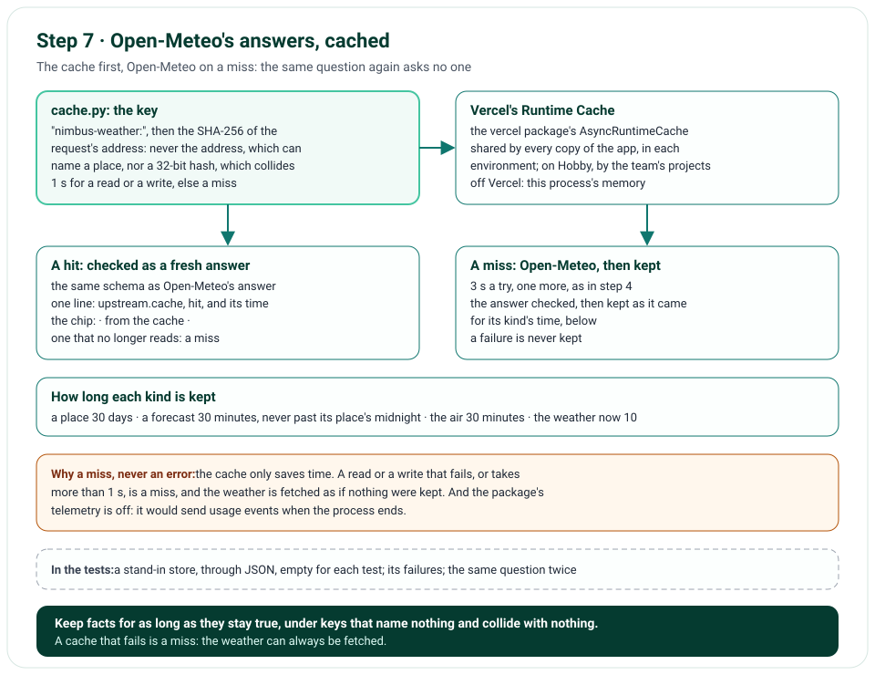

# Step 7 · Open-Meteo's Answers, Cached

Step 7 keeps Open-Meteo's answers in Vercel's Runtime Cache, so a question asked again doesn't ask Open-Meteo again.
It's Vercel's own cache, which every copy of the app shares, unlike their memory, and which on Hobby every project of
the team shares too: so each key is our namespace, then the SHA-256 of the request's address, which names no place
and which no other address shares. Each kind of answer is kept for as long as it stays true; one that comes back is
checked as a fresh one is; and a cache that fails, or is slow, is a miss: the weather is fetched as if nothing were
kept. The chip says when the cache answered.

**In one line:** a tool's request → `nimbus-weather:` + the address's SHA-256 → kept? checked, and the chip says
"from the cache" → else Open-Meteo, checked, then kept for its time: a place 30 days, the weather now 10 minutes.

## What you'll build

- `nimbus/cache.py`: the cache on Vercel's Runtime Cache, through the `vercel` package: its keys, and a read or a
  write that fails, or takes more than 1 s, given up as a miss.
- The Open-Meteo client asks the cache first: an answer kept is checked against the same schema as a fresh one; else
  it asks Open-Meteo, then keeps the answer, only if it worked, for its kind's time.
- The times: a place's name and point, 30 days; a forecast, 30 minutes, but never past its place's midnight; the
  air, 30 minutes; the weather now, 10.
- The chip: "REST · no auth · api.open-meteo.com · from the cache · 0.0 s"; opened, the request as it went out when
  the answer was first fetched.
- The package's telemetry, off; and `python -m tools.run_tool ... --again`, which runs a tool twice.

## What you'll learn

- How to cache an upstream API's answers in a serverless app, whose copies share no memory.
- How to make a cache key that can't collide or leak, in a cache that others share.
- How long to keep each kind of data, and why a forecast's time ends at its place's midnight.
- Why a cache should fail as a miss, never as an error, and why only answers that worked are kept.
- What a package sends home, and how to read that from its source before you use it.

## Before you start

- Step 6's project, and the `vercel` package (0.12.0), which `uv sync` installs.

## The design



| Decision | Why |
|---|---|
| Vercel's Runtime Cache, through the `vercel` package | No database, as the plan decided; the app's copies share no memory, but they share this cache, in each environment |
| Our namespace, then the address's SHA-256 | On Hobby, a team's projects share one cache; the package's own hash has 32 bits, which two addresses can share; and an address names a place |
| Open-Meteo's answer as it came, checked again when read | The same schema as a fresh answer: one that no longer reads is a miss, fetched again and kept in its place |
| Each kind for its own time | A place hardly moves: 30 days; the weather now changes within the hour: 10 minutes; a forecast and the air: 30 |
| A forecast never past its place's midnight | Its first day is the day it was fetched: after midnight, its "today" would be yesterday |
| Only answers that worked | A failure kept would be served for its whole time |
| 1 s for a read or a write, else a miss | The package would wait 30 s; the answer can't |
| A cache that fails is a miss | The weather can always be fetched: the cache only saves time |
| "from the cache" on the chip | The visitor sees where the weather came from, and the request that first fetched it |
| The package's telemetry off | It would send usage events, with the ids it finds, when the process ends (issue 58) |

## Files

| File | What it does |
|---|---|
| `nimbus/cache.py` | `WeatherCache`: its keys, its time limit, its failures as misses; `make_weather_cache()` on Vercel's Runtime Cache; the telemetry, off |
| `nimbus/open_meteo.py` | The cache asked first; an answer kept checked again; a fresh one kept for its time; `UpstreamAnswer.from_cache` |
| `nimbus/constants.py` | ⑫ the namespace, the 1 s, each kind's time |
| `nimbus/tools.py`, `nimbus/chips.py`, `templates/chat_parts.html` | Whether the cache answered, from the tool's run to its chip |
| `nimbus/app.py`, `nimbus/answer.py`, `nimbus/chat.py` | One cache for the app, given to each answer's Open-Meteo client |
| `tools/run_tool.py` | `--again`: the tool once more, as the next question would run it |
| `tests/fakes.py`, `tests/unit/conftest.py`, `tests/e2e/conftest.py` | `FakeCacheStore`, through JSON as the real one; empty for each test |
| `tests/unit/test_cache.py`, `test_open_meteo.py`, `test_chips.py`, `test_chat.py`, `tests/e2e/test_chat.py` | The keys, the misses, the times; the same question twice |
| `tools/mutation_check.py` | 6 more rules |

## How it works

### The keys and the misses: `nimbus/cache.py`

`to_cache_key()` makes each key: `nimbus-weather:`, then the SHA-256 of the request's address, in hex. The package
would hash a key itself, with 32 bits, so `make_weather_cache()` hands it ours as they are. `WeatherCache.get()` and
`set()` each give the store 1 s; a store that takes longer, or raises, writes one `cache.failed` warning, with the
operation and the error's class, and the read is a miss. On Vercel, the package's store catches the cache's own
errors: it prints each in a plain line, and gives a miss (issue 60). Before it imports the package, the module sets
`VERCEL_TELEMETRY_DISABLED` to 1, unless it's set already (issue 58). Off Vercel, the package keeps the answers in this
process's memory, and says so once, in a plain line of its own.

### The cache asked first: `nimbus/open_meteo.py`

`_get()` asks the cache for the request's address before Open-Meteo. An answer kept is checked against the same
schema as a fresh one: one that reads is the answer, and one `upstream.cache` line says so, with its time; one that
doesn't is a warning, and a miss. On a miss, `_get()` asks Open-Meteo as in step 4, checks the answer, then keeps it,
as it came, for the time its kind's function gives: an error, or an answer that doesn't read, is never kept. A
forecast's time is 30 minutes, or what's left of its place's day, from the forecast's own `utc_offset_seconds`.

### The chip: `nimbus/chips.py`

`from_cache` goes with the answer, to the tool's run, its record, and its chip, whose line says "from the cache"
before the time; opened, it shows the request as it went out the first time, "when it was first fetched".

## Run it

The runner, with `--again`, runs a tool twice, as two questions would: the first asks Open-Meteo, the second gets its
answer from the cache (in this process's memory, off Vercel, as the package's first line says):

```text
$ uv run python -m tools.run_tool geocode_location '{"query": "Paris", "count": 1}' --again
Runtime Cache unavailable in this environment. Falling back to in-memory cache.
{"upstream": "open-meteo", "host": "geocoding-api.open-meteo.com", "path": "/v1/search", "status": "ok",
 "httpStatus": 200, "ms": 231, "attempts": 1, "event": "upstream.http", "level": "info",
 "ts": "2026-10-31T13:04:14.017118Z", "env": "local", "commit": null, "deploymentId": null}
GET https://geocoding-api.open-meteo.com/v1/search?name=Paris&count=1&language=en&format=json
accept: application/json
→ Paris, Île-de-France Region, FR · 48.85, 2.35
{
  "candidates": [
    {
      "name": "Paris",
      "region": "Île-de-France Region",
      "country": "France",
      "country_code": "FR",
      "latitude": 48.85341,
      "longitude": 2.3488,
      "time_zone": "Europe/Paris",
      "population": 2138551
    }
  ],
  "is_ambiguous": false
}
{"upstream": "open-meteo", "host": "geocoding-api.open-meteo.com", "path": "/v1/search", "status": "hit", "ms": 0,
 "event": "upstream.cache", "level": "info", "ts": "2026-10-31T13:04:14.017508Z", "env": "local", "commit": null,
 "deploymentId": null}
Again → Paris, Île-de-France Region, FR · 48.85, 2.35 · from the cache
```

With your key in `.env.local`, ask "Will it rain in Paris tomorrow?" twice: the second answer's chips say "from the
cache", in a few milliseconds.

## Test it

```text
$ uv run ruff check .
All checks passed!
$ uv run ruff format --check .
81 files already formatted
$ uv run mypy
Success: no issues found in 52 source files
$ uv run pytest
413 passed in 5.64s
$ uv run pytest tests/e2e --browser-channel msedge
137 passed in 98.85s (0:01:38)
$ uv run python tools/mutation_check.py
...
caught: a cache key names no place
caught: a slow read of the cache is given up
caught: an answer from the cache says so
caught: the weather now is kept 10 minutes
caught: a forecast is kept no later than its place's midnight
caught: a chip says when the cache answered
112 of 112 caught
```

The unit tests give the cache a stand-in store, which keeps each value through JSON, as the real one does, and is
empty for each test (issue 59). The keys are checked: our namespace, then the SHA-256, never the place; a store that
fails or is slow is a miss with one warning, in 0.05 s instead of 2; and the package's own cache takes our keys as they
are. The Open-Meteo client keeps each kind for its own time, gives an answer kept with no request, keeps a forecast no
later than its place's midnight, fetches again one that no longer reads, never keeps a failure, and answers when the
cache is down. The same question twice gets "from the cache" on every chip, in the route and in the browser. The
mutation check breaks 6 more rules (its first 106 lines are left out above; each says caught).

## Things to take care of, and pitfalls

- **A cache that others share needs a namespace, and keys that can't collide:** a 32-bit hash can't promise that.
- **A key made from an address can leak it:** hash it.
- **A slow cache costs more than none:** give it a time limit, then fetch.
- **Never keep a failure:** it would be served for its whole time.
- **A forecast near midnight:** its days carry their dates, but a cached one's first day can be yesterday; end its
  time at its place's midnight.
- **A package can send what you didn't ask it to:** read its source. The `vercel` package reads its telemetry
  setting once, when it's imported, so the setting must come first.
- **A process-wide cache shares state between tests:** give each test its own store (issue 59).
- **A package may catch its own errors:** the `vercel` package prints the cache's, and gives a miss; read what it
  does with them before you count on your own warning (issue 60).
- **A hash of an address that can be guessed can be guessed too:** anyone who reads the team's cache could hash
  Paris's address and find it. A keyed hash, an HMAC, would stop that; a cache only the team's projects share
  doesn't need one.
- **A value from a cache is input:** check it as you check a fresh one.

## Issues we hit

58. The `vercel` package sends telemetry when the process ends: it's turned off, before the package is imported.
59. The tests shared one cache, and a test's weather came from another's: each test has its own store.
60. On Vercel, a cache that fails says so in the package's line, not ours: the docs say so; step 12 makes it ours.

Each is told in full, with how it was found and how it's checked, in [Issues and fixes](issues.md).

## Interview questions

**1. How do you cache in a serverless app?**
Not in memory: each copy has its own, and copies come and go. In a cache the copies share, such as Vercel's Runtime
Cache, with a key and a time to live for each value.

**2. How do you make a cache key in a cache others share?**
A namespace of your own, then a hash of everything that makes the request what it is, here its whole address: a
SHA-256, which no other address shares, and which says nothing of a place.

**3. How long do you keep each kind of data?**
As long as it stays true: a place for 30 days, a forecast and the air for 30 minutes, the weather now for 10. And no
longer than it stays whole: a forecast's first day ends at its place's midnight.

**4. What happens when the cache fails?**
Nothing the visitor sees: a read or a write that fails, or takes more than 1 s, is a miss, and the weather is fetched
from Open-Meteo. Our warning says when the cache was too slow; on Vercel, the package prints the cache's own errors.

**5. Why cache Open-Meteo's answers, not Nimbus's?**
A question asked in other words, in another place or a day later wants another answer; Open-Meteo's answers are
facts with a known lifetime, which every answer can reuse.

## Things to try

- Run `get_forecast` with `--again`: `uv run python -m tools.run_tool get_forecast '{"latitude": 48.85,
  "longitude": 2.35, "days": 2}' --again`.
- Ask about the weather now in Tokyo, twice, then once more after 10 minutes: the third asks Open-Meteo again.
- Open a chip that says "from the cache", and read the request it was first fetched with.

## What's next

Step 8 builds our own MCP server, with FastMCP, at `/api/mcp`, offering the same four weather tools.
