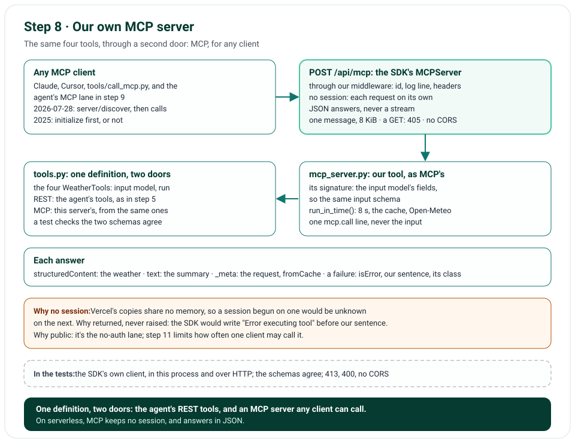

# Step 8 · Our Own MCP Server

Step 8 offers Nimbus's four weather tools to any MCP client, from our own MCP server at `/api/mcp`: the official MCP
SDK's `MCPServer`, which was FastMCP before the SDK's version 2. Each tool is the very definition the agent runs over
REST: the same input model, now the MCP tool's input schema, and the same run, within its 8 s, through the same cache.
The server keeps no session, since Vercel's copies share no memory, and answers in JSON. Each answer carries the
weather as structured content, the chip's summary as text, and, in `_meta`, the request that fetched it and whether
the cache gave it; a failure carries our sentence and its error's class. The agent still calls its tools directly:
step 9 adds the lane that reaches them through this server.

**In one line:** an MCP client → `POST /api/mcp`, one message of at most 8 KiB → `MCPServer`, no session, JSON → our
tool, its input checked by its own model → the cache or Open-Meteo → the weather, the summary, `_meta`.

## What you'll build

- `nimbus/mcp_server.py`: the server, its four tools made from the REST tools' definitions, and its one route.
- The app's lifespan, which runs the SDK's session manager; and the route at `/api/mcp`, through our middleware: the
  request's id, its log line, the security headers.
- `run_in_time()` in `nimbus/tools.py`: one tool call within its 8 s, for the agent's tools and the server's alike.
- `tools/call_mcp.py`: an MCP client from the command line, for our server or any other.

## What you'll learn

- What MCP's Streamable HTTP transport is, and why a serverless server keeps no session and answers in JSON.
- How to offer one tool over REST and over MCP from one definition, and test that the two schemas agree.
- What an MCP tool's answer carries: structured content, text, `_meta`, `isError`.
- What a public MCP server must refuse: big bodies, batches, and pages elsewhere.
- What MCP's 2026-07-28 version changed: no `initialize` handshake; a client asks `server/discover`.

## Before you start

- Step 7's project, and the `mcp` package (2.3.0), which `uv sync` installs, with its `mcp-types`.

## The design



| Decision | Why |
|---|---|
| The official SDK's `MCPServer` | The plan's FastMCP, renamed in the SDK's version 2; it speaks MCP's 2026-07-28 version, and the 2025 ones too |
| The same four tools, from the same definitions | One schema and one run for both doors: a changed input model changes both, and a test checks they agree |
| An input schema made from the tool's own model | The SDK makes a tool's schema from its function's signature: our function's signature is the model's fields |
| No session, JSON answers | Vercel's copies share no memory: a session begun on one would be unknown on the next; one answer per request needs no stream |
| Structured content, the summary, `_meta` | The weather for a model; the summary for a person; the request and the cache's part for step 9's lane |
| A failure: our sentence, its class in `_meta` | Never an error's own text; the class lets step 9's lane raise the same error as on REST |
| A body of 8 KiB at most, one message | A call's input takes a few hundred bytes; a batch could carry many calls past any limit per request |
| A GET gets 405 | The SDK would answer it with a stream that never ends; on Vercel, a client leaving never reaches the app, so each GET would hold a copy 300 s (issue 61) |
| On a computer, the SDK's Host and Origin checks | A page that rebinds its own name to 127.0.0.1 would be same-origin with the app: only 127.0.0.1 and localhost may name it (issue 62) |
| On Vercel, no CORS, and no Host check | Its edge sends the app only our own names, and a page elsewhere can't send JSON without a preflight, which gets no allowance |
| Through our middleware | Each MCP request gets its id, its log line and the security headers, as every other |
| The server's version: the build's commit | A client can tell which build answered |

## Files

| File | What it does |
|---|---|
| `nimbus/mcp_server.py` | The server, its tools, its route; one `mcp.call` line for each call |
| `nimbus/app.py` | The lifespan; the server and its route |
| `nimbus/tools.py` | `run_in_time()`: one call within its 8 s, for both doors |
| `nimbus/constants.py` | ⑬ the path, the server's name, 8 KiB |
| `tools/call_mcp.py` | An MCP client from the command line |
| `tests/unit/test_mcp_server.py` | The schemas, an answer, the cache, a failure; over HTTP, the protocol, no session, the limits, no CORS |
| `tools/mutation_check.py` | 9 more rules |

## How it works

### The tools: `nimbus/mcp_server.py`

`to_mcp_function()` wraps each of our `WeatherTool`s in a function whose signature is its input model's fields, from
which the SDK makes the tool's input schema: the same properties as the model's. Its body checks the input with the
model again, runs the tool through `run_in_time()`, with a new HTTP client from the app's factory and the app's cache,
and answers with a `CallToolResult`: the output's JSON as structured content, the summary as text, and `_meta` with
the request and `fromCache`. An `UpstreamError` answers with our sentence, `isError`, and its class in `_meta`;
returned, not raised, since the SDK would put "Error executing tool" before a raised one. Each call writes one
`mcp.call` line: the tool, the status, the time, never the input. The tools are marked read-only and open-world.

### The route and the lifespan: `nimbus/app.py`

`streamable_http_app()` gives the server's route, at `/api/mcp`: no session, JSON, 8 KiB at most; on a computer, the
Host and the Origin checked. Ahead of it, a route of ours answers a GET or a HEAD with 405 and `Allow: POST` (issue
61). The app adds both beside its own routes, so the middleware wraps them, and its lifespan runs the SDK's session
manager, which each request needs, though it keeps no session. A manager runs only once, so each app makes its own
server.

### What a client sees

A client of the 2026-07-28 version asks `server/discover`, then `tools/list` and `tools/call`, each request on its
own; one of the 2025 versions may `initialize` first, or not. The SDK puts the server's name and version, the build's
commit, in each answer's `_meta`.

## Run it

With the app running (`uv run uvicorn main:app`), the runner calls it as any MCP client would. It needs no key: the
server calls Open-Meteo, never Gemini.

```text
$ uv run python -m tools.call_mcp http://127.0.0.1:8000/api/mcp geocode_location '{"query": "Paris", "count": 1}'
protocol 2026-07-28 · server nimbus-weather
tools: geocode_location, get_current_weather, get_forecast, get_air_quality
isError: False
text: Paris, Île-de-France Region, FR · 48.85, 2.35
structuredContent: {
  "candidates": [
    {
      "name": "Paris",
      "region": "Île-de-France Region",
      "country": "France",
      "country_code": "FR",
      "latitude": 48.85341,
      "longitude": 2.3488,
      "time_zone": "Europe/Paris",
      "population": 2138551
    }
  ],
  "is_ambiguous": false
}
_meta: {
  "request": {
    "method": "GET",
    "url": "https://geocoding-api.open-meteo.com/v1/search?name=Paris&count=1&language=en&format=json",
    "headers": {
      "accept": "application/json"
    }
  },
  "fromCache": false,
  "io.modelcontextprotocol/serverInfo": {
    "name": "nimbus-weather",
    "version": "local"
  }
}
```

Any MCP client that speaks Streamable HTTP can use the live server, Claude or Cursor among them:

```json
{ "nimbus-weather": { "url": "https://weather-chatbot-hazel.vercel.app/api/mcp" } }
```

## Test it

```text
$ uv run ruff check .
All checks passed!
$ uv run ruff format --check .
85 files already formatted
$ uv run mypy
Success: no issues found in 55 source files
$ uv run pytest
432 passed in 6.53s
$ uv run pytest tests/e2e --browser-channel msedge
141 passed in 94.24s (0:01:34)
$ uv run python tools/mutation_check.py
...
caught: each MCP tool's input schema is its model's
caught: the MCP tools say they only read
caught: a failed MCP call says it's an error
caught: an MCP answer says when the cache gave it
caught: the MCP server keeps no session
caught: the MCP server answers in JSON, not a stream
caught: an MCP request's body is at most 8 KiB
caught: a GET at /api/mcp gets 405, never a stream
caught: on a computer, the MCP server checks the Host
121 of 121 caught
```

The unit tests call the server through the SDK's own client: in this process, it offers our four tools, each input
schema its model's (the contract: a changed schema fails), each marked read-only; a call answers with the weather, the
summary and the request; the same call again comes from the cache, with no request; a failure is our sentence and its
class; input the model refuses is an error naming the field. Over HTTP, through the whole app: the client agrees on
2026-07-28 and names the build; a request with no handshake gets JSON and no session; a body over 8 KiB gets 413, with
the security headers; a batch, 400; a page elsewhere, no CORS allowance; a GET or a HEAD, 405 within 2 s; on a
computer, a request naming another host, 421, while on Vercel the host isn't checked. The mutation check breaks 9 more
rules (its first 112 lines are left out above; each says caught).

## Deploy it

The push, 041655c, was live on Vercel, and CI's checks had passed, within about two minutes. Checked on the live
site, https://weather-chatbot-hazel.vercel.app/api/mcp, on 31 October 2026, with the SDK's own client and plain HTTP:

- The client agreed on MCP 2026-07-28 and connected in 0.16 s; the server named itself `nimbus-weather`, version
  `041655c`, the build that answered. `tools/list` took 0.13 s and gave our four tools.
- `get_air_quality` for Delhi took 0.55 s: "US AQI 136 · European AQI 100", with the request in `_meta`. The same
  call again took 0.10 s, from the cache: from this computer, that is the MCP hop's own cost, which step 9's compare
  view weighs against REST's none.
- A body over 8 KiB got 413, with the security headers; a batch, 400; a bare 2025 `tools/list`, 200 and no session;
  a GET, 405 in 0.07 s; a preflight from a page elsewhere, 405, with no CORS allowance.
- The chat's live check passed as in step 7: the Paris question twice, the second from the cache; Delhi's air and
  its follow-up in Edge; New chat; axe; a console with no error.

## Things to take care of, and pitfalls

- **A major version can rename what you know:** FastMCP is `MCPServer` in the SDK's version 2; its old import says so.
- **A serverless MCP server keeps no session:** a client's next request may reach another copy.
- **A session manager runs once:** make a server for each app, or a test's second app fails.
- **Two doors, one definition:** test that their schemas agree.
- **Raise in a tool, and the SDK writes "Error executing tool" before your sentence:** return `isError` instead.
- **A public server:** cap the body, refuse batches, and give no CORS allowance.
- **A server with no stream can still open one:** the SDK answers a GET with a stream; answer it 405 (issue 61).
- **DNS rebinding is a computer's danger:** there, check the Host, as a page can make itself same-origin (issue 62).

## Issues we hit

61. A GET at `/api/mcp` opened a stream that never ended: a route of ours answers it 405.
62. On a computer, a page that rebinds its name to 127.0.0.1 could reach the server: the SDK checks the Host there.

Each is told in full, with how it was found and how it's checked, in [Issues and fixes](issues.md).

## Interview questions

**1. What does an MCP server offer, and to whom?**
Tools, with their names, descriptions and input schemas, to any MCP client: a model's host lists them, then calls
them. Ours offers the four weather tools, which the agent itself calls over REST.

**2. Why no session, and why JSON instead of a stream?**
Serverless copies share no memory, so a session begun on one is unknown on the next; and each call has one answer,
which needs no stream.

**3. How do you keep the REST and MCP tools from drifting apart?**
One definition for both: the MCP tool's schema is made from the same input model, and a test checks that the two
schemas agree.

**4. What does an MCP tool's answer carry?**
Content for a person, here the summary; structured content for a model, the weather; `_meta` for the client, the
request and the cache's part; and `isError` when it failed.

**5. What must a public MCP server guard against?**
Big bodies, batches of calls in one request, streams held open, and pages elsewhere using a visitor's browser;
on a computer, DNS rebinding; then, in step 11, too many calls from one client.

## Things to try

- Call `get_forecast` through the runner twice: the second answer's `_meta.fromCache` is true.
- Point MCP Inspector, or Claude, at the live server.
- Send a batch with curl, and read the 400.

## What's next

Step 9 adds the MCP · no auth lane: the agent reaches its tools through this server, with `langchain-mcp-adapters`,
and the page compares the two lanes.
