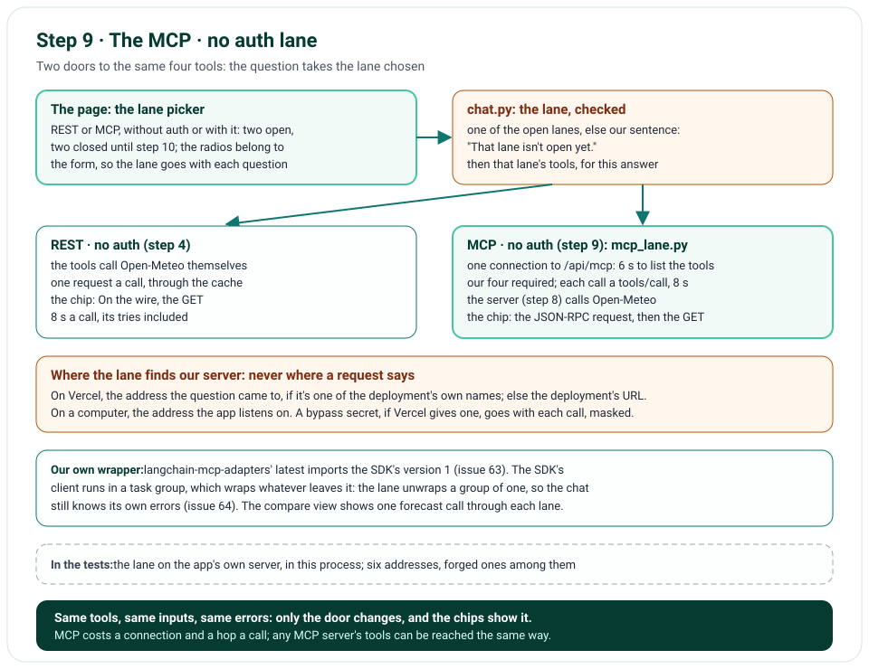

# Step 9 · The MCP · No Auth Lane

Step 9 gives the agent a second way to reach its four tools: MCP · no auth, through our own MCP server from step 8,
on this same deployment. The page gets a lane picker, REST or MCP, without auth or with it, the two with auth shown
closed until step 10; the question takes the lane chosen. On MCP · no auth, the answer opens one connection to
`/api/mcp` with the official SDK's client, checks our four tools are there, and runs each call as a `tools/call`. The
chips say which lane each call took, and show the JSON-RPC request as the client sent it, then the request the server
sent Open-Meteo. A compare view shows one forecast call through each lane, side by side.

**In one line:** the lane picker → `lane` in the form, checked → REST · no auth: the tools call Open-Meteo; MCP · no
auth: the tools call our MCP server, at an address of this deployment, which calls Open-Meteo → the chips show both
hops.

## What you'll build

- `nimbus/lanes.py`: the four lanes, two open; the form's `lane`, checked, its own sentence for one that isn't open.
- `nimbus/mcp_lane.py`: the MCP lane, one connection an answer, our four tools as LangChain tools made from our own
  definitions, each call a `tools/call`; where it finds the server; the requests it sent, kept for the chips.
- The lane picker in the form, and a compare view of one forecast call through each lane.
- The chips: the lane, and on MCP the two requests; `tool.call` and `chat.request` lines with the lane.
- `python -m tools.run_tool ... --mcp <address>`: a tool through the MCP lane, with no model and no key.

## What you'll learn

- How an agent calls tools through MCP, and what that costs next to calling the API itself.
- How a serverless app calls itself safely: at an address of its own, never one a request names.
- How to show the request a library really sends: a hook on its HTTP client, a secret masked.
- Why an error can come out of an anyio task group wrapped, and how to give it back as itself.
- How to keep two ways of doing one thing honest: one definition, and tests that the two agree.

## Before you start

- Step 8's project; no new package. The plan named `langchain-mcp-adapters` for the MCP lanes, but its latest still
  imports the SDK's version 1 (issue 63): the lane makes its LangChain tools itself.

## The design



| Decision | Why |
|---|---|
| The lane in the form, checked against the open ones | The page can send anything; a lane not open yet gets our sentence, as a broken rule does |
| Our MCP server on this same deployment | A preview talks to its own server, the code beside it; the lane needs no other address or key |
| The address: one of the deployment's own names, else its URL | A request's Host is the client's word: the lane never calls a name it gives (no SSRF); on a computer, the address the app listens on |
| One connection an answer: connecting and listing within 6 s | A question's calls share it; a server that doesn't answer fails the answer early, with our sentence |
| Our four tools required, from our own definitions | The model sees the same names, descriptions and inputs on both lanes; a server lacking one is McpLaneError |
| Each call a `tools/call` within 8 s, as on REST | The same limit for the same work |
| A failure: the same error as on REST, by its class's name | The chip and the model get the same sentence, whichever lane failed; one naming no class we know is the server refusing the call, which the chip shows as a call made the wrong way |
| The request as the client sent it, from a hook on its HTTP client | The chip shows what really went on the wire, the SDK's own headers and `_meta` included; any secret masked: the bypass secret, a credential, a cookie |
| An error out of the SDK's task group unwrapped | Else the chat sees a group, not our error, and says "Something went wrong" (issue 64) |
| Our own wrapper, not langchain-mcp-adapters | Its latest imports the SDK's version 1 (issue 63) |
| A compare view made by the lanes' own code | The REST request and the JSON-RPC message are the ones the lanes make; a test checks the MCP one against what's sent |

## Files

| File | What it does |
|---|---|
| `nimbus/lanes.py` | The four lanes; which are open |
| `nimbus/mcp_lane.py` | The MCP lane: its address, its connection, its tools, the requests it sent, its errors |
| `nimbus/tools.py`, `nimbus/agent.py`, `nimbus/answer.py` | A tool made with the run of its lane; the lane as LangSmith's tag; the answer with its lane's tools |
| `nimbus/chat.py` | `lane` in the form, checked; the lane's tools for each answer; the lane in `chat.request` |
| `nimbus/chips.py`, `templates/chat_parts.html` | A chip's lane; on MCP, the request to our server, then the server's to Open-Meteo |
| `nimbus/pages.py`, `templates/chat.html`, `public/static/app.css` | The lane picker and the compare view |
| `nimbus/config.py`, `nimbus/constants.py`, `nimbus/errors.py`, `nimbus/open_meteo.py`, `nimbus/app.py` | Vercel's names and bypass secret; ⑭ 6 s; the lanes' sentences; a request's body; the lane's factories |
| `tools/run_tool.py` | `--mcp`: a tool through the MCP lane |
| `tests/unit/test_mcp_lane.py`, `test_chat.py`, `test_chips.py`, `test_pages.py`, `tests/e2e/test_chat.py` | The lane; its address; a whole answer through it; the picker and the compare view |
| `tools/mutation_check.py` | 7 more rules |

## How it works

### The lane, chosen and checked

The lane picker's radios belong to the form (`form="chat-form"`), so the lane goes with each question. `ChatRequest`
takes `lane` as one of the open lanes' ids, REST · no auth's if none is sent; any other gets "That lane isn't open yet.
Please choose REST · no auth or MCP · no auth." `chat()` opens the lane's tools for the answer: on REST, as before; on
MCP, `open_mcp_lane()`, at the address `to_self_mcp_url()` gives.

### The MCP lane: `nimbus/mcp_lane.py`

`to_self_mcp_url()` finds our server: on Vercel, at the address the question came to if it's one of the deployment's
own names (`VERCEL_PROJECT_PRODUCTION_URL`, `VERCEL_BRANCH_URL`, `VERCEL_URL`), else at the deployment's URL; on a
computer, at the address the app listens on. `open_mcp_lane()` hooks the HTTP client so every request it sends is
kept, adds the bypass secret if Vercel gives one, connects with the SDK's `Client` and lists the tools within 6 s, and
checks our four are there. Each tool is `to_langchain_tool()` with the lane's own run: a `tools/call` within 8 s, its
answer read back as the tool's run: the weather from the structured content, the summary from the text, the cache's
part and the server's request from `_meta`, and the request the lane sent, found among those kept, any secret in it
masked. An answer that's an error raises the error its `_meta` names, the same as on REST; one that names no class we
know, a tool error with the server's text; a call that can't be made, McpLaneError. The SDK's client runs in a task
group, which wraps whatever leaves it: `unwrap()` gives the error inside back, its cause kept; from a group of more,
the cancellation or closing it holds, else McpLaneError (issue 64).

### What the chips and the compare view show

A chip on MCP says "MCP · no auth · weather-chatbot-hazel.vercel.app · 0.6 s"; opened, "On the wire" is the JSON-RPC
request the lane sent, and "Then, from our MCP server" the one the server sent Open-Meteo, the first time's if the
cache answered. The compare view builds one forecast call for each lane with the lanes' own code: REST's request, MCP's
`tools/call`, and "Opens in step 10." for the two with auth.

## Run it

With the app running (`uv run uvicorn main:app`), the runner runs one tool through the MCP lane, as an answer would,
with no model and no key:

```text
$ uv run python -m tools.run_tool get_air_quality '{"latitude": 28.65, "longitude": 77.23}' \
  --mcp http://127.0.0.1:8000/api/mcp
{"tool": "get_air_quality", "lane": "mcp-no-auth", "status": "ok", "ms": 612, "event": "tool.call", "level": "info",
 "ts": "2026-10-31T15:31:43.658643Z", "env": "local", "commit": null, "deploymentId": null}
POST http://127.0.0.1:8000/api/mcp
host: 127.0.0.1:8000
accept-encoding: gzip, deflate
connection: keep-alive
user-agent: python-httpx2/2.13.1
accept: application/json, text/event-stream
content-type: application/json
mcp-protocol-version: 2026-07-28
mcp-method: tools/call
mcp-name: get_air_quality
content-length: 314

{
  "jsonrpc": "2.0",
  "id": 3,
  "method": "tools/call",
  "params": {
    "name": "get_air_quality",
    "arguments": {
      "latitude": 28.65,
      "longitude": 77.23
    },
    "_meta": {
      "io.modelcontextprotocol/protocolVersion": "2026-07-28",
      "io.modelcontextprotocol/clientInfo": {
        "name": "mcp",
        "version": "0.1.0"
      },
      "io.modelcontextprotocol/clientCapabilities": {}
    }
  }
}
Then, from our MCP server:
GET https://air-quality-api.open-meteo.com/v1/air-quality?latitude=28.65&longitude=77.23&
  current=pm2_5,pm10,european_aqi,us_aqi&timezone=auto
accept: application/json
→ US AQI 141 · European AQI 107
{
  "latitude": 28.65,
  "longitude": 77.23,
  "time_zone": "Asia/Kolkata",
  "observed_at": "2026-10-31T20:30",
  "pm2_5": 106.4,
  "pm10": 295.2,
  "european_aqi": 107,
  "us_aqi": 141
}
```

With your key in `.env.local`, choose MCP · no auth on the page, and ask about Paris: each chip says the lane, and
opens to both requests. Open "Compare the lanes" to see one call through each.

## Test it

```text
$ uv run ruff check .
All checks passed!
$ uv run ruff format --check .
89 files already formatted
$ uv run mypy
Success: no issues found in 58 source files
$ uv run pytest
463 passed in 7.77s
$ uv run pytest tests/e2e --browser-channel msedge
147 passed in 109.90s (0:01:49)
$ uv run python tools/mutation_check.py
...
caught: the MCP lane never calls a host a request names
caught: the MCP lane checks our four tools are offered
caught: a chip masks the bypass secret
caught: an MCP tool's failure is the same error as on REST
caught: an error out of the MCP lane is never wrapped
caught: a lane that isn't open is refused
caught: a chip names its lane
128 of 128 caught
```

The unit tests open the lane on the app's own MCP server, in this process: our four tools, with our inputs; a call
whose record holds the request the lane sent and the server's to Open-Meteo, and the second time the cache's part; a
failure that's the same error as on REST, and one naming no class we know a tool error; a server that lacks a tool, or
can't be reached, McpLaneError; an error the answer raises, out as itself, and a bigger group's ending; the bypass
secret, a credential and a cookie masked; the compare view's message, the one sent; and where the lane finds the
server, for six requests, forged names among them. A whole answer on MCP goes through the route; a closed lane and an
unknown one get our sentence; a chip names its lane; the page has its picker and its compare view. In the browser, the
picker takes a question through our server, and the compare view passes axe and fits a phone. The mutation check
breaks 7 more rules (its first 121 lines are left out above; each says caught).

## Things to take care of, and pitfalls

- **Never call an address a request names:** a serverless app calling itself must choose the address itself.
- **A library's task group can wrap your errors:** unwrap a group of one, or your error handling never sees them.
- **Show what was really sent:** hook the HTTP client; a request you rebuild can say something the wire didn't.
- **Mask a secret wherever a request is shown:** the bypass secret goes on every call.
- **A package's metadata can promise what its code can't:** `uv` installed langchain-mcp-adapters beside the SDK's
  version 2, and its import failed (issue 63).
- **Building the app sets the logging up again:** build it before a test captures logs.

## Issues we hit

63. langchain-mcp-adapters' latest imports the SDK's version 1: the lane makes its LangChain tools itself.
64. An error out of the SDK's client came out wrapped in a group: the lane unwraps it.

Each is told in full, with how it was found and how it's checked, in [Issues and fixes](issues.md).

## Interview questions

**1. What does an MCP lane cost next to calling the API itself?**
A connection and a tool list before the first call, then a hop to the MCP server for each call, before the server
calls the API. In return, any MCP server's tools can be reached the same way.

**2. How does a serverless app call itself safely?**
At an address it knows is its own: one of the names its platform gives it, else its deployment's URL; never the Host a
request sends, which the client controls.

**3. How do you show the request a library sends?**
Hook its HTTP client: every request goes through the hook as it's sent, and a secret is masked before it's shown.

**4. Why can an error come out of a task group wrapped?**
anyio and asyncio task groups gather the errors of their tasks into an exception group; an error raised inside the
group's block leaves it wrapped. Give a group of one back as the error inside.

**5. How do you keep two lanes the same?**
One definition for both, the same names, descriptions and inputs; the same errors, by name; and tests that the two
agree.

## Things to try

- Run the runner with `--mcp` twice: the second chip-to-be says the cache answered.
- Choose MCP · no auth, ask a question, and compare its chips' times with REST's.
- Open "Compare the lanes", and set the two requests side by side.

## What's next

Step 10 opens the two lanes with auth: Apify's Actor over REST and over Apify's MCP server, each falling back to its
twin with no auth.
