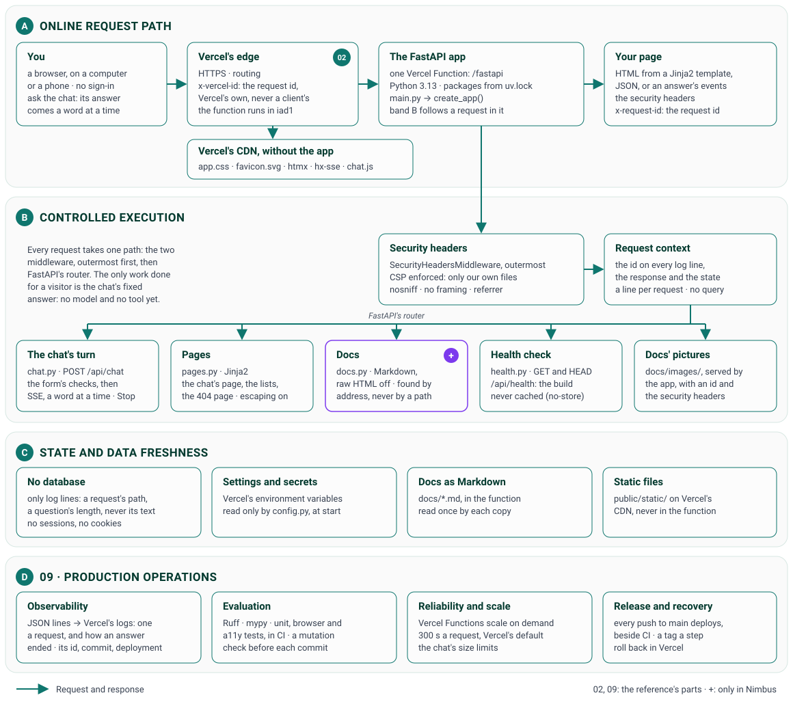

# System Design

How Nimbus is built after step 7, drawn the way the TypeScript version's
[System design_deprecated](system-design_deprecated.md) was: as a common reference design for AI assistants draws an
online shop's assistant, in four bands, from the request's path at the top to running it in production at the bottom.
A number on a box is the reference's number for the part it plays (02 for the gateway, 09 for production operations);
**+** marks a part only Nimbus has. Step 1 laid the ground the assistant will stand on: the pages, the documentation
and the health check. Step 2 made the chat answer, streamed a word at a time. Step 3 put Gemini in place of step 2's
fixed answer, through LangChain. Step 4 gave it four weather tools, which call Open-Meteo: the REST · no auth lane.
Step 5 made the agent that runs them a LangGraph graph of our own. Step 6 gave the chat a memory, kept in the
browser. Step 7 keeps Open-Meteo's answers in Vercel's Runtime Cache. Each step adds its parts to this page.
Below the diagram, each band is described, then each part of the reference is set against what Nimbus has so far.



## The four bands

### A · The online request path

1. **You**, in a browser, on a computer or a phone, open a page: the chat, the documentation, or this one; or ask the
   chat a question: a chip for each tool call behind its answer, then the answer, Gemini's, a word at a time. There's
   no sign-in.
2. **Vercel's edge** (02) serves HTTPS and routes the request. It gives the request an id, `x-vercel-id`, which a
   client can't forge: sent with a request, it's replaced by Vercel's own (checked on the live site). Five files never
   reach the app: **Vercel's CDN** serves the stylesheet, the icon, htmx, its stream extension and our `chat.js` from
   `public/` itself, with the security headers `vercel.json` gives them.
3. **The app**, one Vercel Function (`/fastapi`, Python 3.13, in `iad1`, Washington, D.C.), runs `main.py`'s FastAPI
   app, which `create_app()` builds when the function starts. Band B follows a request through it.
4. **Your page** comes back as HTML from a Jinja2 template, as JSON from the health check, or, for a question, as the
   answer's stream: server-sent events of HTML, which htmx puts into the page. Each carries the security headers and
   the request's id in `x-request-id`.

### B · Controlled execution

Every request takes the same path through the app: the two middleware classes, outermost first, then FastAPI's
router. The only work done for a visitor is the chat's answer: the agent's run, which calls the model and the weather
tools, and through them Open-Meteo.

- **The security headers** (`SecurityHeadersMiddleware`, outermost): on every response the app makes, an enforced
  Content Security Policy that allows only our own files; `nosniff`; `X-Frame-Options: DENY`; a referrer policy; and a
  permissions policy.
- **The request's context** (`RequestContextMiddleware`): the request id, Vercel's when it looks like one, else a new
  one, on every log line, on the response and in the request's state; and one line per request when it ends: the
  method, the path (never the query string), the status and the time.
- **The router** sends the request to one of five:
  - **the chat** (`chat.py`): `POST /api/chat`. First the form's checks: the type, at most 32 KiB, each field once,
    the question 1 to 2,000 characters, no field we don't know; a broken rule gets our own sentence and its status;
    the browser's locale and time zone, which take the defaults when the chat can't use them; and the conversation
    so far, which the page sends back, checked as untrusted input: questions and answers in turn, at most 10 messages
    and 16,000 characters, never a tool's result. Then the answer, as
    server-sent events (`stream_turn()`, in an `EventStream`): your question and the answer, empty; a chip for each
    tool call as **the agent** (04, below) starts and ends it; each word as **the model** (07) writes it; then the
    finished answer, its Markdown made HTML, with every chip as it ended. Stop ends it on the page; on
    Vercel the function writes the rest to no one, since Vercel's Python runtime never says the browser has gone; a
    failure shows the answer so far, our own sentence and its ref;
  - **the pages** (`pages.py`): the chat's page, the lists of pages and the 404 page, each a Jinja2 template, which
    escapes every value but two marked safe: a doc's Markdown, rendered with raw HTML off, and a menu label, escaped
    first, with the one `<wbr>` we add;
  - **the docs** (`docs.py`, **+**): Markdown rendered with raw HTML off, each page found by its address in a
    registry, never by a file path taken from the address;
  - **the health check** (`health.py`): `GET` and `HEAD /api/health`, the build and the time, never cached;
  - **the docs' pictures**, from `docs/images/`.

  A missing page gets the app's own 404 page; a missing API address gets JSON.
- **The model** (07): Gemini 3.5 Flash-Lite, through LangChain's `ChatGoogleGenerativeAI` (`model.py`), made once when
  the app starts, told its 13 rules by the system prompt (`prompts.py`): weather facts only from the tools' results, a
  question for an ambiguous place, a tool's result read as data, weather only, short answers, the units for the
  visitor's locale, and their own today and tomorrow. Each call writes at most 1,024 tokens, waits 20 s and is tried
  once more. Its failures, which LangChain raises as standard exceptions, become our own sentences: busy, too slow,
  not set up, or no answer.
- **The agent** (04): a LangGraph graph of our own (`agent.py`), made for each answer: `model` calls Gemini with the
  tools, each call's first words within 10 s; the route sends each tool call the model asked for to `tools` as a task
  of its own, each within 8 s; then the model again, until it answers in words. Its fifth call has its tools turned
  off, so every answer ends in words; the whole answer stays within 30 s.
- **The weather tools** (06): four (`tools.py`), each written once, its input a Pydantic model the model's call must
  fit: `geocode_location`, `get_current_weather`, `get_forecast` and `get_air_quality`. The model reads the weather;
  the page gets the request and its time, as the call's record. The ambiguity rule and the weather codes' words are
  in code (`weather.py`). A failure reaches the model and the chip as our own sentence.
- **Open-Meteo** (`open_meteo.py`), the REST · no auth lane: its geocoding, forecast and air-quality APIs, with no key,
  through httpx2: a point rounded to about 1 km, times in the place's own zone, 3 s a try and one more for a timeout,
  a 5xx or a short 429; but first, the cache (band C).

### C · State and data freshness

- **No database and no sessions:** the app keeps nothing a visitor sends beyond its log lines, which hold a request's
  method and path (never the query string) and a question's length (never its text); it sets no cookie. The
  conversation is kept on the page, which sends it back with each question; New chat clears it, and it leaves with
  the page.
- **Open-Meteo's answers** are kept in Vercel's Runtime Cache (`cache.py`), which every copy of the app shares, and
  on Hobby every project of the team: under our namespace, each key the SHA-256 of the request's address. A place is
  kept 30 days; a forecast 30 minutes, never past its place's midnight; the air 30 minutes; the weather now 10. An
  answer kept is checked as a fresh one is; only answers that worked are kept; a read or a write that fails, or takes
  more than 1 s, is a miss.
- **Settings and secrets** are Vercel's environment variables, or `.env.local` on a computer, which git never sees;
  `config.py` is the only module that reads them, checked when the app starts. Vercel's own (the environment, the
  commit, the deployment) come from the real environment only. The app reads `LOG_LEVEL`, the Gemini key (a Sensitive
  variable) and model's name, and LangSmith's variables. The other keys set in Vercel for the TypeScript version
  (Apify's, Axiom's, Sentry's) wait for the steps that use them, all but Sentry's three build variables, which are to
  be deleted ([To do](todo.md)).
- **The docs** are Markdown in `docs/`, deployed with the function, each page read once by each copy of it.
- **The static files**, `public/static/`, are on Vercel's CDN, never in the function.

### D · Production operations

- **Observability** (09): JSON lines (structlog), on stdout, which Vercel's logs keep: one per request, and for each
  question, `chat.request` (its length) and how its answer ended, `chat.done`, `chat.aborted` or `chat.failed`, or
  `chat.rejected` with the broken rule's code; an answer's end holds its tool calls, its tokens and the model; each
  tool call writes `tool.call` (the tool and its time, never its input), and each request to Open-Meteo
  `upstream.http` (its host and path, never its query string, and its tries). Every line carries the
  request id, the environment, the commit and the deployment, so one search for an id finds a request's lines. The
  field names are the TypeScript version's (`requestId`, `deploymentId`), so the queries written for it still match.
  Another library's warnings and errors become lines of ours too, any query string cut off; their info lines are
  never written. LangSmith traces each agent run, each call to the model and each tool call in it, with its timing
  and tokens, its inputs and outputs hidden.
- **Evaluation** (09): Ruff, mypy in strict mode, unit tests, and browser tests on every page and of the chat, with
  axe's accessibility checks, which CI runs on every push that touches the project; and a mutation check, which breaks
  each rule on purpose to show a test catches it, run before each commit.
- **Reliability and scale** (09): Vercel Functions start as many copies of the app as the traffic needs, each request,
  an answer's stream included, stopping at 300 s at most, Vercel's default (`vercel.json` sets no limit); the static
  files don't need the app at all.
- **Release and recovery** (09): every push to `main` deploys to production, side by side with CI, so a failing CI
  doesn't hold the deployment back. Any push means any: one that changes only another project in the repository
  deploys Nimbus again too, and the menu's build label then names that commit. Each step is tagged (`py-step-01`,
  `py-step-02`, and so on), Vercel can roll back to an earlier deployment, and the TypeScript version's code is kept
  in the tag
  `weather-chatbot-typescript-backup`.

## Compared with the reference

| The reference | Nimbus after step 4 | Why, or when |
|---|---|---|
| Shopper: web or mobile chat | You, in a browser, on a computer or a phone: Gemini answers from the weather tools' results, each call a chip | |
| 02 · API gateway and identity: WAF, rate limits, sign-in | Vercel's edge: HTTPS, routing, and a request id it sets itself; the security headers on every response, the CDN's files included | The weather is public, so there's no sign-in. Rate limits come with the firewall's rules (step 11) |
| 01 · Input guardrails: injection, PII, scope | In part: the form's checks: its type, at most 32 KiB, each field once, the question 1 to 2,000 characters, a language tag and a known time zone, no field we don't know; each tool call's input checked against its schema | Rules against prompt injection come in step 11 |
| 03 · Semantic cache: safe answers, by similarity | None | The weather changes by the hour, so a cached answer would go stale; Open-Meteo's answers are cached instead, each for its own time (step 7) |
| 04 · Router and orchestrator: intent, step limits, time budgets | FastAPI's router; our own LangGraph graph: 5 calls to the model, the last with its tools off; 10 s for each call's first words, 8 s a tool call, 30 s an answer, which Stop ends on the page (on Vercel, the function goes on to the end) | |
| 01 · Output guardrails: safety, privacy, grounding | In part: Jinja2 escapes every value but the two marked safe; an answer's Markdown renders with no raw HTML and no pictures, its links in a new tab; the rules: weather facts only from the tools' results, a tool's result read as data; the page puts in only our own HTML, and our script only text; the policy runs only our own files | Nothing checks an answer before it streams |
| Answer: citations or a safe refusal | Gemini's answer, a word at a time, after a chip for each tool call, which opens to its request, input and output; a polite refusal off the weather; our own sentence for each thing that can go wrong, a failure's with its ref | |
| 05 · Retrieval (RAG) and its index | None | The weather will come live from tools, not from documents |
| 06 · Commerce tools: typed inputs, per-user permissions | Four weather tools (`tools.py`), each input a Pydantic model; no per-user permissions, as the weather is public | The MCP lanes from step 8, the auth lanes in step 10 |
| Commerce APIs and databases | Open-Meteo's geocoding, forecast and air-quality APIs, with no key: 3 s a try, one more; their answers in Vercel's Runtime Cache | |
| 07 · Model gateway: model choice, budgets, fallback | Gemini 3.5 Flash-Lite through LangChain (`model.py`): 1,024 tokens, 20 s and two attempts a call; 5 calls and 30 s an answer; LangChain's standard exceptions mapped to our sentences | One model, no fallback yet |
| 08 · Human in the loop | None | |
| Knowledge ingestion, change events, index refresh | None | |
| Session store | The browser: the page keeps the conversation and sends it back with each question, checked as untrusted input; New chat clears it | |
| Secure storage | Vercel's environment variables, read only by `config.py`; the Gemini key a Sensitive one, a `SecretStr` in the app, never logged | |
| 09 · Observability: traces, p95 latency, tokens, cost, alerts | JSON lines with the request's id and its build, in Vercel's logs: one per request, each tool call and each request to Open-Meteo, and how each answer ended, with its tool calls and tokens; LangSmith's trace of each agent run, its inputs and outputs hidden | Axiom, Sentry and the dashboards come in step 12 |
| 09 · Evaluation: golden set, safety tests, feedback | Unit, browser and accessibility tests in CI; a mutation check before each commit | |
| 09 · Reliability and scale: autoscaling, caps, queues, breakers | Vercel Functions, as many copies as the traffic needs; the CDN for the files; the chat's size limits | |
| 09 · Release and recovery: load tests, canary, rollback, backups | Every push to `main` deploys, side by side with CI; a tag per step; Vercel can roll back | CI doesn't gate the deployment, so a failure shows after it's live. No backups: Nimbus stores no data |

## What Nimbus has that the reference doesn't

- **Its documentation, inside the app** (**+**): a chapter for each step, this page, the issues log, the interview
  guide and the to-do list, written as the steps are built, from the same Markdown GitHub shows.
- **The TypeScript version's pages, kept:** at their old addresses with `_deprecated` added, under "Deprecated" in the
  menu.

## One request, end to end

A real question on the live site, on 31 October 2026 (commit 3baecd9): "Will it rain in Paris tomorrow?", posted to
`/api/chat` as the page's form posts it, with the locale `en-US` and the time zone `America/Chicago`.

| Where | What happened |
|---|---|
| Vercel's edge, `cle1` (Cleveland) | Took the HTTPS request, gave it the id `cle1::swxbm-1793438921786-1986053d1d52`, and sent it to the function in `iad1` |
| `SecurityHeadersMiddleware`, `RequestContextMiddleware` | Wrapped the response's `send`, and took Vercel's id as the request's id, in the log context and the request's state |
| `chat.py`, `chat()` and `read_chat_request()` | Checked the form: its type, its length, its three fields, the question's 31 characters, the locale and the time zone; logged `chat.request` |
| `prompts.py`, `to_messages()` | The system prompt: the 13 rules, imperial units for `en-US`, and the visitor's today and tomorrow in Chicago; then the question |
| `chat()`, then `EventStream` | Made the turn's first event, then sent it and the rest as they came, the first 0.25 s after the question was sent |
| `answer.py`, `stream_weather_answer()` | Opened the answer's HTTP client, from the app's factory, and made the four tools and the agent for it |
| `agent.py`, the agent | Called Gemini (0.89 s), which asked for `geocode_location`; ran it; called Gemini again (0.54 s), which asked for `get_forecast`; ran it; called Gemini a third time (1.17 s), which answered in words |
| `tools.py`, `open_meteo.py` | `geocode_location`: Open-Meteo's geocoding, "Paris", in 422 ms; `get_forecast`: its forecast for 48.85, 2.35, 2 days, imperial, in 415 ms; each logged `upstream.http` and `tool.call` |
| `stream_turn()` | A chip for each call as it started (1.15 and 2.12 s) and as it ended (1.59 and 2.55 s); the words from 3.26 s; logged `chat.done`: 100 characters, 3,476 ms, 2 tool calls, 5,150 tokens in and 89 out |
| `RequestContextMiddleware` | Once the whole response had gone, wrote the request's line: `200`, in 3,505 ms |
| Vercel's edge | Passed each event on as it came, with the security headers and the request's id |

Searched for the id, Vercel's logs found its seven lines, the question's text and the place in none of them:

```json
{"questionChars": 31, "event": "chat.request", "level": "info", "ts": "2026-10-31T09:28:41.911282Z",
 "env": "production", "commit": "3baecd9", "deploymentId": "dpl_DNqnKzjqvAu7tccyhBGobeKH5JyK",
 "requestId": "cle1::swxbm-1793438921786-1986053d1d52"}
{"upstream": "open-meteo", "host": "geocoding-api.open-meteo.com", "path": "/v1/search", "status": "ok",
 "httpStatus": 200, "ms": 422, "attempts": 1, "event": "upstream.http", "level": "info",
 "ts": "2026-10-31T09:28:43.276763Z", "env": "production", "commit": "3baecd9",
 "deploymentId": "dpl_DNqnKzjqvAu7tccyhBGobeKH5JyK", "requestId": "cle1::swxbm-1793438921786-1986053d1d52"}
{"tool": "geocode_location", "lane": "rest-no-auth", "status": "ok", "ms": 422, "event": "tool.call", "level": "info",
 "ts": "2026-10-31T09:28:43.277068Z", "env": "production", "commit": "3baecd9",
 "deploymentId": "dpl_DNqnKzjqvAu7tccyhBGobeKH5JyK", "requestId": "cle1::swxbm-1793438921786-1986053d1d52"}
{"upstream": "open-meteo", "host": "api.open-meteo.com", "path": "/v1/forecast", "status": "ok", "httpStatus": 200,
 "ms": 415, "attempts": 1, "event": "upstream.http", "level": "info", "ts": "2026-10-31T09:28:44.235364Z",
 "env": "production", "commit": "3baecd9", "deploymentId": "dpl_DNqnKzjqvAu7tccyhBGobeKH5JyK",
 "requestId": "cle1::swxbm-1793438921786-1986053d1d52"}
{"tool": "get_forecast", "lane": "rest-no-auth", "status": "ok", "ms": 416, "event": "tool.call", "level": "info",
 "ts": "2026-10-31T09:28:44.236060Z", "env": "production", "commit": "3baecd9",
 "deploymentId": "dpl_DNqnKzjqvAu7tccyhBGobeKH5JyK", "requestId": "cle1::swxbm-1793438921786-1986053d1d52"}
{"answerChars": 100, "ms": 3476, "toolCalls": 2, "tokensIn": 5150, "tokensOut": 89, "model": "gemini-3.5-flash-lite",
 "event": "chat.done", "level": "info", "ts": "2026-10-31T09:28:45.414506Z", "env": "production", "commit": "3baecd9",
 "deploymentId": "dpl_DNqnKzjqvAu7tccyhBGobeKH5JyK", "requestId": "cle1::swxbm-1793438921786-1986053d1d52"}
{"method": "POST", "path": "/api/chat", "status": 200, "ms": 3505, "event": "http.request", "level": "info",
 "ts": "2026-10-31T09:28:45.415208Z", "env": "production", "commit": "3baecd9",
 "deploymentId": "dpl_DNqnKzjqvAu7tccyhBGobeKH5JyK", "requestId": "cle1::swxbm-1793438921786-1986053d1d52"}
```

[Step 1's chapter](step-1.md) explains each of these parts in its code, [step 2's](step-2.md) the chat's,
[step 3's](step-3.md) the model's, and [step 4's](step-4.md) the agent's and its tools'.

## What comes next

Step 8 builds our own MCP server, with FastMCP, at `/api/mcp`, offering the same four weather tools. Each step after
it adds its parts to this page and its diagram; the plan, `PLAN.md`, has them all.
