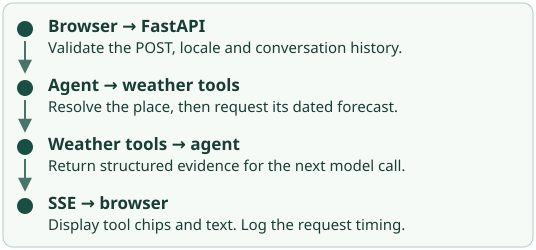
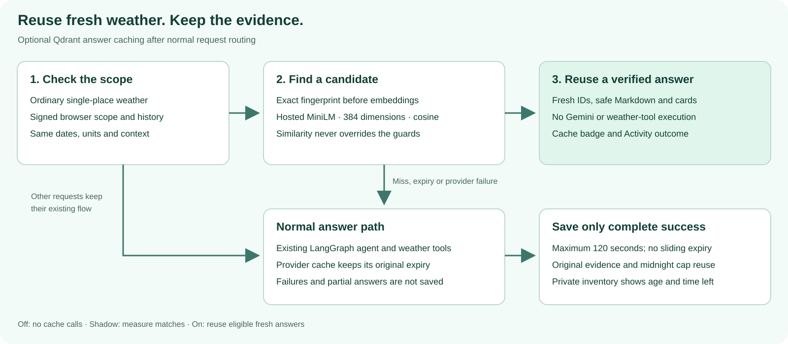

# Technical Details

Start in `nimbus/chat.py` for an unexpected reply, `nimbus/parks.py` for an unexpected passage, and
`nimbus/travel/` for trip dates or offers. Each path below names the functions that make the decision and
a way to observe the result.

## Follow a weather request



1. **Receive the question.** For “Will it rain in Paris tomorrow?”, `templates/chat.html` posts to
   `/api/chat`. The browser supplies locale, time zone and bounded history. `read_chat_request()` validates
   them. A question can contain up to 2,000 characters. History is limited to ten alternating messages
   and 16,000 characters in total. History is treated as untrusted text.
2. **Choose the execution path.** `chat()` recognizes explicit memory-management requests and loads usable approved
   preferences. It then checks park planning intent, city trip intake, missing hotel dates and requests beyond
   the forecast horizon before accessing Gemini. A city dates-only follow-up can reuse
   the earlier destination. The Paris weather question falls through to the agent. The supported daily
   forecast horizon is 16 days, and hourly output covers up to three days. Eligible ordinary weather questions
   can check the optional answer cache before constructing the agent; this specific rain question is excluded.
3. **Run the graph.** `nimbus/agent.py: make_agent()` binds the tools for this turn. Gemini can request a
   place lookup and then a forecast at the chosen coordinates. LangGraph's `Send` can dispatch independent
   calls in parallel. At most six tool calls fit in a model round. The fifth model call has tools turned off.
   The first model chunk has a ten-second deadline, within the turn's 30-second unauthenticated or 50-second
   authenticated budget.
4. **Return evidence and text.** `nimbus/answer.py` turns graph events into tool starts, tool outcomes and
   text. The chat streams HTML using server-sent events (SSE). Expand a chip to see the tool, its timing
   and outcome. The final Markdown renderer filters links against the permitted sources. If a weather lane
   fails, the request outcome and Activity timeline can retain the failure even after partial output.
   [Agent chapter](step-5.md) · [Streaming chapter](step-2.md).

Completed weather calls also feed `nimbus/weather_cards.py`. It validates the tool JSON and groups results by
coordinates, destination time zone and returned units. The chat shows current conditions, feels-like temperature,
wind, daily highs and lows, precipitation probabilities, daylight details and up to six upcoming hourly samples.
Every requested daily forecast remains available. A city heading comes only from matching geocoded coordinates;
without that match, the heading names the coordinates. Missing measurements remain unavailable, rather than zero.

`templates/weather_cards.html` and `/static/weather-cards.css` render these measurements separately from the model's
**Summary & context**. The original prose stays in `.answer`, so chat history and evaluation graders do not receive
duplicate card labels or values. The cards show the observation time, destination time zone, forecast check time,
source and cache status. Forecast check time is the tool's local reference time, not a forecast issuance time.
Failed tools do not create cards; successful weather can still appear alongside a later model error.

The offline regressions in `tests/unit/test_weather_cards.py` cover missing values, dates, daylight, city and unit
separation, malformed results and escaping. `tests/e2e/test_weather_cards.py` exercises the real streamed chat with
synthetic weather, follow-up history, phone layouts and accessibility. Run the corresponding evidence mutations with
`python tools/mutation_check.py --weather-cards`.

## Follow a weather cache hit

The answer cache is separate from Open-Meteo's provider cache and from Mem0 preferences. When enabled, a short
question such as “Dallas weather” first checks an exact fingerprint, then a semantic candidate from Qdrant.
There is no Gemini call just to decide whether two questions match. Eligibility and independent request guards
must also agree; a semantic score alone cannot authorize reuse.



| Responsibility | Code | Invariant |
| --- | --- | --- |
| Eligible request | `semantic_cache/policy.py`, `integration.py` | Short explicit single-place English weather overviews on REST without auth. Memory commands, trips, park guidance, alerts, safety advice, unknown context and other lanes retain their existing paths. |
| Browser and history | `semantic_cache/identity.py`, `integration.py` | A signed HTTP-only cookie lasts one day. Authenticated weather turns may switch unqualified cities while retaining units and time intent. Changed qualified locations, other constraints or altered history bypass reuse. |
| Candidate lookup | `semantic_cache/service.py` | Exact lookup before hosted MiniLM; both require matching browser, context and policy filters. Locally recheck record integrity, ownership, expiry and score. |
| Successful admission | `semantic_cache/evidence.py`, `chat.py` | Only complete successful geocoding and ordinary weather evidence is stored. Reject ambiguous destinations, mismatched coordinates or units, missing required forecast coverage, duplicate calls, tool errors and partial model output. |
| Original data age | `open_meteo.py`, `tools.py` | Versioned provider-cache envelopes carry original fetch and expiry times through tool records. Old entries without valid freshness metadata are fetched again. |
| Output and inventory | `weather_cards.py`, `semantic_cache/page.py` | Re-render typed evidence and safe Markdown with new turn IDs. The private page lists normalized labels, source age and expiry; it never shows raw question or answer text. |

Qdrant's hosted `sentence-transformers/all-minilm-l6-v2` produces 384-dimensional dense embeddings. The dedicated
collection uses cosine distance. The existing asynchronous `httpx2` dependency calls Qdrant's REST API with the
key in an `api-key` header, bounded response sizes and timeouts. No Qdrant SDK, Torch or local embedding model is
added to the Vercel runtime. The hosted model is available on Qdrant Free; its availability and limits remain
provider-controlled. [Qdrant inference documentation](https://qdrant.tech/documentation/cloud/inference/).

The default semantic cutoff is `0.80`, a measured candidate threshold, not a confidence guarantee. Browser scope,
place spelling and qualifiers, overview/current/today intent, calendar date, units, locale and time zone remain
independent requirements. Context fingerprints cover the prompt contract, model, build, enabled features and
preference revision/mode. Unrecognized place spellings and unsupported wording fall back safely rather than
guessing that two nearby vectors refer to the same city.

The approved alias `Vizag` resolves to `Visakhapatnam` in both the location guard and embedding input; explicit
region/country qualifiers remain required. Dallas and Vizag occupy separate entries, and a signed conversation
can switch between them. General weather validates forecast coverage against the destination's current date.
Explicit “today” retains the browser date defined by the prompt and requires that date in the returned forecast.
Neither case can reuse an answer beyond either time zone's midnight.

A completed eligible weather turn receives its signed history receipt even when its evidence is not stored.
The receipt authenticates the conversation, not the weather data. This lets a later eligible city question cache
normally after an incomplete result; failed or cancelled streams and altered history still cannot mint receipts.
Conversations already missing a receipt from an older build need New chat once; unsigned history is never trusted
retroactively.

The cache deadline is the earliest of save time plus 120 seconds, each original provider expiry, and midnight in
the visitor and destination time zones. Reading a hit never renews it. The page rechecks expiry when rendering;
remaining seconds are a snapshot at refresh. Expired points can remain physically stored while idle. Later stores
opportunistically delete expired entries across cache versions, while read-time checks always prevent reuse.

The record contains Markdown, validated weather evidence and minimal policy metadata under an opaque browser scope.
An HMAC protects integrity; it does not encrypt the stored record. Eligible weather text is sent to Qdrant for
embedding, and the provider stores its vector and answer payload. Full chat history is not sent to Qdrant.
Questions, answers, vectors, scopes, preferences and keys are absent from application logs and LangSmith traces.
The browser cookie is separate from Mem0 consent; sharing a browser profile also shares its cache inventory.

Three deployment modes make rollout explicit: `off` makes no cache network calls; `shadow` records matches while
the normal agent still answers; `on` allows accepted hits to bypass Gemini and weather tools. A hit has a fresh
feedback reference and a “Cached answer” badge. Activity records `workflow=cached` and cache operation outcomes,
with an explicit explanation that no new model run was needed. With tracing enabled, the request still has its
own LangSmith root and cache lookup steps; it does not replay the previous answer's model or tool spans.
Timeouts, malformed records, refusals, quota limits and failed writes leave the normal answer flow available.

### Trace a cache decision

The request's **Weather answer cache lookup** step records `exact_hit`, `semantic_hit`, `miss`, `shadow_hit`,
`error` or `bypass`. **Weather answer cache store** records `saved`, `not_reusable`, `cache_full`, `error` or
`bypass`. A step returning an error is marked Failed even when the cache adapter catches the exception so that
the ordinary answer can continue. A cache failure alone does not mark a successful chat request failed.

Each provider operation nests under the lookup or store that started it: **Qdrant exact match**, **Qdrant
similarity search**, **Qdrant remove expired**, **Qdrant count** and **Qdrant save**. Only operations that ran
appear. An exact hit needs no similarity call; a full cache needs no save call. Operation outcomes distinguish
completed work from a match, a capacity decision or an error. Cancellation closes the active spans, while a
provider timeout is an error. A failed trace upload cannot change the answer or cache result.

The similarity step records the configured threshold as a finite number from 0 to 1. A returned candidate's
score is recorded only when it is a finite number from -1 to 1. Qdrant applies the threshold before returning
candidates, so a miss may have no score; Nimbus never invents a score for it. These numbers help inspect the
cutoff but do not replace the independent ownership, context, location, units and freshness checks.

When a request skips lookup, the root records `cache_outcome=bypass` and a fixed `cache_bypass_reason`.
Reasons distinguish `disabled`, `unconfigured`, `ineligible`, `unverified_history`, `incompatible_history`,
`workflow`, `lane`, `origin`, `memory_unavailable` and `not_evaluated`. These are categories, not captured
question text or private context. Lookup outcomes are also recorded on the root; store outcomes remain on
their own step so a later failed write cannot overwrite the original lookup decision.

The Nimbus trace explorer shows the allowed outcome, bypass reason, similarity score and threshold alongside
timing and status. The reader accepts these fields only for recognized cache spans or the request root and
discards unrecognized metadata. Cache traces have empty inputs and outputs: no question, answer, vector,
browser scope, history, guard, preference or key is sent. Raw provider errors are replaced by a fixed message.
Offline tests use the real LangSmith serializer to check outcomes, parent relationships, bounded measurements,
error and cancellation handling, and the absence of private values; mutation checks protect these behaviors.

Local validation on 9 November 2026 passed the affected unit checks, five Chrome cases (including desktop/mobile
layout and accessibility), and all 16 affected mutations. Ruff and strict mypy passed; two independent reviews
found no blocking issues. No full-suite run, deployment or live LangSmith delivery check was performed for this
change. Existing traces are not backfilled; the extra detail applies to requests made after deployment.

### Configure and validate answer reuse

Set `QDRANT_URL` and `QDRANT_API_KEY` only in ignored `.env.local` for local work. `SEMANTIC_CACHE_MODE` defaults to
`off`; start with `shadow`. `QDRANT_COLLECTION` defaults to `nimbus_weather_cache`, and the threshold is optional
configuration. Runtime access needs only the dedicated collection; the setup command needs collection-management
permission. Key rotation invalidates existing cache signatures and browser scopes, which can safely expire.

```sh
uv run python -m tools.setup_semantic_cache
uv run pytest tests/unit -k semantic_cache
uv run pytest tests/e2e -k semantic_cache --browser-channel chrome
uv run python -m tools.eval_semantic_cache --cases evals/semantic_cache.json
uv run python -m tools.eval_semantic_cache --cases evals/semantic_cache_heldout.json
```

The setup command creates or verifies a compatible collection without replacing it, applies six filter indexes,
and enables Qdrant strict limits of 2,000 points and 120,000,000 payload bytes. A count admission check reduces
unnecessary writes; the server-side strict limits enforce capacity across simultaneous Vercel instances.

Mock-provider tests prove adapter behavior, expiry, ownership, history integrity, fallback and rendering. Chrome
tests cover the real form/history flow, cache badges, private inventory, phone layouts and accessibility. Those
tests do not establish the real embedding model's recall. Live evaluations use a separate `_eval` collection and
random synthetic scope, remove their own fixtures and report exact reuse, cross-browser isolation, false hits,
provider errors and positive recall separately. An unavailable run is not a pass. Inspect the JSON artifact and its
case IDs before enabling reuse. A case used to improve normalization becomes regression evidence, not a new held-out
test; the initial report remains available.
[Hosted settings and validation](waiting-on-you.md#qdrant-weather-answer-cache).

### Local validation on 9 November 2026

Local mode is `on` after these checks. The running local app and `/weather-cache` returned HTTP 200; the inventory
response uses `Cache-Control: no-store`. Vercel settings and an exact hosted-build check are still pending.

- **Unit and mutation checks:** all 2,021 unit tests passed in 72.25 seconds. All 12 cache mutations were caught,
  including the original-evidence-expiry guard added after the first mutation exposed a missing assertion.
- **Browser and harness regressions:** all 226 Chrome tests passed, including accessibility and responsive layouts.
  The offline harness replay passed 455 cases: 10 golden, 41 park, 4 provider, 7 red-team, 1 regression and 392 weekend
  cases. Replay exercises recorded or synthetic behavior; it is not three repeated live model trials.
- **Real hosted embeddings:** at the measured `0.80` threshold, the final normalized evaluation passed 18 cases,
  exact reuse and cross-browser isolation, with zero false hits, zero provider errors and positive recall `1.0`.
  Repository artifact: `evals/semantic-cache-last-run.json`.
- **The initial independent set exposed a limitation:** the frozen `0.80` run recalled 3 of 5 positive examples
  (`60%`). The original `evals/semantic-cache-heldout-run.json` is preserved. General normalization of question
  politeness and the approved `wether` spelling improved the same set to 10/10 overall. Place names, dates and units
  are unchanged. The refined `evals/semantic-cache-refined-run.json` is regression evidence; those examples are no
  longer an untouched held-out set.
- **Real chat smoke:** “Dallas weather” used Gemini and three weather tools, then stored a complete answer.
  “Weather in Dallas” in the same conversation produced `semantic_hit`, `workflow=cached` and zero tool calls,
  without another Gemini call. The private inventory returned HTTP 200 with entries.
  Sanitized repository artifact: `evals/semantic-cache-live-chat.json`.
- **Two independent reviews:** the resulting fixes preserve original source age, bind reuse to the prompt build
  and qualified history policy, require complete hourly/daily coverage, clean expired records across versions and
  count provider failures separately in evaluations. A mutation also exposed a missing original-evidence-expiry
  assertion; the regression now covers it.

## Follow a trip through the same endpoint

| Starting point | Code to inspect | What to check |
| --- | --- | --- |
| Broad city request | `travel/city_intake.py`, `travel/hotel_intake.py`, `forecast_horizon.py` | “Plan a trip to Dallas” asks for dates. A weather-specific follow-up can take the ordinary weather path. |
| Named park and weekend | `travel/planner_intake.py`, `weekend_dates.py`, `return_times.py` | The resolved destination, departure time zone and date range. An explicit deadline to arrive home takes precedence over an evening default. |
| Dated park briefing in chat | `travel/briefing.py`, `briefing_page.py`, `conditions.py` | `check_conditions()` runs forecast, stored guidance, NPS notices and NWS point alerts concurrently. The decision uses location, scope, coverage and overlap. |
| Confirmed park trip | `travel/planner_page.py`, `planner.py` | `make_plan()` collects flights, hotels, weather, preparation and NPS outcomes independently under a shared deadline. |
| An individual flight or hotel search | `travel/tools.py`, `service.py`, `kiwi.py`, `trivago.py` | The validated query, provider outcome and offer cards. Chat and the planner reuse the same search service. |

`nimbus/travel/models.py` accepts hotel dates as either `check_in` / `check_out` or the
`checkin_date` / `checkout_date` names a model may emit. The same date-order and stay-length validation
applies to both. A `TravelTurn` shares identical lookups within a request and caps distinct searches at two
per provider. The adapters return up to five validated offers. The browser gets eligible provider links,
while Gemini receives bounded offer facts with those URLs removed. [Travel tool contracts](step-18.md).

## Follow an approved preference

Mem0 is an optional preference store. It does not replace the park index, forecast cache or LangGraph agent.
Nimbus reads one typed profile for the current browser scope; it does not perform semantic search over conversation
history. The implementation uses bounded HTTP calls through `httpx2`, with no additional embedding model or Mem0 SDK
in the deployed function.

| Boundary | Code | What it enforces |
| --- | --- | --- |
| Allowed values | `memory/models.py: PreferenceProfile` | One three-letter airport code; metric or imperial units; USD, CAD, EUR or GBP; easy hikes, hiking, sightseeing or camping; morning, evening or by-noon departure. Every field can be unset. Extra fields are rejected. |
| Explicit approval | `memory/intake.py`, `memory/routes.py`, `templates/preference_form.html` | “Remember…” produces an editable preview. Only a validated save form with consent writes the selected fields. The model has no save tool. |
| Browser ownership | `memory/identity.py` | A signed, expiring HTTP-only cookie carries a random scope, mode and expiry. Forms have short-lived scope-bound tokens; mutations also require the same origin. Submitted record or user IDs cannot select another profile. |
| Provider ownership | `memory/client.py` | A fixed Mem0 host, bounded responses and pagination, owner metadata checks, supported schema and one canonical profile. Foreign, invalid or duplicate records do not become defaults. |
| Honest writes | `Mem0Service.save()` and `forget()` | Check the expected revision before saving, then verify values by reading them back. Delete only discovered owned records and confirm absence. A write acknowledgement alone is not success. |
| Optional request context | `memory/context.py` | Only an active browser identity and a ready snapshot supply defaults. Disabled, paused, conflicting and unavailable states leave the current request in control. |
| Trip precedence | `travel/preferences.py`, `planner_intake.py` | Current parsed instructions and explicit details of the active trip precede stored defaults. Apply the origin before local weekend dates; preserve driving and service opt-outs. Initial form prefill never overwrites submitted fields. |
| Independent units | `travel/park_forecast.py`, `BriefPreferences`, `ParkTrip` | Carry the chosen unit system through the briefing and confirmed plan. Use browser locale only when units are unset; keep currency separate. |

The five fields are serialized as JSON, with inference disabled when adding a Mem0 record. Nimbus sends neither
the full conversation nor an automatic summary to Mem0. An approved profile may enter the agent's context as defaults,
with an instruction that current details take precedence. The deterministic park intake uses the same typed values
directly. A saved preference never approves a flight or hotel search, changes a date already submitted, or supplies
evidence that a park is open or safe.

Open [My preferences](/preferences) to review, edit, pause or forget this browser's profile. It has no account recovery
or cross-device synchronization. A shared browser profile is shared access. Both the cookie and the stored record
receive a 180-day expiry from saving; expiry prevents normal use, but is not confirmed physical deletion. Forget
includes expired owned records. If deletion is uncertain, Nimbus keeps use disabled and retains the scope for a retry.
Clearing cookies before deleting can lose access to those records. New chat clears only conversation history.

Memory pages and responses use private, no-store caching. `memory.operation` events contain only action, bounded
status/reason, elapsed time and, when traced, a fresh operation trace ID under the normal request reference.
They omit preference values, owner and record IDs,
cookie contents, credentials and provider response bodies. Chat prompts and memory values are not logged or exposed
in public Activity. LangSmith input/output hiding continues to apply to agent context.

`memory/tracing.py` records independent `mem0.read`, `mem0.save` and `mem0.delete` tool roots using the existing
configured LangSmith client. Only empty inputs/outputs and fixed operation status/reason metadata are sent;
exception details and provider bodies are never attached. Each duration includes ownership checks and readback
verification. An empty read is successful; an unavailable, conflicting or unconfirmed operation is failed. A trace
write failure cannot change the preference operation, and cancellation still closes the trace safely. Uploads use
the SDK's existing background queue and bounded Vercel flush. A queued trace can take a moment to become readable.

In **Activity → Memory**, open the labeled read, save or delete trace. The explorer shows a Memory operation,
its duration and status, with zero model calls. A memory read and a later chat agent have separate links on the same
request: the read precedes the graph, while preference saves and deletions use their own HTTP requests. Internal
readback checks are part of the save/delete span, not extra user read operations. Pause is a local control and makes
no Mem0 call; resume traces its verification read. Tracing disabled means no memory trace is created, and old entries
are not backfilled. The existing LangSmith privacy settings and Activity query credential remain required.

For local setup, use `MEMORY_ENABLED`, `MEM0_API_KEY` and `MEMORY_COOKIE_SECRET` in ignored `.env.local`; the example
file contains placeholders. See [the hosted configuration checklist](waiting-on-you.md#mem0-travel-preferences).
The offline coverage lives in `tests/unit/test_memory_client.py`, `tests/unit/test_memory_travel.py` and
`tests/e2e/test_memory_preferences.py`. It exercises owned-profile handling, provider failures, preference precedence,
date boundaries and the browser controls without requiring a real visitor's stored preferences.

Trace coverage adds `test_memory_tracing.py` (actual SDK serialization, private-data canaries, safe failures and
project fallbacks), `test_memory_trace_routes.py` (real save/read/chat/delete requests), Activity linkage tests and
the Chrome trace explorer checks. Local validation on 9 November 2026 passed 1,810 unit tests, 18 Chrome trace and
preference tests, all 22 trace mutation checks, Ruff and strict mypy. Two independent reviewers rechecked the project
fallback correction and reported no remaining actionable findings. Hosted LangSmith delivery was not verified:
no local LangSmith credential was configured, and this validation did not deploy the changes.

## Reproduce a park retrieval

In the [Retrieval Playground](/knowledge/retrieval), select **The Narrows** and ask **What should I know about
flash floods?** Inspect the retrieved section and its source, then compare the highest-ranked candidate with
another candidate. Also try **What should I wear to hike The Narrows in Zion in spring?** The mode identifies
the available ranking branches; individual score contributions show which branches influenced each result.

1. **Prepare public text offline.** `park_ingest.py` extracts reviewed NPS sections. A pinned tokenizer splits
   passages within MiniLM's 256-token limit, including title and heading, without generating embeddings.
   `prepared.json` holds approved text and provenance; `catalog.json` holds only destination and integrity metadata.
   The matching version and complete-record hashes prevent a partial build or changed metadata being published.
2. **Publish once.** `tools.setup_park_search` stores text, provenance, the searchable `bm25_text` field and one
   hosted MiniLM vector per chunk in the same Qdrant collection. Native scored text indexing supplies BM25;
   it does not need another embedding model. Publication verifies every record and vector before its readiness marker.
   Repeated setup verifies existing records and does not regenerate their embeddings.
3. **Limit the candidates.** `ParkKnowledge.resolve()` uses approved destination names and aliases from the compact
   catalog. Both Qdrant search branches enforce matching generation, park, destination, eligible IDs and season.
   A visit date takes priority; otherwise an explicit season or one unambiguous seasonal phrase can restrict scope.
   Names such as Nevada Fall do not imply a season. Conflicting explicit date and season inputs are rejected.
4. **Calculate the scores.** Nimbus removes generic terms and expands reviewed concepts before sending the BM25
   query. The indexed field repeats the section heading for weighting and includes passage text. Qdrant calculates
   native BM25; hosted MiniLM supplies cosine similarity in the same collection. Reciprocal rank fusion combines
   qualifying ranks in Nimbus. The Playground shows actual query terms, raw scores, branch ranks and contributions.
   A cosine score is similarity, not an answer-confidence percentage. Equal totals break by passage ID.
5. **Validate the evidence.** Runtime passages and citations come from Qdrant. Each full record must match its
   approved complete-record hash, metadata, version and scope in `catalog.json`. At most four passages fit within
   10,000 text characters. Source pages and the vector explorer read this same verified collection; their PCA map
   uses actual hosted vectors, not newly generated ones. [Browse chunks and vectors](/knowledge/chunks).
6. **Check failure states.** `PARKS_RETRIEVAL_MODE=lexical` uses Qdrant BM25 only; `hybrid` and `auto` also request
   dense scores. A semantic-only failure retains already verified BM25 evidence and marks the dense branch failed.
   A catalog or BM25 failure makes retrieval unavailable. There is no local database fallback and no successful
   empty answer hiding an outage. Chat, trip planning and Playground share this core. [Implementation](step-16.md).

Dense ranks include cosine scores of at least `0.30`. A candidate with a positive BM25 match can receive that
semantic contribution; a candidate without a BM25 match needs cosine at least `0.55` to enter the fused result.
The score is `1 / (60 + BM25_rank) + 0.1 / (60 + semantic_rank)`, with absent or ineligible contributions set to zero.
Only `0.55` controls admission; `0.30` controls which BM25 matches get a semantic bonus. Fusion uses ranks, not
scores: a weak `0.31` cosine ranked first earns the same `0.1 / 61` bonus as a stronger first-ranked candidate.
These are calibrated heuristics, not confidence guarantees. The Playground displays active thresholds and branch
contributions rather than implying every returned vector changes ranking.

### Publish and validate hosted park search

The default collection is `nimbus_park_guidance_v3`, separate from `QDRANT_COLLECTION`, the private weather answer
cache. Public guidance has no answer-cache TTL or browser partition. Setup checks collection ownership, dimensions,
[native scored-text support](https://qdrant.tech/documentation/manage-data/indexing/#bm25-scoring) and matching
prepared/catalog versions. It sends approved title, section and text for
hosted 384-dimensional MiniLM embeddings and 96-dimensional ColBERT token vectors, verifies payloads and vectors,
then publishes a versioned readiness marker. ColBERT uses MaxSim with its HNSW graph disabled: it reranks a small
shortlist, rather than searching an approximate graph of every token.
It never runs at app startup. It never deletes weather-cache records or silently adopts an incompatible collection.

Use ignored `.env.local` for `QDRANT_URL` and credentials. The defaults select Qdrant and hybrid retrieval.
`PARKS_QDRANT_API_KEY` optionally overrides the existing Qdrant credential for park operations. Serving needs read
access; setup also needs collection/index/point write permissions. The development-only tokenizer has no model
weights. Neither preparation nor production needs Torch, Transformers, SentenceTransformers or an `ml` group.

```sh
uv run python -m tools.build_park_index
uv run python -m tools.setup_park_search --reuse-collection nimbus_park_guidance_v2
uv run python -m tools.eval_park_hybrid --recording evals/park-retrieval-recording.json
uv run python -m tools.eval_park_hybrid --cases evals/parks-colbert-holdout.json \
  --output evals/park-colbert-holdout-last-run.json
```

The reuse option verifies the previous collection's model, ownership, manifest and complete source records, then
copies its existing MiniLM vectors into the separate v3 collection. Only ColBERT embeddings are generated.
Omit that option on a fresh cluster. Repeating either setup verifies existing points without reembedding them.

Both evaluation commands call real Qdrant. One explained retrieval per question compares BM25, semantic-only,
scoped RRF and ColBERT on identical candidates, recording recall@4, top-1, MRR@4 and provider failures separately.
A provider failure cannot pass
as an unsupported-question abstention. The semantic-only comparison uses the `0.30` cutoff without BM25 admission
rules, so it exposes dense-only misses. These retrieval checks do not grade Gemini's answer faithfulness.

For credential-free checks, `tools.harness run --mode replay` uses `evals/park-retrieval-recording.json`. This contains
recorded Qdrant IDs, scores and statuses keyed by hashes of the exact reviewed query, method, scope and generation.
It contains no raw questions. Replay combines those scores with approved public prepared text and executes the real
resolver, fusion and evidence checks. Unknown questions, changed eval records and version mismatches fail closed.
This is **recorded Qdrant retrieval**, not a current provider-health or embedding-quality measurement. To deliberately
refresh it from the reviewed public eval suite, run `uv run python -m tools.park_replay` with configured credentials.

The search adapter sends the search question to Qdrant, without attaching full history or preference values. Setup
sends public source text. Logs and traces exclude questions, bodies, vectors and keys. **Activity → LangSmith trace**
shows catalog, BM25, semantic lookup, fusion and ColBERT steps, timings, fixed outcomes and bounded counts.
Failed branches remain visibly failed even when usable guidance survives. Playground requests can have a linked trace;
chat retrieval nests under its tool call. Health verifies the published Qdrant generation without generating vectors.

Local setup does not configure Vercel or validate a production build. Follow the exact-build checks on
[Waiting on you](waiting-on-you.md#qdrant-hybrid-park-retrieval).

### Scoped BM25 and ColBERT validation

BM25 now sends `params.idf.corpus` equal to its exact result filter: park, destination, season, generation and eligible
IDs. This restores destination-specific term frequency and length statistics instead of using shard-wide statistics.
The same MiniLM vectors, passage text, labels and RRF weights remain in use.

After RRF admission, Qdrant's hosted `answerdotai/answerai-colbert-small-v1` compares the full search question with at
most 12 candidates. It returns token-level MaxSim scores, not probabilities or cosine confidence values. Nimbus
verifies the complete shortlist and reorders it, then applies the existing four-passage/10,000-character budget.
Equal scores preserve RRF order. Timeout, malformed results or missing candidates retain the complete RRF ordering
and mark the attempted rerank span failed. The reranker shares the original 5.5-second retrieval deadline.
`PARKS_RERANK_ENABLED=false` disables this stage; lexical mode also skips it.

The main comparison preserves the prior artifact and records the new result in `evals/park-colbert-last-run.json`.
There are 41 resolved cases, of which 38 have labeled evidence; the other three check abstention.

| Main evidence measurement | Previous Qdrant hybrid | Scoped BM25 + RRF | With ColBERT |
| --- | --- | --- | --- |
| Top-ranked evidence | 30/38 (78.9%) | 33/38 (86.8%) | 34/38 (89.5%) |
| Evidence recall@4 | 100% | 100% | 100% |
| MRR@4 | 0.890 | 0.930 | 0.947 |
| Case rules passed | 41/41 | 41/41 | 41/41 |

The ColBERT run had zero provider failures. Relative to scoped RRF, four questions gain the first position and three
lose it while retaining evidence in the top four: `narrows-footwear-paraphrase`, `canyon-food-paraphrase` and
`narrows-spring-garments`. This is a modest aggregate gain, not a 95% result or an improvement on every question.

Eight additional questions were frozen before running ColBERT, in `evals/parks-colbert-holdout.json` (SHA-256
`7eb36463b333e44ec0133031cfda540c90700a2cbcfb2f1072156a168d3fdc9c`). Seven require evidence; one requires abstention.
Scoped RRF passed 7/8 with evidence recall 6/7 and top-1 3/7. ColBERT passed 8/8, with recall 7/7 and top-1 4/7,
zero provider failures. `evals/park-colbert-holdout-last-run.json` records that result. The set is small and does not
establish broad generalization. No Gemini answer evals or unrelated live eval suites were run for this change.

Live publication verified all 40 chunks, copied existing dense vectors and generated the additional ColBERT vectors.
A repeat publication made zero writes and generated zero embeddings. The prior park and weather-cache collections
remain unchanged. Replay now binds the v3 profile, models, scope, RRF policy and exact rerank shortlist.
Two independent reviews found no blockers; their test-budget and recording-preservation suggestions were addressed.

### Qdrant-only migration validation

This historical v2 migration measurement precedes the scoped-BM25/ColBERT results above.
The published generation `5b2eddcd5a2f6a24` preserves all 40 original passages across 13 documents and six destinations.
Tokenizer-only preparation reproduced the original complete-record fingerprint, with a maximum input of 252 tokens.
The live provider supports native BM25 and stores both passage payloads and actual 384-dimensional dense vectors.

| Real Qdrant comparison, 41 resolved cases | BM25 | Semantic-only | Hybrid |
| --- | --- | --- | --- |
| Case rules passed | 41/41 | 39/41 | 41/41 |
| Evidence recall@4 | 100% | 94.7% | 100% |
| Evidence top-1 | 73.7% | 81.6% | 78.9% |
| MRR@4 | 0.857 | 0.871 | 0.890 |

`evals/park-hybrid-last-run.json` records zero provider failures and no hybrid regression against the current BM25
baseline. Semantic-only still misses supporting evidence for `narrows-spring-wear` and `narrows-spring-tool-query`.
Their BM25 and hybrid passes show why both branches matter. Native Qdrant BM25 uses its own index statistics, so
its raw scores and order need not reproduce the retired local ranker's earlier calibration results below.
Compared with the previous recorded hybrid run, four cases moved their labeled evidence from first to second and
one moved from second to first. Top-1 fell from 86.8% to 78.9%; recall@4 stayed at 100%. This migration simplifies
storage and removes duplicate embedding generation; it is not a claim of improved ranking over the retired backend.

The full 47-case public run also passed, including unsupported and ambiguous destinations, and supplied the recorded
baseline. The offline harness passed 461/461 scenarios, including those 47 recorded park cases. Focused checks cover
unchanged source records, token limits, hash/version mismatches, failed providers, score bounds, replay scope and
question privacy. These reused examples are regression evidence, not an independent claim of general quality.
Final migration verification passed **2,487 unit tests**, **54 targeted mutations**, Ruff and strict mypy.
Two independent reviewers checked the changes; their outage-state, disclosure and deadline findings were fixed.
Chrome passed 15 controlled integration checks plus eight actual-Qdrant page checks at 360 and 1280 pixels, with
no accessibility violations or horizontal overflow. The live spring question returned hybrid results in 611–707 ms.
Publication verified all 40 vectors; repeat publication generated zero embeddings and wrote no points.
Gemini answer grading, live LangSmith delivery and exact-build production release checks remain separate.

### Hosted ranking calibration on 10 November 2026

**Historical evidence: this section describes the retired SQLite/local-BM25 architecture, not the current run.**

The first real-provider comparison exposed a regression: a `0.65` cutoff with equal branch weights reduced top-1
evidence from 81.6% to 76.3%, despite all 41 cases passing their top-four evidence rules. Calibration introduced
the `0.30` reranking / `0.55` semantic-only admission cutoffs and `1:0.1` branch weights. It also corrected generic
keyword noise and the clothes/clothing expansion. The final comparisons used public index `d93691d32a848853`:

| Calibration evidence | BM25 | Hybrid |
| --- | --- | --- |
| Main set: case rules passed | 41/41 | 41/41 |
| Main set: evidence top-1 | 81.6% | 86.8% |
| Main set: MRR@4 | 0.897 | 0.930 |
| Additional six relevant and six unsupported questions | 11/12 | 12/12 |
| Supplementary five relevant and three unsupported questions | 8/8 | 8/8 |

All three historical runs reported zero provider failures. The old main report is preserved in Git history;
`evals/park-hybrid-last-run.json` now records the Qdrant-only migration above. Supplementary historical artifacts
are `evals/park-hybrid-regression-last-run.json` and `evals/park-hybrid-validation-last-run.json`.
The supplementary questions exposed generic `by`, `have` and `there` matches, which became stop-word regressions.
Those questions informed the changes, so these measurements demonstrate
the observed calibration result, not independent generalization or production readiness. The semantic-only profile
still exposes unsupported-question errors. A separate fresh evaluation is needed before claiming broader gains.

Validation also passed the primary 477 affected unit/integration checks, 147 planner/harness compatibility checks,
461 offline replay scenarios, 22 focused mutation checks and nine Chrome cases at desktop/mobile widths. Later
targeted reruns covered final edits; these counts overlap and are not a full-suite total. The real local Playground
returned HTTP 200 for the spring Narrows question using hosted retrieval. Local LangSmith delivery was not checked
because no tracing key was configured, and no production deployment was performed for this extension.

### Grade park answers end to end

A park answer can fail in two places: the search doesn't return the passage that holds the answer, or it does and
the model misreads it or adds facts the passage doesn't hold. `tools.eval_parks` grades only the first, so
`tools.eval_park_answers` grades the answers too (issue 183). Its 11 reviewed cases in `evals/park_answers.json`
are of four kinds, each catching a different failure:

| Kind | Cases | Example | Catches |
| --- | --- | --- | --- |
| Fact | 3 | How much drinking water should I bring for a day hike in the Zion Narrows? | Basic retrieval and accuracy |
| Safety | 3 | If I hear thunder on Yosemite's Mist Trail, is a big tree or a rock overhang a safe place? | Dangerous wrong answers |
| Tricky | 2 | Will a cotton hoodie keep me warm enough in the Zion Narrows? | General knowledge in place of the page, users' own words |
| Unanswerable | 3 | Can I drink water from the Virgin River in the Zion Narrows if I use my backpacking filter? | Invented answers |

Each case is asked of a running Nimbus as the page asks it. The passages and NPS notices Gemini actually received are
read from the finished turn's tool chips, then four checks run. The **search** must have been called and must not
have failed. The **retrieval hit** asks whether each evidence phrase is in a retrieved passage, a plain string
match. The **golden rules** are the tools called, words such as "gallon" or "56", required citations, and no link to
a source no tool returned; a weather authority such as weather.gov, which rule 9 asks for, is allowed. The **LLM
judge** (`tools/answer_judge.py`, Gemini at temperature 0) reads the question, the reference answer, the evidence
and the answer, all as JSON data it must never take instructions from. It writes its reason first, then three
verdicts: correct (agrees with the reference), grounded (every claim given as park guidance is in the evidence;
statements the prompt requires, such as "current closures weren't checked", never count against it) and abstained
(says the guides don't cover it). The first check that fails says where to look:

| Pattern | Meaning | Look at |
| --- | --- | --- |
| `search_not_called`, `search_failed` | No passage could come back | The tool choice, or the search tool's failure or deadline |
| `retrieval_miss` | The evidence never came back | Chunking, search settings, or the search text Gemini wrote |
| `answer_wrong` | It came back; the answer misread it | The prompt or the model |
| `not_grounded` | The answer used outside knowledge or invented a specific | The prompt's grounding rules |
| `answered_unanswerable` | A question the guides don't cover got an answer | The prompt's "say it isn't covered" rule |
| `rules` | Wrong tools, missing words or citations | The tools, wording or citations |

Every safety case, the water spigots and the river-water question are hard: one that doesn't pass, whether wrong or
ungraded, is listed first and makes the run exit 1, whatever the score; other failures exit 3. A 95% score that
includes "filtered river water is fine" is not ready. The river-water question is unanswerable only because our
stored Narrows page lacks the live page's cyanobacteria section: ingesting that section changes its reference. A
question the guides don't cover passes when the answer declines, or when it states only what a returned NPS notice
says (a shuttle time, say). The judge can be wrong too, and by default it is the same Gemini model as the app
(`--judge-model` chooses another). So run with `--review` first and check about ten verdicts by hand before
trusting it. With `--save`, the grades (case IDs and verdicts, never questions or answers) go to
`evals/park-answers-last-run.json`. A case is usually four Gemini calls, three for the answer and one for the judge,
12 s apart; retries can make it nine. A dropped connection fails that case only.

```bash
uv run python -m tools.eval_park_answers https://weather-chatbot-hazel.vercel.app --review
```

Eleven cases are a start; 30 to 50 per guide would cover it better. The cases' reference answers follow the stored
pages: when a page changes, rebuild the index and recheck its references.

## Trace a failure without reading a conversation

The **Memory** tab at [Activity](/activity?show=memory) shows reads, saves, pause/resume and deletion outcomes, plus
chat previews. Its timeline keeps action, status, bounded failure reason and timing; preference values, browser
identifiers and provider record IDs are excluded. A preview is clearly distinguished from a confirmed save.

The offline harness includes six preference regressions in `evals/harness/memory-defaults.json`: saved-airport
calendar boundaries, explicit overrides, active-trip precedence, driving, unrestricted departure and ordinary
weather. Run `python -m tools.mutation_check --memory` to prove the consent, ownership, expiry, deletion and logging
guards fail when deliberately broken. Provider and browser tests cover persistence and failure paths separately.

Activity groups events by request so you can distinguish a missing tool from a slow tool or provider.
Its summaries identify model answers, cached weather answers, clarification replies and park briefings. A safety pause
is shown as a planning decision. Failed or incomplete source checks appear in Errors, including partial NPS
and NWS results and timed-out trip sections. Cached notices retain their cache label. Optional answer-cache failures
also remain visible, even when the ordinary model answer succeeds.

Performance separates those response paths and calculates model latency and token averages from agent turns.
When usage was never recorded, the page shows it as unavailable. Service timings include park retrieval,
official alerts and travel searches across the configured Axiom dataset, even after a provider is disabled.

Each traced chat request has one LangSmith root, `nimbus.chat`, begun before its first step. Its Mem0 read, its
weather answer cache lookup and store, and the agent with its model and tool calls nest under it, so a cached
answer, a trip form or a preference preview has a trace too. The root carries only the workflow (agent, cached,
intake, briefing or memory), whether it failed, and the fixed cache outcome and bypass reason when applicable.
Open **View LangSmith trace** on its Activity row to see those
steps and their parent-child relationships in the trace explorer. Summary cards show the request's elapsed time
and displayed model/tool span counts. The waterfall uses a common time axis; nested durations overlap and must
not be added together. Filter by call type or errors, search call labels, collapse a branch, or select a call
for exact timings and its parent. These controls operate in the browser without another LangSmith request.

Only sanitized operational fields reach this view. Cache steps add allowed outcome labels and bounded numeric
similarity measurements; the request root can explain a cache bypass. No prompts, outputs, credentials, token
counts or costs are added. Nested tool spans remain separate records; a repeated name is not necessarily another
external API request. A partial trace is labeled, and unknown durations remain unknown. Access still uses the
same privacy settings and signed, bounded read path described below.

The reader restricts the trace to the configured project. Nimbus requires tracing, a key and both input/output
privacy settings. A signed link binds the trace to the project and Activity dataset. It expires within one hour
and within the seven-day Activity window. A chat's Mem0 read shares its request's trace, so the request has one
link. A save or delete on My preferences is still a Mem0 trace of its own, with its own link. Accepted roots are
a chat request (`nimbus.chat`), the agent's own (older traces) or one of the three exact Mem0 operation names
with the tool run type; arbitrary LangSmith roots remain withheld.
[Activity](/activity) · [Performance](/performance).

Health reports whether enabled weather dependencies and the park index are ready. Its optional Kiwi and
trivago checks discover search tools. For a failed park check, use the source-specific status in Activity
or the current notices page. A healthy tool catalog alone gives no evidence about today's notices, live
inventory, or the quality of a Gemini answer. [Health](/health) · [Park alerts](/parks/alerts).

## Verify a change

From the project directory, run credential-free replay. The BM25 evaluation additionally needs Qdrant credentials.

```sh
uv run python -m tools.eval_parks --lexical-only
uv run python -m tools.harness run --mode replay
```

The replay fixes the clock and uses synthetic or recorded inputs, including the Dallas clarification and a
Zion conditions check. Live trials exercise a named target and record each attempt separately, including
timeouts, missing tools, provider outcomes and latency. A smoke run can help diagnose a fault. For release
review, the harness requires full passing replay and live suites, both run within the past 24 hours from a
clean checkout at the specified commit, with at least three live attempts per case against the exact preview
commit and deployment. A passing gate produces evidence for a human release decision.

A visitor can flag an answer by category. A reviewer can use that signal to write a synthetic regression
with explicit expected behavior.
[Evaluation harness and release commands](step-19.md) · [Recorded scorecards](/evaluations).
