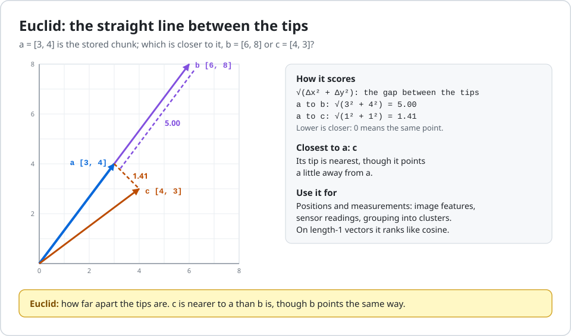
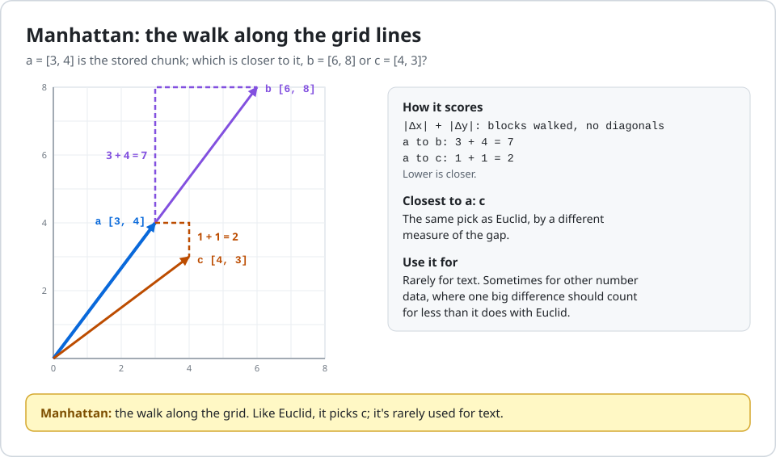

# 05 · Vector store

## What it does

A vector database stores vectors so that they can be searched later. This step stores the 28 chunks in Qdrant,
running inside the Python process ("in memory"): there's no server and nothing to install, and everything in it is
gone when the program ends (step 11 changes that).

`vector_store.py`:

- makes a collection, `it_knowledge_base` (Qdrant's word for a table of points), for vectors of 768 numbers compared
  by cosine similarity: how closely two vectors point the same way;
- loads the articles, cuts them into step 03's 28 chunks and adds them through LangChain's `QdrantVectorStore`.
  `add_documents()` embeds them, with the same call as step 04, and stores each chunk as a point: an id, its vector,
  and a payload with its text (`page_content`) and its labels (`metadata`);
- reads the points back from Qdrant and prints them, to show what was stored.

This is the last step of getting the knowledge base ready to be searched: load, chunk, embed, store. There's still no
question here: the search starts in step 06.

```text
28 chunks  ->  Gemini: 768 numbers each  ->  Qdrant, in memory: 28 points (vector + text + labels)
```

Each run makes 1 call to Gemini, for all 28 chunks. It embeds them again rather than using step 04's vectors, because
each project runs on its own, from the CSV.

## How to run it

You need Python 3.11 or newer, and a Gemini API key.

```bash
cd "projects/RAG/IT Knowledge Base/05-vector-store"   # from the repo root; the quotes are for the spaces
python -m venv .venv                 # once: a private folder for this project's packages
source .venv/bin/activate            # macOS, Linux and Codespaces
#   Windows PowerShell:      .venv\Scripts\Activate.ps1
#   Windows Command Prompt:  .venv\Scripts\activate
#   Windows Git Bash:        source .venv/Scripts/activate
pip install -r requirements-dev.txt  # once: the packages and pytest, into .venv/
cp .env.example .env                 # once (Windows PowerShell or Command Prompt: copy .env.example .env)
python vector_store.py
```

Creating the venv, installing and making `.env` are once only; activate the venv again in every new terminal.

**Your key:** open `.env` in an editor and put your key after `GOOGLE_API_KEY=` (`tutorials/09-gemini-key` shows how
to make one). `.env` is in `.gitignore`, so your key never goes into git. Without a key, the script stops with:

```text
Can't build the models: GOOGLE_API_KEY is not set. Copy .env.example to .env and put your key after the =, or set GOOGLE_API_KEY as an environment variable (in Codespaces: a Codespaces secret).
```

`python vector_store.py` prints the collection's settings, then every stored point, one line each: its article, where
in the article the chunk starts, its vector's size, its text's length and how many labels it has. Gemini's numbers
aren't printed, so this is exactly what you'll see:

```text
Collection 'it_knowledge_base': 28 points, vectors of 768 numbers, compared by Cosine
Each point holds an id, a vector and a payload with metadata, page_content

Point 1 of 28: VPN Connection Timeout, from character 0: 768 numbers, 457 characters of text, 7 labels
Point 2 of 28: VPN Connection Timeout, from character 459: 768 numbers, 110 characters of text, 7 labels
Point 3 of 28: MFA Setup Failure, from character 0: 768 numbers, 144 characters of text, 7 labels
...
Point 28 of 28: Microsoft Teams Audio Issues, from character 581: 768 numbers, 118 characters of text, 7 labels
```

The 7 labels are the article's 6 from step 02 (`doc_id`, title, system, category, priority, tags), plus
`start_index` from step 03.

To run the tests:

```bash
python -m pytest                     # 20 passed, 2 skipped
```

The 2 skipped tests are live tests: they call the real Gemini, so they run only when your key is set.

## How Qdrant measures "close": the distance

When `make_vector_store()` creates the collection, it also fixes how Qdrant will measure how close two vectors are:

```python
client.create_collection(collection, vectors_config=VectorParams(size=size, distance=Distance.COSINE))
```

Qdrant offers four distances. To see how they differ, take three vectors of 2 numbers instead of 768:

```text
a = [3, 4]     the stored chunk
b = [6, 8]     the same direction as a, twice as long
c = [4, 3]     a slightly different direction, the same length as a
```

Which is closer to `a`, `b` or `c`? The four distances don't agree:

| Distance | What it measures | a vs b | a vs c | Closest to a | Better score |
|---|---|---|---|---|---|
| **Cosine** | the angle between the arrows, ignoring their length | 1.00 | 0.96 | **b** | higher |
| **Dot** | the angle and the lengths, multiplied together | 50 | 24 | **b** | higher |
| **Euclid** | the straight line between the arrows' tips | 5.00 | 1.41 | **c** | lower |
| **Manhattan** | the walk between the tips along the grid lines | 7 | 2 | **c** | lower |

Cosine and Dot say `b`, which points exactly the same way as `a`. Euclid and Manhattan say `c`, whose tip is nearer.
For text, the direction is what carries the meaning, so `b` should win: that's why text embeddings use cosine.

### Cosine: the angle (what this project uses)

![Cosine. Three arrows from the origin on a grid: a to [3, 4], b to [6, 8] along the same line as a, and c to [4, 3]. An arc marks the 16 degree angle between a and c; a and b are 0 degrees apart. Cosine of a and b: 50 / (5 x 10) = 1.00. Cosine of a and c: 24 / (5 x 5) = 0.96. Higher is closer, so b is closest: only the direction counts.](images/cosine.svg)

Cosine divides the dot product by both lengths, so only the angle is left: 1 means the same direction, 0 unrelated,
-1 opposite. `b` scores 1.00 although it's twice as long as `a`.

**Use it for** text embeddings, where the meaning is the direction, and for any vectors that don't already have
length 1, like Gemini's at 768 numbers. If a model's documentation doesn't say otherwise, cosine is the safe choice.

### Dot: the angle and the lengths


The dot product multiplies the numbers pair by pair and adds them up: `3×6 + 4×8 = 50`. It's the same as `a`'s length
times the other vector's "shadow" on `a`: `b`'s shadow is all of it, 10, so `5 × 10 = 50`; `c`'s is 4.8, so
`5 × 4.8 = 24`. A longer vector scores higher, so length counts as well as direction.

**Use it for** vectors that already have length 1. Then dot and cosine give exactly the same order, and dot is a
little faster. OpenAI's embeddings, and Gemini's at the full 3072 numbers, come back with length 1. Use it also when a
model's documentation says to, or when a longer vector should win on purpose (in some recommendation systems, a longer
vector means a more popular item).

### Euclid: the straight line between the tips



The ordinary distance between two points: `√(3² + 4²) = 5.00` from `a`'s tip to `b`'s, `√(1² + 1²) = 1.41` to `c`'s.
Lower is closer, and 0 means the same point. `b` loses because it's long, even though it means the same thing.

**Use it for** data where the actual position matters, not just the direction: image features, sensor readings,
measurements, grouping similar items into clusters. On vectors of length 1 it ranks results in the same order as
cosine.

### Manhattan: the walk along the grid



Like walking city blocks, with no diagonals: add up the differences, `3 + 4 = 7` to `b` and `1 + 1 = 2` to `c`.
Lower is closer.

**Use it for** text rarely. It shows up with other kinds of number data, where one big difference should count for
less than it does with Euclid, which squares every difference.

### Why Qdrant's stored numbers differ from Gemini's

With cosine, Qdrant stores each vector at length 1. It divides every number by the vector's length, which keeps the
direction:

![Normalized. A long grey arrow goes from the origin to [3, 4], length 5: what Gemini returns. A short blue arrow along the same line ends on a dashed circle of radius 1, at [0.6, 0.8]: what Qdrant stores. Every number is divided by 5. The direction, and so every cosine score, stays the same.](images/normalize.svg)

```text
Gemini returns:  [3, 4]        length √(3² + 4²) = 5
Qdrant stores:   [0.6, 0.8]    [3/5, 4/5], length 1
```

The meaning is the direction, and that doesn't change, so every cosine score stays the same. Qdrant does it so that
each search becomes a simple dot product, which is faster. It does this only with cosine; with Dot, Euclid and
Manhattan it stores the vectors exactly as they came. So if you compared the first numbers `embed_chunks.py` prints in
step 04 with the vectors stored here, they'd differ, by the same factor for every number in a vector.

### Choosing a distance

- **Use the distance the embedding model's documentation recommends.** For Gemini's embeddings, that's cosine.
- **It's fixed when the collection is created.** To change it, make a new collection and store the chunks again.
- **It decides what the scores mean.** With cosine and dot, higher is closer; with Euclid and Manhattan, lower is
  closer. The scores step 06 prints read "the closer to 1, the closer the meaning" because this project uses cosine.
