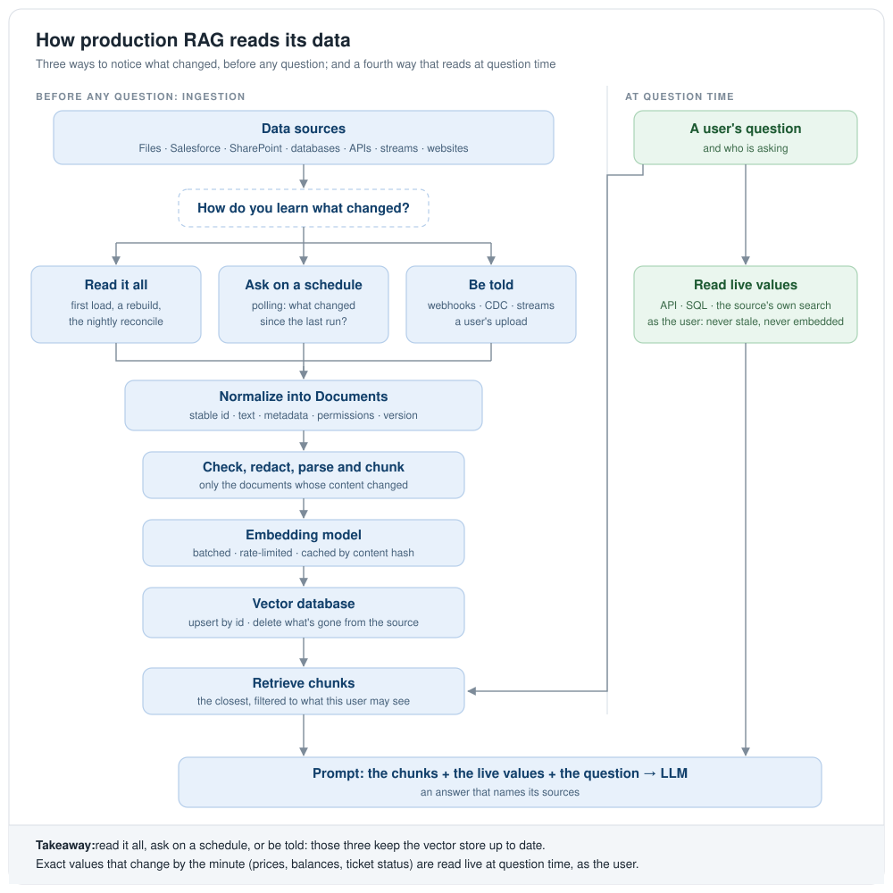
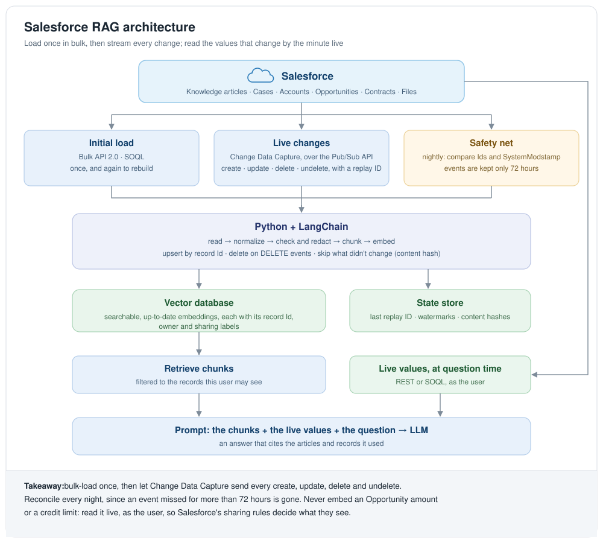

# Expert 01 · TODO: Read the Knowledge Base in Real Time

> **Status:** 📝 Planned: this TODO is the plan; there's no code yet.

Basic/01 and Advanced/01 read one CSV file, once. A production RAG application reads many systems (files,
Salesforce, SharePoint, databases, APIs, streams), keeps up with every change they make, and reads some values only
at the moment a question is asked. This TODO answers *how many ways can a production RAG application read its data
in real time*, says which way fits which source, goes through Salesforce in detail, lists what real time adds, the
evals that prove it works, and the order to learn and build it in.

---

## 1. How Many Ways? The Short Answer

**11 ways, which come down to 4.** Eight are the usual list. Production applications use three more: reading at
question time, crawling websites, and taking a user's upload. Underneath, each of the 11 is one of 4 ways to learn
what's there:

| The 4 | What it means | Ways (section 2) |
|---|---|---|
| **Read it all** | Read everything: the first load, a rebuild, the nightly check that nothing was missed | 1, 2, 3, 8, 10 |
| **Ask on a schedule** | Every few minutes: what changed since the last run? | 4, and 1, 2, 3, 8, 10 run on a timer |
| **Be told** | The source pushes each change as it happens | 5, 6, 7, 11, and 8 when the connector takes events |
| **Read at question time** | Nothing is stored: the app reads the source while it answers | 9 |

The first three keep the vector store up to date. The fourth never touches it: exact values that change by the minute
(prices, balances, ticket status) are read live, as the user, and never embedded.

---

## 2. The 11 Ways

| # | Way | How the data is read | How a change is noticed | How a delete is noticed | Typical sources | How fresh |
|---|---|---|---|---|---|---|
| 1 | **File and document loaders** | Read PDF, Word, Excel, CSV, TXT and HTML files | Each file's hash or modified time, against the last run's | A file in the last run's list that's gone | Policies, contracts, knowledge articles exported as files | On demand, or scheduled |
| 2 | **API-based loading** | REST, GraphQL or SOAP calls, page by page | Ask for the records modified since a time, if the API can | Often a separate "deleted records" call; some APIs can't tell you | Salesforce, ServiceNow, Jira, Zendesk | On demand to near real time |
| 3 | **Database queries** | SQL or NoSQL queries, best against a read replica | An `updated_at` column, if every write sets it | Only with a soft-delete flag, or by comparing every id | PostgreSQL, SQL Server, MongoDB | On demand |
| 4 | **Scheduled, incremental polling** | A job every few minutes asks what changed since its saved watermark | The watermark: a time (Salesforce's `SystemModstamp`) or a cursor (a Microsoft Graph delta link, a Google Drive page token) | Delta APIs report deletes; a plain "modified since" query doesn't | Salesforce records, SharePoint, shared folders | Near real time: as fresh as the interval |
| 5 | **Webhooks and events** | The source calls your HTTPS endpoint when something changes | Pushed to you: usually "this record changed", then you fetch it | When the source sends delete events | GitHub, Microsoft Graph (SharePoint, OneDrive, Outlook), Slack, Google Drive | Seconds |
| 6 | **Change data capture (CDC)** | Read a database's transaction log, or an application's change events | Every insert, update and delete, in order, with what changed | A delete is an event like any other | PostgreSQL, MySQL, SQL Server (with Debezium); Salesforce CDC | Seconds |
| 7 | **Message queues and streams** | Consume a stream of events, continuously | Each message is a change | When the producer sends delete events (tombstones) | Kafka, Amazon Kinesis, Azure Event Hubs, Google Pub/Sub | Seconds, continuously |
| 8 | **Cloud and SaaS connectors** | A ready-made connector syncs a platform's content | The connector's own polling, delta API or webhooks | Depends on the connector: check it | SharePoint, Google Drive, Confluence, Amazon S3 | Scheduled or event-driven |
| 9 | **Retrieval at question time** | The app calls the source while it answers: an API, a SQL query, the source's own search | Nothing to notice: it reads the current value | Nothing to delete: nothing is stored | Prices, balances, stock, ticket status, "my open cases" | Live |
| 10 | **Web crawling** | Fetch pages from a sitemap, or by following links | Conditional requests (`ETag`, `Last-Modified`), the sitemap's `lastmod`, RSS feeds | A page that now answers 404 or 410 | Public documentation, intranet pages, vendors' knowledge bases | Scheduled |
| 11 | **User uploads** | A person adds a file in the app | The upload is the event | The user deletes it in the app | Employees' documents, files attached in a chat | Seconds: processed when it arrives |

These are categories, not 11 technologies that exclude each other. Salesforce CDC events can flow through a message
queue (the Pub/Sub API into Kafka, or Salesforce's Event Relay into Amazon EventBridge), and a SaaS connector might
poll an API inside. A webhook often carries only "record 42 changed", so the app then reads record 42 through the
API: two ways in one pipeline.

LangChain's community package has document loaders for many of these: files (`PyPDFLoader`, `CSVLoader`), websites
(`WebBaseLoader`, `SitemapLoader`, `RecursiveUrlLoader`), platforms (`ConfluenceLoader`, `SharePointLoader`,
`S3DirectoryLoader`) and databases (`SQLDatabaseLoader`). A loader reads; it doesn't notice changes. For that,
LangChain's indexing API (`index()` with a record manager) keeps a hash of every Document it has written, skips the
unchanged ones, and deletes the ones that are gone (its cleanup modes, `incremental` and `full`).

---

## 3. Which Way for Which Source

| Data source | Recommendation | Why |
|---|---|---|
| Static PDF documents | File loaders + a scheduled sync | They change rarely |
| Salesforce Accounts and Opportunities | An initial Bulk API load, then Salesforce CDC | The data as it is now, then every change after |
| Salesforce live pricing or credit data | An API call at question time | Never answer from an outdated embedding |
| PostgreSQL or SQL Server | An initial snapshot, then database CDC | Changed records processed one at a time |
| SharePoint or Confluence | A SaaS connector + incremental sync | Knowledge documents kept up to date |
| Live application events | Kafka or Kinesis streaming | Continuous, high-volume changes |
| Public websites | A web crawler + a scheduled refresh | Changed pages found and updated |
| Employees' uploaded documents | The upload event, or a webhook | Each document processed when it arrives |
| Salesforce Knowledge articles (an IT knowledge base) | A Bulk API load of the published versions, then CDC if the object supports it, or a Platform Event that a Flow publishes when an article is published or archived | Only what's published, in its latest version, should be searchable |
| ServiceNow knowledge and incidents | The Table API with a `sys_updated_on` watermark, plus an outbound REST call from a business rule for near real time | The watermark catches what the push missed |
| Jira issues and Confluence pages | Webhooks, plus a nightly JQL or CQL query for `updated` since the last check | Webhooks can be lost; the query is the safety net |
| Slack or Microsoft Teams threads | The Slack Events API, or Microsoft Graph change notifications | Answers that live in conversations, as they're posted |
| A shared support mailbox | Microsoft Graph delta queries and change notifications (or IMAP IDLE) | New mail and its attachments, as they arrive |
| Files dropped in Amazon S3, Azure Blob Storage or Google Cloud Storage | Storage event notifications (S3 to SQS or EventBridge; Blob Storage to Event Grid; Cloud Storage to Pub/Sub) | Each file processed when it lands, with no listing of the bucket |
| A data warehouse (Snowflake, Databricks) | The warehouse's own change tracking (Snowflake streams, Delta Lake's change data feed) | Only the changed rows, without querying everything |
| Runbooks and docs kept in Git | A push webhook, then the diff | Only the changed files re-embedded |
| Counts and totals ("how many P1 incidents are open?") | Text-to-SQL, or an API, at question time | Vector search finds similar text; it can't count or add up |
| One user's own data ("my open cases") | An API call at question time, with the user's token | The source decides what that user may see |
| Meeting recordings, scanned forms | The upload event, then speech-to-text or OCR | The text has to be extracted before it can be embedded |

---

## 4. Salesforce

### The Ways In, and Out

| Way | Salesforce feature | Use it for | Watch out for |
|---|---|---|---|
| Initial or full load | Bulk API 2.0 query jobs | A first load or a rebuild: thousands to millions of records | It's asynchronous: start the job, wait for it, then download the results in parts |
| Smaller reads | The REST API with SOQL: `query`, and `queryAll`, which also returns deleted and archived records | One object at a time, up to thousands of records | The org's API request limit per 24 hours |
| Incremental polling | SOQL with `WHERE SystemModstamp > :lastRun ORDER BY SystemModstamp`, and the REST `updated` and `deleted` resources | Objects that CDC doesn't cover | Deletes show only while the records are in the Recycle Bin; overlap each window a little, for records saved in the same second |
| Change Data Capture | `<Object>ChangeEvent` messages over the Pub/Sub API (gRPC), from a stored replay ID | Creates, updates, deletes and undeletes, seconds after they happen | Events are kept 72 hours; an update event carries only the fields that changed; formula fields aren't in events; gap and overflow events mean "re-read these records"; only a few objects without an add-on license |
| Platform Events | Your own events, published by a Flow or by Apex (for example `Article_Published__e`) | Business moments: an article published, a case closed | You design them, and publish them |
| Event Relay | CDC and Platform Events passed on to Amazon EventBridge | A pipeline that runs in AWS | AWS only |
| Flow or Apex callout | An HTTP call to your webhook when a record changes | Simple pushes, a few records at a time | From a trigger, a callout must be asynchronous (Queueable or `@future`); retries are yours to write |
| At question time | REST and SOQL, or SOSL search, with the asking user's own OAuth token | Amounts, credit limits, stages, a case's status | A call, and its time, on every question |
| Inside Salesforce | Data Cloud's vector search, and Agentforce's retrievers | A RAG application that lives in Salesforce | A different stack: no Python pipeline to run |

### What a Salesforce Sync Must Handle

- [ ] **Knowledge articles**: index only `PublishStatus = 'Online'` and `IsLatestVersion = true`; a new draft
  doesn't replace the published version; an archived article leaves the index; keep the language, the data categories
  and the channels (internal, customer, partner, public) as labels, since they say who may see it.
- [ ] **Files**: attachments are `ContentVersion` records, linked to their records through `ContentDocumentLink`;
  parse PDFs and Word files; watch their size.
- [ ] **Rich text fields hold HTML**: strip the tags, keep the text, and decide what to do with embedded images.
- [ ] **Picklists**: keep the label people read and the API value code uses; mind record types and, with more than one
  currency, `CurrencyIsoCode`.
- [ ] **Update events carry only the changed fields**: merge them into the stored record, or read the whole record;
  formula fields change without an event, so read them when you read the record.
- [ ] **Deletes, undeletes and merges**: a delete removes the record's vectors; an undelete brings them back; a merge
  deletes the records that lost it.
- [ ] **Ownership and sharing changes**: who may see a record is data too; when the owner or the sharing changes, the
  labels on its vectors change.
- [ ] **Who sees what**: the integration user can read everything, and the person asking can't. Keep the owner and
  sharing labels in each vector's metadata and filter on them; before showing a record, check it with
  `UserRecordAccess` for the asking user. Don't embed fields that some users aren't allowed to see (field-level
  security), or keep a separate index for each audience.
- [ ] **Replay IDs**: store a channel's replay ID only after its change is fully applied, so a crash replays it
  instead of skipping it; that means each change can arrive twice, so every write must be safe to repeat.
- [ ] **Bursts**: a data load or a mass update sends thousands of events in a minute; queue them, and embed in batches
  at the speed the embedding API allows.
- [ ] **Limits**: API requests per 24 hours, event delivery allocations, Bulk API jobs. Measure what the sync uses,
  and prefer CDC to polling.
- [ ] **Sandboxes**: build against a Developer Edition org or a sandbox; never copy production records into a
  development vector store.
- [ ] **More than 72 hours down**: the events are gone; reload with the Bulk API, then compare (section 5).

---

## 5. What Real Time Adds: Scenarios to Handle

### Getting It Right

- [ ] **Deletes**: a record deleted in the source must leave the vector store too, with every one of its chunks.
- [ ] **Updates**: a changed document can have more or fewer chunks than before; delete its old chunks (by document
  id), then write the new ones.
- [ ] **Delivered twice**: queues, webhooks and CDC deliver each change at least once, so the same change can come
  twice. Write by stable id (document id, chunk number, content hash), so a repeat changes nothing.
- [ ] **Out of order**: an older change can arrive after a newer one. Keep each document's last applied version (or
  commit time), and ignore anything older.
- [ ] **Missed changes**: a webhook that was down, an expired subscription, a lost event. Trust the events, then
  check: a regular reconcile compares every id and content hash with the source, and fixes the difference.
- [ ] **Half-done writes**: the chunks are embedded, then the write to the vector store fails. Record each step, so a
  retry finishes the job instead of starting over or leaving half.
- [ ] **Watermarks**: clocks differ between servers, and many records can share one timestamp; overlap each window,
  order by time and then id, and let the duplicates fall away (they're safe to repeat).
- [ ] **Schema changes**: a new field, a renamed one, a new picklist value. Keep the mapping from source to Document
  in a versioned settings file, and fail loudly on a field it doesn't know.
- [ ] **Debounce**: a person saves an article ten times in a minute; wait until it's quiet before re-embedding it.
- [ ] **Unchanged content**: an update that changed only a field that isn't embedded shouldn't cost an embedding call;
  compare the content hash first.

### Scale and Cost

- [ ] **Backpressure**: changes can arrive faster than the embedding API accepts them; queue them, embed in batches,
  and add workers, without losing order for any one document.
- [ ] **Rate limits** on both sides: the source's API limits and the embedding provider's; back off and retry, as
  their `Retry-After` headers say.
- [ ] **Big documents**: a 300-page PDF; parse it as a stream, with a timeout and a maximum size.
- [ ] **Rebuild without downtime**: a new embedding model or new chunk sizes mean re-embedding everything. Build a new
  collection beside the old one, write changes to both, check it, then switch an alias; the old one stays for a
  rollback.
- [ ] **Replay**: keep enough history (in the stream, or as raw documents) to rebuild the index from scratch.

### Security and Privacy

- [ ] **Permissions travel with the data**: every document keeps who may read it, and every search filters by the
  asking user. Removing someone from a group must take effect in the search too.
- [ ] **Tenants**: in an application with several customers, a tenant id on every record and in every filter.
- [ ] **Webhooks are a public door**: check each request's signature (for example GitHub's
  `X-Hub-Signature-256`), answer fast, and queue the work.
- [ ] **Least privilege**: integration users read only what the sync needs; rotate their secrets.
- [ ] **A sensitive-data gate before embedding**: redact as Advanced/01 does. An embedding isn't anonymous:
  research has rebuilt much of the original text from embeddings alone.
- [ ] **The right to be forgotten**: deleting a person's data in the source must reach the vectors, the caches, the
  logs and the backups.
- [ ] **Where the data may live**: the embedding API and the vector store may have to stay in a region.
- [ ] **Text read at question time is untrusted**: a live record can carry instructions aimed at the model; treat it
  as data, never as instructions.

### Running It

- [ ] **A freshness target** for each source (for example: searchable within 5 minutes of a change), measured.
- [ ] **Lag, per source**: the time from a change in the source to that change being searchable; alert when it's late.
- [ ] **A dead-letter queue** for changes that fail again and again, with an alert, and a way to replay them.
- [ ] **Lineage**: for every chunk, its source, record id, version, and when and how it was loaded.
- [ ] **A runbook**: what to do when a source is down, a subscription expired, or the lag grows.

---

## 6. Evals

How to prove that real-time reading works, and keeps working.

- [ ] **Freshness**: the lag from a change in the source to an answer that uses it, as the 50th and 95th
  percentiles, per source, against its target.
- [ ] **Completeness**: a reconcile against the source counts what's missing, what's extra (still in the index but
  gone from the source) and what's stale (an older version). Each should be 0.
- [ ] **Deletes**: delete a test record in the source; it must not be retrievable after the freshness target.
- [ ] **Canary documents**: a test record created, changed and deleted every few minutes, with a question only its
  latest version answers; it measures the whole path end to end, all day.
- [ ] **Permission leaks**: labeled users and documents; user A must never retrieve anything only B may see. The
  target is 0 leaks.
- [ ] **Repeats and order**: replay the same change stream with duplicates and in a shuffled order; the final index
  must be the same as from the clean stream.
- [ ] **Answers that change over time**: questions whose right answer changes when a document changes; after each
  change, the answer must follow.
- [ ] **Live against stored**: for values that are read live, how often the stored version would have been wrong;
  it's the measure of why they're read live.
- [ ] **Load**: throughput and lag during a burst (10,000 changes at once), and the cost per 1,000 changes.
- [ ] **Failures on purpose**: stop the consumer for an hour, expire a webhook subscription, return errors from the
  embedding API; the index must recover with nothing lost.

---

## 7. What to Learn First

For a developer who knows Salesforce and Python, these five patterns, in this order:

1. **File loading**: read PDF, TXT and CSV files with LangChain's loaders.
2. **REST API loading**: fetch Salesforce records and turn them into LangChain Documents.
3. **Database loading**: read PostgreSQL records with Python.
4. **Incremental ingestion**: process only the new, changed and deleted records.
5. **Event-driven ingestion**: Salesforce CDC → Python → LangChain → a vector database.

Start with a Python and LangChain application that reads Salesforce Account records through the REST API or SOQL,
turns them into LangChain Documents, chunks them and embeds them. Then extend it to take CDC events. That goes from a
simple `TextLoader` example to the architecture of enterprise RAG systems.

The most important lesson: **not all data should be embedded.** An exact value that changes often, such as an
Opportunity's amount or an account's current credit limit, should be read live from Salesforce at question time, not
found by vector search in a copy that may be out of date.

---

## 8. The Build Plan

The order to build it in; each step on top of the one before.

1. [ ] **A source interface**: `load_all()`, `changes_since(cursor)` (the changed and the deleted records, and the
   new cursor) and `fetch(ids)`. Each way in section 2 becomes one class behind it.
2. [ ] **A state store** (SQLite to start) for each source's cursor (watermark, delta link or replay ID) and each
   document's content hash; or LangChain's indexing API with a SQL record manager.
3. [ ] **Files**: a folder of CSV and PDF files, by hash; deleted files removed; Advanced/01's checks reused.
4. [ ] **The REST API**: Salesforce records over REST and SOQL from a free Developer Edition org; pagination,
   retries with backoff, and the API limit watched.
5. [ ] **A database**: PostgreSQL in Docker, with an `updated_at` watermark and soft deletes.
6. [ ] **Incremental indexing**: only changed documents re-chunked and re-embedded; a changed document's old chunks
   deleted; deleted documents removed.
7. [ ] **Events**: Salesforce CDC over the Pub/Sub API, the replay ID stored after each change is applied; then
   Debezium and Kafka for PostgreSQL.
8. [ ] **Webhooks**: a FastAPI endpoint that checks signatures, answers at once, and queues the work.
9. [ ] **Question time**: tools the model can call: a live SOQL query as the user, and text-to-SQL for counts.
10. [ ] **Permissions**: access labels on every vector, the search filtered by them, and `UserRecordAccess`
    checked before a record is shown.
11. [ ] **The reconcile**: a nightly comparison of ids and content hashes, with a report of what it fixed.
12. [ ] **Monitoring**: lag per source, queue depth, dead letters, cost, and the canary documents.
13. [ ] **Rebuild without downtime**: a new collection, writes to both, then the alias switched.
14. [ ] **The evals** in section 6, run in CI and on a schedule.
