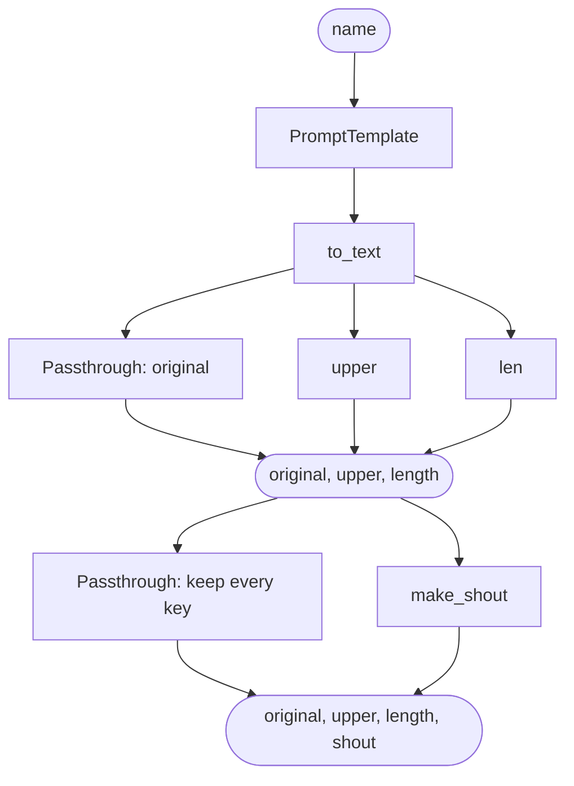

# 06 · Run steps side by side

Until now each chain was a straight line; this one splits it: one input goes into `RunnableParallel`, which runs
three steps on it side by side and returns their results as one dict, and `RunnablePassthrough.assign()` adds a
fourth key. Side by side matters once steps are slow, such as model calls (you wait for the slowest step, not for
all of them in a row), but this project needs no model and no API key yet.

```text
{"name": "Raghu"}  ->  {"original": "Hello Raghu, welcome to LangChain!",
                        "upper": "HELLO RAGHU, WELCOME TO LANGCHAIN!",
                        "length": 34,
                        "shout": "HELLO RAGHU, WELCOME TO LANGCHAIN!!!"}
```

## What you'll build

- `hello.py`: the chain `prompt | to_text | side_by_side | add_shout`. `python hello.py` prints its four results as
  JSON, then the chain's graph as Mermaid text.
- `main.py`: a FastAPI server. `POST /api/hello` runs the chain and returns its dict as it is; `GET /api/graph`
  returns the graph text.
- `index.html`: a page with a name box. One click fills a table with all four results from a single call; the graph
  is loaded once, when the page opens.

## What you'll learn

- **`RunnableParallel(a=..., b=...)`**: gives the same input to every step and returns `{"a": ..., "b": ...}`.
- **`RunnablePassthrough()`**: passes its input through unchanged, so the original sits next to the new results.
- **`RunnablePassthrough.assign(key=function)`**: keeps every key of a dict and adds `key`, computed by
  `function(dict)`.
- **Really side by side**: `invoke()` and `ainvoke()` both start the steps together, so the parallel step takes as
  long as its slowest step.
- **The dict shorthand**: in a chain, a plain dict such as `{"a": ..., "b": ...}` becomes a `RunnableParallel` for
  you.
- **`chain.get_graph().draw_mermaid()`**: the chain's shape as Mermaid text; `name=` sets a step's label in it.

## What's new since project 05

- [Project 05 · Pass several inputs](../05-langchain-inputs/README.md) sent three inputs down a straight chain. This
  one is back to one input, `{name}`, and the chain fans out instead: three steps run on the same greeting and come
  back as one dict, which `.assign()` extends.
- `POST /api/hello` returns the chain's dict as it is (four keys), not `{"answer": "..."}`, and `GET /api/graph` is
  new.
- `RunnableLambda(..., name="to_text")` gives a step a label for the graph, and `python hello.py` prints JSON and the
  graph instead of one line.
- For the first time since project 02, the page asks the server for something as soon as it opens (the graph), and
  it shows the results in a table.

## Before you start

- Python 3.11 or newer.
- No API key: nothing in this project calls a model.

## Files

| File | What it is |
|---|---|
| `hello.py` | The chain: `prompt \| to_text \| side_by_side \| add_shout`. Run on its own, it prints the four results and the graph |
| `main.py` | FastAPI: `GET /` and `/index.html` serve the page, `POST /api/hello` returns the four results, `GET /api/graph` returns the Mermaid text |
| `index.html` | The page: a name box, a table with the four results from one call, and the chain's graph |
| `tests/test_hello.py` | The tests: each piece, that the steps really run at the same time, the whole chain and its graph, the script, both endpoints and the page |
| `pytest.ini` | Tells pytest to look for tests only in `tests/`, and to import `hello` and `main` from this folder |
| `requirements.txt` | The packages the project needs: `fastapi`, `uvicorn`, `langchain-core` |
| `requirements-dev.txt` | `requirements.txt` plus `pytest` and `httpx`, for the tests |
| `README.md` | This file |

## How it works

### The prompt and `to_text`

```python
# ① The template, with one input: {name}. Same as project 4.
prompt = PromptTemplate.from_template("Hello {name}, welcome to LangChain!")

# ② The converter: the prompt gives back an object (a StringPromptValue), this turns it into text.
#    name="to_text" is new: it is this step's label in the chain's graph (⑥). A lambda has no name of its own,
#    so without it the graph's box would just say "Lambda".
to_text = RunnableLambda(lambda value: value.to_string(), name="to_text")
```

Apart from `name=`, these two steps are project 04's: `{"name": "Raghu"}` becomes one string,
`"Hello Raghu, welcome to LangChain!"`. That string is the input of everything that follows.

### Side by side: `RunnableParallel` and `RunnablePassthrough`

```python
side_by_side = RunnableParallel(
    original=RunnablePassthrough(),       # "Hello Raghu, welcome to LangChain!"
    upper=RunnableLambda(str.upper),      # "HELLO RAGHU, WELCOME TO LANGCHAIN!"
    length=RunnableLambda(len),           # 34
)
```

`RunnableParallel` gives the greeting to each of its three steps and collects their answers in one dict. The keys
are the argument names you chose (`original`, `upper`, `length`). The steps are ordinary Runnables: `str.upper` and
`len` are Python's own functions, wrapped in `RunnableLambda`.

**What does `RunnablePassthrough` pass through?** Exactly what it is given, here the greeting string. On its own
it does nothing; inside a `RunnableParallel` it keeps the input next to the new results.

This is a common shape in LangChain. In RAG (retrieval-augmented generation: look up the documents that match a
question, then give them to the model together with the question), one step searches the documents while
`RunnablePassthrough()` keeps the question, so the next step gets both:
`{"context": retriever, "question": RunnablePassthrough()}`, where `retriever` is the search step.

That example is a plain dict, and a plain dict in a chain means the same thing as `RunnableParallel`:
`to_text | {"original": RunnablePassthrough(), "upper": ...}` is turned into a `RunnableParallel` for you, and plain
functions inside it (`"upper": str.upper`) are wrapped too. Many LangChain examples, RAG ones included, use this
shorter form.

### Do the three steps really run at the same time?

Yes, with both ways of running a chain. `invoke()` hands all three steps to a pool of threads at once, then waits
for every result. `ainvoke()`, the async version the server uses, starts all three together too, and runs a plain
function such as `len` on a thread. Here the steps finish in microseconds, so you won't see a difference. With steps
that wait (a model call, a document search), the parallel step takes as long as the slowest one, not the sum of all
of them. `test_parallel_steps_really_run_at_the_same_time` checks this with `invoke()`: it gives a
`RunnableParallel` three steps that each sleep half a second, and they finish together in under a second (about
0.5 s; one after another they would take 1.5 s).

### One more key: `.assign()`

```python
def make_shout(result: dict) -> str:
    return result["upper"].replace("!", "!!!")


add_shout = RunnablePassthrough.assign(shout=make_shout)

# ⑤ Join them. The input is {"name": ...}; the output is {"original", "upper", "length", "shout"}.
chain = prompt | to_text | side_by_side | add_shout
```

`.assign()` is the passthrough idea for dicts: everything that came in goes out, plus the new key. In
`.assign(shout=make_shout)`, `shout` is the new key and `make_shout` is the function that computes it (the names
differ on purpose, so you can tell which is which). `make_shout` gets the whole dict from `side_by_side`, which is
why it can read `result["upper"]`. It is a plain function: `.assign()` wraps it in a `RunnableLambda` for you.

`.assign()` needs a dict, so it must come after a step that returns one. Put `add_shout` before `side_by_side` and
the chain fails with `ValueError: The input to RunnablePassthrough.assign() must be a dict.`

| After step | The value is |
|---|---|
| input | `{"name": "Raghu"}` |
| `prompt` | a `StringPromptValue` |
| `to_text` | `"Hello Raghu, welcome to LangChain!"`, one string |
| `side_by_side` | `{"original": "Hello Raghu, …", "upper": "HELLO RAGHU, …", "length": 34}`: three steps, same input |
| `add_shout` | the same dict plus `"shout": "HELLO RAGHU, WELCOME TO LANGCHAIN!!!"` |

### What `python hello.py` prints

```python
# ⑥ Run it, but only when this file is run directly (python hello.py), not when main.py imports it.
if __name__ == "__main__":
    name = sys.argv[1] if len(sys.argv) > 1 else "Raghu"
    # ensure_ascii=False prints a name like José as José, the way the API sends it, not as Jos\u00e9.
    print(json.dumps(chain.invoke({"name": name}), indent=2, ensure_ascii=False))
    print()
    print("The chain's graph (Mermaid; paste it into https://mermaid.live to see the picture):")
    print(chain.get_graph().draw_mermaid())
```

`json.dumps()` turns the result dict into JSON text, and `indent=2` puts each key on its own line. Project 05
printed a string; a dict printed with plain `print()` would come out on one line, with single quotes.
`ensure_ascii=False` keeps letters such as é as they are: by default `json.dumps()` replaces them with escape
codes. Then the script prints the chain's graph.

### The graph

The graph is what `chain.get_graph().draw_mermaid()` returns; `GET /api/graph` sends the same text to the page.
Mermaid is a plain-text diagram language that GitHub and https://mermaid.live draw as a picture.
Simplified, the chain's graph is:



To see the real one drawn, paste the printed text into https://mermaid.live. Reading the real text:

- It starts with a small `---` config block, then `graph TD;` (top down), the boxes, and the arrows.
- `Parallel<original,upper,length>Input` and `Parallel<original,upper,length>Output` are where `side_by_side` hands
  out the greeting and collects the dict. In the box ids, `\3c`, `\2c` and `\3e` are `<`, `,` and `>` written as
  hex codes, so that Mermaid accepts the ids.
- Each box is named after its step's function, not after its key: `upper` (from `str.upper`), `len` (for the key
  `length`), `make_shout` (for the key `shout`). A lambda has no name, which is why `to_text` gets `name=`.
- `.assign()` is drawn as `Parallel<shout>`: the new key's step, `make_shout`, next to a second `Passthrough` that
  carries the old dict across. `Passthrough_1` and `Passthrough_2` are numbered only because there are two.

### The server and the page

```python
class HelloIn(BaseModel):
    """The JSON body the page sends. FastAPI checks it before hello() runs; a bad one gets a 422."""
    model_config = ConfigDict(str_strip_whitespace=True)   # "  Raghu " -> "Raghu", and "   " -> "" (too short)

    name: str = Field(min_length=1, max_length=40)
...
@app.post("/api/hello")
async def hello(body: HelloIn):
    """Runs the chain with the name and returns its dict as is: original, upper, length and shout."""
    # ainvoke() is invoke()'s async twin; inside the chain, the three side-by-side steps run concurrently.
    return await chain.ainvoke({"name": body.name})


@app.get("/api/graph")
async def graph():
    """The chain's shape, drawn by LangChain itself as Mermaid text."""
    return {"mermaid": chain.get_graph().draw_mermaid()}
```

`hello()` returns the chain's dict as it is, and FastAPI turns it into JSON. A bad name gets a 422 before the
chain runs. The graph doesn't depend on the name, so the page asks for it once, when it opens:

```js
    fetch("/api/graph")
      .then((res) => {
        // fetch() only fails by itself when no answer comes back. An error answer (a 404, a 500) still arrives,
        // with res.ok false, so turn it into an error here.
        if (!res.ok) throw new Error(`the server answered HTTP ${res.status}`);
        return res.json();
      })
      .then((data) => { graphBox.textContent = data.mermaid; })
      .catch((err) => { graphBox.textContent = `Something went wrong: ${err.message}`; });
```

The whole flow, with the form working as in project 04:

```text
open the page          →  fetch("/api/graph")  →  {"mermaid": "..."}, shown under "The chain's graph"
type a name, submit    →  fetch("/api/hello", POST, {"name": "Raghu"})
FastAPI                →  reads the JSON into HelloIn: trims the name, checks it is 1 to 40 characters
   ├─ bad name         →  422 {"detail": [...]}: the page says "Please type a name first."
   │                      or "That name is too long: 40 characters at most."
   └─ good name        →  hello(body)  →  await chain.ainvoke({"name": "Raghu"})
JSON back              →  {"original": ..., "upper": ..., "length": 34, "shout": ...}: one table row each
any other error        →  the page says "Something went wrong: the server answered HTTP 500" (or the network error)
```

## Run it

```bash
cd tutorials/06-langchain-parallel
python -m venv .venv                 # once: a private folder for this project's packages
source .venv/bin/activate            # macOS, Linux and Codespaces
#   Windows PowerShell: .venv\Scripts\Activate.ps1
#   Windows Git Bash:   source .venv/Scripts/activate
pip install -r requirements-dev.txt
```

```bash
python hello.py                      # the four results for Raghu as JSON, then the graph
python hello.py Asha                 # the same for Asha
uvicorn main:app --reload            # the server (Ctrl+C to stop)
```

With the server running, open:

| What | On your laptop | In GitHub Codespaces |
|---|---|---|
| The page | http://127.0.0.1:8000 | `https://<codespace-name>-8000.app.github.dev` |
| The graph as JSON | http://127.0.0.1:8000/api/graph | `https://<codespace-name>-8000.app.github.dev/api/graph` |
| Try the API by hand | http://127.0.0.1:8000/docs | `https://<codespace-name>-8000.app.github.dev/docs` |

Only one server can use port 8000 at a time: stop the previous project's server (Ctrl+C) before starting this one.

The curl examples are for bash (macOS, Linux, Codespaces, Git Bash):

```bash
curl -X POST http://127.0.0.1:8000/api/hello -H "Content-Type: application/json" -d '{"name": "Raghu"}'
# {"original":"Hello Raghu, welcome to LangChain!","upper":"HELLO RAGHU, WELCOME TO LANGCHAIN!","length":34,...}

curl -X POST http://127.0.0.1:8000/api/hello -H "Content-Type: application/json" -d '{"name": ""}'
# 422: {"detail":[{"type":"string_too_short","loc":["body","name"],...}]}

curl http://127.0.0.1:8000/api/graph
# {"mermaid":"---..."}
```

`/api/hello` takes POST only, so opening it in the address bar gives `{"detail":"Method Not Allowed"}` (405).

## Test it

The tests need no server and no key: FastAPI's `TestClient` sends their requests straight to the app. There are 23
tests, all plain: nothing here calls a model, so there are no live tests. They check:

- `RunnablePassthrough` gives back exactly what it gets: a string, a number, a dict and a list (4)
- `side_by_side` runs every step on the same input (1), and three half-second steps in a `RunnableParallel` finish in
  under a second (1)
- `.assign()` keeps every key and adds `shout` (1)
- the whole chain gives the four results for Raghu (1), and its graph has a box for every step (1)
- `python hello.py`, with and without a name, prints the results and the graph (2), and prints a name like José as
  it is (1)
- `POST /api/hello` returns the four results, with the spaces around the name trimmed (1)
- a 422 for an empty, a spaces-only, a 41-character and a missing name (4), and a 405 for `GET /api/hello` (1)
- `GET /api/graph` returns the Mermaid text (1)
- the page at `/` and `/index.html` has a cell for every result (2); its script posts the name only on submit and
  loads the graph (1), and turns errors into plain words (1)

```bash
python -m pytest              # all 23 tests
python -m pytest -v           # the same, with each test's name
```

## When things go wrong

| What happens | What you see | What to do |
|---|---|---|
| Another project's server still has port 8000 | Usually `uvicorn` stops with an error that the address is already in use (on Windows: `[Errno 10048] ... only one usage of each socket address ... is normally permitted`). On Windows with `--reload` there may be no error at all: `uvicorn` says it is running, but the old server keeps answering, so you see the old project's page | Stop the old server with Ctrl+C in its terminal, then start this one again |
| You open `/api/hello` in the address bar | `{"detail":"Method Not Allowed"}` (405) | It takes POST only: use the page, `/docs` or curl |
| You give `python hello.py` a name with letters outside English, in Git Bash on Windows | An accented letter may come out garbled, and a name in another script (Telugu, say) stops the script with `UnicodeEncodeError: 'charmap' codec can't encode characters ...` | Git Bash's terminal hands Python a pipe, and Python on Windows then writes the old cp1252 code page. Run `export PYTHONUTF8=1` in that terminal first: Python then writes UTF-8 |
| You renamed a key in `side_by_side`, say `upper` to `caps` | `KeyError: 'upper'` from `python hello.py`; the page says "Something went wrong: the server answered HTTP 500" | `make_shout` reads `result["upper"]`: rename it there too |
| You moved `add_shout` before `side_by_side` | `ValueError: The input to RunnablePassthrough.assign() must be a dict.` | `.assign()` needs a dict: keep it after a step that returns one |

## Things to try

1. **A fourth step side by side.** In `side_by_side`, add `words=RunnableLambda(lambda text: len(text.split())),`.
   `python hello.py` now shows `"words": 5`, and the graph gets a box called `Lambda`; add `name="words"` to that
   `RunnableLambda` and the box says `words`. `python -m pytest` fails the three tests that expect exactly the old
   keys. The page still shows its four rows, because it only fills in the keys in its `KEYS` list.
2. **Slow steps.** Add `import time` and two functions that sleep first: `slow_upper(text)` does `time.sleep(1)` and
   returns `text.upper()`, `slow_len(text)` does `time.sleep(1)` and returns `len(text)`. Use them in `side_by_side`
   (`upper=RunnableLambda(slow_upper)`, `length=RunnableLambda(slow_len)`), then time the chain:
   `python -c "import time, hello; start = time.time(); hello.chain.invoke({'name': 'Raghu'}); print(round(time.time() - start, 1))"`
   prints a number close to 1 (`1.0`, or `1.1` on a slower computer), not `2.0`: the two slow steps wait at the same
   time. The graph's boxes are now called `slow_upper` and `slow_len`, so the graph test fails.
3. **A second `.assign()`.** Change the chain line to
   `chain = prompt | to_text | side_by_side | add_shout | RunnablePassthrough.assign(shout_length=lambda result: len(result["shout"]))`.
   A fifth key appears, `"shout_length": 36`: a later `.assign()` sees the keys added before it.
4. **The dict shorthand.** In the chain line only, replace `side_by_side` with
   `{"original": RunnablePassthrough(), "upper": RunnableLambda(str.upper), "length": RunnableLambda(len)}`. You get
   the same result and the same graph, and all the tests still pass. Leave the `side_by_side` variable itself alone:
   a test calls `side_by_side.invoke()`, and a dict has no `.invoke()`.

## Next

**[Project 07 · Branch and batch a chain](../07-langchain-branch/README.md)**: every input here takes the same path;
next, `RunnableBranch` picks a formal or a casual path from the input, and `batch()` runs a whole list of inputs in
one call.
